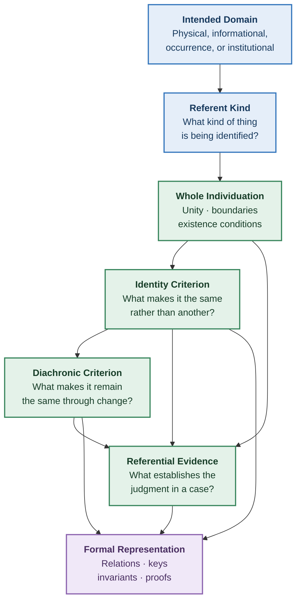
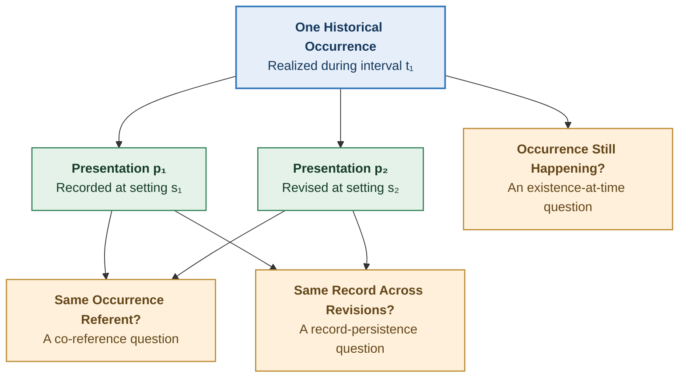
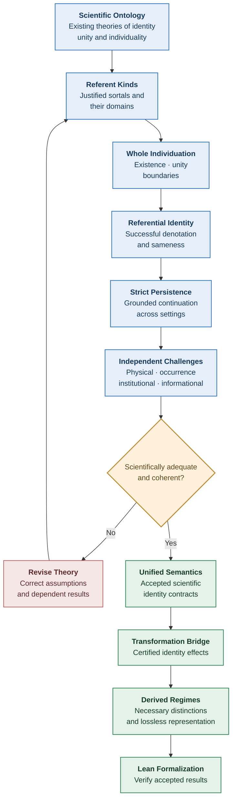

# Structural Explainability

# Individuation, Referential Identity, and Strict Persistence

**Scientific Development Note — v0.3**
**Date:** October 16, 2026
**Status:** OPEN — Scientific construction, not accepted theory
**Parent:** Unified Referential Semantics v0.2
**Scope:** Independent scientific grounding of whole individuation, sameness across presentations, and strict identity across settings

---

## 1. Research Objective

Establish the substantive scientific conditions underlying referential identity in Structural Explainability.

The investigation addresses three connected questions.

1. **Whole individuation:** What constitutes one referent?
2. **Referential identity:** What establishes that different presentations identify that same referent?
3. **Strict persistence:** What establishes that a referent remains numerically identical across settings?

These questions must be answered using independently justified ontological, scientific, mathematical, or institutional principles.

The answers cannot be manufactured by selecting:

- An identifier.
- A carrier element.
- An equivalence relation.
- A dimension signature.
- A transformation classification.
- A collection of preserving operators.

Such constructions may represent an established identity criterion, but they do not independently establish it.

The objective is a unified theory that supports different referent kinds without arbitrarily imposing identical individuation conditions on fundamentally different phenomena.

All previous Structural Explainability theories remain revisable.

---

## 2. Assessment of the Two v0.2 Proposals

The prior ChatGPT review and Claude's independent proposal agree on the principal defects of draft v0.1.

Both reject unconditional dimension-based identity, recognize missing referential bridges, distinguish strict persistence from counterpart relations, and reject historically predetermined regime counts.

Claude's review adds several useful formal observations.

### 2.1 Findings to retain from Claude

**C1. Explicit comparison domains**

Dimension-based identity results must state their domain.

The relation established among transformation configurations is not automatically a referential identity relation among their participants.

**C2. Situated presentations**

A presentation must be evaluated under an appropriate context.

Cross-setting identity cannot be reconstructed solely from relations defined at individual settings.

**C3. Necessary and sufficient bounds are not canonical**

Multiple sound pairs of dimension bounds may represent the same relation.

A complete dimension signature is a special case, not the general definition of referential identity.

**C4. The expressibility theorem**

Claude identifies a meaningful limitation.

For a proposed equivalence relation \(R\) and the declared dimension vocabulary \(D\), a sufficient dimension signature exists only if the signature cannot agree on a pair that \(R\) distinguishes.

In its simplest form:

\[
\operatorname{agree}\_D\subseteq R
\]

is necessary for agreement on some subset of \(D\) to suffice for \(R\).

With an independently justified comparison guard \(G\), the restricted condition becomes:

\[
\operatorname{agree}\_D\cap G\subseteq R.
\]

This is a useful mathematical characterization of dimension expressibility.

It is not evidence that the current dimensions adequately represent real referents.

**C5. Transformation realization requires an explicit bridge**

The upstream `StateModel` relates configurations.

It does not identify the referent whose identity is being evaluated.

A referential transformation theorem must specify which subjects are compared and why the state transition represents that comparison.

**C6. Identity regimes are interface-relative**

The equivalence relation induced by a declared service interface is a mathematically valid way to characterize lossless representations.

The number of equivalence classes depends on the interface.

This does not establish a scientifically necessary universal number of identity regimes.

### 2.2 Findings not to adopt as scientific foundations

Several elements of Claude's repair remain scientifically insufficient.

#### The carrier-policy problem

Claude proposes distinguishing two policies:

- `el`: sameness requires equality of presented carrier elements.
- `abs`: sameness may cross carrier boundaries.

This makes the earlier contradiction avoidable, but does not establish which policy is scientifically correct.

Carrier equality might be a necessary criterion for one referent kind, irrelevant to another, or insufficient for either.

Moreover, an abstraction policy combined with complete dimension agreement can still identify distinct referents merely because their represented features coincide.

**Decision:** Do not adopt the binary carrier policy as foundational.

Carrier relationships must be derived from the intended referent kind and its justified identity conditions.

#### The equivalence-class problem

Claude proposes defining continuing units as equivalence classes of a primitive sameness relation.

This is mathematically coherent.

However, it does not explain why the primitive relation represents strict identity.

Defining stages as members of those equivalence classes also does not provide independent scientific criteria for stage membership.

The construction avoids one form of syntactic circularity while retaining the central explanatory obligation.

**Decision:** Retain equivalence-class representation as a possible mathematical implementation, not as the scientific grounding of persistence.

#### The partial-completion problem

Claude's collection of equivalence relations between necessary and sufficient bounds is mathematically useful.

It represents uncertainty relative to a declared family of possible relations.

However, that family must itself be scientifically justified.

Otherwise, the mathematical construction may classify pairs as determined or indeterminate without establishing that those are the genuine admissible interpretations.

**Decision:** Retain the completion construction as conditional mathematics. Do not automatically identify its results with scientific or epistemic warrant.

#### The transformation-tracking problem

A proposed tracking relation must not require sameness of carrier elements merely to recognize an applicable comparison.

A valid transformation may compare the original referent with a newly created, distinct output.

That comparison is precisely where breakage needs to be detected.

Excluding it from tracking would hide a legitimate nonidentity judgment.

**Decision:** Referent selection and identity judgment must remain distinct.

#### The preservation-classification problem

Sufficiency of unaffected dimensions provides a sound preservation certificate when the semantic bridge is valid.

It is not generally a necessary condition for every identity-preserving operator in an arbitrary state model.

An operator may always preserve identity for reasons not captured by the current dimension vocabulary.

**Decision:** Distinguish certified preservation from semantic preservation itself.

### 2.3 Integrated conclusion

The two v0.2 proposals supply useful mathematical structures.

Neither establishes the intended real-world identity criteria.

The next research must therefore begin with ontology and scientific grounding, not with another refinement of the bounds or carrier guards.

---

# Part I — Foundations of Individuation

## 3. Three Questions That Must Not Be Collapsed

Consider the statements:

1. This is one object.
2. These two presentations describe the same object.
3. This is the same object that existed previously.

They concern different aspects of referential identity.

The first requires individuation and unity.

The second requires successful denotation and a criterion of sameness.

The third requires strict diachronic identity.

An account may answer one without answering the others.

For example, successfully identifying one particular document version does not establish which later version, if any, is numerically the same document.

Likewise, identifying two objects as parts of the same assembly does not establish that the two objects are numerically identical.

### 3.1 Scientific grounding must precede formal equality

The diagram expresses an order of scientific justification.

It does not imply that each problem can be solved independently of the others.

For example, a proposed identity criterion may reveal that its associated whole-individuation conditions are inadequate.

When that occurs, the earlier definitions must be reconsidered.

---

## 4. What Established Ontology Contributes

### 4.1 Identity and unity are distinct

Guarino and Welty's ontological analysis distinguishes identity from unity.

Identity concerns what makes an individual the same individual rather than another.

Unity concerns what makes the parts of an individual constitute one whole.

A collection of objects is not necessarily one object of the intended sortal merely because its members share some properties or relationships.

This is directly relevant to Structural Explainability.

**Scientific consequence:**

Successful presentation of one carrier element cannot universally establish successful individuation of one whole.

A carrier may represent:

- One independently individuated whole.
- One part of a larger whole.
- Multiple representations or versions.
- An aggregate.
- A complex occurrence.
- An institutional unit constituted by rules.

A whole-individuation condition must therefore establish the relevant unity and boundaries rather than assuming them.

**Source:**

Guarino and Welty, _Identity, Unity, and Individuality: Towards a Formal Toolkit for Ontological Analysis_ (2000).

https://www.researchgate.net/publication/2625760_Identity_Unity_and_Individuality_Towards_a_Formal_Toolkit_for_Ontological_Analysis

Their account supports the distinction, but does not establish a universal unity criterion for all SE referent kinds.

### 4.2 Referent kinds matter

Basic Formal Ontology (BFO) distinguishes several ontological categories relevant to the present investigation:

- Material objects.
- Object aggregates.
- Fiat object parts.
- Continuants.
- Occurrents.
- Processes.
- Process boundaries.
- Generically dependent continuants.

These distinctions indicate that a single undifferentiated notion of an entity is inadequate for many scientific identity questions.

For example, the identity conditions of a material object need not be those of an aggregate.

The identity conditions of an occurring process need not be those of an informational object.

**Source:**

BFO 2020, associated with ISO/IEC 21838-2.

https://github.com/BFO-ontology/BFO-2020

BFO supplies a scientifically developed ontological classification.

It does not automatically establish every domain-specific individuation criterion.

### 4.3 Identical properties need not establish identity

The philosophical literature on the Identity of Indiscernibles examines whether distinct objects can share all relevant properties.

Max Black's familiar two-sphere example is designed to challenge the claim that perfect qualitative agreement entails numerical identity.

Whether stronger versions of the Identity of Indiscernibles hold remains contested.

For SE, the narrower methodological conclusion is sufficient:

**Equality of a selected finite feature vocabulary does not establish numerical identity without an independently justified completeness result.**

Even if the represented dimensions were exhaustive for a particular scientific model, their completeness would require proof.

**Source:**

Stanford Encyclopedia of Philosophy, _The Identity of Indiscernibles_ (2025).

https://plato.stanford.edu/entries/identity-indiscernible/

### 4.4 Event identity presents a separate difficulty

The scientific and philosophical literature contains materially different approaches to event individuation.

For example:

- Property-exemplification accounts distinguish events by constitutive properties.
- Causal approaches investigate causes and effects.
- Mereological approaches investigate event parts.
- Spatiotemporal approaches investigate realization regions.

The Stanford Encyclopedia's discussion also notes that Davidson's original causal identity criterion was subsequently abandoned.

This is significant.

A seemingly plausible identity criterion may prove inadequate because it introduces circularity or fails on concrete cases.

An event's timestamp alone cannot universally establish its identity.

Two events can occur simultaneously, while one event may admit multiple descriptions or temporal decompositions.

**Source:**

Stanford Encyclopedia of Philosophy, _Events_, section 3.2.

https://plato.stanford.edu/entries/events/

### 4.5 Institutional entities can have constitutive identity conditions

Institutional entities offer an important contrast to physical objects.

Their existence and continuity may depend on authoritative constitutive rules.

The relevant authority can determine when an institution is formed, transformed, dissolved, or legally continued.

This provides a way to investigate identity conditions that are not reducible to material continuity or attribute equality.

However, different institutions are governed by different rules.

The existence of legally constituted identity conditions does not establish one universal institutional identity criterion.

**Sources:**

Searle, _Status functions and institutional facts: reply to Hindriks and Guala_ (2015).

https://www.cambridge.org/core/journals/journal-of-institutional-economics/article/status-functions-and-institutional-facts-reply-to-hindriks-and-guala/B19855351F1963B0DFB3BE78E17C3CA5

Delaware General Corporation Law.

https://delcode.delaware.gov/title8/c001/

---

# Part II — A Scientific Basis for Whole Individuation

## 5. Candidate Individuation Conditions

A scientifically adequate individuation account must establish more than unique representation.

For an intended referent kind \(K\), investigate the following conditions.

### W1. Kind membership

What makes a candidate an instance of kind \(K\)?

For example:

- What makes something a biological organism?
- What makes something one occurrence?
- What makes something an incorporated legal entity?
- What makes something a particular informational artifact?

The answer must be grounded in the relevant scientific or institutional theory.

### W2. Existence

What establishes that an individual of kind \(K\) exists in the relevant setting?

The answer must distinguish existence from evidence of existence.

A missing record need not mean the referent does not exist.

A record's presence need not establish that the represented referent actually exists.

### W3. Unity

What makes the relevant components constitute one whole of kind \(K\)?

Possible sources of unity include:

- Physical integration.
- Biological organization.
- Causal organization.
- Functional organization.
- Constitutive institutional rules.
- Formal construction rules.

None is assumed universal.

The criterion must specify why the components constitute this particular whole rather than a larger or smaller collection.

### W4. Boundary

What distinguishes the intended whole from its parts, surroundings, and neighboring wholes?

The criterion may involve:

- Spatial boundaries.
- Temporal boundaries.
- Organizational boundaries.
- Constitutive scope.
- Formal construction.
- Another justified form of demarcation.

The boundary need not be physically sharp in every domain.

If the kind permits boundary vagueness, that must be represented rather than silently replaced with an arbitrary exact boundary.

### W5. Individuation

What distinguishes one whole of kind \(K\) from another?

This condition must resist cases involving:

- Duplicate objects.
- Identical observable properties.
- Shared identifiers.
- Multiple representations.
- Overlapping parts.
- Ambiguous boundaries.
- Different versions.
- Common provenance.

An identity criterion cannot merely assert that two things are different because the model gives them different identifiers.

### 5.1 Necessary versus sufficient conditions

These five questions are a proposed scientific investigation structure.

They are not five independent axioms and are not claimed to be universal necessary-and-sufficient conditions for every ontology.

A particular source may provide a combined constitutive rule establishing several conditions at once.

Another domain may offer only partial criteria.

The research must determine which relationships are necessary, sufficient, or independently grounded for each intended kind.

### 5.2 Grounded whole-individuation judgment

For a kind \(K\), interpretation \(I\), presentation \(p\), and candidate referent \(u\), write:

\[
\operatorname{Individuates}\_{I,K}(p,u)
\]

when the relevant existence, kind, unity, boundary, and uniqueness conditions justify that \(p\) presents \(u\) as one whole.

This is a candidate semantic judgment.

It must not be defined by a mere collection of unexplained predicates.

Each substantive predicate requires its own grounding.

The principal scientific task is to determine what makes this judgment true.

---

## 6. Distinguishing Ontological Truth From Referential Evidence

A second distinction is essential.

The proposition:

\[
\text{Presentation }p\text{ refers to }u
\]

may be true even when the available evidence does not establish it.

Similarly, evidence may suggest the wrong referent.

We therefore distinguish:

**Semantic judgment**

What is true under the governing referential interpretation.

**Warranted judgment**

What follows from sufficiently justified evidence under that interpretation.

**Undetermined judgment**

What the available evidence fails to establish.

A theory should not define successful referential identity simply as the existence of a successful proof or a matching key.

Nor should it infer nonidentity from the absence of such a proof.

### 6.1 Proposed grounding relationship

Let:

\[
\operatorname{Evidence}\_I(e,p,u)
\]

describe evidence \(e\) supporting the claim that \(p\) identifies \(u\).

Let:

\[
\operatorname{ValidGrounding}\_I(e,p,u)
\]

mean that the evidence satisfies the independently justified requirements for this referential question.

The central adequacy obligation is:

\[
\operatorname{ValidGrounding}_I(e,p,u)
\Longrightarrow
\operatorname{Individuates}_{I,K}(p,u).
\]

This is not accepted as an axiom.

It is a scientific claim requiring justification.

If `ValidGrounding` is defined merely as evidence that the conclusion is true, the proposed implication would be circular and scientifically uninformative.

The evidence conditions must be stated independently.

A corresponding completeness claim would require showing when every legitimate individuation can be supported by such evidence.

Completeness may be unavailable in some domains.

That limitation must be explicit.

---

# Part III — First Substantive Construction: Institutional Identity

## 7. Delaware Corporations as a Grounded Example

Institutional identity provides a useful starting point because authoritative rules explicitly establish some conditions of formation and continuation.

The example does not prove a universal identity theory.

It demonstrates what independently specified conditions can look like.

### 7.1 Formation of one corporate entity

Delaware General Corporation Law §106 defines the commencement of corporate existence through a properly filed certificate of incorporation, subject to the applicable effective-time provisions.

Section 103 governs execution, filing, and effective time.

These rules provide independent constitutive conditions for legal corporate existence.

They do not merely define a database identifier.

A certificate, when legally effective under the governing rules, participates in establishing a corporate entity.

**Sources:**

https://delcode.delaware.gov/title8/c001/sc01/index.html

Relevant provisions: §§103, 105, 106.

### 7.2 Successful identification

A presentation purporting to identify a particular Delaware corporation may be grounded by verified corporate records and the relevant legal history.

However, the name alone is not the identity criterion.

Nor is equality of:

- Shareholders.
- Directors.
- Assets.
- Addresses.
- Business activities.
- Corporate descriptions.

Those properties may change while the same legal corporation continues.

The governing legal status and authoritative history matter.

### 7.3 Persistence through merger

Delaware General Corporation Law §259 distinguishes a surviving corporation from constituent corporations whose separate existence ceases.

It also establishes consequences for property, rights, liabilities, and duties.

Suppose corporations \(A\) and \(B\) merge, with \(A\) legally designated as the survivor.

The legal framework supports distinguishing:

\[
A*{\text{before}}=A*{\text{after}}
\]

from:

\[
B*{\text{before}}\ne A*{\text{after}}.
\]

Here equality is understood as identity under the relevant corporate-law interpretation, and the result assumes the merger validly takes effect as described.

The cessation of \(B\)'s separate existence does not imply that all of its legal relationships vanish.

The statute expressly provides for their transfer or attachment to the survivor.

Therefore:

\[
\operatorname{LiabilitiesTransfer}(B,A)
\]

does not entail:

\[
B=A.
\]

This is a substantive distinction between continuity of responsibility and strict identity of legal persons.

**Source:**

Delaware General Corporation Law §259.

https://delcode.delaware.gov/title8/c001/sc09/index.html

### 7.4 Scientific significance

This example gives us more than an arbitrary mathematical identity relation.

It supplies:

1. A governing referent kind: a corporation constituted under a particular legal system.
2. Authoritative formation conditions.
3. Effective-time conditions.
4. Rules distinguishing a surviving entity from a newly resulting entity.
5. Rules determining the treatment of liabilities and rights.
6. Documentary evidence capable of supporting specific judgments.

The identity result is grounded in a constitutive legal framework.

It is not derived from agreement on a finite collection of descriptive attributes.

### 7.5 Important limitation

The result is jurisdiction- and transaction-specific.

It does not establish that all institutions behave like Delaware corporations.

It also does not establish that every transfer of corporate rights or liabilities represents strict identity.

Different legal systems, institution types, and transaction structures may have different consequences.

This example becomes construction evidence for the developing theory, not independent validation of the final theory.

---

## 8. First Derived Scientific Distinction

The corporate example suggests an important separation:

**Continuity of rights or responsibility is not sufficient for continuity of the responsible entity's numerical identity.**

This is directly relevant to Structural Explainability.

An entity may succeed another in some responsibility without being the same entity.

An artifact may inherit authority without preserving its predecessor's identity.

A software artifact may derive from another without being the same artifact.

An organization may acquire assets and obligations without thereby becoming numerically identical to the previous owner.

The exact transfer or succession mechanism depends on the domain.

### Candidate principle IP-1

For an interpretation governed by independently established identity conditions:

\[
\operatorname{Succession}\_I(x,y)
\not\Rightarrow
\operatorname{Same}\_I(x,y).
\]

Likewise:

\[
\operatorname{Derivation}\_I(x,y)
\not\Rightarrow
\operatorname{Same}\_I(x,y).
\]

These expressions deny a universal implication.

They do not assert that succession and identity are necessarily incompatible.

A particular successor can also be a strict continuation when the governing semantics warrants both relationships.

**Scientific status:** Strongly supported as a distinction of concepts, but the precise integrated SE formulation remains a candidate.

---

# Part IV — Comparison Across Referent Kinds

## 9. Informational Identity

Consider a finite byte sequence.

If the intended referent is the abstract byte sequence itself, then its identity can be defined mathematically by equality of its members in order.

Two presentations successfully denoting the same byte sequence identify the same abstract value.

This is a precise, complete identity criterion for that stipulated mathematical kind.

However, it does not follow that two files containing the same bytes are numerically the same file instance.

Nor does it follow that they constitute the same document, record, software package, or intellectual work.

The referent kind changes the question.

### Scientific consequence

An identity criterion can be complete and mathematically exact while still being inappropriate for a different referent kind.

Therefore:

\[
\text{Correct key for }K_1
\not\Rightarrow
\text{Correct key for }K_2.
\]

Even if both kinds use the same carrier or representation.

### Connection to PROV-DM

W3C PROV-DM distinguishes derivation, specialization, and alternate entities.

A relation indicating that two provenance entities describe aspects of a common underlying thing does not automatically establish their numerical equality as provenance entities.

The standard also distinguishes a particular version of a document from a more general document description.

**Source:**

W3C Recommendation, _PROV-DM: The PROV Data Model_ (2013).

https://www.w3.org/TR/prov-dm/

### Open question

Which informational referents are abstract values, which are concrete artifacts, and which are institutionally or operationally constituted objects?

This must be answered before selecting their identity criteria.

---

## 10. Physical Identity

Physical objects present a different problem.

A physical object may undergo:

- Material replacement.
- Reconfiguration.
- Movement.
- Damage.
- Repair.
- Growth.
- Division.
- Fusion.

A mathematical equality test on its instantaneous properties does not universally establish persistence.

A justified physical-object criterion may depend on causal history, physical organization, material continuity, functional integration, or another scientifically defensible condition.

But no single candidate should be promoted to a universal criterion without examination.

### Example: biological organisms

An organism may retain its identity while replacing substantial material through metabolism.

This puts pressure on a criterion requiring strict equality of material composition.

A developmental history and integrated biological organization may provide relevant evidence of continuity.

However, the status of organisms undergoing division, fusion, or other unusual transformations must be examined separately.

The biological example therefore challenges naive material-identity criteria.

It does not yet establish a complete alternative criterion.

### Scientific status

**OPEN.**

The relevant unity and persistence conditions require further grounding in biological ontology and the scientific literature.

BFO's distinction between objects and aggregates is a starting point, not an established biological persistence theorem.

---

## 11. Occurrence Identity

An occurrence is not simply an enduring object with a timestamp.

A process or event may have:

- Participants.
- Temporal extent.
- Spatial extent.
- Causal organization.
- Constitutive activity.
- Sub-occurrences.
- Multiple descriptions.

### 11.1 Occurrence granularity

One process can be described as a whole or decomposed into several component occurrences.

Different descriptions do not automatically imply different events.

Nor do overlapping temporal intervals automatically imply event identity.

The relevant event criterion must specify what constitutes the occurrence and distinguishes it from others.

### 11.2 A crucial distinction between two times

Consider a historical occurrence that took place at time \(t_1\).

A database contains a description of that occurrence at \(t_1\).

At a later time \(t_2\), the description is updated.

The historical occurrence has not necessarily persisted as an ongoing occurrence from \(t_1\) to \(t_2\).

Instead, two records may refer to the same completed occurrence.

This distinguishes:

1. **Occurrence time:** When the event happened.
2. **Evaluation or recording time:** When a presentation is created, examined, or revised.

The distinction is essential for the revised persistence theory.

The same historical occurrence can be referred to at multiple later settings without implying that it continues to exist as an occurring process at those settings.

This exposes a limitation in v0.2's treatment of settings and stages.

### Candidate principle IP-2

The time of evaluating a reference must not be conflated with the temporal existence of its referent.

Formally, distinguish:

\[
\operatorname{EvaluatedAt}(p,s)
\]

from:

\[
\operatorname{ExistsAt}(u,t).
\]

A successful presentation at setting \(s\) does not imply that the referent exists at the corresponding physical time, unless the governing semantic contract establishes that relationship.

**Scientific status:** A necessary distinction for the intended historical-occurrence use case. Its general formalization remains open.

This may require revising P1 and the stage model in v0.2.

---

# Part V — Candidate Unified Grounding Principles

## 12. What the Examples Establish

The examples show that scientifically defensible identity criteria arise from different sources.

| Referent kind          | Candidate grounding source                     | What may be established                                                     | What remains open                           |
| ---------------------- | ---------------------------------------------- | --------------------------------------------------------------------------- | ------------------------------------------- |
| Abstract byte sequence | Mathematical construction                      | Exact value identity                                                        | Relationship to files, documents, and works |
| Delaware corporation   | Constitutive legal rules                       | Formation, legal continuation, and termination under specified transactions | Generalization to other institutions        |
| Physical organism      | Biological organization and causal history     | Relevant unity and continuity evidence                                      | Complete persistence and branching criteria |
| Occurrence             | Event ontology and domain-specific realization | Candidate event boundaries and constituent processes                        | Granularity and event identity              |
| Document or record     | Information-object and institutional semantics | Version, representation, and provenance relationships                       | Identity of evolving works and records      |

The differences are substantive.

They are not simply choices of which transformation dimensions to preserve.

### 12.1 First candidate conclusion

**There is no currently justified universal identity criterion for all SE referent kinds.**

This does not imply that a unified theory is impossible.

It implies that a unified theory must distinguish:

- General logical properties of identity.
- General semantic requirements for referring.
- Kind-specific individuation conditions.
- Kind-specific diachronic identity conditions.
- Evidence supporting particular judgments.

The unification lies in the relationships among these concepts, not necessarily in one universal material or structural identity rule.

### 12.2 Second candidate conclusion

**The referent kind must be established before the identity criterion can be evaluated appropriately.**

For example, copying a file might preserve an abstract byte sequence while creating a new concrete file instance.

The answers are not contradictory because the intended referents differ.

However, this does not license arbitrary relabeling of a disputed identity question.

A referent kind must be justified by the domain and the intended explanatory task.

It cannot be selected merely to obtain a convenient identity verdict.

### 12.3 Third candidate conclusion

**Strict diachronic identity requires a grounded continuation criterion, not merely a chain of transformations.**

A sequence of events may show:

- Derivation.
- Historical continuity.
- Material transfer.
- Responsibility transfer.
- Version succession.
- Causal influence.

None universally implies strict identity.

When every step is independently justified as preserving strict identity, transitivity permits a mathematical derivation of identity across the sequence.

But the classification of those steps must be justified first.

---

## 13. Proposed Scientific Identity Contract

The next formulation should not begin with dimension bounds.

For each independently justified referent kind \(K\), develop a scientific identity contract addressing the following questions.

### IC1 — Domain

What entities are eligible to be considered referents of kind \(K\)?

### IC2 — Whole individuation

What establishes the existence, boundaries, and unity of one whole of kind \(K\)?

### IC3 — Reference

What establishes that a presentation identifies that whole?

### IC4 — Synchronic identity

What establishes that two successful presentations identify the same whole?

### IC5 — Diachronic identity

What establishes that the same whole exists across distinct relevant settings?

### IC6 — Distinctness

What establishes that two candidates are different referents?

### IC7 — Evidence and limitations

What evidence warrants these judgments, and what circumstances defeat or limit the criterion?

These are questions requiring scientific answers.

They are not proposed fields for a new implementation schema.

A scientifically complete identity contract must establish the relationships among them.

An account that simply defines `Same` as an arbitrary equivalence relation has not satisfied IC4.

An account that simply defines `Persists` as a relation between stages has not satisfied IC5.

Likewise, defining a whole as something satisfying an uninterpreted unity predicate does not satisfy IC2.

The contract must state what the substantive conditions actually are.

---

## 14. Mathematical Consequences Once Grounding Is Established

Suppose a kind-specific account establishes a scientifically justified identity relation:

\[
\equiv\_{I,K}
\]

on a specified domain of individuated units.

The following mathematical properties may then be considered.

### 14.1 Identity equivalence

If the relation genuinely represents numerical identity, it must satisfy:

\[
\operatorname{Reflexive}(\equiv\_{I,K}),
\]

\[
\operatorname{Symmetric}(\equiv\_{I,K}),
\]

\[
\operatorname{Transitive}(\equiv\_{I,K}).
\]

These laws are requirements of the intended strict-identity semantics.

They do not establish that the proposed relation actually represents identity.

### 14.2 Sound presentation identity

If successful presentations \(p\) and \(q\) have grounded denotata:

\[
\delta_I(p)=u
\]

and:

\[
\delta_I(q)=v,
\]

then:

\[
\operatorname{Same}_I(p,q)
\iff
u\equiv_{I,K}v.
\]

The scientific obligations concern the denotation assignments and the identity criterion.

### 14.3 Sound diachronic continuation

Suppose:

\[
C\_{I,K}(a,b)
\]

is an independently justified strict-identity-preserving continuation relation.

The required soundness statement is:

\[
C*{I,K}(a,b)
\Longrightarrow
a\equiv*{I,K}b.
\]

If this is established, then:

\[
\operatorname{Reach}(C*{I,K})
\subseteq
\equiv*{I,K}
\]

follows from reflexivity and transitivity.

Likewise, the equivalence closure generated by \(C\_{I,K}\) is contained in strict identity.

This is a useful connection to the existing Persistence repository.

**But completeness is separate:**

\[
\equiv*{I,K}
\subseteq
\operatorname{Generated}(C*{I,K})
\]

requires additional proof.

A generated equivalence relation does not become a complete referential identity relation merely by construction.

### 14.4 Transformation certificates

Once the identity relation is justified, its relationship to transformation dimensions can be investigated.

Necessary and sufficient dimension conditions are then candidate representations of that relationship.

Their validity must be established over the relevant comparison domain.

The upstream Transformation theorems may subsequently establish certified preservation or breakage.

This retains the mathematical benefits of the existing theory without using those benefits as the grounding of identity.

---

# Part VI — Scientific Challenges to the Proposed Direction

## 15. Adversarial Questions

The developing theory must survive more than familiar software examples.

### Challenge A — Distinct indiscernibles

Can a criterion distinguish two independently established referents whose represented properties coincide?

If not, is that a legitimate limitation or a failure of the criterion?

### Challenge B — One object with changing parts

Can the account identify one continuing object without requiring all of its parts to remain identical?

What independently establishes its continuation?

### Challenge C — Composite unity

What makes an aggregate one whole of the intended kind?

Can the theory distinguish the whole from its components and a larger encompassing collection?

### Challenge D — Branching

Can the account establish that one successor continues the original and another does not?

If it cannot, does it correctly report the judgment as unresolved?

### Challenge E — Institutional succession

Can the theory distinguish a surviving legal entity from another entity that assumes its liabilities?

### Challenge F — Occurrence granularity

Can the theory distinguish one complex occurrence from its component occurrences without merely selecting arbitrary temporal boundaries?

### Challenge G — Different presentation times

Can a historical event be successfully referred to today without the theory claiming that the event is still occurring today?

### Challenge H — Abstract versus concrete identity

Can the theory distinguish the same abstract information from different physical or digital instances carrying that information?

### Challenge I — Conflicting interpretations

Can the theory preserve justified, genuinely conflicting identity judgments without silently imposing one interpretation's criterion on the other?

### Challenge J — Inadequate evidence

Can the theory distinguish an actually true identity proposition from a currently unwarranted one?

These are attempts to defeat the proposed semantics.

Cases used to repair the semantics become construction evidence.

Independent validation must use separately selected cases.

---

# Part VII — Next Research Decisions

## 16. What Is Established at This Point?

### Established mathematical foundations

- Equality is an equivalence relation.
- Pulling equality back through a suitably defined denotation function gives an equivalence relation on its successful domain.
- Sound identity-preserving transitions generate relations contained in strict identity.
- The Transformation state model establishes its frame and required-change consequences.
- A declared observation interface induces a behavioral equivalence among accounts.

These results do not establish the correctness of any particular real-world identity criterion.

### Independently grounded domain findings

**Informational values**

An explicitly defined mathematical value admits exact identity through equality.

This does not identify its representations.

**Institutional corporations**

Authoritative corporate law establishes formation, continuation, and termination rules in specified contexts.

Rights and liabilities may transfer without strict identity of the corresponding legal persons.

**Physical objects**

Instantaneous descriptive equality is insufficient as a universally justified identity criterion.

Substantive physical persistence criteria remain to be established.

**Occurrences**

The scientific and philosophical literature does not supply one universally accepted event-individuation criterion.

Occurrence time and presentation-evaluation time must be distinguished.

### Candidate SE contributions

The present research suggests that SE can contribute:

1. A unified relationship among kind-specific whole individuation, reference, and strict identity.
2. An explicit separation between ontological identity and evidence warranting identity judgments.
3. A scientifically constrained transformation-to-identity bridge.
4. A disciplined distinction between identity, continuity, succession, and derivation.
5. Lossless representations defined relative to scientifically justified referential services.

These remain candidate contributions, not accepted discoveries.

---

## 17. The Next Focused Investigation

The next work should establish **whole individuation** more rigorously.

Specifically:

### Question 1 — Is a general account of unity possible?

Investigate whether the scientific literature supports general constraints on what constitutes a whole across physical, informational, occurrence, and institutional kinds.

Determine which constraints are genuinely general and which depend on the intended sortal.

### Question 2 — What independently establishes an individual?

Investigate the relationship among:

- Existence.
- Unity.
- Boundary.
- Individuation.
- Numerical identity.
- Identity criteria.

Determine which notions may be primitive, which can be derived, and which require additional scientific assumptions.

### Question 3 — Can identity across presentations be grounded noncircularly?

Investigate whether independently grounded referential relationships can support sameness without defining a referent merely as an equivalence class of presentations.

Determine the legitimate role of keys, canonicalization, provenance, and other evidence.

### Question 4 — What grounds strict diachronic identity?

Investigate whether there are general identity-preserving conditions across time or only kind-specific conditions.

Distinguish these from continuity and successor relations.

Examine the implications for continuants, occurrences, and institutional artifacts.

### Question 5 — What can Neutral Substrate assert?

Determine which referential commitments survive across admissible interpretations without treating an arbitrarily selected criterion as universal.

Preserve the existing distinction between framework compatibility, universal entailment, and attributed judgments.

---

## 18. Research Sequence

The process is iterative.

Independent review may require revisiting earlier definitions.

Formalization should follow scientific acceptance of the relevant definitions and relationships, rather than serving as their substitute.

---

## 19. Repository Implications

The current research does not justify modifying any repository immediately.

A further repository has been confirmed to exist:

https://github.com/structural-explainability/se-theory-structural-explainability

It currently serves as an integration layer involving Neutral Substrate and Identity Regimes.

This makes it a potential location for future cross-theory formalization.

However, its existing boundaries are not binding on scientific development.

The appropriate ownership of the eventual semantic contracts should follow from their scientific meaning and dependency structure.

In particular:

- Foundational referential relationships may require changes to Neutral Substrate.
- The semantics of strict identity may require changes to Persistence.
- The Transformation vocabulary may require extension or narrowing.
- Identity Regimes may require substantial re-derivation.
- The integration layer may own cross-theory results once the underlying scientific definitions are established.

No architecture should be selected merely to avoid revising previous work.

---

## 20. Scientific Verdict

**Status: OPEN**

The present investigation establishes a more defensible direction for the research.

It identifies independently grounded examples of different kinds of identity conditions and demonstrates why they cannot be replaced by arbitrary feature agreement or generated equivalence relations.

It also exposes a significant additional distinction:

**A referent's existence at a time is not the same as the evaluation of a presentation referring to that referent at a time.**

This matters especially for occurrences and historical records.

The investigation does not yet establish a complete universal theory of individuation.

The evidence currently supports a candidate architecture in which:

1. Referential kinds have scientifically justified individuation conditions.
2. Those conditions establish successful presentation and identity.
3. Strict persistence is governed by independently justified diachronic criteria.
4. Evidence warrants particular judgments without constituting identity merely by being recorded.
5. Transformations and regime classifications are derived from those semantics.

The principal unresolved scientific question is now more precise:

> **What general conditions, if any, establish individuality across referent kinds, and which additional kind-specific conditions are necessary to establish one whole, its identity across presentations, and its strict persistence through change?**

Resolving that question is the next foundational research task.

---

## 21. Sources

### Foundational ontology

Guarino and Welty (2000). _Identity, Unity, and Individuality: Towards a Formal Toolkit for Ontological Analysis._

https://www.researchgate.net/publication/2625760_Identity_Unity_and_Individuality_Towards_a_Formal_Toolkit_for_Ontological_Analysis

Welty and Guarino (2001). _Supporting Ontological Analysis of Taxonomic Relationships._

https://www.sciencedirect.com/science/article/pii/S0169023X01000301

Basic Formal Ontology (2020), ISO/IEC 21838-2.

https://github.com/BFO-ontology/BFO-2020

### Identity and events

Stanford Encyclopedia of Philosophy. _Identity._

https://plato.stanford.edu/entries/identity/

Stanford Encyclopedia of Philosophy. _Identity Over Time._

https://plato.stanford.edu/entries/identity-time/

Stanford Encyclopedia of Philosophy. _The Identity of Indiscernibles._

https://plato.stanford.edu/entries/identity-indiscernible/

Stanford Encyclopedia of Philosophy. _Events._

https://plato.stanford.edu/entries/events/

Toyoshima and Barton (2023). _Two Approaches to the Identity of Processes in BFO._

https://arxiv.org/abs/2311.15689

### Institutional identity

Searle (2015). _Status Functions and Institutional Facts: Reply to Hindriks and Guala._

https://www.cambridge.org/core/journals/journal-of-institutional-economics/article/status-functions-and-institutional-facts-reply-to-hindriks-and-guala/B19855351F1963B0DFB3BE78E17C3CA5

Delaware General Corporation Law, §§103, 105, 106, and 259.

https://delcode.delaware.gov/title8/c001/

### Provenance and information objects

W3C (2013). _PROV-DM: The PROV Data Model._

https://www.w3.org/TR/prov-dm/

### Structural Explainability

- Unified Referential Semantics v0.1.
- Unified Referential Semantics v0.2.
- Unified Semantics Grounding Ledger.
- Claude's independent scientific review and v0.2 proposal.
- The existing Neutral Substrate, Transformation, Persistence, Identity Regimes, and Structural Explainability integration repositories.

The referenced scientific literature supports the particular distinctions described above. It does not, by itself, establish the integrated SE theory.

---

**End of Scientific Development Note v0.3**

**Next focus:** General and kind-specific conditions of unity, individuation, and numerical identity. Establish the scientific conditions before choosing their formal representation.
