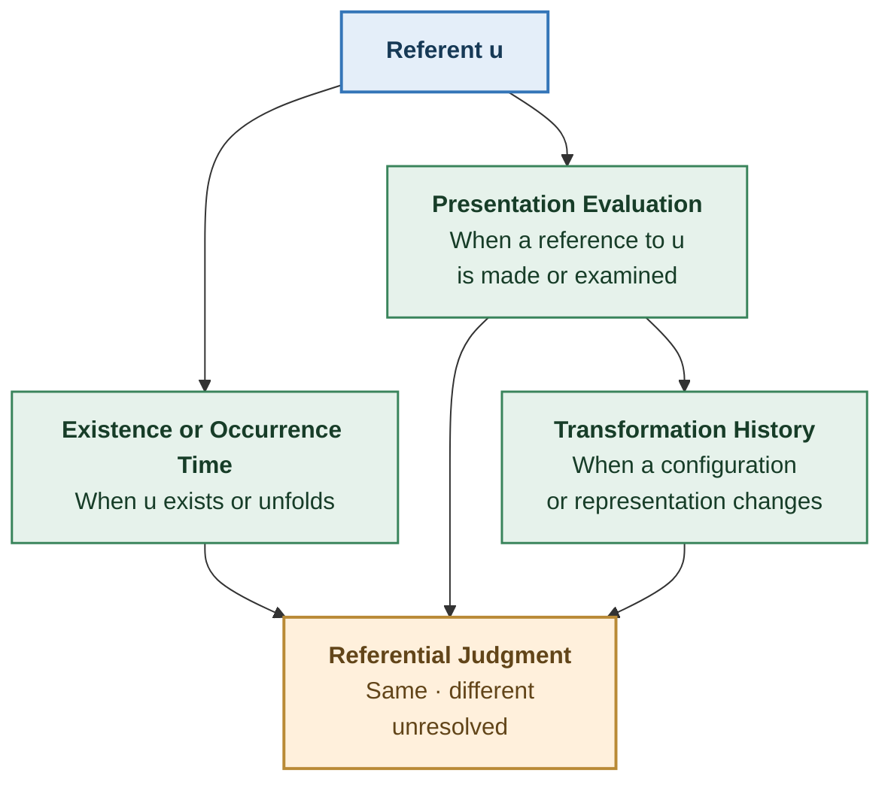
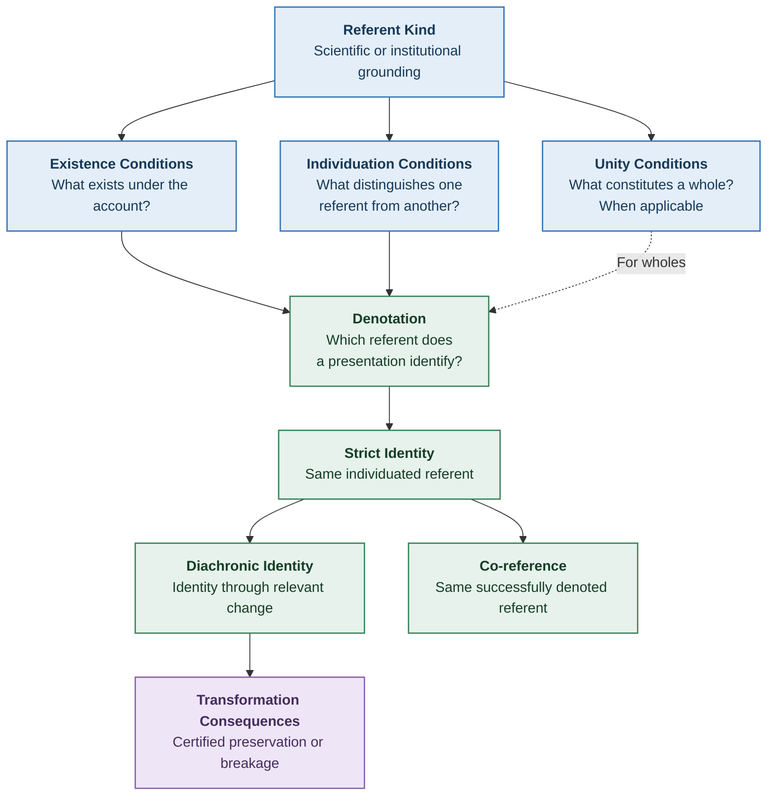
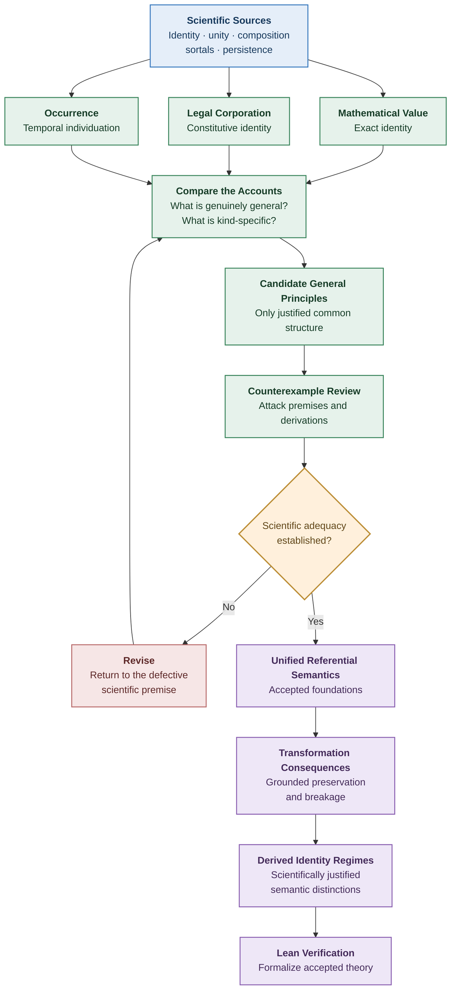

# Structural Explainability

# Scientific Foundations of Individuation and Identity

**Scientific Development Note — v0.4**
**Date:** October 16, 2026
**Status:** OPEN — Candidate scientific theory
**Parent:** Unified Referential Semantics v0.2 and Scientific Development Note v0.3
**Research focus:** General and kind-specific conditions of unity, individuality, and numerical identity

---

## 1. Objective

Determine whether a general theory can establish the conditions under which something is one individual, and which further conditions must be supplied by the particular kind of referent.

The investigation concerns three scientific questions:

1. What constitutes one individual or whole?
2. What establishes that two presentations identify that same individual?
3. What establishes that the individual remains numerically identical across settings?

The goal is not merely to introduce predicates representing these judgments.

It is to establish the scientific conditions that justify those predicates.

The investigation draws on:

- Guarino and Welty's theory of identity, unity, and individuality.
- Contemporary work on sortals and numerical identity.
- Mereology and theories of composition.
- Basic Formal Ontology (BFO).
- Descriptive Ontology for Linguistic and Cognitive Engineering (DOLCE).
- The philosophy of material constitution and persistence.
- Event individuation.
- Constitutive institutional rules.
- Information-object and provenance semantics.

These sources provide partly complementary and partly competing accounts.

No one source is adopted as an unquestioned foundation for Structural Explainability.

---

# Part I — The General Scientific Problem

## 2. A Significant Finding: Individuality Is Not Simply Unity

Guarino and Welty's original account establishes a distinction that should change our proposed semantics.

They separate:

**Identity:** What distinguishes an individual from other individuals.

**Unity:** What makes the relevant parts constitute one whole.

**Individuality:** The combination of being identifiable and having the appropriate unity.

Their analysis also distinguishes properties carrying:

1. Both identity and unity conditions.
2. Identity conditions without unity conditions.
3. Unity conditions without identity conditions.
4. Neither kind of condition.

This is important because the v0.3 investigation treated whole individuation as though every successful referent must satisfy the same list of existence, unity, boundary, and uniqueness requirements.

That assumption is too strong.

A referent may be singular without being a composite whole.

A collection may be identifiable through membership without possessing the intrinsic unity characteristic of an organism.

A property may provide a way to describe a referent without providing its identity criterion.

A presentation may identify one referent without establishing a particular theory of its internal composition.

### 2.1 Four possibilities

The distinction can be represented as follows.

|                                        | Has a justified unity condition                    | No justified unity condition                                       |
| -------------------------------------- | -------------------------------------------------- | ------------------------------------------------------------------ |
| **Has a justified identity condition** | Individuated whole                                 | Identifiable referent without an established whole-unity condition |
| **No justified identity condition**    | Whole whose identity criterion remains unspecified | Neither condition is established                                   |

These are classifications of what an account supplies.

They should not be confused with claims that the represented entities objectively lack identity or unity.

For example, failure to supply an identity condition may reflect an incomplete scientific account rather than metaphysical indeterminacy.

Guarino and Welty's framework makes this distinction explicitly.

**Source:** Guarino and Welty (2000), Sections 4–5.

https://www.researchgate.net/publication/2625760_Identity_Unity_and_Individuality_Towards_a_Formal_Toolkit_for_Ontological_Analysis

### 2.2 Consequence for Structural Explainability

We should not define successful singular reference and successful whole individuation as universally identical.

Instead, distinguish:

\[
\operatorname{SingularRef}\_I(p)
\]

from:

\[
\operatorname{Whole}\_I(p).
\]

The first concerns the successful identification of a single referent.

The second requires the additional conditions appropriate to an individuated whole.

A composite whole must meet an appropriate unity criterion.

A simple referent need not have multiple parts requiring integration.

Other referents may be successfully identified without the governing interpretation supplying a whole-unity theory.

### Candidate SE principle F-1

**Successful singular reference does not universally entail successful whole individuation.**

A stronger relationship may be established for particular referent kinds.

This corrects a weakness in the proposed v0.2 definition of `One_I` and its use as the universal precondition for reference.

**Status:** Candidate general principle, supported by the distinction between identity and unity.

---

## 3. What Counts as a Whole?

A whole is not established merely because its parts have been collected into a set.

A candidate collection might be:

- A physical object.
- A biological organism.
- A functional assembly.
- An institutional organization.
- An arbitrarily selected collection of objects.
- A process composed of sub-processes.
- A mathematically defined aggregate.

The conditions making these collections wholes differ.

### 3.1 The Special Composition Question

Contemporary mereology investigates the conditions under which some things compose another thing.

This is the Special Composition Question.

There are competing views.

One position allows unrestricted composition: any plurality has a mereological sum.

Other positions recognize composites only under more restrictive conditions, such as biological organization, physical integration, or functional organization.

Still others reject some or all ordinary composite objects.

The literature does not establish one uncontroversial universal answer.

**Source:** Stanford Encyclopedia of Philosophy, _Mereology_, revised June 27, 2026.

https://plato.stanford.edu/entries/mereology/

### 3.2 Consequence for SE

We cannot take the existence of a collection of parts as sufficient proof that it constitutes one whole of the intended kind.

Likewise, an arbitrarily defined relation connecting those parts is not automatically a scientifically legitimate unity criterion.

A meaningful unity criterion must explain why those parts constitute the intended whole rather than merely making a convenient mathematical grouping.

### Candidate SE principle F-2

**Formal composition is not sufficient to establish scientifically justified unity.**

The relevant criterion must be grounded in the ontology of the referent kind.

This does not require every whole to have a natural physical boundary.

A justified institutional or conventional boundary may also establish a whole within its domain.

---

## 4. What Guarino and Welty Actually Establish About Unity

Guarino and Welty investigate unity through relations connecting the parts of an object.

Their approach builds on Peter Simons' work.

A unifying relation is intended to connect the relevant parts of a whole without indiscriminately connecting unrelated objects.

A sufficiently broad or arbitrary equivalence relation cannot be accepted merely because it groups the desired parts.

The authors explicitly introduce conditions intended to avoid trivializing the notion of wholeness.

Their account also distinguishes:

- Contingent unity at a particular time.
- Unity sustained throughout an object's existence.
- Identity conditions.
- Properties that supply identity or unity conditions.

### 4.1 Why this matters

Suppose we define a relation:

\[
U(x,y)\iff
x\text{ and }y\text{ are parts of assembly }A.
\]

This relation may correctly collect the parts of assembly \(A\).

But it presupposes that the assembly has already been established.

If the scientific question is what makes those parts constitute \(A\), this definition does not explain their unity.

The conclusion has been embedded in the definition.

### 4.2 A legitimate unity criterion

A grounded unity criterion would instead identify an independently justified relationship among the relevant constituents.

Depending on the kind, that relationship might concern:

- Biological organization.
- Physical integration.
- Functional coupling.
- Causal organization.
- Constitutive institutional membership.
- A formal construction.

The criterion must explain why the relevant constituents form the intended unit.

### Candidate SE principle F-3

**A unity condition is scientifically adequate only if its grounds can be specified without presupposing the very whole whose unity it is intended to establish.**

This is a methodological noncircularity requirement.

It does not assert that every whole can be reduced to an independently existing set of parts.

Some ontologies treat wholes and parts as mutually dependent or primitive.

In those cases, the scientific assumptions and explanatory limits must be explicit.

**Status:** Candidate SE adequacy requirement.

---

# Part II — Sortals and the Meaning of Identity

## 5. Identity Requires an Appropriate Question

The literature on sortals provides another important finding.

A sortal can help determine:

- What kind of thing is under consideration.
- How instances can be counted.
- How one instance differs from another.
- What kinds of change permit persistence.

But there is no single universally accepted definition of a sortal.

Different philosophical accounts emphasize counting, individuation, identity, or persistence.

**Source:** Stanford Encyclopedia of Philosophy, _Sortals_, revised July 7, 2025.

https://plato.stanford.edu/entries/sortals/

### 5.1 A useful distinction

Consider these questions:

- Is this the same material?
- Is this the same statue?
- Is this the same physical object?
- Is this the same information?
- Is this the same record?
- Is this the same institution?

The questions can produce different legitimate answers because they may concern different referents or governing identity criteria.

However, this does not automatically establish the controversial philosophical theory of relative identity.

SE can preserve ordinary numerical equality within an adequately defined referential domain while recognizing that different presentations or sortals select different domains.

### 5.2 Why a label is insufficient

Simply declaring something to be a new sortal does not establish a new identity criterion.

For example, defining a hypothetical sortal:

> An X is whatever retains property P.

does not establish that preservation of P constitutes identity.

That conclusion needs scientific grounding.

Likewise, selecting a sortal because it reproduces a desired historical transformation classification is not legitimate.

### Candidate SE principle F-4

**The intended referent kind must be independently justified, and its identity criterion must be appropriate to that kind.**

Kind selection and identity judgment are related but distinct scientific operations.

---

## 6. Same Material, Different Objects

The statue-and-clay problem exposes the difficulty of universal material criteria.

Imagine a lump of clay formed into a statue.

The statue and lump may occupy the same spatial region and share the same material constituents.

Yet their persistence conditions may differ.

For example, flattening the clay might destroy the statue while leaving the lump of clay.

The literature contains several competing interpretations:

- Statue and lump are numerically distinct.
- They are one object understood differently.
- One or both proposed entities should be rejected.
- The puzzle requires a different theory of constitution or persistence.

The debate is unresolved.

**Source:** Stanford Encyclopedia of Philosophy, _Material Constitution_, revised January 14, 2026.

https://plato.stanford.edu/entries/material-constitution/

### 6.1 What can safely be concluded

The example does not establish one preferred metaphysical answer.

It does establish that:

**Sharing material constituents is not an independently established universal criterion of numerical identity.**

Likewise, occupying the same location is not universally sufficient.

### 6.2 Consequence for the carrier model

A physical carrier cannot automatically serve as the identity of every object constituted by or associated with that carrier.

The relationship may involve:

- Numerical identity.
- Constitution.
- Parthood.
- Dependence.
- Representation.
- Another domain-specific relationship.

These must remain distinguishable.

### Candidate SE principle F-5

**Carrier relationships do not determine referential identity without an independently justified correspondence between the carrier and the intended kind of referent.**

This strengthens our decision not to adopt Claude's binary carrier policy as a scientific foundation.

---

# Part III — A General Mathematical Limitation

## 7. An Underdetermination Result

We can establish a useful general mathematical result without resolving every philosophical dispute about identity.

Suppose two presentations \(p\) and \(q\) have identical values on every observed dimension.

Let:

\[
m:P\rightarrow V
\]

be the function representing the available observational signature.

Assume:

\[
m(p)=m(q).
\]

Now consider two possible semantic models.

### Model A — One referent

\[
\delta_A(p)=u
\]

and:

\[
\delta_A(q)=u.
\]

Both presentations denote the same individual.

### Model B — Two referents

\[
\delta_B(p)=u
\]

and:

\[
\delta_B(q)=v
\]

where:

\[
u\ne v.
\]

The observations remain unchanged:

\[
m(p)=m(q).
\]

Both models satisfy the ordinary mathematical laws of equality.

They differ only in the referential interpretation of the presentations.

### 7.1 Result

**Theorem candidate M-1 — Observation underdetermination**

If the semantics imposes no condition connecting observational agreement to referential identity, observational agreement alone does not entail identity.

### Proof

Construct Models A and B as above.

The observational premises hold in both.

The identity conclusion holds in Model A and fails in Model B.

Therefore the identity conclusion is not a logical consequence of the observational premises.

### 7.2 Interpretation

This is a mathematical underdetermination result.

It does not establish that both interpretations are scientifically adequate for a particular domain.

An independently justified identity criterion may exclude one model.

That is precisely the point.

**The additional scientific criterion is what makes identity derivable.**

The available Transformation dimensions cannot provide that conclusion by themselves.

### 7.3 Consequence for SE

Any sufficient identity key or dimension signature must be supported by a semantic completeness condition.

For an eligible comparison domain \(\Omega_I\):

\[
\forall(p,q)\in\Omega_I,\quad
m(p)=m(q)
\Longrightarrow
\operatorname{Same}\_I(p,q).
\]

This implication must be independently justified.

Defining `Same_I` as equality of signatures would make the statement true by definition while leaving its scientific adequacy unestablished.

### Candidate SE result M-1

**Observation alone cannot establish referential identity when the observation model admits scientifically relevant identity distinctions that it does not represent.**

The mathematical underdetermination argument is complete at the level of the stated models.

Its relevance to particular scientific domains requires demonstrating that the competing interpretations are genuinely admissible for those domains.

**Status:** Mathematically justified, not Lean-verified.

---

# Part IV — Ontological Categories and Persistence

## 8. Continuants and Occurrents

BFO and DOLCE distinguish enduring entities from entities that unfold over time.

In broad terms:

**Continuants**

Entities considered as continuing through time while potentially changing properties or parts.

**Occurrents or perdurants**

Entities characterized by unfolding or occurring through temporal extension.

The two ontologies do not employ identical category systems, but both recognize the importance of this distinction.

**Sources:**

BFO 2020:

https://github.com/BFO-ontology/BFO-2020

Borgo et al. (2023), _DOLCE: A Descriptive Ontology for Linguistic and Cognitive Engineering_:

https://arxiv.org/abs/2308.01597

### 8.1 Why this matters

An enduring object and a process do not necessarily admit the same interpretation of:

- Existence at a time.
- Temporal parts.
- Stages.
- Continuation.
- Persistence.
- Completion.

A process that has ended can still be referred to.

A document describing that process may be revised long afterward.

The historical occurrence does not thereby become a continuing physical process.

### 8.2 Three temporal notions

The earlier SE proposal used settings for several different purposes.

We should distinguish at least:

1. The time or interval during which a referent exists or occurs.
2. The time at which a presentation is evaluated.
3. The time or ordering associated with a transformation.

These are not universally identical.

A transformation of a presentation need not be a transformation of the referent.

An update to a historical record may change the representation without changing the historical event described.

This distinction belongs in the scientific semantics before transformation effects are classified.

### Candidate SE principle F-6

**Referent existence, presentation evaluation, and transformation occurrence must remain semantically distinct unless their relationship is independently established.**

This result requires revisiting the v0.2 stage model.

---

## 9. Strict Persistence Is Not a Universal Change Rule

The philosophy of identity over time distinguishes numerical identity from qualitative similarity and investigates multiple accounts of persistence.

Among the competing accounts are:

- Endurance.
- Perdurance.
- Stage theory.
- Counterpart relations.
- Various approaches to constitution and temporal identity.

There is no universally accepted reductive persistence criterion covering every kind of object.

**Source:** Stanford Encyclopedia of Philosophy, _Identity Over Time_, revised January 12, 2026.

https://plato.stanford.edu/entries/identity-time/

### 9.1 What is general

If a relation is intended to mean strict numerical identity, then ordinary equality laws apply.

In particular:

\[
a=b\land b=c\Longrightarrow a=c.
\]

A purported strict identity relation that violates transitivity is not ordinary numerical identity.

### 9.2 What is not established generally

The laws of identity do not determine which stages represent the same continuing individual.

Transitivity cannot decide whether a copying operation preserves the original.

Reflexivity cannot establish that a candidate stage belongs to an existing referent.

Symmetry cannot establish that historical succession is identity.

These are substantive semantic questions.

### Candidate SE principle F-7

**The logical properties of strict identity are general; the scientific criteria establishing strict identity across change are not supplied by those logical properties.**

This is the appropriate boundary between mathematical identity and scientific persistence.

---

# Part V — Toward One Coherent Referential Theory

## 10. Revised Conceptual Structure

The research now supports a clearer division of responsibilities.

The diagram separates several concepts previously combined in `One_I`.

It does not claim that the semantic predicates can all be defined independently.

The research must establish their actual dependencies.

### 10.1 The relationship among individuation, identity, and denotation

A scientifically grounded account must answer:

- Which referents are eligible?
- Which candidate is one referent?
- What, if anything, makes it one whole?
- Which referent does a presentation denote?
- When do two presentations denote the same referent?

The last two questions cannot be answered merely by assigning arbitrary labels.

### 10.2 The relationship between identity and persistence

A scientifically grounded persistence account must answer:

- What exists before the change?
- What exists after the change?
- What relation connects the earlier and later candidates?
- Why does that relation establish strict identity rather than merely continuity?

The final question must be resolved using a substantive criterion.

A closure construction cannot replace it.

---

## 11. A Candidate Scientific Identity Contract

The next accepted specification should distinguish the following responsibilities.

| Condition       | Scientific question                                        | Universal requirement?                                   |
| --------------- | ---------------------------------------------------------- | -------------------------------------------------------- |
| Kind            | What kind of referent is intended?                         | Required for a scoped identity question                  |
| Existence       | What is asserted to exist, and under what conditions?      | Required, with domain-specific semantics                 |
| Individuation   | What distinguishes one referent from another?              | Required for warranted identity judgments                |
| Unity           | What makes constituents one whole?                         | Required where whole-unity is part of the intended claim |
| Denotation      | Which referent is identified by a presentation?            | Required for successful reference                        |
| Strict identity | Are the denotata numerically the same?                     | Governed by equality on the intended referent domain     |
| Persistence     | Is the same referent present across the relevant settings? | Required for diachronic claims                           |
| Evidence        | What warrants the assertion?                               | Required for scientifically warranted judgments          |
| Limitations     | What does the criterion fail to decide?                    | Required for scientific acceptance                       |

This is a list of scientific obligations, not an implementation schema.

The substantive criteria may differ across referent kinds.

Where a relation is taken as primitive, its interpretation and scientific justification must still be explicit.

---

# Part VI — Pressure Tests Across Kinds

## 12. Informational Referents

A mathematical byte sequence has identity by equality of its ordered elements.

Two physical or digital instances containing identical sequences need not be the same instance.

Thus:

\[
\operatorname{SameBytes}(a,b)
\]

need not imply:

\[
\operatorname{SameFileInstance}(a,b).
\]

The distinction is not a contradiction.

The two relations answer different questions.

### Scientific obligation

Establish whether the intended referent is:

- An abstract value.
- A concrete digital artifact.
- A document version.
- A continuing record.
- An intellectual or informational work.

The identity criterion follows from the justified target, not from the mere availability of a content hash.

---

## 13. Institutional Referents

The Delaware corporation example from v0.3 supplies a case where constitutive rules determine important identity consequences.

A corporation's rights and liabilities may pass to a successor without the successor being numerically identical to every predecessor.

Therefore:

\[
\operatorname{Successor}(a,b)
\]

does not universally imply:

\[
a=b.
\]

The constitutive rules establish which entity survives in a specified legal transaction.

### Scientific obligation

Determine what features of this construction generalize to other institutional artifacts.

In particular:

- When does authority constitute a new entity?
- When does an institution survive internal change?
- When does reorganization terminate an institution?
- When does succession transfer responsibility without identity?

No universal institutional persistence rule is accepted yet.

**Source:** Delaware General Corporation Law §259.

https://delcode.delaware.gov/title8/c001/sc09/index.html

---

## 14. Physical Referents

Physical objects may remain numerically identical through substantial material or structural changes.

Other changes may destroy one object and produce another.

Neither material equality nor current-state similarity is universally sufficient.

### Scientific obligation

Determine whether the intended kind admits a justified criterion based on:

- Material continuity.
- Causal continuity.
- Functional integration.
- Biological organization.
- Historical continuity.
- Some combination of conditions.

Test the criterion against replacement, division, fusion, and reconstruction.

Do not assume continuity itself is numerical identity.

---

## 15. Occurrence Referents

Occurrences require particular care.

A single occurrence may have multiple descriptions.

A complex occurrence may have sub-occurrences.

Two occurrences may overlap in time and space without being identical.

The literature does not provide a universally accepted event-individuation criterion.

Davidson's revisions to his own event-identity account illustrate the difficulty.

He initially proposed a criterion involving causes and effects, then adopted a spatiotemporal criterion.

Neither historical proposal should be imported into SE without independent analysis of its adequacy.

**Source:** Stanford Encyclopedia of Philosophy, _Donald Davidson_.

https://plato.stanford.edu/entries/davidson/

### Scientific obligation

Determine whether occurrence individuation should depend on:

- Constitutive activity.
- Participants.
- Causal organization.
- Temporal realization.
- Spatiotemporal extension.
- Mereological structure.
- Domain-specific event rules.

Also distinguish historical reference from occurrence persistence.

A completed event can still be the successful referent of a later presentation.

---

# Part VII — The Scientific Contribution Taking Shape

## 16. What Is Emerging?

The current investigation does not establish one universal substantive identity criterion.

It does support a candidate theory with two levels.

### Level 1 — General referential principles

These concern the structure of identity reasoning itself.

Candidate principles include:

1. Numerical identity obeys equality laws.
2. Successful reference requires adequately grounded denotation.
3. Observational equivalence alone does not establish identity without an adequate semantic bridge.
4. Unity and identity are distinct concepts.
5. Constitution, parthood, derivation, succession, and identity must not be silently conflated.
6. Referential judgments require explicit domains and interpretations.
7. Evidence supporting a judgment is distinct from the judgment's truth.

These are general constraints.

They do not replace kind-specific scientific criteria.

### Level 2 — Grounded kind-specific identity

These concern what actually establishes identity in a scientific or institutional domain.

Examples include:

- Mathematical equality for abstract values.
- Constitutive legal rules for particular institutional entities.
- Appropriate physical or biological continuation criteria.
- Appropriate occurrence-individuation criteria.
- Information-object identity and version semantics.

The adequacy of these conditions must be established separately.

### 16.1 Proposed unification

The central candidate is:

> **A referential identity judgment is scientifically warranted when the intended referent kind is adequately specified, the relevant individuals are successfully identified, and an independently justified identity criterion establishes their sameness within that domain.**

For strict persistence, the same requirement applies across the relevant settings, with a scientifically justified account of continued existence.

This is currently a candidate adequacy principle.

It is not yet an original theorem: in this form it largely states the obligations the completed theory must satisfy.

Its scientific value will depend on deriving further nontrivial results, especially concerning transformation and explainability.

---

## 17. What Must Be Rejected?

The present research provides substantial reasons not to adopt the following as universal scientific axioms:

| Proposed universal rule                                                  | Disposition                                       |
| ------------------------------------------------------------------------ | ------------------------------------------------- |
| One carrier element establishes one whole                                | Reject                                            |
| Every singular referent must be an integrated whole                      | Reject                                            |
| Equal observed dimensions establish referential identity                 | Reject without independent sufficiency proof      |
| Carrier equality establishes unit identity                               | Reject without a justified correspondence         |
| Common material constitutes identical objects                            | Reject as universal                               |
| A generated equivalence relation is automatically identity               | Reject                                            |
| Transformation reachability establishes strict persistence               | Reject without identity-preserving edge soundness |
| Historical continuity establishes numerical identity                     | Reject as universal                               |
| Successful presentation at time \(t\) means the referent exists at \(t\) | Reject as universal                               |
| A predetermined finite regime classification exhausts identity           | Reject without a completeness theorem             |

These are restrictions on what may be claimed universally.

They do not prohibit narrower results when their conditions are independently established.

---

# Part VIII — Open Scientific Questions

## 18. Remaining Foundational Obligations

### O1 — General individuality

Can individuality be characterized through general constraints on existence, distinction, and unity without assuming that every referent kind has identical internal structure?

### O2 — Kind justification

What makes a proposed referent kind scientifically legitimate rather than an arbitrary grouping introduced to obtain a desired identity result?

### O3 — Noncircular unity

What prevents a proposed unifying relation from merely presupposing the whole it is intended to explain?

### O4 — Referential denotation

What establishes that a presentation denotes one particular referent rather than an observationally identical alternative?

### O5 — Diachronic continuation

What scientifically justified relationships establish strict identity across settings?

### O6 — Cross-kind interpretation

When different interpretations describe one underlying subject, when do they identify the same referent, related referents, or distinct entities?

### O7 — Evidence and warrant

What conditions justify an identity assertion without confusing evidential completeness with ontological truth?

### O8 — Domain adequacy

Which existing ontological distinctions are necessary for the three broad Neutral Substrate carriers, and which additional distinctions must be admitted?

### O9 — Scientific contribution

What substantive transformation or explainability theorem follows from the integrated semantic theory that is not already assumed in its definition?

These are essential research obligations.

They cannot be declared complete merely because a Lean structure provides corresponding fields.

---

# Part IX — Recommended Next Development

## 19. Develop Three Independently Grounded Identity Accounts

The next research work should move beyond general architecture.

I recommend constructing three explicit scientific identity accounts, selected for their contrasting kinds of grounding.

### Account A — Mathematical information value

**Referent:** An abstract finite byte sequence.

**Grounding:** Equality in a formally defined mathematical domain.

**Research purpose:** Establish a case with an exact, complete identity criterion.

Questions:

- What constitutes one sequence?
- What makes two descriptions identify the same sequence?
- What changes preserve the abstract value?
- What distinguishes the value from its physical or digital instances?

This provides a controlled mathematical baseline.

### Account B — Legally constituted corporate entity

**Referent:** A corporation under a specified legal jurisdiction.

**Grounding:** Authoritative constitutive and continuation rules.

**Research purpose:** Establish a case where identity depends on institutional rules rather than instantaneous material or descriptive equality.

Questions:

- What constitutes the legal entity?
- What establishes its successful identification?
- Which changes preserve the entity?
- Which transactions terminate one entity and transfer responsibilities to another?

This provides a scientifically relevant institutional contrast.

### Account C — Temporally extended occurrence

**Referent:** A specified occurrence or process kind.

**Grounding:** An established occurrence ontology plus an appropriate domain-specific realization criterion.

**Research purpose:** Test whether the developing theory handles entities that unfold through time rather than merely endure through time.

Questions:

- What constitutes one occurrence?
- What distinguishes one occurrence from its sub-occurrences?
- When do two descriptions identify the same occurrence?
- How should temporal extent and granularity be established?
- What does persistence mean for a completed occurrence?

This account presents the greatest unresolved foundational challenge.

### 19.1 Why these three?

They expose genuinely different kinds of grounding.

| Account            | Principal basis                               | Main difficulty                         |
| ------------------ | --------------------------------------------- | --------------------------------------- |
| Mathematical value | Formal construction                           | Correct referent selection              |
| Legal corporation  | Constitutive rules                            | Institutional continuity and succession |
| Occurrence         | Ontological and domain realization conditions | Unity, boundaries, and granularity      |

They also prevent the theory from developing exclusively around the existing software supply-chain examples.

The corporate case and informational examples already informed the theory, so their subsequent use remains construction evidence.

The occurrence domain requires separately selected evidence for genuine validation.

---

## 20. Acceptance Strategy

The research should develop these accounts before building a new universal Lean interface.

For each account:

1. Identify the authoritative scientific or institutional source.
2. State the intended referent kind.
3. Establish its existence and individuation conditions.
4. Determine whether a separate unity condition is required.
5. Establish successful denotation.
6. Establish identity across presentations.
7. Establish any relevant diachronic criterion.
8. Construct counterexamples intended to defeat the account.
9. Identify which results follow mathematically.
10. Record unresolved scientific assumptions.

Then compare the accounts.

Only the relationships genuinely shared across them should become candidates for universal SE principles.

Additional kind-specific requirements should remain explicit.

A source-grounded judgment in one account must not be generalized to all referents without argument.

---

## 21. Development Roadmap

No repository modifications are required during this scientific construction pass.

Existing Lean definitions and theorems remain available for reuse or revision after the relevant scientific criteria have been accepted.

---

## 22. Scientific Verdict

**Status: OPEN — Foundational progress, not an accepted integrated theory.**

This investigation establishes several important distinctions.

First, successful singular reference, whole unity, and identity are not universally the same concept.

Second, neither arbitrary composition nor the existence of an equivalence relation establishes that a referent is one scientifically justified whole.

Third, sortals and their identity criteria require independent justification.

Fourth, observational equality alone does not logically determine referential identity without a semantic completeness condition.

Fifth, strict persistence requires scientifically grounded diachronic identity conditions; the mathematical laws of identity do not supply those conditions.

Sixth, an occurrence's existence, a presentation's evaluation, and a transformation's occurrence must remain distinguishable.

These findings narrow the scientifically defensible architecture of Structural Explainability.

They also identify the next step with greater precision.

**The immediate priority is to establish complete scientific identity contracts for contrasting referent kinds and then derive what is genuinely common to them.**

The unified theory should emerge from those justified contracts, not from an arbitrary universal definition of identity or a historical transformation classification.

---

## 23. Primary Sources

### Identity, unity, and individuality

Guarino, N., and Welty, C. (2000). _Identity, Unity, and Individuality: Towards a Formal Toolkit for Ontological Analysis._

https://www.researchgate.net/publication/2625760_Identity_Unity_and_Individuality_Towards_a_Formal_Toolkit_for_Ontological_Analysis

Stanford Encyclopedia of Philosophy. _Sortals._ Revised July 7, 2025.

https://plato.stanford.edu/entries/sortals/

### Mereology and constitution

Stanford Encyclopedia of Philosophy. _Mereology._ Revised June 27, 2026.

https://plato.stanford.edu/entries/mereology/

Stanford Encyclopedia of Philosophy. _Material Constitution._ Revised January 14, 2026.

https://plato.stanford.edu/entries/material-constitution/

### Identity through time

Stanford Encyclopedia of Philosophy. _Identity._ Revised October 2, 2026.

https://plato.stanford.edu/entries/identity/

Stanford Encyclopedia of Philosophy. _Identity Over Time._ Revised January 12, 2026.

https://plato.stanford.edu/entries/identity-time/

### Foundational ontologies

Basic Formal Ontology 2020.

https://github.com/BFO-ontology/BFO-2020

Borgo, S., et al. (2023). _DOLCE: A Descriptive Ontology for Linguistic and Cognitive Engineering._

https://arxiv.org/abs/2308.01597

### Institutional and occurrence identity

Delaware General Corporation Law, §259.

https://delcode.delaware.gov/title8/c001/sc09/index.html

Stanford Encyclopedia of Philosophy. _Donald Davidson._

https://plato.stanford.edu/entries/davidson/

### Structural Explainability

- Unified Referential Semantics v0.1.
- Unified Referential Semantics v0.2.
- Scientific Development Note v0.3.
- Claude's independent review and corrected proposal.
- Neutral Substrate, Transformation, Persistence, Identity Regimes, and Structural Explainability integration repositories.
- SE Research Protocols, especially Theory Acceptance.

---

**End of Scientific Development Note v0.4**

**Next scientific task:** Construct and challenge the three grounded identity accounts—mathematical information value, legally constituted corporate entity, and temporally extended occurrence—before deriving universal referential semantics.
