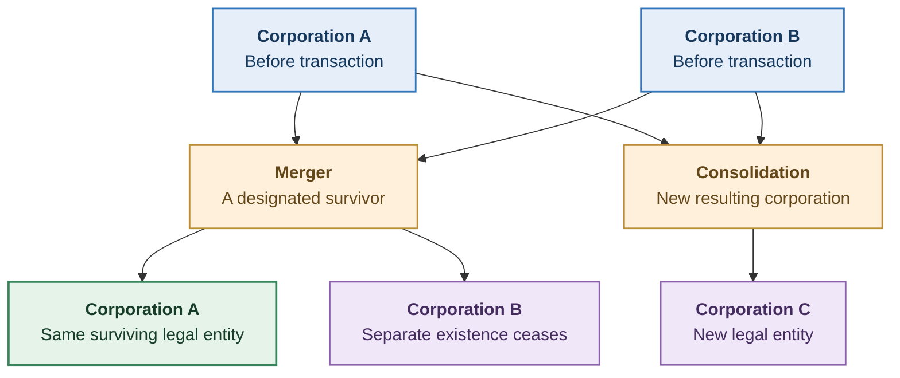
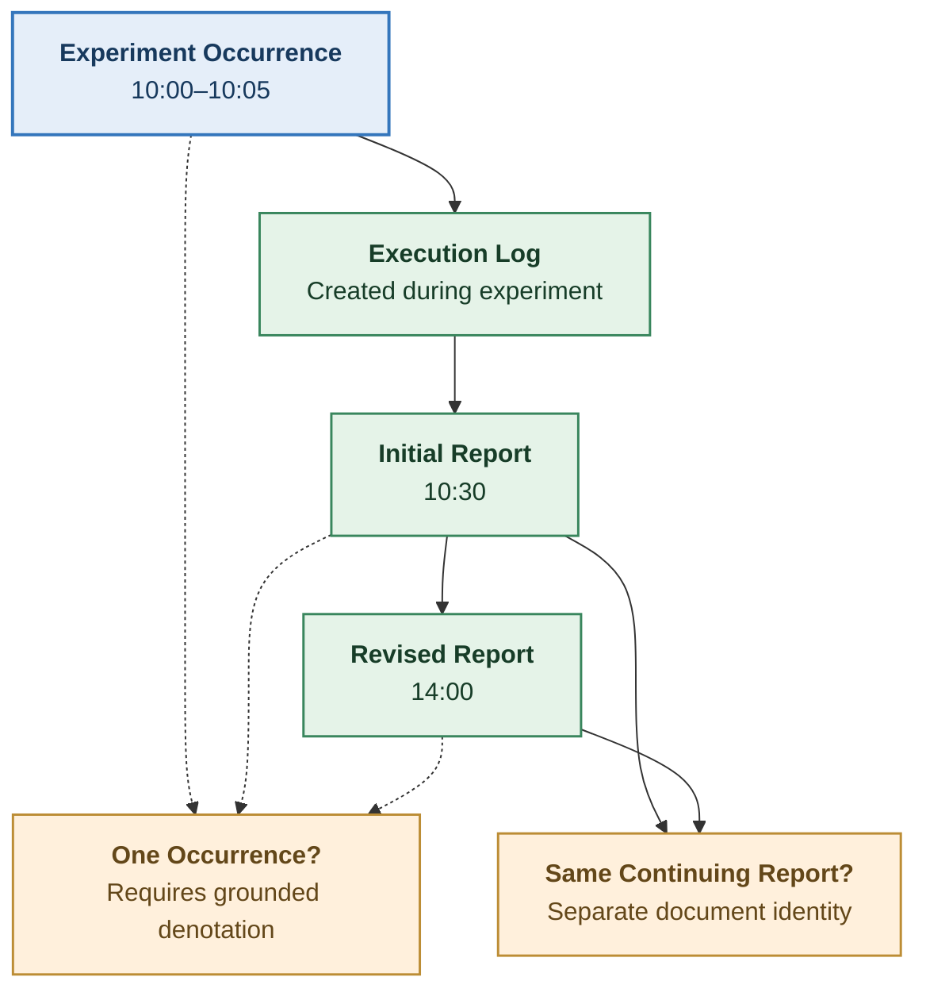
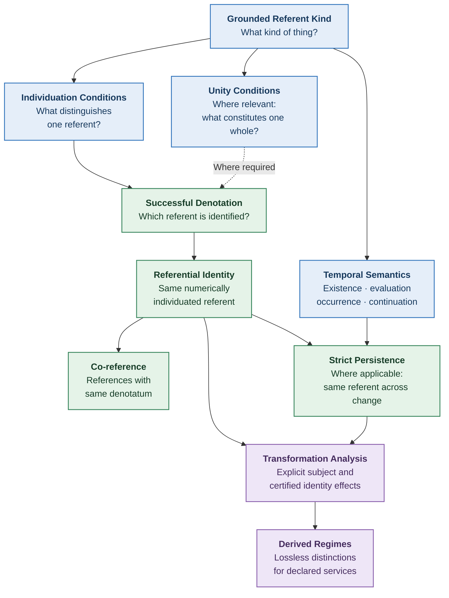
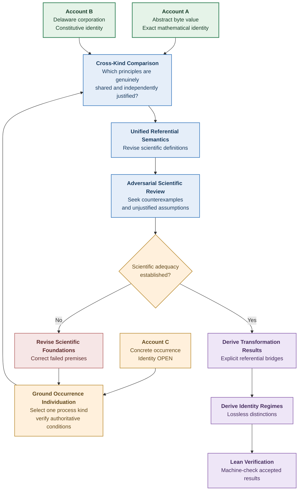

# Structural Explainability

# Three Grounded Identity Accounts and Their Scientific Consequences

**Scientific Development Note — v0.5**
**Date:** October 16, 2026
**Status:** OPEN — Scientific construction and adversarial evaluation
**Parent:** Unified Referential Semantics v0.2; Scientific Development Notes v0.3–v0.4
**Research focus:** Establish substantive identity conditions for contrasting referent kinds, then determine which principles genuinely generalize.

---

## 1. Research Objective

The previous investigation established that unity, individuation, denotation, numerical identity, and strict persistence must not be conflated.

It also established an important limitation:

**Correct mathematical representations of identity do not, by themselves, establish scientifically adequate identity criteria.**

We now investigate three contrasting referent kinds:

1. An abstract finite byte sequence.
2. A corporation constituted under Delaware law.
3. A temporally extended occurrence or process.

For each, we seek to establish:

- What the intended referent is.
- What makes it one individual.
- How a presentation successfully identifies it.
- What establishes identity across presentations.
- What constitutes persistence or identity across settings.
- What kinds of change preserve or break identity.
- What evidence supports the conclusions.
- Which conclusions remain unresolved.

The goal is to establish scientifically meaningful identity conditions before deriving universal SE principles.

A successful outcome need not be three complete accounts.

Discovering that an apparently authoritative source fails to establish an essential identity condition is itself a scientifically important finding.

---

# Part I — Mathematical Information Values

## 2. Account A: Abstract Finite Byte Sequences

### 2.1 Referent kind

Let the intended referents be finite sequences of bytes.

Define:

\[
B=\{0,1,\ldots,255\}.
\]

The referent domain is:

\[
U*A=\bigcup*{n\in\mathbb N}B^n.
\]

Each element of \(U_A\) is one finite sequence.

For example:

\[
u=(65,66,67)
\]

is the three-byte sequence corresponding to ASCII text `ABC`.

This account concerns the abstract sequence value.

It does not concern a particular file, storage location, physical device, software package, or document.

That distinction is essential.

### 2.2 What establishes one individual?

The mathematical construction supplies exact conditions.

A sequence is determined by:

1. Its finite length.
2. Its members.
3. The order of those members.

Two sequences are identical exactly when they have the same length and the same byte at every position.

Formally:

\[
\begin{aligned}
u=v\iff {}&
|u|=|v|\\
&\land
\forall i<|u|,\ u_i=v_i.
\end{aligned}
\]

No appeal to provenance, physical continuity, or institutional authority is required.

These are the equality conditions of the stipulated mathematical domain.

### 2.3 Is a separate unity condition required?

Not in the sense required for a physical composite object.

The sequence is one mathematical value under its formal construction.

Its members and ordering are part of that construction.

This does not establish physical integration or organism-like unity.

**Finding A1:** Successful individuation of an abstract mathematical value need not require an additional material or causal whole-unity criterion.

The account is mathematically complete for the chosen kind.

Whether that kind is appropriate to a particular scientific application is a separate question.

---

## 3. Identity Across Presentations

Different presentations may encode the same byte sequence.

Consider:

**Presentation 1 — Hexadecimal**

`41 42 43`

**Presentation 2 — Base64**

`QUJD`

**Presentation 3 — Decimal**

`65, 66, 67`

Given the appropriate decoding conventions, all three denote:

\[
u=(65,66,67).
\]

Define a partial decoding function:

\[
\delta_A:P_A\rightharpoonup U_A.
\]

Then:

\[
\operatorname{Same}\_A(p,q)
\iff
\delta_A(p)=\delta_A(q)
\]

for successfully decoded presentations.

### 3.1 Scientific and mathematical status

The identity result is exact once the following are established:

- The intended referent kind is an abstract byte sequence.
- The presentations use known decoding conventions.
- Decoding succeeds.
- The resulting sequences are equal.

The result is not merely equality of arbitrary presentation identifiers.

It follows from the defined mathematical objects and validated decoding.

### 3.2 Counterexample: identical bytes, different file instances

Suppose two separate files contain:

`41 42 43`

They denote the same abstract byte value.

They need not be the same file instance.

Thus:

\[
\operatorname{SameByteValue}(f_1,f_2)
\]

does not entail:

\[
\operatorname{SameFileInstance}(f_1,f_2).
\]

There is no contradiction.

The two predicates concern different referent kinds.

**Finding A2:** A scientifically adequate identity assertion must distinguish the intended referent from the representation or instance carrying it.

---

## 4. Identity Through Transformation

Consider three transformations.

### 4.1 Exact copying

An exact copy of a byte sequence preserves its abstract value.

If:

\[
f(u)=u,
\]

then:

\[
\operatorname{SameValue}\_A(u,f(u)).
\]

This is true by construction.

However, the operation may create a new concrete file instance.

The same operation can therefore preserve abstract value identity while producing a distinct concrete artifact.

### 4.2 Appending a byte

Let:

\[
u=(65,66,67)
\]

and:

\[
v=(65,66,67,68).
\]

Because:

\[
|u|\ne|v|,
\]

we have:

\[
u\ne v.
\]

Appending a byte breaks abstract sequence-value identity.

A particular mutable file containing the sequence may nevertheless remain the same file instance.

That requires a separate identity criterion for files.

### 4.3 Changing the encoding

Converting a correctly represented byte sequence from hexadecimal to Base64 changes the presentation but not the abstract sequence value.

This is a representation transformation, not a transformation of the mathematical referent.

### Finding A3

**A transformation can change a representation without changing its referent.**

Conversely, a transformation can preserve a concrete carrier while changing the abstract value represented by that carrier.

The transformation target must therefore be specified before any identity verdict is meaningful.

---

## 5. A Counterexample to Hash-Based Identity

Suppose an implementation uses a fixed-length cryptographic digest:

\[
H:U_A\rightarrow\{0,1\}^{256}.
\]

Because \(U_A\) contains infinitely many finite sequences but the digest range is finite, \(H\) cannot be injective.

Therefore:

\[
\exists u\ne v:\ H(u)=H(v).
\]

This follows from the pigeonhole principle.

Consequently:

\[
H(u)=H(v)
\not\Rightarrow
u=v.
\]

A cryptographic hash may provide extremely strong practical evidence under stated assumptions.

It is not mathematical equality of the original values.

### Finding A4

**An operationally reliable identification method must not be confused with an exact mathematical identity criterion.**

This distinction matters for software supply-chain research.

A content digest may be adequate for a particular engineering assurance task without being a logically complete identity criterion for every possible artifact.

---

## 6. Does the Abstract Value Persist?

This question requires care.

An abstract mathematical sequence is not ordinarily treated as a physical continuant undergoing material change.

A sequence can be denoted at two different evaluation times.

For example:

\[
\delta*A(p*{t_1})=u
\]

and:

\[
\delta*A(p*{t_2})=u.
\]

That establishes identity of the denoted mathematical value.

It does not establish that the sequence underwent a physical process of persistence between \(t_1\) and \(t_2\).

### Finding A5

**Repeated reference to the same abstract value is not automatically a claim of diachronic persistence in the sense appropriate to a physical or institutional continuant.**

This is a substantive limitation on the v0.2 persistence model.

A unified theory must not require every referent kind to have the same temporal ontology.

### Account A verdict

| Requirement                | Status                                              |
| -------------------------- | --------------------------------------------------- |
| Referent kind              | Established by formal construction                  |
| One individual             | Established                                         |
| Identity criterion         | Exact                                               |
| Multiple presentations     | Grounded through decoding                           |
| Exact-value transformation | Established                                         |
| Concrete carrier identity  | Outside this account                                |
| Diachronic persistence     | Not established as a physical continuation relation |
| Scientific generality      | Limited to the defined mathematical kind            |

**Assessment:** Mathematically complete for abstract byte values; scientifically appropriate only when that is the intended referent kind.

---

# Part II — Institutionally Constituted Identity

## 7. Account B: Delaware Corporations

A corporation provides a fundamentally different basis for identity.

Its existence as a legal person is constituted by legal rules.

A corporation cannot be identified solely by its current physical assets, members, officers, or descriptive properties.

The governing law determines important conditions of existence and continuity.

### 7.1 Authoritative basis

The Delaware General Corporation Law establishes relevant rules.

Key provisions include:

- §101 — Incorporation.
- §103 — Execution, filing, and effective dates.
- §105 — Evidentiary status of certified filings.
- §106 — Commencement of corporate existence.
- §251 — Merger and consolidation.
- §259 — Effects of merger and consolidation.
- §278 — Limited continuation after dissolution.
- §312 — Revival of a certificate of incorporation.

Primary source:

https://delcode.delaware.gov/title8/c001/

These provisions are independently specified legal conditions.

Their application requires the relevant transaction facts and valid legal documentation.

---

## 8. What Establishes One Corporation?

Section 101 provides the incorporation mechanism.

Section 106 establishes the commencement of corporate existence, subject to the filing and effective-time rules.

A corporation is not constituted merely by a collection of individuals deciding to use the same name.

Nor is the corporation identical to the physical paper on which its certificate is printed.

Its legal existence follows from validly effective constitutive acts under the governing framework.

### 8.1 Existence

For this narrowly defined account:

\[
\operatorname{CorpExists}(c,t)
\]

must be evaluated under the applicable legal status rules.

Evidence may include the legally effective incorporation documents and subsequent authorized transactions.

### 8.2 Unity

What makes the corporation one institutional entity?

Its unity is not the physical integration of:

- Shareholders.
- Directors.
- Buildings.
- Bank accounts.
- Employees.
- Equipment.

Rather, it is constituted as one legal organization under the applicable rules.

This is a form of institutional unity.

### 8.3 Individuation

Two corporations may have similar:

- Names.
- Owners.
- Directors.
- Addresses.
- Assets.
- Purposes.

Those similarities do not make them one legal corporation.

Conversely, one corporation may change many of those properties while remaining the same legal person.

### Finding B1

**Institutional identity is not reducible to equality of material composition, participants, location, or descriptive attributes.**

Within this account, constitutive legal history has a different role from ordinary observational similarity.

---

## 9. Identity Through Merger

The Delaware statute distinguishes merger from consolidation.

This distinction supplies a direct scientific test of strict identity.

### 9.1 Merger into a surviving corporation

Suppose corporations \(A\) and \(B\) validly merge into \(A\).

Under the applicable statutory rules, \(A\) is the surviving corporation.

Its legal identity continues.

The separate existence of \(B\) ceases as a constituent corporation.

We may represent the legally grounded judgment:

\[
A*{\text{before}}
=

A*{\text{after}}.
\]

But:

\[
B*{\text{before}}
\ne
A*{\text{after}}.
\]

The second judgment is not contradicted by the transfer of \(B\)'s property or liabilities to \(A\).

### 9.2 Consolidation into a new corporation

Now suppose:

\[
A+B\longrightarrow C
\]

where \(C\) is a newly constituted resulting corporation.

The new corporation receives the legal consequences specified by the statute.

But it is not thereby numerically identical to either constituent corporation.

The distinction follows from the constitutive legal arrangement.

### 9.3 Diagram



The branches depict alternative legally structured transactions, not simultaneous events involving the same corporations.

### Finding B2

**Transfer of rights, obligations, or property does not establish numerical identity of the transferor and recipient.**

This is grounded in the legal distinction between constituent and surviving or resulting corporations.

Source:

https://delcode.delaware.gov/title8/c001/sc09/index.html

Relevant provisions: §§251 and 259.

---

## 10. An Important Counterexample: Dissolution Does Not Always Mean Immediate Nonexistence

A simplistic identity theory might adopt:

> Dissolution terminates corporate existence.

That is not an adequate account of Delaware corporate law.

Section 278 provides for continuation of a dissolved corporation as a body corporate for specified winding-up and litigation purposes, subject to statutory periods and extensions.

Section 312 also establishes circumstances and effects of revival when a certificate of incorporation has become forfeited or void.

These provisions complicate any model that treats corporate existence as a simple, permanent transition from `True` to `False`.

### 10.1 Why this matters

The same legal entity may have different legally recognized capacities at different times.

A dissolved corporation may continue for limited purposes.

A valid revival can have effects addressing the period during which its certificate was void or forfeited.

We therefore cannot assume:

\[
\operatorname{NotOperating}(c,t)
\Rightarrow
\neg\operatorname{CorpExists}(c,t).
\]

Nor may we assume every change in legal standing creates a new legal person.

### Finding B3

**Existence, operational capacity, legal standing, and identity are distinct properties, even within one institutional referent kind.**

This matters directly to the Transformation vocabulary, which already distinguishes `standing` from other dimensions.

It does not follow that every change in standing breaks institutional identity.

The legal account provides an independently grounded counterexample to such a universal inference.

Sources:

https://delcode.delaware.gov/title8/c001/sc10/index.html

https://delcode.delaware.gov/title8/c001/sc12/index.html

Relevant provisions: §§278 and 312.

---

## 11. Identity Across Corporate Presentations

Suppose two independently obtained documents purport to identify the same corporation.

They may use different:

- Corporate names.
- Dates.
- Addresses.
- Officers.
- Shareholder descriptions.

The documents may still identify the same legal entity.

But that conclusion must be supported by the relevant corporate record and legal history.

### 11.1 A certificate is evidence, not the referent

A certified copy of a filing is not the corporation.

Making another copy of the certificate does not create another corporation.

The certificate may establish or support facts about the legally constituted entity.

This distinguishes:

\[
\operatorname{DocumentAbout}(p,c)
\]

from:

\[
p=c.
\]

### 11.2 Identity through authorized history

An identity judgment may require examining a sequence of legally effective transactions.

For example:

- Formation.
- Amendment.
- Name change.
- Merger.
- Consolidation.
- Dissolution.
- Revival.

An adequate account must apply the governing rule to each relevant transaction.

It cannot merely compare the descriptions before and after.

### Finding B4

**An evidentiary chain can justify identity across changed presentations when the chain is grounded in constitutive rules that establish legal continuation.**

The chain itself is not sufficient without those rules.

This is a candidate generalizable pattern, not a universal identity theorem.

---

## 12. Account B Verdict

| Requirement                            | Status                                   |
| -------------------------------------- | ---------------------------------------- |
| Referent kind                          | Grounded in Delaware corporate law       |
| Formation                              | Grounded                                 |
| Institutional unity                    | Grounded within the legal framework      |
| Identity across merger                 | Grounded for specified transaction forms |
| Identity across consolidation          | Grounded for specified transaction forms |
| Liability succession                   | Explicitly distinguished from identity   |
| Dissolution and revival                | Additional rule analysis required        |
| Identity across arbitrary transactions | Not completely established               |
| Generalization to other institutions   | Not established                          |

**Assessment:** Substantively grounded but not a complete theory of all institutional identity.

This account demonstrates that genuine referential identity judgments can follow from independent constitutive rules.

It also demonstrates that even one institutional kind requires more than a simplistic persistence invariant.

---

# Part III — Temporally Extended Occurrences

## 13. Account C: Processes and Activities

This is the most difficult of the three accounts.

It is also a crucial test of the proposed unified semantics.

The intended referent is a concrete temporally extended occurrence.

Examples include:

- A particular physical process.
- A biological process.
- A recorded experimental activity.
- A specific manufacturing operation.
- A particular software execution.

Unlike an abstract mathematical value, an occurrence unfolds in time.

Unlike a corporation, it is not generally constituted by a legal act.

The question is:

**What independently establishes one occurrence rather than another, and what makes multiple descriptions refer to that very occurrence?**

---

## 14. What BFO Establishes

BFO 2020 distinguishes continuants and occurrents.

Its formal ontology includes:

- Processes.
- Process boundaries.
- Temporal parts.
- Occurrent parthood.
- Participation.
- Temporal regions.

BFO provides ontological structure for investigating temporally extended entities.

For example, BFO treats the first set of a tennis match as an occurrent part of the match.

The two are related, but the first set is not identical to the entire match.

### 14.1 A substantive distinction

Let:

- \(m\) be one tennis match.
- \(s_1\) be its first set.

If:

\[
\operatorname{ProperPart}(s_1,m),
\]

then:

\[
s_1\ne m.
\]

This follows from the meaning of proper parthood.

The temporal relationship is not merely a difference in descriptions.

The ontology distinguishes the component occurrence from the encompassing occurrence.

### Finding C1

**Occurrence parthood must not be mistaken for occurrence identity.**

Descriptions referring to a process and one of its temporal parts need not co-refer, even if they share participants, location, and some temporal information.

### 14.2 What BFO does not settle by itself

BFO's process categories do not automatically determine whether two independently recorded descriptions refer to the same particular tennis match, experiment execution, or manufacturing event.

The records require adequate links to the intended process.

Therefore, BFO provides meaningful ontology but not a complete account of referential identification for arbitrary process descriptions.

Primary source:

https://github.com/BFO-ontology/BFO-2020

---

## 15. What W3C PROV-DM Establishes

W3C PROV-DM supplies another independently specified framework.

It distinguishes:

- Entities.
- Activities.
- Agents.
- Usage.
- Generation.
- Derivation.
- Start and end of activities.

An activity is treated as something occurring over a period of time and interacting with entities.

This provides a useful operational representation of occurrences and their relationships to informational artifacts.

Primary sources:

https://www.w3.org/TR/prov-dm/

https://www.w3.org/TR/prov-constraints/

### 15.1 A provenance activity

Suppose a provenance record states:

```text
activity(ex:run1,
         2026-10-16T10:00:00,
         2026-10-16T10:05:00)
```

Under PROV-DM, this asserts an activity identified by `ex:run1`, with the indicated start and end times.

A second description may use the same identifier.

PROV-CONSTRAINTS provides rules for merging compatible descriptions and enforcing consistency conditions.

### 15.2 The crucial scientific limitation

A provenance identifier does not independently establish that the described real-world activity happened exactly as recorded.

Nor does the mere use of different identifiers prove that two descriptions refer to distinct actual occurrences.

The records require trustworthy grounding.

The data model governs the semantics and consistency of provenance descriptions.

It does not make every reported real-world identity judgment automatically true.

### Finding C2

**Consistency of occurrence descriptions is not equivalent to independently established identity of the described occurrences.**

This is analogous to the distinction between a corporate record and the corporation itself.

However, the grounding mechanisms differ.

---

## 16. An Occurrence Counterexample

Consider two descriptions:

**Description A**

> A sample was processed on instrument X between 10:00 and 10:05.

**Description B**

> A sample was processed on instrument X between 10:00 and 10:05.

The descriptions agree on all supplied attributes.

There are at least two possible situations.

### Situation 1 — One occurrence

Both records describe the same processing activity.

### Situation 2 — Two occurrences

Two distinct processing activities took place during the same interval.

They may have involved different samples, concurrent processing, separate channels, or otherwise distinct executions.

The two descriptions are insufficient to determine which situation occurred.

Formally, the shared observations do not establish:

\[
a=b.
\]

### 16.1 What additional evidence might establish identity?

Potentially relevant evidence could include:

- An authoritative execution record.
- Verified sample provenance.
- Instrument transaction semantics.
- Independently grounded process boundaries.
- Causal relationships among participants.
- Protocol-defined execution rules.

These are candidates.

Their sufficiency depends on the process kind and the source's actual guarantees.

### Finding C3

**Matching process descriptions do not universally establish identity of the underlying occurrences.**

The problem is not solved by adding a timestamp or a generated UUID.

Such information may be useful evidence, but its referential authority must be established.

---

## 17. A Second Occurrence Problem: Temporal Boundaries

Consider a temporally extended process \(p\).

Its duration is:

\[
[t_0,t_3].
\]

Suppose the process can be decomposed into:

\[
p_1:[t_0,t_1],
\]

\[
p_2:[t_1,t_2],
\]

\[
p_3:[t_2,t_3].
\]

The existence of that decomposition does not necessarily establish that there are exactly three scientifically relevant occurrences.

A different analysis may identify two, four, or more component processes.

The appropriate boundaries may depend on the process ontology and domain-specific realization conditions.

### 17.1 Why temporal equality is insufficient

Two processes may:

- Occur simultaneously.
- Share participants.
- Occupy overlapping temporal intervals.
- Be causally related.
- Have one as a component of the other.

None of those relationships universally establishes numerical identity.

### Finding C4

**Temporal coincidence and temporal overlap are not general identity criteria for occurrences.**

A complete occurrence account requires independently justified process boundaries and individuation conditions.

---

## 18. A Third Occurrence Problem: Persistence

Suppose a laboratory experiment finishes at 10:05.

At 14:00, someone examines the experiment log.

The completed occurrence is still a legitimate referent.

But the experiment is not necessarily still occurring at 14:00.

We must distinguish:

\[
\operatorname{OccursAt}(u,t)
\]

from:

\[
\operatorname{ReferencedAt}(u,t).
\]

The second does not imply the first.

### 18.1 A diagram of the distinction



This distinction is critical.

A revised presentation of an occurrence should not automatically be treated as a later stage of that occurrence.

The referent and its descriptions have different temporal histories.

### Finding C5

**Identity across presentations of a completed occurrence is not equivalent to continued temporal existence of the occurrence.**

This requires a substantive change to the earlier v0.2 persistence architecture.

---

## 19. Account C Verdict

| Requirement                              | Status                               |
| ---------------------------------------- | ------------------------------------ |
| Ontological category                     | Grounded in BFO and PROV-DM          |
| Processes and temporal parts             | Grounded                             |
| Activity representation                  | Grounded                             |
| Temporal boundaries in general           | Not sufficiently established         |
| Concrete occurrence individuation        | OPEN                                 |
| Identity across independent descriptions | OPEN                                 |
| Persistence of completed occurrences     | Requires distinct temporal semantics |
| Universal occurrence identity criterion  | Not established                      |

**Assessment:** Structurally informative but scientifically incomplete.

The most important finding is that neither BFO nor PROV-DM should be treated as supplying a complete, domain-independent identity criterion for concrete occurrences.

A narrower scientifically grounded process kind must be investigated before this account can satisfy the acceptance requirements.

---

# Part IV — Comparison of the Three Accounts

## 20. Comparative Scientific Results

The accounts reveal different foundations for identity.

| Question                                           | Abstract byte sequence                            | Delaware corporation                    | Concrete occurrence               |
| -------------------------------------------------- | ------------------------------------------------- | --------------------------------------- | --------------------------------- |
| What constitutes the referent?                     | Mathematical sequence                             | Legally constituted entity              | Temporally extended process       |
| What establishes individuality?                    | Exact mathematical construction                   | Governing constitutive rules            | Not fully established             |
| Is material unity required?                        | No                                                | No                                      | Not universally                   |
| Can two descriptions differ yet co-refer?          | Yes                                               | Yes                                     | Yes, when grounded                |
| Does equality of descriptive properties suffice?   | Only when properties completely specify the value | Generally no                            | Not generally                     |
| Does provenance alone suffice?                     | Not needed for abstract equality                  | Not without legal authority             | Not generally                     |
| Can the referent change?                           | A different sequence is a different value         | Yes, under governing continuity rules   | Occurs through temporal extension |
| Is persistence ordinary physical endurance?        | No                                                | No                                      | Not necessarily                   |
| Is the identity criterion scientifically complete? | Yes, for the defined mathematical kind            | Partially, within specified legal cases | No                                |

### 20.1 A major conclusion

The accounts do not support one universal material, structural, or informational identity criterion.

They do support the need for a common referential framework.

That framework must preserve:

1. The intended referent kind.
2. Its independently grounded conditions of individuation.
3. Successful identification of the referent.
4. Strict numerical identity.
5. Relevant temporal semantics.
6. Evidence supporting judgments.
7. Explicit unresolved cases.

This is a candidate general framework.

Its scientific contribution must be demonstrated by substantive consequences, not by listing these fields.

---

# Part V — Revising the Unified Semantics

## 21. A Necessary Change to the Earlier Architecture

Our v0.2 proposal used successful whole individuation as the general gateway to reference.

The current research shows why that is too restrictive.

An abstract value can be successfully identified without possessing the same unity conditions as a physical organism.

An institutional entity can be individuated through constitutive rules.

A completed occurrence can be successfully referenced without continuing to occur at the evaluation time.

Therefore, the theory needs three distinguishable semantic relationships.

### 21.1 Successful identification

A presentation identifies one intended referent under a scientifically justified referential account.

### 21.2 Whole individuation

For kinds requiring whole-unity conditions, the presentation identifies a unit satisfying those conditions.

### 21.3 Diachronic identity

For kinds to which temporal persistence applies, the account establishes identity across the relevant settings according to the governing scientific criterion.

These conditions need not collapse into one predicate.

### Revised architecture



The arrows express scientific dependencies.

They are not a claim that the governing criteria can be derived from a generic equivalence relation.

---

## 22. A More Precise Treatment of Time

The examples require distinguishing at least three temporal notions.

### T1 — Referent time

When does the referent exist or occur?

### T2 — Presentation time

When is a presentation created, evaluated, or revised?

### T3 — Transformation time

When does a transformation act on a referent, carrier, or representation?

These may coincide in particular applications.

They must not be universally equated.

### 22.1 Different temporal semantics by kind

**Abstract value**

Its identity is not constituted by temporal continuation.

**Institutional entity**

Its existence and legal capacities may change over time under constitutive rules.

**Occurrence**

Its temporal extent is part of its ontology, but a later reference does not extend the occurrence.

### Candidate principle T-1

**Cross-setting sameness must be distinguished from temporal persistence.**

Two presentations evaluated at different times can denote the same referent without establishing that the referent persisted as an ongoing continuant through the interval between evaluations.

This is a candidate general correction to v0.2.

---

# Part VI — Transformation Semantics Must Identify Its Subject

## 23. Three Different Transformation Questions

Consider a copying operation.

What is copied?

### Question A — Representation

Does the copied presentation still denote the same referent?

### Question B — Concrete artifact

Is the new file instance numerically identical to the source file instance?

### Question C — Abstract value

Does the copy preserve the original byte sequence?

The answers may differ.

Similarly, consider the merger of two corporations.

The operation may:

- Preserve one surviving corporation.
- Terminate another constituent corporation's separate existence.
- Transfer assets and liabilities.
- Produce a new resulting corporation in a consolidation.

A single unqualified preservation verdict cannot capture all those referential consequences.

### 23.1 The missing bridge

The Transformation theory operates on state configurations.

A referential identity judgment requires identifying the comparison subjects.

The bridge must state:

1. Which referent kind is being considered.
2. Which before and after subjects are selected.
3. What the operator actually changes.
4. Whether the comparison is meaningful.
5. Which independently justified identity criterion applies.

A transformation's footprint does not supply these facts by itself.

### Candidate principle T-2

**No referential preservation or breakage theorem is scientifically adequate without an explicit, grounded subject-selection and realization contract.**

This is stronger than merely adding a mapping from presentations to configurations.

It prevents the formal bridge from silently assuming the identity verdict.

---

## 24. A Negative Result About Universal Operator Verdicts

Consider the operation described informally as copying.

Under the abstract-value account, exact copying preserves byte-sequence identity.

Under a concrete-file-instance account, creating a second file need not preserve instance identity.

Under an occurrence account, copying a report of an event does not create another occurrence of the reported event.

Re-executing the event-generating procedure may create a new occurrence.

The informal operator name does not have one universal referential effect.

### Candidate result T-3

**An operation vocabulary cannot support universal referential identity verdicts unless the operator semantics and the intended referential subjects are sufficiently constrained.**

This does not imply that transformation effects are arbitrary.

It means they must be derived relative to an adequately specified domain and comparison.

The existing Transformation theory can still establish important mathematical guarantees.

The new scientific obligation is to establish the interpretation under which those guarantees concern genuine referential identity.

---

# Part VII — Scientific Counterexamples

## 25. Adversarial Case Matrix

The following cases challenge the proposed generalizations.

They are construction and adversarial evidence, not independent validation.

| Case                                    | Incorrect inference                                 | Scientific challenge                             |
| --------------------------------------- | --------------------------------------------------- | ------------------------------------------------ |
| Identical byte values in distinct files | Same value implies same file instance               | Distinguish abstract value and concrete artifact |
| Same digest for unequal values          | Hash equality proves exact value identity           | Hash collision possibility                       |
| Exact copy into another file            | Copy must have one identity effect                  | Specify referent kind and subject                |
| Two corporations with same owners       | Shared participants imply identity                  | Constitutive entity distinction                  |
| Merger with one survivor                | Liability transfer implies predecessor identity     | Survival and succession differ                   |
| Consolidation into new corporation      | New entity is identical to constituents             | Constitutive creation of a new entity            |
| Dissolved corporation in winding up     | Dissolution implies immediate absolute nonexistence | Limited legal continuation                       |
| Corporate revival                       | Once void, identity can never continue              | Statutory revival effects                        |
| Tennis match and first set              | Temporal overlap implies identity                   | Proper temporal parthood                         |
| Two matching process descriptions       | Matching metadata proves one occurrence             | Independent occurrence grounding                 |
| Completed experiment described later    | Later reference means event still occurring         | Evaluation time versus occurrence time           |
| Report copied after an experiment       | Copying the report duplicates the experiment        | Representation versus referent                   |

The proposed semantics must retain the distinctions demonstrated by these cases.

A solution that merely introduces a new identifier for each case is not scientifically acceptable.

---

# Part VIII — What Can Be Claimed Universally?

## 26. Candidate General Principles

The comparisons support several candidates.

### G1 — Referential kind dependence

A meaningful identity judgment must identify the intended referential domain.

**Status:** Supported as a general semantic requirement.

### G2 — Individuation grounding

A claim that a presentation identifies one referent requires an adequately justified identification relationship.

**Status:** Methodological requirement; substantive criteria remain domain-dependent.

### G3 — Unity distinction

Whole unity is distinct from numerical identity and need not take one universal form.

**Status:** Supported by foundational ontology and the contrasting accounts.

### G4 — Representation distinction

Equality of representations, observational features, or identifiers does not universally establish equality of referents.

**Status:** Supported by mathematical countermodels and the applications.

### G5 — Identity versus relatedness

Constitution, parthood, provenance, derivation, succession, and continuity do not universally imply strict identity.

**Status:** Supported by distinctions in the examined domains.

### G6 — Temporal separation

Referent time, presentation time, and transformation time must not be silently conflated.

**Status:** Supported by the occurrence and institutional examples.

### G7 — Grounded transformation

Identity-preserving effects must be evaluated on independently specified referential subjects.

**Status:** Candidate general transformation-adequacy requirement.

### G8 — Evidence distinction

Evidence supporting an identity claim is not itself identical to the truth of that claim.

**Status:** General epistemic requirement.

These candidate principles constrain the scientific theory.

They do not yet constitute a complete substantive theory of identity.

---

## 27. What Has Not Been Established?

The investigation does not establish:

1. One universal criterion of whole unity.
2. One universal criterion of diachronic persistence.
3. One complete identity criterion for all concrete occurrences.
4. One sufficient signature in the eleven Transformation dimensions for every referent kind.
5. A universally complete method of identifying concrete referents from representations.
6. A universally valid interpretation of transformation tracking.
7. A fixed number of identity regimes.
8. A complete scientific theory of Structural Explainability.

The mathematical principles remain useful.

But the scientifically incomplete areas must not be disguised through uninterpreted relations or assumptions chosen only to make proofs succeed.

---

# Part IX — Theoretical Contribution Test

## 28. Are We Establishing New Science?

The current work provides a stronger scientific foundation, but most general distinctions are already recognized in ontology, philosophy, mathematics, law, and provenance theory.

For example:

- Equality is an equivalence relation.
- Identity and unity are distinguishable.
- Abstract values and concrete carriers differ.
- Legal succession need not be numerical identity.
- Occurrences and their descriptions differ.

SE cannot claim these familiar distinctions as original discoveries merely by expressing them in Lean.

### 28.1 Where a substantive contribution may exist

The prospective contribution is an integrated theory that establishes when independently grounded identity criteria can be transported through transformations without losing essential referential distinctions.

This would connect:

1. Substantive referential identity conditions.
2. Formal state transformations.
3. Operator-level preservation and breakage.
4. Explicit applicability and uncertainty.
5. Faithful cross-framework representation.
6. Structural explainability claims supported by those results.

### 28.2 Required theoretical achievement

The completed theory must establish results of the following kind:

> Given an independently justified identity criterion, an explicit transformation realization, and scientifically adequate dimension conditions, determine which identity claims a transformation warrants, contradicts, or leaves unresolved.

The result must be stronger than simply restating the assumptions.

For example, a meaningful theorem might derive preservation from a nontrivial combination of independent transformation constraints and independently established identity invariants.

Another might demonstrate that a proposed representation necessarily loses an identity distinction relevant to a declared explanatory service.

### 28.3 Acceptance condition

The theory must establish at least one substantive result whose conclusion is not simply the identity criterion repeated in different notation.

That result must have a clear scientific interpretation and meaningful application.

**Current status:** Candidate contribution, not established.

---

# Part X — Development Decision

## 29. The Three Accounts Are Not Equally Complete

The present investigation has reached an important decision point.

**Account A — Abstract byte sequence**

Sufficiently specified for exact mathematical identity.

It is useful as a formal baseline.

**Account B — Delaware corporation**

Grounded for selected formation and transaction rules.

It demonstrates genuine constitutive identity conditions.

A complete treatment of dissolution, revival, conversion, and other legal changes remains outside the current scope.

**Account C — Concrete occurrence**

Scientifically incomplete.

BFO and PROV provide useful structures, but do not independently determine identity across arbitrary process descriptions.

A more specific occurrence kind and adequate empirical or operational grounding are required.

The third account must not be marked complete merely to make the comparison symmetrical.

---

## 30. Recommended Next Research Focus

The next investigation should concentrate on concrete occurrence individuation.

A promising approach is to select a narrowly defined occurrence kind governed by an explicit operational protocol.

For example, a scientifically documented experimental trial could provide:

- A specified initiation condition.
- A specified completion condition.
- Defined participants and equipment.
- A documented operational boundary.
- Rules distinguishing one trial from another.
- Independent execution evidence.

These elements are not assumed sufficient.

The protocol and scientific literature must establish whether they genuinely individuate the intended occurrence.

The research should test:

1. Whether two records describe one trial or different trials.
2. Whether interruption and resumption constitute one occurrence.
3. Whether repeating the same procedure creates another occurrence.
4. Whether a sub-operation is identical to the complete trial.
5. Whether a later revision of the experiment record changes the original occurrence.
6. Whether process descriptions are adequate to support independently warranted identity judgments.

### Why concentrate here?

The abstract mathematical case is exact.

The institutional case supplies explicit constitutive rules.

The occurrence case exposes the largest remaining scientific gap in the three-account comparison.

Resolving that gap should clarify which general referential principles the theory can actually support.

---

## 31. Research Dependency Roadmap



A satisfactory occurrence account does not automatically establish scientific adequacy across every physical, institutional, and informational kind.

It would provide another independently grounded case for evaluating the proposed general principles.

Additional independent applications will still be required before claiming broad generality.

---

# Part XI — Scientific Assessment

## 32. Mathematical Correctness

**Status: PARTIALLY ESTABLISHED**

The abstract-value identity criterion is mathematically exact.

The distinction between observed equality and referential identity is supported by explicit countermodels.

The proposed general transformation implications remain conditional.

No new Lean verification has been performed.

---

## 33. Scientific Adequacy

**Status: OPEN**

The institutional account establishes substantive identity consequences for specified legal transactions.

The occurrence account remains incomplete.

The theory still lacks a complete, independently justified account of how its proposed semantic relations connect to the intended phenomena across all relevant referent kinds.

This is an unresolved foundational obligation.

---

## 34. Original Theoretical Contribution

**Status: CANDIDATE**

The investigation clarifies the structure required for a substantive contribution.

It has not yet established the final integrated theory or the novel nontrivial transformation results that would demonstrate that contribution.

---

## 35. Compatibility With Earlier SE Theory

**Status: REQUIRES REVISION**

The findings require reconsidering several earlier assumptions.

In particular:

- Successful reference should not universally require a whole-unity predicate.
- Cross-setting sameness must not automatically be interpreted as temporal persistence.
- Transformation tracking must not assume the identity judgment it is intended to support.
- The identity effect of an operator must identify its referential subjects.
- Dimension sufficiency must be scientifically established for its intended domain.
- Identity regimes must preserve the distinctions required by the accepted semantic interface.

These are scientific corrections.

Their eventual impact on Lean definitions, repository boundaries, and manuscripts should follow from the accepted theory.

No repository has been modified.

---

## 36. Conclusion

The three-account investigation establishes a useful contrast.

**Abstract mathematical identity** can be exact by formal construction.

**Institutional identity** can be grounded in independently authoritative constitutive rules.

**Occurrence identity** requires scientifically justified boundaries, individuality, and cross-presentation grounding that are not supplied by descriptive similarity or provenance identifiers alone.

The resulting distinction is central:

> A scientifically adequate referential identity theory must establish not only that its formal judgments obey the laws of identity, but also why those judgments apply to the intended referents.

The investigation also demonstrates that the same transformation may have different identity consequences for an abstract value, a concrete artifact, an institution, or an occurrence.

Those consequences must be derived from the intended referent kind and the scientifically justified comparison.

The next research problem is therefore:

**For a concrete temporally extended occurrence, what independently justified conditions establish one occurrence, distinguish its parts and repetitions, and warrant identity across different descriptions?**

Resolving this problem will provide a stronger basis for determining which referential principles are genuinely general and what new theoretical results SE can establish.

---

# 37. Primary Sources

## Mathematical identity

- Standard mathematical construction of finite sequences over a finite alphabet.
- The pigeonhole principle for finite-range hash functions.

These mathematical results require no empirical identity hypothesis.

## Delaware corporate identity

Delaware General Corporation Law:

https://delcode.delaware.gov/title8/c001/

Formation, §§101–106:

https://delcode.delaware.gov/title8/c001/sc01/index.html

Merger and consolidation, §§251 and 259:

https://delcode.delaware.gov/title8/c001/sc09/index.html

Dissolution and continuation, §278:

https://delcode.delaware.gov/title8/c001/sc10/index.html

Revival, §312:

https://delcode.delaware.gov/title8/c001/sc12/index.html

## Occurrence ontology

Basic Formal Ontology 2020:

https://github.com/BFO-ontology/BFO-2020

W3C, *PROV-DM: The PROV Data Model*:

https://www.w3.org/TR/prov-dm/

W3C, *Constraints of the PROV Data Model*:

https://www.w3.org/TR/prov-constraints/

Stanford Encyclopedia of Philosophy, *Donald Davidson*:

https://plato.stanford.edu/entries/davidson/

## Structural Explainability

- Unified Referential Semantics v0.1.
- Unified Referential Semantics v0.2.
- Scientific Development Notes v0.3 and v0.4.
- Claude's independent corrected-unification proposal.
- Existing Neutral Substrate, Transformation, Persistence, Identity Regimes, and Structural Explainability repositories.
- SE Research Protocols and Theory Acceptance.

---

**End of Scientific Development Note v0.5**

**Next focus:** Grounded individuation of a concrete temporally extended occurrence, including process boundaries, repetitions, component occurrences, and identity across independent descriptions.

**Scientific status:** OPEN. No theoretical acceptance or repository modifications.
