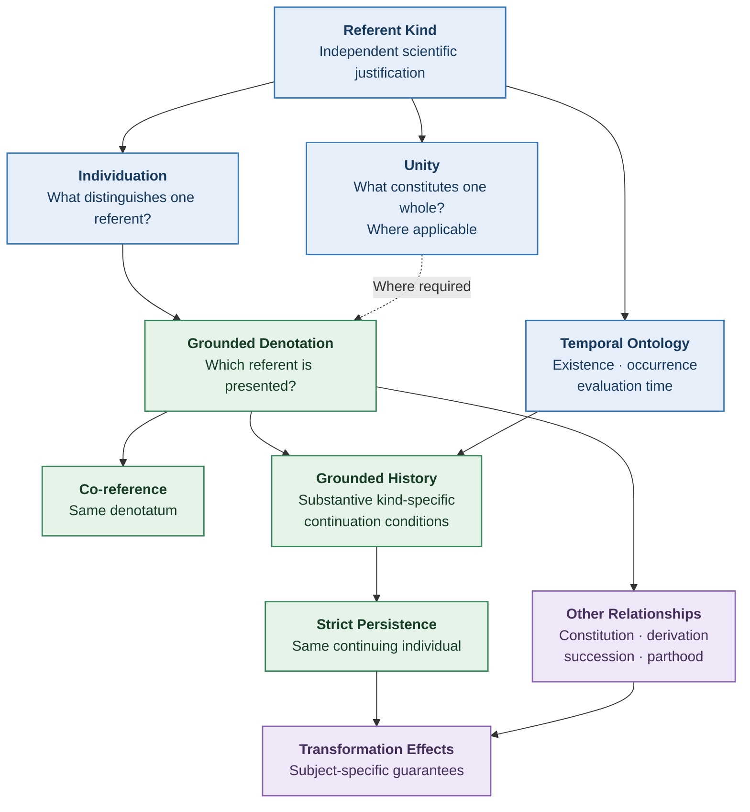
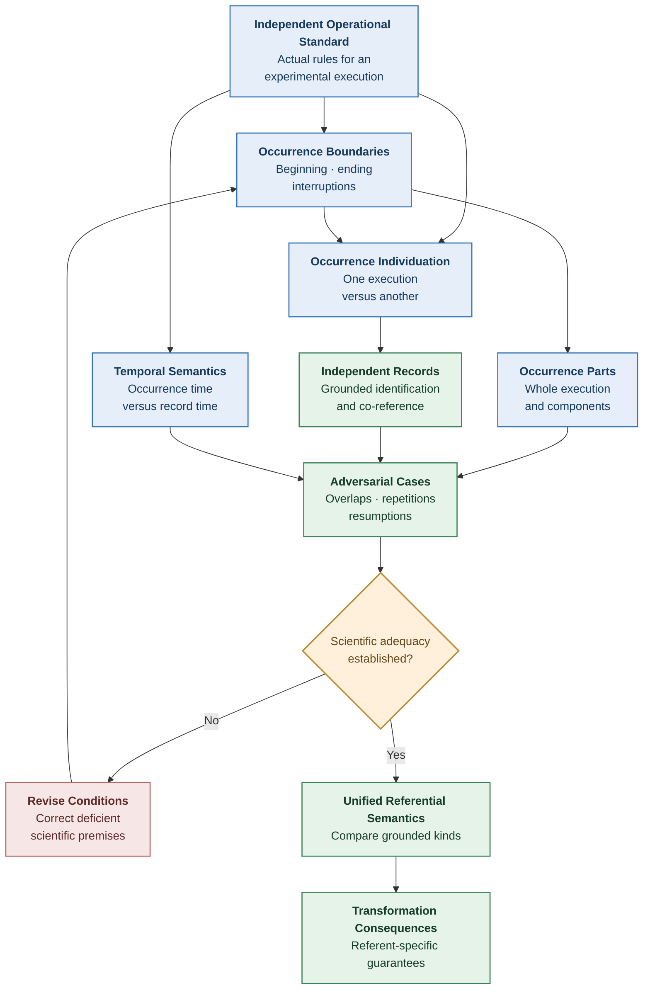

# Structural Explainability

# Consolidated Scientific Review: Unity, Identity, and Persistence

**Scientific Development Note — v0.6**
**Date:** October 16, 2026
**Status:** OPEN — Scientific review and theory refinement
**Inputs:** SE Development Notes v0.2–v0.5 and Claude's independent research on unity and individuality
**Research mode:** Read-only

---

## 1. Research Decision

Claude's findings should be incorporated into the developing Unified Referential Semantics, with several corrections.

The most important conclusion is:

**There is currently no independently justified universal substantive criterion of unity, individuality, or diachronic identity covering all intended SE referent kinds.**

This is a conclusion about the research evidence examined, not a proof that no such principle could exist.

A unified theory remains possible.

However, the unification must distinguish three levels:

1. **Logical identity:** The mathematical behavior of numerical equality.
2. **Referential semantics:** How presentations identify the intended referents.
3. **Scientific grounding:** What establishes the referents and their identity conditions.

The third level cannot be replaced by constructions at the first two levels.

This provides a more defensible scientific foundation than either earlier v0.2 proposal.

---

## 2. Findings Accepted From Claude

### 2.1 Unity is not necessarily required for singular reference

A successful reference may identify an abstract value, material quantity, institution, or occurrence without supplying one universal notion of whole-unity.

A unity condition is necessary when the intended claim concerns a whole whose composition and boundaries require justification.

It is not automatically required for every successful singular reference.

**Decision:** Retain the separation between successful denotation and whole individuation established in v0.4.

### 2.2 Multiple kinds can apply to one carrier

Claude's biological example is particularly useful.

In clonal aspen growth, a ramet and a genet represent distinct biological units of analysis.

One grove may contain multiple ramets belonging to one genet.

Consequently, counting individuals depends on which biological kind is intended.

This supports distinguishing referent kinds without requiring that every carrier belong to exactly one kind.

**Decision:** Permit multiple applicable kinds, with their identity conditions explicitly justified.

### 2.3 Co-reference and persistence must be separate

This is a necessary correction to the earlier unified definition.

Two presentations evaluated at different times may identify the same completed occurrence.

That does not mean the occurrence persists as an ongoing activity between the two evaluation times.

**Decision:** Replace the use of cross-setting sameness as a definition of strict persistence.

### 2.4 Strict identity does not resolve fission

If two successors are genuinely distinct, they cannot both be numerically identical to one predecessor under classical equality.

But logic alone does not establish which successor, if either, continues the predecessor.

**Decision:** Retain the fission exclusion result while leaving the positive continuation judgment dependent on scientific grounding.

### 2.5 Institutional facts require grounds and governing rules

Epstein's distinction between grounds, frame principles, and anchors offers a useful way to investigate institutional identity.

The Delaware corporation example has a related structure:

- Governing law establishes the applicable rules.
- Legally effective acts establish the relevant institutional facts.
- Records provide evidence of those acts.
- Transaction-specific rules establish continuation or termination.

**Decision:** Investigate the grounding and authority relationships explicitly rather than treating institutional identity as equality of records or identifiers.

### 2.6 Indeterminacy requires careful interpretation

When strict identity is modeled using classical equality, it is determinate within each completed mathematical model.

However, uncertainty may arise concerning:

- Which referent a presentation identifies.
- Which kind or criterion applies.
- Which scientific model is adequate.
- Whether evidence establishes the identity judgment.

**Decision:** Preserve these distinctions.

Do not assume that all metaphysical indeterminacy has been disproved. The philosophical literature continues to debate vague objects and vague identity.

---

# Part I — Corrections to Claude's Proposal

## 3. Correction One: Unity and Overlapping Wholes

Claude identifies a potentially important limitation of the OntoClean-style unity schema.

Suppose a fixed equivalence relation \(\omega\) determines the constituents of a whole.

Let:

\[
P(x)=\{z:z\text{ is part of }x\}.
\]

If every whole's parts are exactly one equivalence class of \(\omega\), then:

\[
P(x)\cap P(y)\ne\varnothing
\]

implies:

\[
P(x)=P(y).
\]

### Proof

Choose:

\[
a\in P(x)\cap P(y).
\]

By the assumed unity schema:

\[
P(x)=[a]\_{\omega}
\]

and:

\[
P(y)=[a]\_{\omega}.
\]

Therefore:

\[
P(x)=P(y).
\]

This is a valid conditional mathematical result.

### What follows?

Two wholes governed by one such partition-based unity relation cannot have partially overlapping sets of parts.

They may still be distinct wholes with identical parts unless an additional extensionality principle is assumed.

### What does not follow?

It does not follow that every equivalence-based unity account is scientifically inadequate.

The result depends on assumptions including:

- One common equivalence relation.
- Constituents determined by its equivalence classes.
- The relevant domain and parthood semantics.
- No additional contextual distinction affecting the relation.

Different kinds may use different unity relations.

A context-indexed unity criterion may also avoid the conclusion.

### Scientific decision

**Do not require unity to be an equivalence relation universally.**

But also:

**Do not universally prohibit equivalence-based unity criteria.**

The appropriate question is:

> Does the intended referent kind require overlapping wholes that the proposed unity structure cannot represent?

If so, the unity account is inadequate for that kind.

This gives us a concrete falsification condition rather than another universal metaphysical axiom.

---

## 4. Correction Two: Existence at Two Times Is Not a Complete Persistence Criterion

Claude proposes:

\[
\operatorname{Persists}(u;t_1,t_2)
\iff
E(u,t_1)\land E(u,t_2)\land t_1<t_2.
\]

This establishes existence of the same specified individual at two times, assuming the identity of \(u\) is already fixed.

It does not independently establish why the earlier and later observations concern the same individual.

Nor does it necessarily establish uninterrupted existence throughout the intervening interval.

For example, some institutional accounts recognize termination-like states and legally effective revival.

Whether those states involve continuation, restoration, or another legal construction depends on the governing rules.

A definition involving only endpoint existence cannot settle that question.

### Scientific decision

Separate:

1. **Cross-time co-reference:** Two presentations identify the same referent.
2. **Existence at a time:** The referent exists at a specified time under the governing ontology.
3. **Continuation:** The referent satisfies the kind-specific conditions for persistence over the relevant temporal history.

The third requires independently justified substantive conditions.

### Revised principle T-1

**Existence at two times is insufficient as a general scientific explanation of identity-preserving continuation.**

In some accounts, the existence claim already presupposes an established continuing individual.

The theory must make that dependence explicit.

---

## 5. Correction Three: Cross-Kind Comparison Requires More Than Disjoint Labels

Claude suggests that different declared kinds should sometimes give an automatic nonidentity verdict.

That is correct only when the governing interpretation establishes that the denoted referents are distinct.

Suppose:

\[
U_K\cap U_L=\varnothing.
\]

If these are genuinely disjoint subsets of one referential universe and the denotata are known members of the respective subsets, nonidentity follows.

But two separately typed representations may refer to the same underlying individual.

Conversely, two representations may share an underlying carrier while denoting distinct constituted objects.

Therefore, disjoint implementation types do not by themselves establish ontological distinctness.

### Scientific decision

Cross-kind comparison requires an explicit relationship between the referential domains.

Possible outcomes include:

- Established identity.
- Established nonidentity.
- Established constitution, parthood, or another relation.
- Undefined comparison under the current service interface.
- A meaningful but unresolved identity question.

**Undefined** and **unresolved** are not the same.

A question may be outside one model's declared interface without being scientifically meaningless.

---

## 6. Correction Four: Metaphysical Indeterminacy Is Not Settled by Classical Equality

Claude proposes locating indeterminacy in interpretation, reference, or evidence rather than identity itself.

That is coherent under a classical identity semantics.

However, Evans's argument against vague identity remains disputed.

The literature contains responses distinguishing linguistic indeterminacy from metaphysical indeterminacy and challenging the underlying inference principles.

### Scientific decision

For the current SE theory:

**Adopt classical numerical equality for strict identity as an explicit formal commitment.**

Do not present this as an experimentally established universal metaphysical fact.

Interpretations rejecting the commitment may require a different relationship and should not be silently represented as strict equality.

Their admissibility relative to Neutral Substrate is a separate question.

This is a transparent theoretical scope choice.

---

# Part II — A More Precise Integrated Semantics

## 7. Distinguish Five Relationships

The current scientific evidence supports separating five relationships.

### R1 — Denotation

A presentation identifies an intended referent.

### R2 — Co-reference

Two successful presentations identify the same referent.

### R3 — Existence

A referent exists or occurs under the governing interpretation at a specified time or interval.

### R4 — Strict continuation

A referent satisfies the kind-specific conditions of numerical identity across relevant temporal change.

### R5 — Relatedness

Two referents are connected through constitution, parthood, derivation, succession, causal history, or another relationship that does not universally imply identity.

These relationships are connected.

They must not be collapsed.

---

## 8. Candidate Formal Organization

Let:

- \(U_I\) be an interpretation's referential universe.
- \(P_I\) be its presentations.
- \(C_I\) be its evaluation contexts.
- \(T_I\) be its temporal domain.

A successful presentation has a denotation:

\[
\delta_I:C_I\times P_I\rightharpoonup U_I.
\]

For successful presentations:

\[
\operatorname{CoRef}\_I((c,p),(d,q))
\iff
\delta_I(c,p)=\delta_I(d,q).
\]

This is equality of established denotata.

It does not assert that successful denotation is easy to determine.

The scientific grounding of \(\delta_I\) remains a central obligation.

### 8.1 Existence and occurrence

Use separate predicates when required:

\[
\operatorname{ExistsAt}\_I(u,t)
\]

and:

\[
\operatorname{OccursDuring}\_I(u,J).
\]

Their relationship depends on the relevant temporal ontology.

For a completed occurrence, later successful references need not imply that the occurrence is taking place at the later evaluation time.

### 8.2 Continuation

A substantive continuation account must establish why earlier and later stages, states, or presentations concern the same continuing individual.

Let:

\[
\operatorname{GroundedContinuation}\_{I,K}(h)
\]

represent a scientifically justified judgment about a history \(h\).

The name does not establish its scientific adequacy.

A complete account must specify:

- Which history is being evaluated.
- The relevant referent kind.
- The scientifically relevant changes.
- The existence and boundary conditions.
- The criterion distinguishing identity from succession.
- The authoritative grounds for the judgment.

This structure is proposed for investigation, not accepted as a completed definition.

### 8.3 Important boundary

A successful continuity proof must not define its premises as:

> The stages belong to the same continuing individual.

unless that fact has already been independently established.

Otherwise the supposed proof merely repeats the identity conclusion.

---

## 9. Revised Conceptual Diagram

The diagram represents dependencies of scientific justification.

It is not a claim that `GroundedContinuation` is currently a complete scientific criterion.

---

# Part III — What the Independent Reviews Now Support

## 10. Consolidated Findings

| Finding                                                                                        | Assessment                                 |
| ---------------------------------------------------------------------------------------------- | ------------------------------------------ |
| Numerical identity follows classical equality laws                                             | Adopt as explicit formal semantics         |
| Identity and unity are distinct                                                                | Supported                                  |
| Successful reference need not require whole-unity                                              | Supported                                  |
| One carrier may be relevant to multiple kinds                                                  | Supported                                  |
| Descriptive agreement alone proves identity                                                    | Rejected without independent sufficiency   |
| OntoClean unity must universally be an equivalence                                             | Not adopted                                |
| Equivalence-based unity is always inadequate                                                   | Not established                            |
| Existence at endpoints explains persistence                                                    | Rejected as a general explanation          |
| Co-reference across settings implies persistence                                               | Rejected                                   |
| Strict identity and counterpart relations are interchangeable                                  | Rejected                                   |
| Succession or derivation universally implies identity                                          | Rejected                                   |
| A complete referential theory can be built from arbitrary equivalence classes                  | Rejected as universal scientific grounding |
| A complete referential theory can use justified quotient constructions for some abstract kinds | Supported conditionally                    |
| Every referent kind shares one substantive continuation criterion                              | Not established                            |
| Identity regimes have a fixed necessary number                                                 | Not established                            |

---

## 11. What Changes in Our Previous Documents?

### Unified Referential Semantics v0.2

Revise the following candidate commitments:

- Separate successful singular denotation from whole individuation.
- Remove any universal implication from cross-setting co-reference to temporal persistence.
- Require explicit referential subject selection for transformation effects.
- Keep kind-specific continuation scientifically grounded.
- Preserve interpretation-relative commitments rather than declaring disputed identity criteria neutral.

### Scientific Development Note v0.3

Clarify that:

- A single carrier may support several legitimate referent kinds.
- Mathematical quotient constructions may constitute abstract referents where justified.
- Corporate merger notation must distinguish one individual observed at different times from time-indexed equality.
- Ontological existence and epistemic warrant remain separate.

### Scientific Development Note v0.4

Clarify that:

- Whole-unity conditions are kind-dependent.
- An equivalence-based unity relation is one possible account, not a universal requirement.
- Overlap challenges particular partition-based unity models.
- Classical strict identity is an explicit modeling commitment.

### Scientific Development Note v0.5

Retain the three contrasting accounts.

However:

- Mathematical-value identity should not be generalized to concrete artifact identity.
- Institutional identity requires its authoritative rules and transaction history.
- Occurrence identity remains incomplete.
- The relationship between process boundaries, overlapping occurrences, and temporal parthood deserves further investigation.

These are proposed scientific corrections.

They are not instructions to modify repositories yet.

---

# Part IV — The Next Necessary Scientific Result

## 12. Stop Broadening the General Architecture

We now have substantial agreement about the structure of the problem.

Further refinement of abstract predicates risks adding mathematical infrastructure without resolving the scientific questions.

The next step should therefore produce one complete, independently grounded account of a concrete occurrence.

We should not attempt to solve event ontology universally.

Instead, select one specific occurrence kind with authoritative operational rules.

### Proposed first case: a controlled experimental execution

The intended referent is:

**One execution of a scientifically specified experimental procedure.**

The investigation must determine:

1. What constitutes an execution.
2. What initiates it.
3. What completes or terminates it.
4. What distinguishes one execution from another.
5. Which interruptions preserve one execution.
6. Which resumptions begin another execution.
7. What makes a component activity part of the execution.
8. What constitutes a repeated execution.
9. How independently recorded descriptions can be shown to identify the same execution.
10. Which evidence warrants each judgment.

The case must come from a genuine operational or scientific standard.

A protocol invented solely for this theory would provide a construction model, not independent validation.

---

## 13. What Would Count as Success?

A satisfactory occurrence account should establish at least:

### O1 — Grounded occurrence boundaries

The conditions for the beginning and ending of one execution must be independently justified.

### O2 — Grounded distinctness

The account must identify conditions that establish two distinct executions.

### O3 — Grounded component relations

The account must distinguish an execution from its component activities.

### O4 — Grounded co-reference

The account must explain how independent records can identify the same execution.

### O5 — Correct temporal treatment

A later record revision must not automatically extend the execution's occurrence interval.

### O6 — Interruption and repetition

The account must give justified answers to interruptions, resumed activity, and repeated executions.

### O7 — Falsifying cases

The proposed criteria must be tested against deliberately challenging cases and independent examples.

### O8 — Scientific contribution

The completed occurrence account must support at least one meaningful SE result about identity, transformation, or explainability that does not merely restate its identity conditions.

---

## 14. Research Dependency

---

## 15. Remaining Scientific Obligations

The consolidated review leaves the following foundational work open.

**U1. Generality**

Determine which claimed principles are substantive universal results and which are simply requirements of the selected representation framework.

**U2. Unity**

Establish scientifically adequate unity conditions for composite and overlapping occurrences.

**U3. Kinds**

Establish the relationship among multiple applicable kinds without imposing arbitrary type disjointness.

**U4. Denotation**

Establish when presentations identify independently grounded concrete referents.

**U5. Persistence**

Establish kind-specific continuation conditions without reducing persistence to endpoint existence.

**U6. Temporal interpretation**

Distinguish referent time, evaluation time, and transformation time.

**U7. Indeterminacy**

Distinguish incomplete evidence, competing interpretations, and formal semantic limitations.

**U8. Transformation**

Establish the scientifically justified connection between transformations and referential subjects.

**U9. Originality**

Derive substantive SE results beyond the existing logical and ontological distinctions.

The first six are foundational scientific obligations.

The final three concern their application to the integrated theory.

---

## 16. Scientific Verdict

**Mathematical correctness:** Conditional. Several proposed constructions are sound, but the integrated corrections have not been Lean-verified.

**Scientific adequacy:** OPEN. The theory lacks an independently grounded general account connecting individuation, co-reference, and strict persistence across its intended referent kinds.

**Original theoretical contribution:** CANDIDATE. The potential contribution lies in deriving defensible identity consequences from independently grounded criteria and transformation semantics.

**Compatibility with Neutral Substrate:** Requires explicit review. Classical identity laws, kind relationships, and attributed judgments must not be confused with unconditional substrate commitments.

**Repository status:** No changes.

### Research decision

Retain the consolidated semantic distinctions.

Do not introduce more general mathematical identity mechanisms merely to reconcile previous versions.

Proceed to independently grounded occurrence individuation.

The next result should show what makes one experimental execution a particular occurrence, what separates it from repetitions and component activities, and what evidence establishes its identity across independently created records.

Only then should we revisit the universal semantics and determine which substantive conclusions genuinely follow.

---

## 17. Sources and Evidence Status

### Verified or corroborated sources

- [Guarino and Welty, _An Overview of OntoClean_](https://www.researchgate.net/publication/226934944_An_Overview_of_OntoClean) — Identity, unity, subsumption, and identity criteria.
- [Stanford Encyclopedia of Philosophy, _Sortals_](https://plato.stanford.edu/entries/sortals/) — The contested relationship among kinds, counting, and identity.
- [Stanford Encyclopedia of Philosophy, _Identity Over Time_](https://plato.stanford.edu/entries/identity-time/) — Persistence and fission.
- [Stanford Encyclopedia of Philosophy, _Vagueness_](https://plato.stanford.edu/entries/vagueness/) — Evans's argument and subsequent challenges.
- [Stanford Encyclopedia of Philosophy, _Biological Individuals_](https://plato.stanford.edu/entries/biology-individual/) — Ramets, genets, and pluralism.
- [Brian Epstein, _Grounding and Anchoring_](https://academic.oup.com/book/5244/chapter-abstract/147942688) — Institutional facts, frame principles, and anchors.
- [Basic Formal Ontology 2020](https://bfo-ontology.github.io/BFO-2020/) — Continuants, occurrents, temporal regions, and associated formal ontology.

### Research material

- Unified Referential Semantics v0.1 and v0.2.
- Scientific Development Notes v0.3–v0.5.
- Claude's independently supplied three-part research pass on unity and individuality.
- Existing SE Neutral Substrate, Transformation, Persistence, Identity Regimes, and Structural Explainability theory repositories.
- SE Research Protocols, including Theory Acceptance.

Claude explicitly marked several primary texts and ontology artifacts as unverified. Those qualifications are retained; they are not promoted to independently established results merely because the review cited them.

No independent empirical validation or new Lean verification was performed in this consolidation.

---

**End of Scientific Development Note v0.6**

**Next research focus:** An independently grounded operational definition of one concrete experimental execution, followed by its identity across records, its relation to component activities, and its behavior under interruption, resumption, and repetition.
