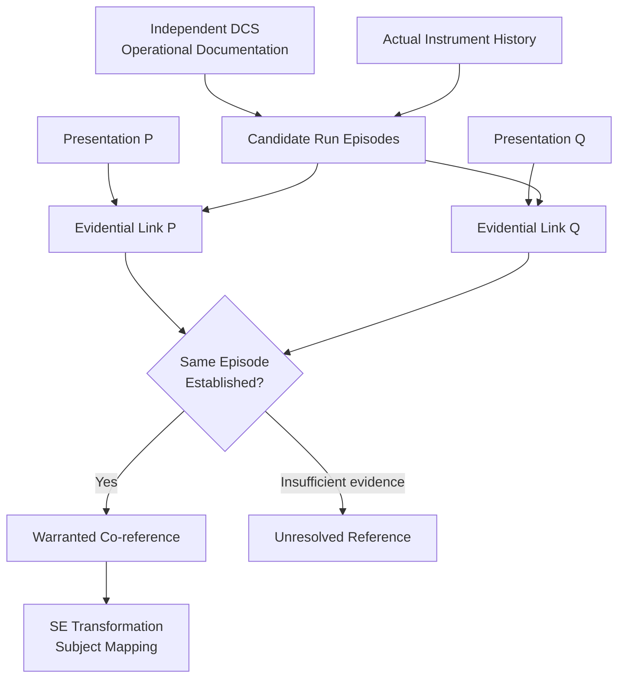
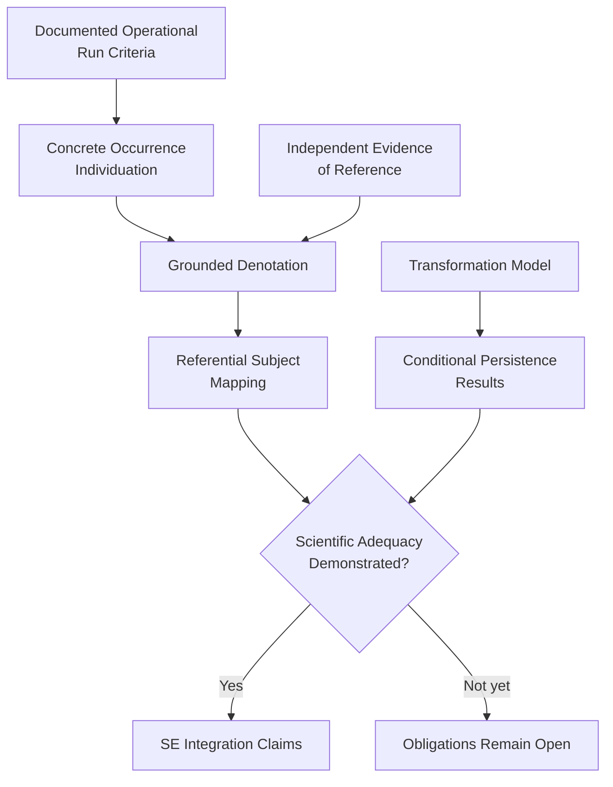

# Structural Explainability

# Scientific Theory Construction: Concrete Occurrence Individuation

**Scientific Development Report — v0.7 (Candidate)**
**Date:** October 16, 2026
**Status:** OPEN — Research investigation
**Research mode:** Read-only
**Predecessor:** Scientific Development Note v0.6

**Source-audit verdict:** PARTIAL
**Theory-construction verdict:** FUNDAMENTAL QUESTION REMAINS

---

## Research Question

Under an independently documented operational or scientific protocol,
what establishes one concrete experimental execution as an individuated
occurrence, and what warrants the conclusion that independently created
presentations identify that very same occurrence?

The investigation separates two questions:

1. What constitutes one particular experimental execution?
2. What evidence establishes that two independent presentations refer
   to that particular execution?

These questions are related but not equivalent.

The first may be resolved by a sufficiently precise operational
protocol.

The second additionally requires justified relationships between
records, observed activities, and the operationally individuated
occurrence.

A documented protocol may answer the first without answering the
second.

---

# A. Source-Audit Findings and Coverage

## A.1 Protocols Applied

The following canonical research protocols were retrieved and read:

1. [Source Audit](https://github.com/structural-explainability/se-protocols-research/blob/main/protocols/source-audit/SKILL.md)
2. [Theory Construction](https://github.com/structural-explainability/se-protocols-research/blob/main/protocols/theory-construction/SKILL.md)

The source-audit protocol requires recovery of existing commitments
without silently repairing them.

The theory-construction protocol requires one falsifiable candidate,
explicit separation of established and proposed claims, adversarial
tests, a verdict, and a deferred-obligation ledger.

The independent-review and theory-acceptance protocols were not
invoked as acceptance procedures.

## A.2 Authority Order

Authority is assigned by scientific responsibility rather than by
repository chronology.

| Source class                                | Authority for this investigation                    |
| ------------------------------------------- | --------------------------------------------------- |
| Instrument operating protocol               | Operational conditions constituting an execution    |
| Institution's measurement and data policies | Data creation, preservation, and evidential context |
| Instrument metadata specification           | Representations and recorded associations           |
| Independent scientific standards            | Comparison and possible counterexamples             |
| Current authoritative SE Lean sources       | Existing formal commitments                         |
| SE v0.6 development note                    | Research context and open conjectures               |
| SE research protocols                       | Research procedure, not scientific semantics        |

A source describing how an instrument works is not automatically
authoritative concerning metaphysical numerical identity.

Likewise, a data-management policy does not automatically define
which concrete occurrence a record denotes.

## A.3 Sources Inspected

### S1 — NIST DCS Users' Guide

National Institute of Standards and Technology,
NIST Center for Neutron Research.

Sections:

- Instrument Computers
- Runs and sequences
- Runs
- Sequences
- Defining runs and sequences
- Starting and stopping runs and sequences
- sequence.prm and sequence.log files

URL:

https://www.nist.gov/ncnr/dcs-users-guide

The page identifies its last update as February 22, 2022.

This is the principal operational source.

### S2 — NIST DCS Design Features and Principal Specifications

Section:

- Data Acquisition Hardware and Software

URL:

https://www.nist.gov/ncnr/dcs-design-features-and-principal-specifications

This independently corroborates the instrument's distinction between
runs, acquisition cycles, and accumulated measurement data.

It is supporting instrument documentation, not an independent
occurrence-identity theory.

### S3 — NIST NCNR Data Management Plan

Effective September 19, 2025.

Sections:

- Summary
- Scope
- Data Types and Classification
- Preservation
- Discoverability and Access

URL:

https://www.nist.gov/ncnr/for-users/data-and-tools/ncnr-data-management-plan

The document establishes institutional practices governing raw
measurement data, preservation, and access.

It does not establish a complete identity criterion for measurement
occurrences.

### S4 — NIST NCNR Instrument Data and Metadata Search API

URLs:

https://www.ncnr.nist.gov/ncnrdata/

https://www.ncnr.nist.gov/ncnrdata/metadata/search/api_docs.html

Relevant sections:

- Experiment
- Datafiles
- searchDatafiles
- Response schemas

The materials demonstrate that instrument data and experiment
metadata are made searchable.

The documented fields include instrument information, experiment
associations, filenames, start dates, content hashes, and other
measurement metadata.

These are potentially useful evidential links.

Their presence does not prove that arbitrary independent records
identify the same physical occurrence.

### S5 — NIST CHRNS FAIR Data

Sections:

- Searchable Metadata
- Permanent Identifiers for Experiments
- Capture of Process Metadata
- Traceable Data Processing

URL:

https://www.nist.gov/programs-projects/chrns-non-equilibrium-structure-materials-initiative/chrns-fair-data-ncnr

The documentation distinguishes experiment-level identifiers,
measurement relationships, datafiles, and processing histories.

Consequently, an experiment-level DOI cannot simply be assumed to
individuate a particular DCS measurement run.

### S6 — NIST OSAC Lexicon: Run

URL:

https://www.nist.gov/glossary-term/36611

The forensic-toxicology definition describes a run as a contemporaneous
unbroken sequence of analyzed samples.

Its cited source is ANSI/ASB 055, concerning breath-alcohol measuring
instrument calibration.

This is a useful comparison, not governing authority for neutron
scattering.

It provides direct evidence that the word "run" has domain-dependent
operational meanings.

### S7 — EPA Method 0010

Modified Method 5 Sampling Train.

Revision 1, August 2018.

Relevant sections:

- 6.5.2 — Leak checks during sampling runs
- 6.5.3 — Post-test leak checks
- 6.6 — Sampling-train operation

URL:

https://www.epa.gov/sites/default/files/2020-04/documents/method_0010_0.pdf

This method explicitly addresses interruptions, component changes,
resumption of sampling, and circumstances requiring a run to be voided.

It establishes that some scientific procedures recognize an
interruption without treating every restart of a component operation
as a new complete run.

However, it does not by itself provide a complete cross-record
identity criterion for the present question.

## A.4 Source Selection

**Selected occurrence kind: One DCS measurement run performed using
the NIST Disk Chopper Spectrometer's data-acquisition system.**

This case was selected because NIST directly documents:

- The activity constituting a run.
- The distinction between a run and a sequence.
- Initiation and termination operations.
- Internal acquisition cycles.
- Multiple cycles belonging to one run.
- Rejected cycles.
- Partial data retention or loss.
- Raw datafiles and command logs.

The EPA procedure has stronger explicit provisions for certain
interruptions.

The DCS documentation provides the clearer initial account of
one measurement occurrence and its constituent cycles.

Neither source supplies a general scientific theory of occurrence
identity.

The selection therefore favors **a precisely bounded, documented
measurement kind**, not a purported universal notion of experimental
execution.

## A.5 Recovered Source Contract

| Question                  | Source finding                                                                                                       | Status          |
| ------------------------- | -------------------------------------------------------------------------------------------------------------------- | --------------- |
| Initiation                | A run is started through the instrument control system; acquisition is initiated                                     | FOUND           |
| Completion                | Acquisition terminates at the run's configured end or through a stop operation                                       | FOUND           |
| Internal activities       | A run can comprise multiple cycles                                                                                   | FOUND           |
| Cycle continuation        | Acquisition resumes between cycles without clearing accumulated memory                                               | FOUND           |
| Rejected components       | A rejected cycle can be lost without remeasurement or changing the planned run endpoint                              | FOUND           |
| Early termination         | Three documented stop modes govern retention and completion of the current cycle                                     | FOUND           |
| Repetition                | The same run-buffer configuration can be invoked to perform a run; a formal repeated-run identity rule is not stated | PARTIAL         |
| Interruption              | Cycle boundaries are documented; an arbitrary pause-and-resume policy is not                                         | PARTIAL         |
| Aborted execution         | Stopping and retaining or losing current-cycle data is documented; a complete aborted-occurrence ontology is not     | PARTIAL         |
| Concurrent executions     | No general rule establishing simultaneous-run identity was recovered                                                 | UNDER-SPECIFIED |
| Independent records       | Logs, raw data, and metadata facilities are documented                                                               | PARTIAL         |
| Cross-record co-reference | No explicit sufficient evidential criterion was recovered                                                            | UNDER-SPECIFIED |
| Strict numerical identity | Not defined as an independent scientific criterion in the operational documentation                                  | UNDER-SPECIFIED |

## A.6 Particularly Important Source Findings

The DCS guide explicitly describes a run as a measurement performed
using the acquisition system.

Its elementary sequence comprises memory preparation, initiation of
acquisition, stopping acquisition, and writing data.

For multi-cycle runs, the guide specifies that acquisition resumes
without clearing memory between cycles.

The accumulated datafile can be overwritten at the end of successive
cycles.

Thus:

**One run can generate different recorded file states while remaining
one operational run.**

The guide also distinguishes a sequence from a run.

A sequence consists of commands and may include multiple run commands.

Consequently:

**One sequence is not necessarily one measurement occurrence.**

The guide's numbered run buffers are configurations used to perform
runs.

Nothing in the inspected instructions makes equality of buffer numbers
a sufficient condition for occurrence identity.

Finally, the data-management and metadata sources describe records
and links among them but do not establish a fully justified mapping
from arbitrary independent presentations to one run occurrence.

This is the central evidential gap.

## A.7 Source-Audit Verdict

**PARTIAL**

The operational sources provide substantial conditions for identifying
the boundaries and constituents of a particular DCS measurement run.

They do not establish a complete scientific contract for independent
cross-record co-reference.

### JUSTIFIED FROM CURRENT SOURCES

1. A DCS measurement run is an actual acquisition operation.
2. Runs and sequences are distinct operational constructs.
3. A run may contain multiple acquisition cycles.
4. Data accumulation may continue across cycle boundaries.
5. Cycle rejection does not automatically create a second run.
6. Stopping a run has explicitly documented operational forms.
7. Recording and data-processing activities are distinguishable
   from the measurement activities they represent.
8. Raw data, sequence logs, experiment metadata, and derived records
   may represent different aspects of experimental work.

### WOULD REQUIRE NEW THEORY OR INTERFACE

1. A complete operational-episode identity definition.
2. A justified interpretation of arbitrary interruptions and restarts.
3. An evidential relation connecting independent records to the
   execution episode they purport to describe.
4. Conditions ensuring that such links do not conflate distinct runs.
5. An explicit account of competing or contradictory evidence.
6. Validation of these conditions against actual independently
   generated records.
7. A defensible mapping from measurement occurrences into SE
   transformation-state representations.

The audit does not establish that these missing conditions are false.

It establishes that they have not been recovered from the inspected
authoritative sources.

---

# B. Selected Occurrence Kind and Scientific Grounding

## B.1 Intended Referent

The intended referent is:

**One actual execution of a DCS measurement run using the instrument's
data-acquisition system.**

Its kind is operationally narrower than:

- A scientific experiment.
- An allocated beamtime session.
- A measurement procedure.
- A command sequence.
- A run-buffer configuration.
- A particular acquisition cycle.
- A saved datafile.
- A data-processing workflow.
- A published scientific result.

The same experiment may contain many runs.

One run may contain multiple cycles.

A datafile represents measurement data obtained through acquisition.

The file is not the measurement occurrence itself.

## B.2 Existence

The occurrence exists, in the intended operational sense, when
measurement acquisition actually begins.

The existence of a configuration is insufficient.

The existence of a requested command is also insufficient if the
request was never executed.

This distinction requires care:

The NIST documentation describes starting a run and initiating
acquisition. It does not independently prove that every issued
start command succeeds.

Therefore the candidate must distinguish:

- Requested start.
- Acknowledged start.
- Actual acquisition initiation.

The third is the relevant physical occurrence condition.

This is a proposed scientific interpretation of documented instrument
behavior, not an additional rule expressly declared by NIST.

An execution can have occurred even when subsequent quality checks
invalidate its data.

An unsuccessful measurement is not necessarily a nonexistent
measurement.

## B.3 Unity

For a multi-cycle DCS run, the documentation provides an operational
unity condition:

The cycles belong to one continuing run under the instrument's
run-control operation.

The guide's continuation of acquisition without clearing accumulated
data supports treating successive cycles as components of that
particular run.

The unity is not established by:

- Equal experimental conditions.
- Equal outputs.
- Equal timestamps.
- Equal operator names.
- Equal files.
- Equal configured buffer numbers.

It depends on the actual organization of acquisition activity.

This is a promising kind-specific operational basis for unity.

It does not establish a universal metaphysical criterion.

## B.4 Boundary of the Operational Claim

The result applies initially to documented DCS acquisition runs.

It does not automatically apply to:

- Biological experiments.
- Chemical reactions.
- Clinical trials.
- Repeated software tests.
- Distributed computational experiments.
- Institutional processes.
- Arbitrary events.

In particular, the forensic-toxicology meaning of "run" cannot
simply be substituted for the DCS meaning.

The operational referent kind must be declared.

---

# C. Candidate Individuation and Identity Conditions

## C.1 Candidate C-DCS-1

**Name:** Acquisition-Episode Individuation

**Status:** PROPOSED

One DCS measurement run is a concrete acquisition episode initiated
by an actual run-control execution and composed of the acquisition
cycles performed under that episode until its operational termination.

Cycle boundaries, disk writes, and permitted within-run acquisition
resumption do not independently divide the episode into separate
runs.

An operational termination closes the episode.

A subsequently initiated execution is a distinct episode under the
candidate's proposed boundary convention.

The final sentence is an explicit additional assumption.

The inspected guide documents stop operations and new start
operations, but does not provide a complete general theory of
post-termination resumption.

## C.2 Interpretation Conditions

For C-DCS-1 to apply, the following must hold.

**C1 — Kind determination**

The referent under investigation is a DCS acquisition run rather than
a beamtime experiment, sequence, file, or cycle.

**C2 — Actual initiation**

There is adequate evidence that the acquisition system actually
initiated a particular run.

**C3 — Control-episode continuity**

Successive acquisition cycles are shown to be performed under that
run's continuing control episode.

**C4 — Terminal boundary**

The run ends through its normal completion or an applicable
documented stop operation.

**C5 — Distinct initiation**

A later actual initiation after a completed terminal boundary is
treated as a new episode.

This is the candidate's proposed post-stop convention.

**C6 — Evidence adequacy**

Any claim that a record identifies the episode requires a justified
mapping from that record to the actual acquisition history.

**C7 — Exclusion of conflation**

Where competing run episodes are possible, the record evidence must
distinguish the intended one.

C1-C4 have varying degrees of operational documentary support.

C5-C7 are additional substantive conditions requiring further
justification and validation.

## C.3 Individuation Is Not Evidence

Let:

- H be an actual instrument-operation history.
- R(H) be the candidate set of acquisition episodes in H.
- p and q be presentations.
- r be a particular episode in R(H).

The proposed operational construction establishes the candidate
referents:

\[
R(H)=\{r_1,r_2,\ldots\}.
\]

This alone does not establish:

\[
\delta(p)=r
\]

or:

\[
\delta(q)=r.
\]

In particular, the fact that both records contain the same displayed
run number does not establish these equations.

The additional relation needed is a justified evidential association
between each presentation and the actual episode.

## C.4 Candidate Evidential Link

Define, provisionally:

\[
\operatorname{Supports}(e,p,r)
\]

to mean that evidence e supports the interpretation that presentation
p identifies episode r.

This is not yet an adequate scientific definition.

It names an evidential obligation.

A satisfactory interpretation must establish:

1. The actual operational episode.
2. The source and production history of the presentation.
3. How the presentation became associated with that episode.
4. Whether the association could equally apply to another episode.
5. Whether the evidence is authentic, complete, and sufficiently
   reliable for the proposed conclusion.

Two records may be created independently but derive their asserted
run identity from one inaccurate copied value.

Thus independent record creation does not guarantee independent
evidential support.

## C.5 Candidate Co-reference Condition

A warranted co-reference judgment requires evidence establishing
that each successful presentation identifies the same independently
individuated episode.

Provisionally:

\[
\operatorname{WarrantedCoRef}(p,q;e)
\]

requires that the admissible evidence establishes some r such that:

\[
\delta(p)=r
\quad\text{and}\quad
\delta(q)=r.
\]

The substantive work is in establishing those denotations.

The equality in this expression is classical numerical equality.

It is not the evidence from which the denotations are discovered.

The current sources provide possible evidential materials but do not
supply generally sufficient conditions for this judgment.

**C-DCS-1 therefore does not yet establish an independently
validated cross-record identity criterion.**

## C.6 Temporal Semantics

The following temporal notions must remain separate.

| Time notion          | Meaning                                                        |
| -------------------- | -------------------------------------------------------------- |
| Acquisition time     | Intervals during which measurement acquisition occurs          |
| Run lifecycle time   | Operational episode from initiation through termination        |
| Record creation time | When a file, log entry, or independent description is produced |
| Record revision time | When a representation is corrected or changed                  |
| Evaluation time      | When an investigator interprets a presentation                 |
| Transformation time  | When a transformation occurs in the relevant model             |

A multi-cycle run may include gaps between acquisition cycles.

Therefore its active-acquisition time need not be one uninterrupted
interval, even if its operational lifecycle has a beginning and end.

A later revision of a scientific record does not establish later
acquisition activity.

## C.7 Conceptual Dependency Diagram

The upper part concerns operational individuation.

The middle concerns evidential interpretation.

The lower part concerns downstream SE transformation semantics.

Importantly, operational documentation does not directly imply
warranted co-reference.

---

# D. Derivations and Proof Obligations

## D.1 Result D1 — Multiple Cycles Do Not Necessarily Mean Multiple Runs

**Premises established by NIST**

- A run may contain multiple cycles.
- Acquisition resumes between cycles.
- Accumulated memory is retained.

**Conclusion**

The existence of multiple acquisition cycles does not entail the
existence of multiple run occurrences.

**Status:** Supported operational conclusion.

This is a substantive constraint on the chosen referent kind.

It is not merely an arbitrary definition introduced by SE.

## D.2 Result D2 — File-State Equality Is Not Necessary for Run Identity

**Premises established by NIST**

- Accumulated measurement data are written at cycle boundaries.
- The datafile can be overwritten with newly accumulated data.
- The operation remains the same multi-cycle run.

**Conclusion**

Two different recorded file states may correspond to one run.

Therefore equality of file contents cannot be required universally
for presentations of the same run.

**Status:** Supported operational counterexample to a candidate
metadata-equality rule.

The relevant claim concerns changing representations of accumulated
measurement data, not necessarily two concurrently preserved files.

## D.3 Result D3 — Run Configuration Does Not Individuate Execution

The guide distinguishes a run-buffer configuration from performing
a run using that configuration.

A configured buffer may be selected when initiating an execution.

Therefore the configured parameters alone are not an adequate
identity criterion for the execution.

**Status:** Supported distinction.

A stronger claim concerning every possible reuse behavior requires
verification of the instrument's operational controls.

## D.4 Result D4 — Whole and Component Must Be Distinguished

In a documented multi-cycle run:

\[
\operatorname{PartOf}(c,r)
\]

may hold for a cycle c and its containing run r.

This does not imply:

\[
c=r.
\]

The guide supports the operational difference between component
cycles and a multi-cycle run.

A special caution concerns one-cycle runs.

The documentation alone does not settle every metaphysical question
about whether the one cycle and the corresponding complete run are
coincident, identical, or distinct under a broader event ontology.

No universal proper-parthood theorem should be inferred.

## D.5 Conditional Formal Consequence

Suppose an adequate model establishes that each relevant operational
episode has exactly one initiating acquisition event.

Suppose further that two purported episodes are demonstrated to have
that same initiating event and the same continuing terminal-bounded
control history.

Within C-DCS-1, they denote one candidate episode.

However:

- Uniqueness of initiating events is an additional requirement.
- The historical relationship must be established from evidence.
- Agreement in descriptions of initiation is insufficient.
- The construction does not automatically establish metaphysical
  identity independent of the operational convention.

This is a conditional formal consequence of C-DCS-1.

It is not yet an independently verified scientific theorem.

## D.6 Evidential Sufficiency

A possible proof obligation can be expressed through evidence-compatible
candidate referents.

Let:

\[
\operatorname{Compatible}(p,e)
\subseteq R(H)
\]

denote the run episodes compatible with presentation p and evidence e.

If an adequately validated interpretation establishes:

\[
\operatorname{Compatible}(p,e)=\{r\}
\]

and:

\[
\operatorname{Compatible}(q,e)=\{r\},
\]

then both presentations have a uniquely supported referent under
that validated interpretation.

But **singleton compatibility is not sufficient by itself**.

The underlying evidential interpretation must be sound.

A mistaken instrument association could produce a false singleton.

Merely stipulating a set of compatible runs would reproduce the
original scientific gap.

## D.7 Unfulfilled Proof Obligations

| ID   | Obligation                                                                                  | Status |
| ---- | ------------------------------------------------------------------------------------------- | ------ |
| PO-1 | Show that actual run initiation is reliably distinguishable from a requested start          | OPEN   |
| PO-2 | Establish the candidate's terminal-boundary rule for all claimed DCS cases                  | OPEN   |
| PO-3 | Establish the behavior of explicit stop followed by restart                                 | OPEN   |
| PO-4 | Establish sufficient evidence for mapping one independent record to one operational episode | OPEN   |
| PO-5 | Prove the mapping excludes competing episodes under stated conditions                       | OPEN   |
| PO-6 | Test the criteria against actual independently produced records                             | OPEN   |
| PO-7 | Establish sound referential subject mappings for SE transformations                         | OPEN   |

The source-supported operational consequences D1-D4 should not be
presented as resolving PO-1 through PO-7.

---

# E. Adversarial Cases and Candidate Failures

These are analytical construction cases based on the documented
operational distinctions.

They are not independent empirical validation.

## E.1 Required Cases

| Case                                                  | Expected judgment                                                   | C-DCS-1 prediction                                                         | Assessment                                                       |
| ----------------------------------------------------- | ------------------------------------------------------------------- | -------------------------------------------------------------------------- | ---------------------------------------------------------------- |
| 1. Two executions with identical recorded attributes  | Distinct if two actual run episodes are established                 | Distinct operational episodes                                              | Survives conditionally; attributes alone insufficient            |
| 2. One execution described in two independent records | Same only if both descriptions identify that episode                | Same when both evidential links are established                            | Unresolved: sufficient links not validated                       |
| 3. Interrupted and resumed execution                  | Depends on interruption and restart behavior                        | Within-run cycle continuation is same; post-stop restart proposed distinct | Narrows candidate; arbitrary interruption unresolved             |
| 4. Two repetitions of the same procedure              | Distinct if two executions occurred                                 | Distinct episodes                                                          | Supported as operational distinction                             |
| 5. Concurrent or overlapping executions               | Distinct when independent run episodes are established              | Distinct if separate actual initiations and control histories              | General concurrency behavior unresolved                          |
| 6. A sub-operation and complete execution             | Generally component and containing run, not automatically identical | Cycle belongs to run                                                       | Supported for multi-cycle runs; one-cycle coincidence unresolved |
| 7. Execution with corrected record                    | Correction does not create another run                              | Original episode unchanged                                                 | Survives; evidential link may change                             |
| 8. Same identifier, conflicting underlying evidence   | Cannot infer identity from identifier                               | Remains unresolved until actual episodes are established                   | Survives identifier-collision test                               |
| 9. Different identifiers assigned to one occurrence   | Same if both demonstrably concern one episode                       | Same under established links                                               | Possible; sufficient evidence remains OPEN                       |
| 10. Failed or aborted execution                       | Occurred if acquisition actually began; success is separate         | Run may terminate without valid retained data                              | Survives conditionally; pre-acquisition abort excluded           |

## E.2 Stronger Cases

### Case 11 — One Run, Changing Datafile Contents

A multi-cycle run records accumulated data after a cycle.

A later cycle contributes additional measurements.

The accumulated file contents change.

The operational run remains one run.

This is directly motivated by the documented DCS behavior.

**Result:** Defeats content equality as a necessary run-identity
criterion.

### Case 12 — Two Runs, Same Configuration

A run configuration is selected for an execution.

The same configuration is selected for another execution.

Both use the same instrument parameters.

**Candidate judgment:** Distinct operational episodes when two
separate executions are established.

**Result:** Defeats parameter equality as a sufficient criterion.

The constructed repetition is not presented as an independently
observed NIST data example.

### Case 13 — One Experiment, Several Measurement Runs

An experiment-level record identifies a broader research activity.

The acquisition system executes several runs under that activity.

An experiment identifier can consequently be associated with
multiple measurement occurrences.

**Result:** Experiment-level identification does not establish
run-level identity.

This follows from distinguishing NIST's experiment metadata from its
instrument-run documentation.

### Case 14 — One Run, Rejected Cycle

A run performs several cycles.

One cycle is rejected according to the documented statistics checks.

The guide specifies that the cycle is lost rather than remeasured.

The run still reaches its scheduled endpoint.

**Result:** Loss of a component's accepted data does not establish
loss of the containing run's identity.

### Case 15 — Conflicting Independent Observations

An instrument-associated record indicates one acquisition episode.

An independently written laboratory note claims another.

The evidence sources conflict.

A model could select one record arbitrarily and still produce a
mathematically consistent identity relation.

**Result:** Mathematical consistency cannot resolve the conflict.

A justified source-authority and evidence-assessment procedure is
required.

### Case 16 — An Apparent Run with No Actual Acquisition

A sequence contains a command requesting a run.

A hypothetical equipment failure prevents acquisition from starting.

A sequence record nevertheless retains the request.

**Candidate judgment:** No actual acquisition-run occurrence is
established, although an attempted execution may have occurred.

**Result:** A command record cannot alone establish successful
physical execution.

The hypothetical fault scenario still requires empirical
validation.

## E.3 Overall Adversarial Assessment

The candidate survives the strongest documented distinctions
concerning:

- Run versus cycle.
- Run versus sequence.
- Configuration versus execution.
- Run versus datafile.
- Successful versus unsuccessful measurement activity.

It remains vulnerable concerning:

- Arbitrary interruptions.
- Stop-and-restart behavior.
- Concurrent execution.
- Ambiguous or conflicting evidence.
- Independent record-to-occurrence identification.

These are scientifically substantive limitations.

They cannot be repaired simply by postulating a unique identifier or
adding an equivalence relation.

---

# F. Comparison With Prior SE Semantics

## F.1 Scope of Repository Inspection

The investigation inspected current public entry surfaces and selected
authoritative Lean modules in:

- se-theory-neutral-substrate
- se-theory-transformation
- se-theory-persistence
- se-theory-identity-regimes
- se-theory-structural-explainability

These were read-only source inspections.

They were not complete audits of every theorem, import, or proof
dependency.

The original Unified Referential Semantics v0.2 document was not
supplied as an independent source in this investigation.

Its comparison is therefore mediated by the supplied v0.6 note.

## F.2 Neutral Substrate

Inspected source:

https://github.com/structural-explainability/se-theory-neutral-substrate/blob/main/SE/Referent/Carriers.lean

The current `ReferentCarriers` structure declares abstract carriers
for entities, occurrences, and institutional artifacts.

The source intentionally does not establish identity, persistence,
or concrete computational representations for those carriers.

**Remains valid**

The formal separation between carrier declarations and their
substantive interpretation.

The prohibition against silently promoting contested interpretation
to unconditional substrate commitment.

**Requires narrowing**

Claims that an occurrence carrier, merely by being declared, provides
a scientifically justified occurrence-individuation criterion.

**May require revision**

Any downstream assumption that occurrence identity is already
scientifically determined solely by the carrier type.

**Cannot yet be determined**

Whether existing interpretation and admissibility mechanisms are
sufficient to receive a completed DCS occurrence model without
further formal changes.

## F.3 Unified Referential Semantics v0.2

The v0.6 review distinguishes:

- Denotation.
- Co-reference.
- Existence or occurrence.
- Strict continuation.
- Other relationships.

The DCS case supports retaining these distinctions.

In particular:

- A run is not its representation.
- A run's constituent cycles need not be separate runs.
- Later records need not extend the occurrence.
- Equal representations do not establish one execution.
- A valid co-reference judgment requires grounded denotations.

**Required narrowing**

No universal relation between record agreement and occurrence
identity is justified.

The theory must explicitly establish the intended referential
subject before claiming a transformation preserves that subject.

## F.4 Persistence Theory

Inspected sources:

https://github.com/structural-explainability/se-theory-persistence/blob/main/SE/Persistence.lean

https://github.com/structural-explainability/se-theory-persistence/blob/main/SE/Persistence/Core.lean

The public source describes classifications of transformations
and relations induced over a carrier, including directed survival
and identity-related relations.

These constructions may provide valid conditional mathematical
results.

They do not establish that the carrier elements correspond to
scientifically individuated DCS measurement occurrences.

**Remains valid**

Conditional results about declared transformations, classifications,
and relations.

**Requires narrowing**

Interpretations of these results as demonstrated strict identity
of concrete experimental occurrences.

**May require revision**

Any definition or theorem interpretation equating a generated
identity relation with substantive occurrence identity without an
independent adequacy condition.

**Cannot yet be determined**

Whether source-level changes are required until the full
persistence dependency chain is audited.

## F.5 Transformation Theory

Inspected sources:

https://github.com/structural-explainability/se-theory-transformation/blob/main/SE/Transformation.lean

https://github.com/structural-explainability/se-theory-transformation/blob/main/SE/Transformation/Effect.lean

The repository owns structural transformation vocabulary and effect
semantics.

It expressly does not decide what persists through a transformation.

The DCS investigation provides an important distinction:

A transformation of a run's representation need not be a
transformation of the run occurrence.

For example:

- Revising a file changes a representation.
- Accumulating additional data during a run changes recorded state.
- Rejecting one cycle changes its contribution to accepted data.
- Terminating a run changes its operational status.

These have different referential subjects and temporal implications.

**Remains valid**

The distinction between transformation effect semantics and
downstream persistence judgments.

**Requires narrowing**

Any use of a transformation theorem as an independent proof of
referential identity.

**May require revision**

The representation-to-subject connection, if existing interfaces
silently identify operational states, data states, and concrete
occurrences.

## F.6 Identity Regimes

Inspected source:

https://github.com/structural-explainability/se-theory-identity-regimes/blob/main/SE/IdentityRegimes/Transform/Core.lean

This inspection yielded a specific existing formalization limitation.

The current classification matrix includes an occurrence row and
assigns classification values to transformations.

Its own source documentation acknowledges that some paper-level
inapplicability cases are represented using the value IGN.

The comment expressly distinguishes inapplicability from an
applicable transformation classified as ignored.

The implementation therefore does not preserve the paper's separate
applicability component in that matrix.

This is an independently observable current-source limitation.

It should not be silently erased or treated as scientifically
validated occurrence semantics.

In particular, the occurrence row's assignment of a preserving value
to a state-evolution transformation does not demonstrate that the
earlier and later states represent one concrete DCS run.

That requires a grounded subject mapping.

**Remains valid**

Mathematical conclusions following from the matrix as actually
defined.

**Requires narrowing**

Any claim that the matrix is an independently justified, universal
scientific classification of occurrence persistence.

**May require revision**

The handling of inapplicability and the interpretation of occurrence
transformations.

**Cannot yet be determined**

The exact necessary change, if any, without a complete audit against
the applicable paper and the intended empirical cases.

No revision is recommended during this investigation.

## F.7 Structural Explainability Integration

Inspected source:

https://github.com/structural-explainability/se-theory-structural-explainability/blob/main/StructuralExplainability.lean

The integration library composes neutral substrate and identity-regime
surfaces into cross-cutting structural predicates and theorems.

Its public documentation excludes domain mapping and operational
validation from the library's direct responsibilities.

This architectural boundary is not itself a scientific defect.

However, scientific acceptance of an integrated theory requires
that foundational empirical interpretation obligations be discharged
somewhere with explicit responsibility and an adequate result.

The existence of an integration theorem does not establish that
its formal structures adequately represent one concrete occurrence.

**Remains valid**

Conditional composition results over the declared structures.

**Requires narrowing**

Claims that successful integration alone establishes scientifically
grounded occurrence identity.

**Cannot yet be determined**

Whether new formal interfaces are necessary until a candidate
operational interpretation has independently passed scientific review.

## F.8 Cross-Layer Dependency

The dependency does not assert that evidence creates the occurrence.

Rather, operational history establishes the candidate occurrence;
evidence establishes justified reference to it.

The transformation model can then be interpreted against the
established referential subject.

---

# G. Scientific Adequacy and Potential Theoretical Contribution

## G.1 Mathematical Correctness

C-DCS-1 can be represented using an operational history and
a partition into candidate acquisition episodes.

Its mathematical properties can be investigated.

However, no new Lean definitions or proofs were produced.

The candidate's consistency and its full formal consequences remain
unverified.

**Assessment: CONDITIONAL / NOT FORMALLY VERIFIED**

## G.2 Scientific Adequacy

The NIST sources independently support a meaningful operational
distinction between one measurement run and its component cycles.

They also justify separating acquisition operations from datafiles
and larger experimental activities.

The evidence is insufficient to establish all necessary conditions
for a complete cross-record identity judgment.

The source documentation does not resolve every interruption,
concurrency, or evidence-conflict case.

The candidate has not been tested against independently selected,
actual measurement records.

**Assessment: PARTIAL / OPEN**

## G.3 Original Theoretical Contribution

The source audit yields useful restrictions on possible SE theories.

For example:

1. A representation can change while referring to one operational
   execution.
2. Several constituent acquisition cycles can belong to one run.
3. A broader experimental identifier can cover multiple measurement
   activities.
4. An execution can occur without producing a valid accepted result.

These are meaningful constraints derived from documented scientific
operations.

However, the operational distinctions themselves originate in NIST
documentation.

They are not original discoveries of SE.

A possible SE contribution would be a demonstrated theorem connecting
independently grounded occurrence identity with specific
transformation guarantees, together with validated interpretation
conditions.

No such completed theorem has been established in this investigation.

**Assessment: CANDIDATE / NOT ESTABLISHED**

## G.4 What Would Constitute a Genuine Contribution?

A substantial result could show that, for a scientifically justified
class of occurrence representations and transformations:

- Specified changes to records preserve grounded denotation.
- Other changes demonstrably break or redirect that denotation.
- Evidence conflicts can be exposed rather than concealed by
  equality conventions.
- A transformation system can distinguish representational
  persistence from persistence of the represented occurrence.

Such a result would require more than naming an identity relation.

It would require scientifically justified premises, actual
interpretation conditions, and nontrivial consequences.

---

# H. Deferred-Obligation Ledger

| ID   | Obligation                                                      | Why deferred                                                        |
| ---- | --------------------------------------------------------------- | ------------------------------------------------------------------- |
| O-01 | Validate actual run-start and run-stop event semantics          | Instrument operational history not experimentally inspected         |
| O-02 | Determine post-stop restart and recovery identity               | Source contract incomplete                                          |
| O-03 | Establish sufficient cross-record evidence                      | Central unresolved scientific issue                                 |
| O-04 | Test actual independently generated DCS records                 | No case-specific empirical validation performed                     |
| O-05 | Determine overlapping or concurrent run semantics               | Instrument concurrency contract not established                     |
| O-06 | Determine one-cycle run versus cycle identity                   | Requires more detailed occurrence/parthood account                  |
| O-07 | Establish generality across other experimental protocols        | One instrument kind is insufficient                                 |
| O-08 | Define evidence authenticity and conflict-resolution conditions | Requires scientific and epistemic justification                     |
| O-09 | Review Neutral Substrate interpretation adequacy                | Depends on established referential semantics                        |
| O-10 | Review Persistence carrier and continuation interpretation      | Cannot precede completed subject individuation                      |
| O-11 | Reconcile applicability and IGN in Identity Regimes             | Distinct formal-semantics issue identified during source inspection |
| O-12 | Establish transformation-state mappings for actual occurrences  | No grounded mapping has passed adequacy review                      |
| O-13 | Derive an original substantive SE theorem                       | The scientific premises remain incomplete                           |
| O-14 | Run independent scientific review                               | Theory construction has not resolved the central question           |
| O-15 | Run theory acceptance                                           | Premature without sufficient scientific adequacy                    |

These obligations are not delegated to unspecified downstream work.

Each remains an explicit requirement before the corresponding
scientific claim can be accepted.

---

# I. Theory-Construction Verdict and Strongest Supported Definition

## I.1 Strongest Source-Supported Definition

**DCS Measurement Run — Operational Definition**

A DCS measurement run is a concrete measurement acquisition performed
through the instrument's data-acquisition system. It may comprise
multiple acquisition cycles within one run-control operation, with
accumulated data maintained across those cycles. The run terminates
upon operational completion or an applicable stop operation. Its
constituent cycles, configuration, command sequence, recorded
datafiles, and later descriptions must not automatically be identified
with the run itself.

This definition is intentionally limited to the documented DCS
operational kind.

It does not claim that the documented procedures constitute a
universal philosophical account of events.

## I.2 Strongest Candidate Individuation Principle

**Acquisition-Episode Individuation — C-DCS-1**

One actual DCS run-control episode, beginning with successful
measurement acquisition and continuing through its constituent cycles
until its operational termination, constitutes one candidate
measurement-run occurrence.

Distinct terminated-and-reinitiated control episodes constitute
distinct run occurrences under the proposed operational convention.

This second sentence remains a theory-construction commitment
requiring independent verification for the intended execution cases.

It is not an established universal fact.

## I.3 Strongest Supported Co-reference Principle

Two presentations can be warranted as identifying the same DCS
measurement-run occurrence only when adequate evidence connects each
presentation to that one independently individuated operational
episode and excludes relevant competing episodes.

This is currently a necessary evidential requirement, not a complete
sufficient scientific decision procedure.

The sources examined do not establish how that requirement can always
be discharged.

## I.4 Explicit Limitations

The investigation has not established:

- Universal occurrence identity.
- General strict persistence across arbitrary interruptions.
- A complete DCS restart identity rule.
- Sufficient independent-record co-reference conditions.
- Adequate treatment of all evidence conflicts.
- Empirical validation against actual independent records.
- A sound and complete SE transformation-subject interpretation.
- A new original SE theorem establishing substantive identity claims.

## I.5 Required Verdict

**FUNDAMENTAL QUESTION REMAINS**

The investigation establishes a defensible, narrow operational basis
for one measurement occurrence.

It does not establish a complete scientific criterion by which
independently produced presentations can be shown to identify
that very same occurrence.

Accordingly, a theory-construction ACCEPT or ACCEPT WITH NARROWING
would be premature for the full research question.

The negative verdict concerns the presently available evidence and
candidate, not the possibility of a scientifically adequate future
solution.

No theory-acceptance determination has been made.

No repository changes are authorized by this report.

---

# J. Exactly One Recommended Next Scientific Question

**What independently validated evidence, beyond shared identifiers,
timestamps, configuration values, and file contents, is sufficient to
establish that two separately produced DCS measurement records
identify one and the same actual acquisition episode rather than
two distinct episodes?**

This question is deliberately narrower than the original problem.

The operational documentation has already provided a useful candidate
for the occurrence kind.

The unresolved requirement is now to establish an adequate evidential
bridge between presentations and that concrete occurrence.

The next investigation should seek actual independent DCS records and
their operational histories, determine what their provenance can
establish, and attempt to falsify proposed co-reference judgments.

The resulting evidence may require revising C-DCS-1.

No new formal identity mechanism should be introduced merely to
circumvent that empirical requirement.

---

## Final Scientific Position

The most important result of this investigation is a distinction
between two achievements:

**Operational individuation:**

A documented scientific procedure can provide substantive conditions
for what constitutes one experimental execution.

**Evidential identification:**

Even after an execution is individuated, independent records do not
automatically establish which execution they describe.

Structural Explainability needs both.

The first has partial independent support in this case.

The second remains scientifically unresolved.

Consequently, successful mathematical formalization of C-DCS-1 would
not yet establish that the theory solves concrete occurrence identity
across presentations.

The next scientific advance must close this specific evidential gap,
or establish principled limits on when it can be closed.

---

**End of Scientific Development Report v0.7 — Candidate**

**Status: OPEN**

**Repository changes: NONE**
