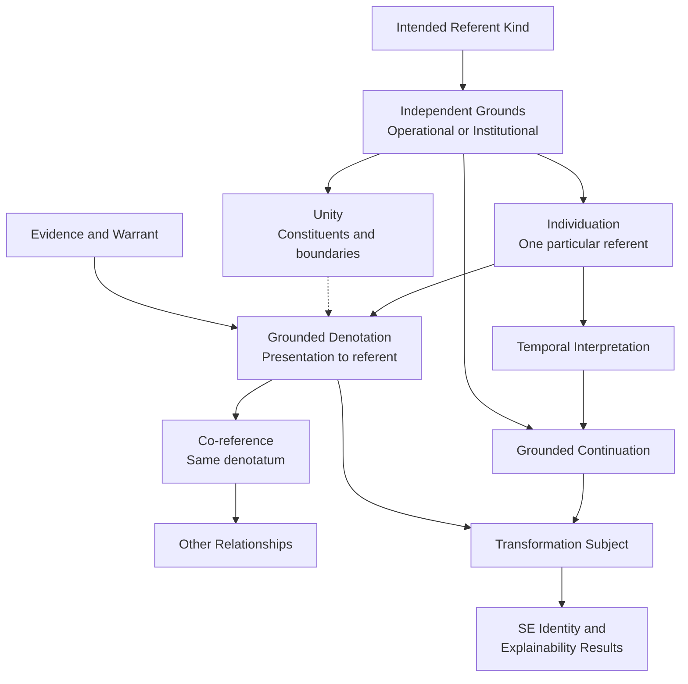

# Structural Explainability

# Scientific Development Note v0.8 — Current State of the Research

**Date:** October 16, 2026
**Status:** OPEN — Scientific theory construction
**Scope:** Unity, individuation, denotation, co-reference, identity, persistence, and transformation
**Research mode:** Read-only

**Inputs:** Scientific Development Note v0.6; NIST DCS occurrence investigation (ChatGPT); GLP study investigation (Claude); current SE research protocols and selected theory repositories.

---

## 1. Executive Summary

Structural Explainability (SE) is investigating how structural transformations affect the identity, persistence, and explainability of referents.

The research has reached a substantive scientific boundary.

Our mathematical frameworks can describe identity relations, transformation effects, persistence classifications, and admissibility conditions. However, those constructions do not independently establish what constitutes one real-world referent or why two presentations identify that very same referent.

**The central unresolved problem is scientific grounding of individuation and reference.**

The recent investigations have produced three important advances.

First, we have clarified distinctions that earlier unified semantics risked collapsing:

- Individuation and unity.
- Denotation and evidential identification.
- Co-reference and temporal persistence.
- Numerical identity and other relationships.
- Transformations of a referent and transformations of its representations.

Second, two independently documented scientific settings reveal different grounds for identifying an individual occurrence:

- A NIST Disk Chopper Spectrometer (DCS) measurement run has operationally specified acquisition behavior.
- A Good Laboratory Practice (GLP) study has institutionally prescribed initiation, governance, and completion conditions.

Third, both cases expose a common limitation:

**Establishing an operational or institutional unit does not automatically establish that two independently created presentations identify that particular unit.**

Neither investigation has resolved the full identity-across-presentations problem.

This is a research finding, not a failure of formalization.

It tells us more precisely what remains to be discovered.

---

## 2. The Scientific Question

The overarching question remains:

> For each intended referent kind, what independently justified conditions establish that a presentation identifies one whole, and that presentations or stages across change identify that very same whole?

This contains several logically distinct questions.

1. **Referent kind:** What kind of thing is being discussed?
2. **Individuation:** What distinguishes one instance from another?
3. **Unity:** When the referent is composite, what constitutes its relevant whole?
4. **Denotation:** What particular referent does a presentation identify?
5. **Co-reference:** Do two presentations identify the same referent?
6. **Temporal existence:** When does that referent exist or occur?
7. **Continuation:** Under what conditions is an individual maintained across relevant change?
8. **Transformation:** What actually changes, and which referent is affected?

These questions cannot be answered merely by selecting an equivalence relation or creating a mathematical identity predicate.

The appropriate referent and its identity conditions must be scientifically justified.

---

## 3. Established Conceptual Distinctions

The following distinctions are retained as defensible analytical requirements for the developing theory. Their retention does not imply that all necessary substantive criteria have been discovered.

### 3.1 Numerical identity

Strict identity uses classical mathematical equality within the present formal framework.

It is reflexive, symmetric, and transitive.

Classical equality also excludes two genuinely distinct successors both being numerically identical to one predecessor.

These are logical consequences of the chosen semantics.

They do not establish which referent exists, what constitutes it, or whether a successor preserves its identity.

Classical identity remains an explicit theoretical commitment rather than a universal empirical discovery.

### 3.2 Individuation

Individuation concerns what establishes one particular referent and distinguishes it from other possible referents.

The conditions may depend on the intended kind.

An acquisition run, a regulated study, an organism, a corporation, and a mathematical value need not share one substantive individuation criterion.

We have not established a universal criterion.

### 3.3 Unity

Unity concerns the constituents and boundaries of a whole.

Whole-unity must not be treated as a prerequisite for every successful singular reference.

It becomes necessary when the scientific claim concerns a composite whole whose membership or boundary conditions require justification.

An equivalence-based account of unity may be appropriate for some kinds. It is not automatically adequate for overlapping wholes.

### 3.4 Denotation and co-reference

Denotation connects a presentation to its intended referent.

Co-reference concerns whether two successful presentations denote the same referent.

In an interpretation \(I\), a candidate semantics may use a partial denotation function:

\[
\delta_I:C_I\times P_I\rightharpoonup U_I.
\]

For successful denotations:

\[
\operatorname{CoRef}\_I((c,p),(d,q))
\iff
\delta_I(c,p)=\delta_I(d,q).
\]

This describes co-reference once the denotations are established.

It does not establish the denotations.

That remains a substantive scientific and evidential obligation.

### 3.5 Co-reference and persistence

Two presentations created at different times may refer to one completed occurrence.

Their co-reference does not imply that the occurrence remains active or continues to exist throughout those times.

Persistence also cannot generally be explained merely by asserting that the same individual exists at two endpoints.

The relevant kind-specific continuation conditions require independent justification.

### 3.6 Identity and relatedness

Numerical identity remains distinct from:

- Parthood and constitution.
- Temporal overlap.
- Causal dependence.
- Derivation and succession.
- Repetition and similarity.
- Counterpart relationships.

None of these relations universally entails strict identity.

### 3.7 Epistemic uncertainty and identity

Uncertainty about evidence, kind selection, reference resolution, or model adequacy must not be confused with numerical identity itself.

Under classical semantics, equality is determinate within each completed interpretation.

That formal commitment does not settle all philosophical questions about metaphysical indeterminacy.

---

## 4. Independent Investigation One: NIST DCS Measurement Runs

### 4.1 Selected referent

The intended referent is one actual measurement run performed using the NIST Disk Chopper Spectrometer's data-acquisition system.

The principal source is the [NIST DCS Users' Guide](https://www.nist.gov/ncnr/dcs-users-guide), particularly its sections on runs, sequences, acquisition cycles, and stopping operations.

### 4.2 What the documentation establishes

The guide distinguishes a run from a command sequence.

A run performs a measurement using the acquisition system.

A run may contain several acquisition cycles.

Accumulated data can be maintained across those cycles while the associated datafile is overwritten with updated measurements.

The guide also describes explicit stopping operations, including retaining or losing data from the current cycle.

These facts establish that:

- A run is not merely a run-buffer configuration.
- A run is not identical to its sequence command.
- Multiple acquisition cycles do not necessarily constitute multiple runs.
- Changing recorded data does not necessarily mean a new run has begun.
- An unsuccessful or rejected cycle does not automatically end the containing run.

### 4.3 Candidate individuation

The proposed candidate is **Acquisition-Episode Individuation**.

One actual measurement-run episode consists of an acquisition initiated under a run-control operation, including its constituent cycles, through its operational termination.

The documentation supports important parts of this description.

However, a complete identity criterion for arbitrary interruption, termination, and restart behavior has not been independently established.

In particular, we must not silently infer that every restart is a new occurrence or that every resumption preserves one occurrence.

Those judgments require the governing operational rules.

### 4.4 What remains open

The documentation identifies relevant operational activity, but does not establish a sufficient general procedure for determining that independently created records identify the same particular run.

Shared timestamps, filenames, identifiers, configurations, or data attributes cannot alone settle the issue.

A scientifically justified association with the actual acquisition history is required.

**DCS result: PARTIAL.**

We have a defensible operational basis for individuation, but not a completed cross-record identity account.

---

## 5. Independent Investigation Two: Good Laboratory Practice Studies

### 5.1 Selected referent

Claude's investigation selected one regulated Good Laboratory Practice study.

The principal sources were the OECD GLP Principles, FDA regulations, EPA regulations and interpretive guidance, and guidance concerning multi-site studies and Study Director responsibilities.

The foundational OECD source is [OECD Principles on Good Laboratory Practice](https://www.oecd.org/content/dam/oecd/en/publications/reports/1998/01/oecd-principles-on-good-laboratory-practice_g1gh32e8/9789264078536-en.pdf).

### 5.2 What the documentation establishes

Under the OECD definitions:

- Study initiation occurs when the Study Director signs the study plan.
- Study completion occurs when the Study Director signs the final report.
- Experimental starting and completion dates are separately defined in terms of collection of study-specific data.
- A study may consist of an experiment or a set of experiments.
- Study-plan amendments and deviations are explicitly distinguished.

The governing study structure includes designated responsibility, documented plans, experimental work, quality assurance, and reporting requirements.

This produces a different individuation problem from instrument acquisition.

### 5.3 The important distinction

A regulated GLP study is not automatically identical to one uninterrupted experimental execution.

Its administrative boundaries and experimental activity boundaries can differ.

For example, a study can be initiated before its first experimental observations occur.

It may contain several experimental phases or activities.

The governing rules can determine whether activities are organized as one regulated study or as several studies.

Consequently:

**The unity of a regulated study is partly determined by authoritative designation and governance rather than solely by physical continuity of experimental activity.**

This conclusion is limited to the investigated regulatory kind.

It is not a universal theory of institutions or occurrences.

### 5.4 Candidate individuation

Claude proposed treating the study's approved plan, responsible Study Director, constituent work, and final report as components of its identity conditions.

That proposal is useful, but requires further scrutiny.

In particular, the statement that two studies are identical precisely when their plans are identical is not accepted.

It conflates potentially different questions:

- Are two plan documents textually identical?
- Are they versions of the same approved plan?
- Do they belong to the same authorized study?
- Do they govern the same experimental activities?
- Does amendment preserve study identity?
- Can separately authorized studies use equivalent plans?

The authoritative rules may answer some of these questions, but plan equality alone has not been established as a sufficient scientific criterion.

### 5.5 Candidate evidence conditions

Claude proposed four requirements for warranted co-reference:

1. Traceable provenance for each presentation.
2. Convergence between relevant evidential histories.
3. Independent attestation.
4. Absence of unresolved defeaters.

These are valuable candidates for scientific investigation.

However, they are not accepted as sufficient conditions.

A shared specimen or activity may be associated with multiple larger studies.

Independent record authors may rely on the same erroneous designation.

An accurate record may concern a component activity rather than the whole study.

Therefore evidence convergence must not be confused with established denotational identity.

### 5.6 What remains open

The investigation did not establish a designation-independent criterion for the identity of all experimental activities constituting a GLP study.

Nor did it establish a complete scientific criterion for interruption, resumption, termination, or identity across independent records.

**GLP result: PARTIAL.**

The administrative study structure is substantially grounded.

Its relationship to concrete experimental execution identity remains incomplete.

---

## 6. What the Two Investigations Establish Together

The cases provide an important contrast.

| Question                        | NIST DCS run                                                 | GLP study                                        |
| ------------------------------- | ------------------------------------------------------------ | ------------------------------------------------ |
| Intended referent               | Instrument measurement run                                   | Regulated scientific study                       |
| Primary unity basis             | Operational acquisition episode                              | Authoritative study designation and governance   |
| Initiation                      | Actual acquisition activity                                  | Study Director's approval of plan                |
| Completion                      | Acquisition termination                                      | Final report signature                           |
| Constituent activities          | Acquisition cycles                                           | Experimental phases and activities               |
| Interruptions                   | Documented cycle behavior; arbitrary interruption unresolved | Study-level pause/resumption not fully specified |
| Independent records             | Instrument data and logs                                     | Raw data, QA records, plans, reports             |
| Identity across records         | Unresolved                                                   | Unresolved                                       |
| Sufficient scientific criterion | Not established                                              | Not established                                  |

### 6.1 Different kinds have different grounds

The DCS account directs attention to actual instrument operations.

The GLP account directs attention to institutionally authorized research organization.

They are not competing definitions of the same referent kind.

Neither should be forced into the other's individuation conditions.

### 6.2 The same activity can participate in several descriptions

An experimental activity may be described as:

- One operation.
- A component of a larger execution.
- Part of an experimental phase.
- Work performed under an authorized study.
- Evidence used in a scientific report.

These descriptions may refer to related but different wholes.

The applicability of several kinds to one underlying activity must not be confused with identity among all the denoted referents.

### 6.3 The referent kind must be selected before identity is judged

Two presentations can only be compared adequately when their intended referents are identified.

One presentation may identify a study, while another identifies an instrument run conducted during that study.

The appropriate relation may be participation or parthood, not identity.

This is a candidate general methodological requirement arising from the contrast.

It is not yet an original mathematical theorem.

### 6.4 Evidence is a separate scientific problem

Both cases provide records, identifiers, and provenance information.

Neither establishes a general sufficient criterion for moving from those materials to the conclusion that two presentations identify one concrete occurrence.

The research therefore needs to distinguish:

1. **Constitution:** What makes a particular referent exist as one individual?
2. **Identification:** How is a presentation connected to that individual?
3. **Warrant:** What evidence is sufficient to justify that connection?

These are related obligations but must not be collapsed.

---

## 7. Current Candidate Research Architecture

The emerging organization is not a collection of universally valid identity laws.

It is a framework of scientific questions whose substantive answers may depend on referent kind and interpretation.

The arrows represent proposed dependencies of scientific justification.

They do not assert that all depicted concepts have been formally completed.

Several important cautions follow.

**First:** The underlying operational or institutional grounds must be established rather than invented for mathematical convenience.

**Second:** Denotation requires scientifically defensible interpretation.

**Third:** Co-reference is equality of established denotata, not a substitute for establishing them.

**Fourth:** Temporal continuation requires the relevant substantive identity conditions.

**Fifth:** Transformation effects must identify their actual referential subjects.

The architecture can organize research without pretending that its open predicates already solve the underlying scientific problem.

---

## 8. Implications for Existing SE Theory

The scientific investigations do not currently justify wholesale repository revisions.

They do justify a careful review of the claims made about existing mathematical structures.

### 8.1 Neutral Substrate

The separation between abstract carriers and substantive referential interpretations remains defensible.

An abstract occurrence carrier does not itself establish concrete occurrence individuation.

The present classical equality commitment should not be confused with an independently justified universal metaphysics.

**Position:** Retain the relevant distinctions; review interpretations when grounded criteria are available.

### 8.2 Unified Referential Semantics

The v0.6 distinctions remain useful.

The case studies reinforce the need to separate referent-kind selection, individuation, denotation, evidence, and temporal continuation.

**Position:** Continue scientific construction; do not declare a universal semantics complete.

### 8.3 Persistence

Formal persistence results may remain mathematically correct under their stated assumptions.

But a generated identity or survival relation does not independently show that actual instrument runs or regulated studies preserve numerical identity through a transformation.

**Position:** Retain conditional mathematical results; withhold unsupported empirical interpretations.

### 8.4 Transformation

Transformation theory may describe changes in states, structures, dimensions, or representations.

The scientific subject of a transformation must nevertheless be established.

A record correction and a physical acquisition interruption cannot automatically be treated as equivalent identity-relevant changes.

**Position:** Preserve the distinction between effect semantics and referential interpretation.

### 8.5 Identity Regimes

The current regime classifications do not establish universal substantive identity conditions.

The earlier source review also identified a specific modeling concern: some inapplicable transformation classifications are represented using an ignore value, which does not preserve the paper's distinction between inapplicability and applicable-but-ignored behavior.

**Position:** Retain that finding as an audit obligation. No premature classification changes.

### 8.6 Structural Explainability Integration

Cross-layer theorems can establish conditional mathematical consequences.

They do not alone validate the correspondence between mathematical structures and concrete scientific referents.

**Position:** Integration remains conditional upon scientific adequacy of its interpretations and premises.

---

## 9. Scientific Assessment

The research continues to distinguish three achievements.

| Achievement                       | Present status        | Explanation                                                                                                               |
| --------------------------------- | --------------------- | ------------------------------------------------------------------------------------------------------------------------- |
| Mathematical correctness          | PARTIAL / CONDITIONAL | Existing formal results may be correct under their assumptions; integrated changes have not been newly verified           |
| Scientific adequacy               | OPEN                  | Two narrow cases provide independent grounding for some occurrence conditions, not complete identity across presentations |
| Original theoretical contribution | CANDIDATE             | No new substantive SE result has yet been demonstrated from independently adequate identity criteria                      |

### 9.1 What has been established

We have independently documented evidence that:

- Different scientific referent kinds use different operational or institutional boundary conditions.
- One measurement run may contain multiple acquisition cycles.
- One regulated study may contain multiple experimental activities.
- Record creation and modification must be distinguished from the occurrence being represented.
- Existing records and identifiers do not automatically establish cross-record identity.

These findings constrain the scientific theory.

### 9.2 What has not been established

We have not established:

- A universal substantive unity criterion.
- A universal individuation criterion.
- A sufficient general criterion of denotation.
- A validated cross-record co-reference procedure.
- A general account of interruption and resumption.
- Universal kind-specific continuation laws.
- Scientifically justified transformation identity classifications for all intended referents.
- An original general SE theorem derived from adequately grounded occurrence conditions.

The absence of these results does not show that they are impossible.

It shows that the current investigation has not earned them.

---

## 10. Consolidated Research Decisions

### Decision 1 — Retain classical strict identity as a formal commitment

Classical equality remains the current mathematical semantics for strict identity.

This does not settle all metaphysical questions.

### Decision 2 — Do not impose one universal substantive unity or persistence criterion

The two investigated kinds demonstrate the importance of kind-specific grounds.

The absence of a universal criterion remains an open scientific result, not a proof of impossibility.

### Decision 3 — Separate institutional and operational identity conditions

A regulated study and a concrete acquisition run must not be presumed identical kinds of occurrence.

Administrative continuity cannot substitute automatically for physical or operational continuation.

### Decision 4 — Keep identity separate from identifiers, records, and provenance

These may supply relevant evidence.

Their sufficiency requires justification.

### Decision 5 — Do not promote current candidates to canonical theory

Neither C-DCS-1 nor Claude's GLP co-reference conditions have passed independent scientific validation.

### Decision 6 — Do not introduce additional general predicates merely to mask missing science

Formalization should express established scientific commitments.

It must not manufacture those commitments.

### Decision 7 — Preserve existing repositories during the present research stage

No immediate repository changes are warranted solely by the current findings.

Necessary revisions should follow a scientifically justified semantic result and a scoped source audit.

---

## 11. Consolidated Deferred-Obligation Ledger

| Priority | ID     | Scientific obligation                                                                               | Status |
| -------- | ------ | --------------------------------------------------------------------------------------------------- | ------ |
| 1        | REF-1  | Establish sufficient evidence that independent records identify one concrete occurrence             | OPEN   |
| 1        | IND-1  | Validate the operational individuation of one DCS run against actual cases                          | OPEN   |
| 1        | TEM-1  | Determine interruption, restart, and continuation boundaries under authoritative rules              | OPEN   |
| 2        | GLP-1  | Establish the relationship between regulated-study identity and constituent experimental executions | OPEN   |
| 2        | GLP-2  | Examine amendment scope, designation continuity, and independent evidential attestation             | OPEN   |
| 2        | UNI-1  | Determine adequate unity conditions for composite and overlapping occurrences                       | OPEN   |
| 2        | MAP-1  | Establish mappings from grounded occurrences to transformation subjects and states                  | OPEN   |
| 3        | GEN-1  | Test which conclusions transfer between referent kinds                                              | OPEN   |
| 3        | NS-1   | Review compatibility with Neutral Substrate interpretation commitments                              | OPEN   |
| 3        | PER-1  | Audit existing persistence relations against grounded referential semantics                         | OPEN   |
| 3        | IR-1   | Review identity-regime classifications and applicability semantics                                  | OPEN   |
| 3        | ORIG-1 | Establish a substantive original SE theorem beyond its assumptions                                  | OPEN   |

These obligations should not be closed merely by assigning them to another repository or a later theoretical layer.

Completion requires an actual scientific result.

---

## 12. Recommended Next Scientific Investigation

The next investigation should remain narrow.

The NIST DCS case provides the more directly operationally bounded experimental occurrence.

The GLP case should remain available as a contrasting source of institutional individuation and evidential requirements.

We should now test whether actual independent operational records can establish co-reference without depending solely on common identifiers or descriptions.

This should involve:

1. Selecting a real DCS acquisition episode supported by inspectable operational evidence.
2. Identifying independently produced presentations associated with that episode.
3. Establishing the provenance and authority of each evidential link.
4. Attempting to construct a competing acquisition episode consistent with the same presented evidence.
5. Determining whether the evidence distinguishes one episode from the alternatives.
6. Reporting any unresolved identity judgment without assigning an artificial equality relation.

Constructed cases may test the proposed conditions.

They must not be presented as independent empirical confirmation.

A positive result must demonstrate why the evidential conditions are sufficient for the stated scope.

A negative result should identify the precise information absent from the scientific record.

---

## 13. Exactly One Next Scientific Question

**For one independently individuated NIST DCS acquisition episode, what independently justified evidence is sufficient to establish that two separately produced records identify that very same episode, rather than distinct executions with compatible attributes?**

This is the immediate research question.

It does not require solving every referent kind.

It tests a necessary scientific bridge between operational individuation and referential co-reference.

The GLP findings remain relevant as a contrasting account, particularly regarding designation, traceability, and independent attestation.

---

## 14. Current Scientific Verdict

**Overall scientific theory status: OPEN**

**Source grounding:** PARTIAL
**Candidate occurrence individuation:** PARTIAL
**Cross-record identity:** UNRESOLVED
**General persistence semantics:** UNRESOLVED
**Original theoretical contribution:** NOT YET ESTABLISHED
**Canonical adoption:** NOT AUTHORIZED
**Repository changes:** NONE

The two independent investigations have sharpened the developing theory without completing it.

We now have evidence that individual occurrences can be constituted or bounded through different kinds of scientific and institutional conditions.

We also know that identifying one operational or institutional whole does not automatically establish its identity across independent presentations.

The central scientific challenge has therefore become more precise.

We must establish both:

**What makes a particular referent one individual, and what independently justifies the conclusion that a presentation identifies that individual.**

Only when those conditions are adequately grounded can we establish scientifically meaningful results about identity-preserving or identity-breaking transformations.

### Final Position

The next advance in Structural Explainability should not be another general identity predicate.

It should be a demonstrably adequate account of one concrete occurrence and the evidence required to identify that occurrence across presentations.

This will give the broader theory a substantive scientific result against which its abstractions can be tested.

---

## 15. Principal Sources

### Research protocols

- [SE Source Audit](https://github.com/structural-explainability/se-protocols-research/blob/main/protocols/source-audit/SKILL.md)
- [SE Theory Construction](https://github.com/structural-explainability/se-protocols-research/blob/main/protocols/theory-construction/SKILL.md)

### Scientific and operational grounding

- [NIST DCS Users' Guide](https://www.nist.gov/ncnr/dcs-users-guide)
- [NIST NCNR Data Management Plan](https://www.nist.gov/ncnr/for-users/data-and-tools/ncnr-data-management-plan)
- [OECD Principles on Good Laboratory Practice](https://www.oecd.org/content/dam/oecd/en/publications/reports/1998/01/oecd-principles-on-good-laboratory-practice_g1gh32e8/9789264078536-en.pdf)
- [OECD Study Director Responsibilities](https://www.oecd.org/en/publications/the-role-and-responsibilities-of-the-study-director-in-glp-studies_9789264078673-en.html)
- [FDA GLP Regulations — 21 CFR Part 58](https://www.ecfr.gov/current/title-21/chapter-I/subchapter-A/part-58)

### Research inputs

- Scientific Development Note v0.6 — Consolidated Scientific Review.
- ChatGPT's NIST DCS occurrence investigation (v0.7 candidate).
- Claude's independent GLP study investigation.
- Selected authoritative Lean source files from the existing SE theory repositories.

**Evidence qualification:** The principal NIST operating guidance and OECD GLP definitions have been checked against their published sources. Not every source and interpretive claim in the two earlier investigations was independently reverified during this synthesis. The two reports remain research inputs, not accepted scientific results.

---

**End of Scientific Development Note v0.8 — Current State of the Research**

**Next phase:** Independently grounded cross-record identification of one concrete occurrence.
