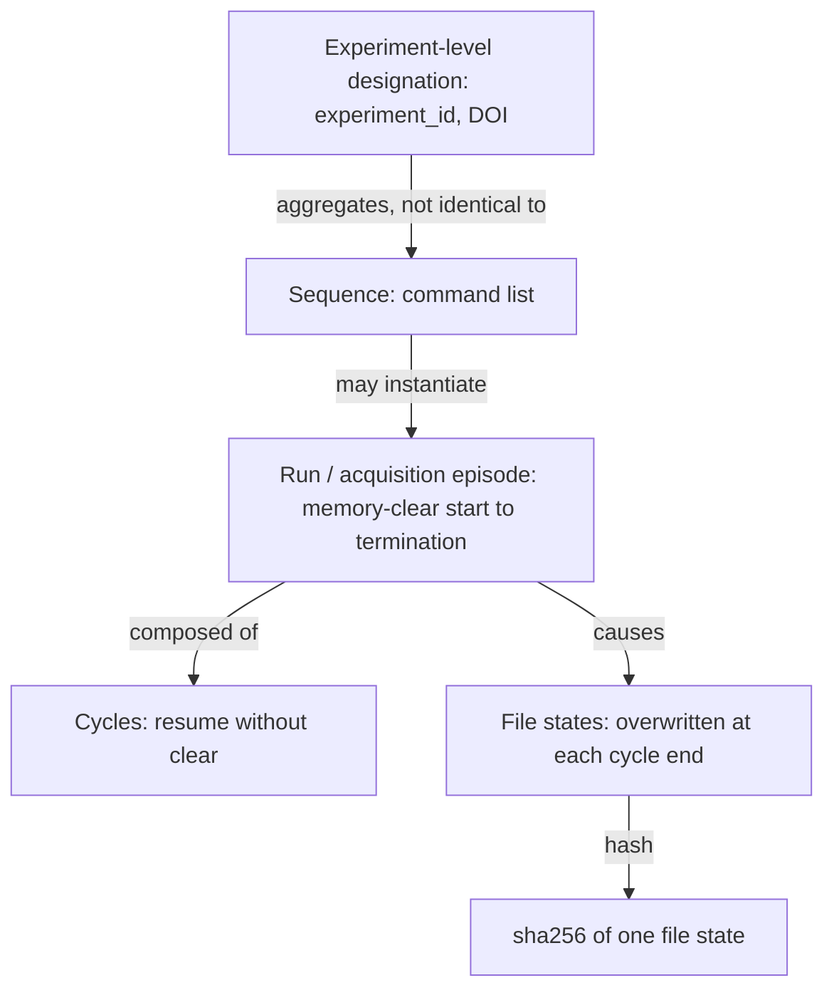
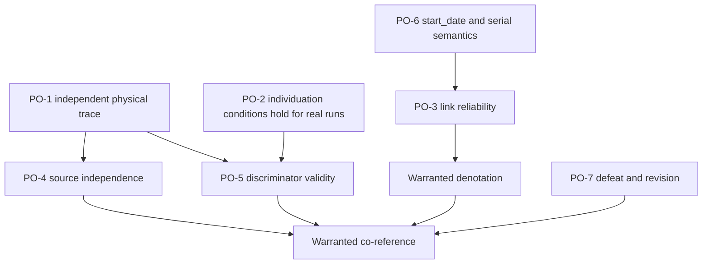

# Scientific Development Note v0.9 — Evidence and Co-reference for Concrete Experimental Occurrences

**Status:** provisional research material. It is not a theory-acceptance judgment.
**Evaluation time:** 2026-10-16. The public index was sampled that morning. The time zone of recorded timestamps is not stated by the sources (UNDER-SPECIFIED).
**Labels used:** [S] stated by a source I read; [I] inference; [A] assumption; [C] conjecture; [X] counterexample or observed anomaly; [O] open obligation. Source statements are paraphrases of what I read, not verbatim quotations.

---

## A. Research question, scope, and source authority

**Question.** For one independently individuated NIST DCS acquisition episode, what independently justified evidence is sufficient to establish that two separately produced records identify that same episode, rather than distinct executions with compatible attributes?

**Scope.**

- One referent kind: a DCS acquisition run. Nothing here generalizes to other kinds.
- Read-only. I made no repository, Lean, paper or protocol changes.
- Protocols: I read `protocols/source-audit/SKILL.md` and `protocols/theory-construction/SKILL.md` from `se-protocols-research`. I used the FOUND / PARTIAL / NOT FOUND / UNDER-SPECIFIED classification and the theory-construction verdict set. I did not read or invoke `independent-review` or `theory-acceptance`.
- Supplied notes (NOTEv06, v07, v07-claude, v08, and the prompt) were used for context and claims to test. Their agreement is not treated as evidence. Their claims about Lean sources and GLP/EPA material remain unverified here unless stated otherwise.

**Source authority ranking used.**

1. NCNR/NIST operational documents (DCS User's Guide, DCS design page, NCNR Data Management Plan, CHRNS FAIR page, metadata API docs).
2. Live public NCNR metadata API output.
3. A published NIST dataset record (`data.nist.gov/od/id/mds2-2139`).
4. Supplied AI notes (lowest authority; used only as hypotheses).

---

## B. Primary-source audit and actual evidence coverage

### B.1 Sources actually read

| Source                                                                 | Sections used                                                                                                                                 | Established                                                                                                                                                                                                                                                                                                                                                                                                                                                                                                                                           |
| ---------------------------------------------------------------------- | --------------------------------------------------------------------------------------------------------------------------------------------- | ----------------------------------------------------------------------------------------------------------------------------------------------------------------------------------------------------------------------------------------------------------------------------------------------------------------------------------------------------------------------------------------------------------------------------------------------------------------------------------------------------------------------------------------------------- |
| DCS User's Guide, `nist.gov/ncnr/dcs-users-guide`                      | _Instrument Computers_; _Runs and sequences_ (Runs, Sequences, Defining, Starting and stopping, sequence.prm / sequence.log); _Miscellaneous_ | [S] The run / cycle / sequence distinction. The "run number" in the guide's control vocabulary is a run-buffer index. Memory is cleared at run start. Between cycles the acquisition resumes without clearing. The data file is written (overwritten) at the end of each cycle. Three stop modes exist. A Check Stats facility can reject a cycle. A single reflective-memory histogram (about 4 MB) is the acquisition target. A file naming scheme `yyyymmdd_kkk.dcs.gz` is used. sequence.prm defines and sequence.log records sequence execution. |
| DCS design page, "Data Acquisition Hardware and Software"              | whole section                                                                                                                                 | [S] General description of the acquisition hardware and software. The page carries a banner saying it is no longer being updated.                                                                                                                                                                                                                                                                                                                                                                                                                     |
| NCNR Data Management Plan; CHRNS FAIR Data page                        | general sections                                                                                                                              | [S] Data are archived and exposed with metadata and persistent identifiers (DOIs per experiment and a repository DOI, 10.18434/t4201b). They do not describe run-level identification of acquisition occurrences beyond the file/index level.                                                                                                                                                                                                                                                                                                         |
| NCNR metadata API docs, `…/metadata/search/api_docs.html`              | whole page                                                                                                                                    | [S] Field vocabulary: filename, experiment_id, rxcycle_id, instrument, start_date, sha256, metadata, localdir.                                                                                                                                                                                                                                                                                                                                                                                                                                        |
| Live API JSON: `…/metadata/api/v1/{instruments,datafiles,experiments}` | unfiltered result pages                                                                                                                       | [S] Observations in B.4.                                                                                                                                                                                                                                                                                                                                                                                                                                                                                                                              |
| Published record `data.nist.gov/od/id/mds2-2139`                       | record page                                                                                                                                   | [S] A DCS dataset-level record. It carries no run-level acquisition fields.                                                                                                                                                                                                                                                                                                                                                                                                                                                                           |

### B.2 Sources not read or not reachable (distinct from "absent")

| Item                                                                                                          | Reason                                                                                                | Consequence                                                                                                                                          |
| ------------------------------------------------------------------------------------------------------------- | ----------------------------------------------------------------------------------------------------- | ---------------------------------------------------------------------------------------------------------------------------------------------------- |
| Raw `*.dcs.gz` files and their headers                                                                        | `ncnr.nist.gov/pub/ncnrdata/` returned ROBOTS_DISALLOWED to the fetch tool. I did not work around it. | **NOT READ.** The file header format and the histogram contents are unknown to me.                                                                   |
| Shell access to `ncnr.nist.gov`                                                                               | Proxy returned 403 on CONNECT.                                                                        | Only the fetch tool's rendition of the pages was available.                                                                                          |
| API query filters (`?alias=dcs`, `?instrument=dcs&limit=5`)                                                   | The returned pages were unfiltered (mixed instruments); the filters did not take effect.              | The 21 DCS rows in B.4 are only those DCS rows that appeared in the newest 25 mixed rows. This is a sample with selection bias, not the DCS archive. |
| `experiments?id=46&instrument_id=20`; `datafiles?instrument=dcs&limit=60&offset=5`; `doi.org/10.18434/t4201b` | Fetch permission prompts went unanswered. I did not retry.                                            | **NOT READ.** What experiment 46 is, and the older DCS rows, are unknown.                                                                            |
| Lean: `identity-regimes` Transform/Core.lean; `neutral-substrate` Referent/Carriers.lean                      | Same unanswered prompts.                                                                              | **NOT READ.** Section H cannot verify any Lean claim.                                                                                                |
| sequence.log, chopper/tracker logs, logbooks, IMS and NICE records                                            | Not publicly exposed in anything I could reach.                                                       | NOT READ and not known to be public.                                                                                                                 |
| Web search for the `.dcs` header format                                                                       | Returned unrelated results.                                                                           | Header contents remain unknown.                                                                                                                      |

### B.3 Source-audit classification against the Phase I questions

| #   | Question                                                       | Class                                                                                                                                   | Basis                                                                                                                                                                      |
| --- | -------------------------------------------------------------- | --------------------------------------------------------------------------------------------------------------------------------------- | -------------------------------------------------------------------------------------------------------------------------------------------------------------------------- |
| 1   | How episodes begin and end                                     | **FOUND** (procedure level); **NOT FOUND** (instance level)                                                                             | [S] Guide, Runs and sequences. No instance's start/stop events were inspected (logs NOT READ).                                                                             |
| 2   | Run vs constituent cycles                                      | **FOUND**                                                                                                                               | [S] Guide.                                                                                                                                                                 |
| 3   | Run vs configuration, experiment designation, command sequence | **PARTIAL**                                                                                                                             | [S] run ≠ sequence (guide). [S] experiment_id exists in the index. The mapping from configuration to files was not read.                                                   |
| 4   | Instrument-generated evidence of actual acquisition            | **PARTIAL**                                                                                                                             | [S] The histogram and per-cycle file writes are the instrument's product. The file contents and header are NOT READ.                                                       |
| 5   | Independently produced records that identify the episode       | **NOT FOUND** among accessible records. Candidates (sequence.log, controller logs) are inaccessible, so this is **unread, not absent**. |                                                                                                                                                                            |
| 6   | How records are linked to the acquisition history              | **PARTIAL**                                                                                                                             | [S] Filename convention, localdir, index fields. [UNDER-SPECIFIED] The index-ingestion mechanism.                                                                          |
| 7   | Do records obtain identifiers from a common source?            | **PARTIAL**                                                                                                                             | [I] Strong: every public record I saw is keyed by the filename or the filing path. The documents I read do not state explicitly that the index derives from the file path. |
| 8   | Authenticity and reliability of associations                   | **UNDER-SPECIFIED**                                                                                                                     | [S] sha256 supports integrity of file bytes. [I] It says nothing about whether the file was correctly associated with an acquisition.                                      |
| 9   | Could two distinct runs satisfy the same attributes?           | **FOUND** (as an attribute-compatibility observation, B.4)                                                                              | Whether the compatible rows are distinct runs is inferred from the guide's one-file-per-run convention [I].                                                                |
| 10  | Effect of conflicting or missing evidence                      | **NOT FOUND**                                                                                                                           | I found no documented reconciliation procedure.                                                                                                                            |

### B.4 Observed index rows (live API, unfiltered pages, sampled ~2026-10-16 morning)

21 rows with `instrument` = DCS appeared. All have `metadata` = null and `localdir` of the form `dcs/202608/<experiment>/data`. Start times are `start_date`, whose semantics (run start, first file creation, or something else) are UNDER-SPECIFIED.

| File                       | start_date                                                                               | experiment_id |
| -------------------------- | ---------------------------------------------------------------------------------------- | ------------- |
| 20261014_005, \_006        | 22:04:34, 23:04:55                                                                       | 46            |
| 20261015_001–\_009         | 00:05:17, 01:05:38, 02:06:00, 03:06:21, 04:06:42, 05:07:03, 06:07:24, 07:07:45, 08:08:07 | 46            |
| 20261015_010, \_011, \_012 | 09:46:29, 10:21:51, 10:38:29                                                             | 46            |
| 20261015_013, \_014, \_015 | 19:08:57, 21:09:41, 23:10:24                                                             | 46            |
| 20261016_001, \_002, \_003 | 01:11:06, 03:11:52, 05:12:34                                                             | 46            |
| 20261016_004               | 09:16:48                                                                                 | **30402**     |

I computed the following by script. The numbers are computed, the readings of them are not.

- Start-to-start intervals are about 1:00:21–22 from 14_005 to 15_009.
- Then come 1:38:22, 0:35:22, 0:16:38 and 8:30:28.
- Then about 2:00:42–46 from 15_013 to 16_003, and 4:04:14 to 16_004.
- Serial numbers are contiguous within each day for the rows shown.

**What these observations do and do not show.**

- [x] Twenty records share experiment_id 46, instrument, null metadata and a path pattern. Only filename and start_date separate them. Both are produced by the same acquisition-and-filing system.
- [I] The near-constant intervals suggest automatically repeated fixed-length runs. The irregular gaps are consistent with manual intervention or different run lengths. Start times alone cannot show which, because run durations are not in the index rows I saw.
- [I] The row for 16_004 began recently, so its file may still have been accumulating at sampling time. This was not checked.
- Nothing here is an independent record of an episode.

### B.5 Source-audit verdict

**JUSTIFIED FROM CURRENT SOURCES**

- The procedural run / cycle / sequence distinction, and the memory-clear versus resume-without-clear asymmetry [S].
- A file's state changes within one run because it is overwritten at each cycle end. File-state identity is therefore not run identity [S + I].
- All public records I could inspect (file, path, index row) share one filename-keyed lineage [I, strong].
- Public index rows for DCS carry no free-form run-level metadata (null) and no per-run provenance attestations [S].

**WOULD REQUIRE NEW THEORY OR INTERFACE**

- Access to causally independent run-level records (control logs, instrument-state logs, file headers) for at least one real run.
- A formal, testable notion of source independence (disjoint causal origin, not disjoint authorship).
- A validated content-level discriminator between "same run, later state" and "different run, compatible state".
- Documented semantics for `start_date` and for the assignment of `kkk`, including whether serials can be reissued.

---

## C. Concrete occurrence and grounded individuation

**C.1 What establishes the occurrence independently of its records?**

- [I] The occurrence is the physical process of neutron counting into the DAQ histogram under one run-control state. Its causal products are the histogram contents, the file states written at cycle ends, and controller events.
- [S] The instrument's own convention individuates runs by memory clearing at run start (guide, Runs).
- [A] The convention tracks a physically meaningful unit. Nothing I read independently tests this.
- So the individuation is **operational-state-anchored** and **stipulated by the instrument's run control**, not independently derived from the physics. This answers the prompt's phrase "independently individuated" only partly. The individuation is independent of the _records_, not of the _run-control convention_.

**C.2 Levels that must stay distinct**

| Level                  | Relation to the episode                                          |
| ---------------------- | ---------------------------------------------------------------- |
| Experiment designation | Membership / aggregation. Not identity.                          |
| Sequence               | Plan / command source. Not identity. A plan is not an execution. |
| Run                    | The episode (by operational stipulation).                        |
| Cycle                  | Part of the episode. Parthood is not identity.                   |
| File state             | Product at a time. A sha256 identifies the state, not the run.   |

**C.3 Individuation conditions (candidate C-DCS-2)**

- I1. A run begins at a start that clears the run buffer [S].
- I2. Cycle boundaries inside a run do not end the run when the acquisition resumes without clearing [S].
- I3. A stop ends the run. Which of the three stop modes yields which post-state is NOT fully resolved in my reading, so I do not rely on mode differences here.
- I4. A new start after termination is a new episode [A]. This was an explicit assumption in v0.7 (C5) and is still an assumption.
- I5. A rejected cycle (Check Stats) is part of the physical acquisition, but its data are excluded from the retained histogram, as I read the guide. The file does not witness the full physical extent of the episode [I].

**C.4 Temporal semantics.** The six times are kept apart.

| Time                       | Meaning                                                   | Status here                                                             |
| -------------------------- | --------------------------------------------------------- | ----------------------------------------------------------------------- |
| Actual acquisition time    | When counting happened                                    | Not available (logs NOT READ).                                          |
| Run-control lifecycle      | Start, cycle ends, stops                                  | [S] procedure only; no instance events read.                            |
| Record creation / revision | When a file state was written; when an index row was made | File overwritten each cycle end [S]. Index ingest time UNDER-SPECIFIED. |
| Evaluation time            | When a co-reference judgment is made                      | 2026-10-16.                                                             |
| Transformation time        | Compression (.gz), archiving, ingest, any later reduction | Not observed.                                                           |

A later record or hash does not imply continued occurrence. A snapshot of a file in progress is a state at some record-creation time, not the whole episode.

---

## D. Candidate cross-record identification and co-reference criteria

**D.1 Candidate C-DCS-2 (narrow).** This revises v0.7's C-DCS-1 and replaces its identifier-centered support with an evidential-chain account. It is a **candidate**, not a result.

- _Trace._ Tr(E) is the set of physical or instrumental effects of episode E (histogram contents, file states, controller events).
- _Attestation._ Attests(p, E) holds iff there is a causal chain Γ from Tr(E) to presentation p.
- _Warranted denotation_ W(p, E) requires:
  - L1. Each link of Γ has documented reliability (this includes a documented reason the association was not mis-keyed).
  - L2. **Content sensitivity.** p carries information that would have differed had a different run been acquired. An identifier assigned by the system is content-insensitive; histogram data are content-sensitive.
- _Independence._ p1 and p2 are independent w.r.t. E iff their chains share no link after Tr(E) and no common identifier-assignment event.
- _Warranted co-reference._ CoRef(p1, p2) is warranted iff all of the following hold:
  1. W(p1, E1) and W(p2, E2).
  2. The chains are independent.
  3. A content-level discriminator excludes the alternative that E1 and E2 are distinct runs with compatible attributes.
  4. No defeater is known (conflicting records, evidence of reissued identifiers, evidence of a restart).

**D.2 What the accessible evidence can instantiate.**

- Condition 2 fails for every pair of public records I could inspect: all are filename-keyed and downstream of one file [I].
- Condition 3 can be instantiated only by a content-level discriminator, which I could not test (raw files NOT READ).
- So no pair of accessible records meets D.1 as stated.

**D.3 What can be said without independence: relative co-reference.** [I] If two presentations are derived from the same archived file (equal sha256, or the same filename plus filing path), they denote the same run **relative to**:

- (a) the one-file-per-run convention, and
- (b) no reissue of a day's serial `kkk` within the same filing path.

Both are assumptions about the filing system. Nothing independent supports them. This is a conditional result about pipeline artifacts, not an independent cross-record identification.

**D.4 The conjectured content discriminator CJ-A [C].** For two file states F1 and F2, each a count histogram: if they are states of the same run (memory not cleared between), then F2 ≥ F1 binwise when F2 was written later. The increment F2 − F1 is the data of the intervening cycle(s).

- _Necessity [I, conditional]._ This holds only if cycle rejection does not subtract counts from the file. I have no evidence on that beyond reading it as non-subtractive.
- _Not sufficient [I, by simple counting argument; untested on real data]._ Two independent runs of the same configuration, one longer than the other, can satisfy binwise dominance whenever the longer run's expected counts exceed the shorter's by enough that Poisson fluctuation rarely reverses a bin. Sparse bins make dominance easy. So dominance fails to discriminate precisely when the second file is much larger than the first, and discriminates better when the two have similar counts.
- _Status._ A candidate necessary condition for same-run succession, with power that depends on the regime. It is not a sufficient criterion.

**D.5 Competing explanations (condition 3).**

| Hypothesis                                   | What would distinguish it                                        | Accessible?   |
| -------------------------------------------- | ---------------------------------------------------------------- | ------------- |
| H1: one run, two records                     | Independent causal chains from one trace item                    | No            |
| H2: two distinct runs, compatible attributes | Content-level discriminator; sequence.log                        | No            |
| H3: one misattributed record                 | Cross-check against control logs                                 | No            |
| H4: shared erroneous source                  | Requires evidence independent of the source (hard by definition) | No            |
| H5: same file at different cycle states      | CJ-A or logs                                                     | CJ-A untested |

**D.6 Strict identity versus relatedness.** C-DCS-2 asserts numerical identity only for E1 = E2 (classical equality, an explicit scope commitment from v0.6). It does not assert identity for:

| Relation                          | Example here                                                                                                 |
| --------------------------------- | ------------------------------------------------------------------------------------------------------------ |
| Shared identifier                 | Filename in two systems                                                                                      |
| Similarity / common configuration | Rows in experiment 46                                                                                        |
| Temporal overlap                  | Not applicable to a single histogram (concurrent distinct runs are excluded by the single-buffer design [I]) |
| Parthood                          | Cycle ⊂ run                                                                                                  |
| Causal connection                 | Run → file state                                                                                             |
| Repetition                        | Hourly fixed-length runs                                                                                     |
| Derivation                        | Compressed file, index row from file                                                                         |
| Succession                        | Run n then run n+1                                                                                           |

**D.7 Residual circularity (named).**

- R1. Deciding that two items come from "the same trace item" currently rests on filename or path, i.e. on identifier assignment. The non-circular alternative (CJ-A or logs) is untested or inaccessible.
- R2. The unit E is defined by the instrument's own run-control convention (C.1). Showing that a record denotes an instrument-defined run does not independently show that the unit is physically individuated.
- R3. A discriminator would be calibrated on archive data that is itself pipeline-derived.

---

## E. Formal consequences and scientific proof obligations

**E.1 Consequences (all [I]).**

1. _Hash lemma._ Equal sha256 ⇒ equal bytes (assuming collision resistance). Equal bytes ⇒ same file state. This identifies a file state. It does not identify a run, because different states of one run have different hashes, and equal hashes between _distinct_ runs is negligible in practice.
2. _Relative co-reference lemma._ Given conventions (a) and (b) in D.3, records sharing a filename and filing path co-refer. The conclusion is only as strong as the filing convention, so it is relative, not independently warranted.
3. _Non-independence lemma._ If p1 and p2 are downstream of one identifier-assignment event, then agreement between them is entailed by the common source and carries no evidence against a shared error (H3, H4).
4. _Compatibility is not sufficiency._ Compatible(p, e) is symmetric across all runs with the same attributes. Without a content-sensitive link, the set of runs compatible with a record has more than one member (observed in B.4).

**E.2 Proof obligations.**

| ID   | Obligation                                                                                           | Status                                   |
| ---- | ---------------------------------------------------------------------------------------------------- | ---------------------------------------- |
| PO-1 | Establish a physical trace of one real run independent of its filename.                              | OPEN — raw files and logs NOT READ.      |
| PO-2 | Show I1–I5 hold for real runs, including stop modes and rejected cycles.                             | OPEN — procedure-level only.             |
| PO-3 | Document the reliability of each link in the chain (acquisition → file → path → index).              | OPEN — ingest mechanism UNDER-SPECIFIED. |
| PO-4 | Define and test source independence as disjoint causal origin.                                       | OPEN.                                    |
| PO-5 | Validate or refute CJ-A (necessity) and quantify its power (sufficiency regime).                     | OPEN — untested conjecture.              |
| PO-6 | Specify the semantics of start_date and the serial `kkk`, including whether serials can be reissued. | OPEN.                                    |
| PO-7 | Define a defeasible revision policy for corrected or contradicted records.                           | OPEN.                                    |

---

## F. Adversarial cases and falsification results

Provenance of each case: **OBS** = observed in the public index this session; **DOC** = derived from the DCS User's Guide; **HYP** = hypothetical construction. HYP cases test the candidate; they are **not independent validation**.

**F1 Two different runs, identical recorded attributes. (OBS, B.4)**

- _Grounded judgment:_ Rows such as 15_003 and 15_004 are distinct file records. That they are distinct runs follows from the guide's one-file-per-run convention [I].
- _Candidate prediction:_ They do not co-refer, but only because filenames differ.
- _Evidence:_ 20 rows share experiment_id 46, null metadata and the same path pattern.
- _Assumptions:_ One file per run; start_date is not a reuse artifact.
- _Ambiguity:_ Every distinguishing attribute is system-assigned. If the filename were mis-assigned, nothing in the row would reveal it.
- _Consequence:_ Shows the problem is real: attribute compatibility is routine. It supplies no independent test.

**F2 One run described in independently produced records. (HYP)**

- _Judgment:_ Would co-refer if the chains are independent and the discriminator holds.
- _Prediction:_ Co-refer, conditional on D.1.
- _Evidence:_ None observed. I found no pair of causally independent public records for one run.
- _Ambiguity:_ Independence of authorship vs independence of source.
- _Consequence:_ The core claim is untested.

**F3 Two records with the same incorrect identifier. (HYP)**

- _Judgment:_ They do not identify the same run if the identifier was wrong for one of them.
- _Prediction:_ An identifier-based criterion would wrongly co-refer. D.1 would catch it only if a content-sensitive discriminator exists and is applied.
- _Ambiguity:_ If both records descend from the same misattributed file, no downstream test can detect it (H4).
- _Consequence:_ Any pipeline-based criterion is defeated; this is the main counterexample.

**F4 Two identifiers referring to one run. (DOC + HYP)**

- _Judgment:_ The guide uses a run-buffer index in control, and the archive uses a file serial `kkk`. They may designate the same run. The mapping between them is not stated in what I read [UNDER-SPECIFIED].
- _Prediction:_ No co-reference derivable from the identifiers alone; it needs a mapping record.
- _Note:_ experiment_id vs filename is not an instance of this case. They denote different levels.
- _Consequence:_ Identifier synonymy is a relation that must be evidenced, not read off equal-looking strings.

**F5 One run with changing accumulated contents. (DOC)**

- _Judgment:_ One episode, many file states; hashes differ.
- _Prediction:_ sha256 mismatch does not imply distinct episodes. Co-reference of two states of one run needs filename or CJ-A.
- _Evidence:_ [S] File overwritten each cycle end.
- _Observed?_ No. I have a single snapshot per row and never compared two states of the same file.
- _Consequence:_ Confirms the file-state / episode separation.

**F6 Two runs using the same configuration. (OBS-partial + HYP)**

- _Judgment:_ Distinct runs.
- _Evidence:_ Same experiment_id 46 across ~20 rows. The configuration itself was not read. The near-constant ~1 h intervals suggest repeated fixed runs [I].
- _Prediction:_ Not co-referring, but the same dependence on the filename as F1.
- _Consequence:_ Repetition is not identity. The candidate needs a discriminator that works for repeated, near-identical runs. CJ-A is weakest exactly here if later runs are longer.

**F7 A run containing several acquisition cycles. (DOC)**

- _Judgment:_ One episode. A cycle-level record and a run-level record are in a part–whole relation.
- _Prediction:_ No co-reference between cycle-level and run-level records.
- _Ambiguity:_ No cycle-level public record was read.
- _Consequence:_ Parthood must not be collapsed into identity.

**F8 A rejected cycle within an otherwise continuing run. (DOC)**

- _Judgment:_ The run continues. The rejected cycle's counting occurred but its data are excluded.
- _Prediction:_ The file under-represents the episode's physical extent.
- _Assumption:_ Rejection removes data without affecting earlier-cycle counts (as read).
- _Consequence:_ The absence of data in the file is not evidence of absence of acquisition. "Acquired" and "retained" differ.

**F9 Interrupted and resumed acquisition. (DOC + HYP)**

- _Judgment:_ Same episode if resumed without clearing (the guide's own rule).
- _Prediction:_ C-DCS-2 treats this as one episode by stipulation of run control.
- _Ambiguity:_ Physical continuity (beam, chopper state) across an interruption is not examined.
- _Consequence:_ The individuation is convention-anchored (R2), not independently justified.

**F10 A terminated run followed by a restart. (OBS-pattern + HYP)**

- _Judgment:_ A new episode if memory is cleared (I4, an assumption).
- _Evidence:_ The irregular gaps (1:38, 0:35, 0:16, 8:30) between regular hourly starts are consistent with interruptions and restarts. They are equally consistent with differently scheduled runs [I].
- _Prediction:_ No co-reference between pre- and post-restart records.
- _Unresolved:_ Whether the pre-restart run was truncated or complete cannot be read from start times.
- _Consequence:_ Succession must stay distinct from continuation.

**F11 A requested run that never acquires data. (HYP, partly DOC)**

- _Judgment:_ There is a run-control request but no acquisition episode.
- _Prediction:_ C-DCS-2 requires trace evidence. A zero-count or absent file cannot distinguish "no acquisition" from "very short acquisition".
- _Unresolved:_ Whether a file is created without acquisition [UNDER-SPECIFIED].
- _Consequence:_ Requests and executions are different referents and need different records.

**F12 A later correction to a record. (HYP)**

- _Judgment:_ A correction changes the record, not the episode.
- _Prediction:_ Warrant is relative to evaluation time. Co-reference judgments must be versioned.
- _Open:_ Whether the index permits corrections [UNDER-SPECIFIED; metadata currently null].
- _Consequence:_ Revision time is a distinct temporal parameter.

**F13 Two independent records with contradictory claims. (HYP)**

- _Judgment:_ Undetermined without evidence about reliability.
- _Prediction:_ C-DCS-2 returns "not warranted" in both directions rather than co-reference or distinctness.
- _Unresolved:_ Independence is not reliability. A rule for adjudication is missing (PO-7).
- _Consequence:_ The candidate has no defeat-ordering and cannot yet resolve conflicts.

**F14 An experiment-level record covering several runs. (OBS)**

- _Judgment:_ The relation is aggregation or membership, not identity.
- _Evidence:_ experiment_id 46 covers 20 rows in the sample; 16_004 carries 30402. The meaning of 46 was not determined. The DOI-level record mds2-2139 has no run-level fields.
- _Prediction:_ No co-reference between experiment-level and run-level records.
- _Ambiguity:_ Where experiment membership begins and ends cannot be read from these rows.
- _Consequence:_ Confirms the level distinction; supports no cross-record claim.

**F-summary.** Cases F1, F6, F10 and F14 are the observed ones, and each exhibits compatibility, not independent evidence. No observed case tests the central claim. Cases F2, F3, F9, F11, F12, F13 are hypothetical constructions and give no independent validation. The strongest result is negative: F3 defeats any criterion that depends only on a shared identifier or shared pipeline.

---

## G. Comparison with the GLP investigation

I use `NOTEv07-claude.md` as supplied. Part of its sourcing came from search excerpts, so I treat its GLP claims as hypotheses. I did not re-investigate GLP.

| Dimension               | DCS (this note)                       | GLP (v07-claude)                                | What it implies                                                                                     |
| ----------------------- | ------------------------------------- | ----------------------------------------------- | --------------------------------------------------------------------------------------------------- |
| Anchor                  | Operational state (run control)       | Designation (study plan / regulatory)           | Different kinds are anchored differently; one universal rule is not supported.                      |
| Execution vs continuity | Physical execution episode            | Administrative study continuity                 | A regulated study can continue while many executions begin and end.                                 |
| Records                 | Instrument-generated, one pipeline    | Independently authored QA and study records     | GLP has an institutional source of independent attestation; the accessible DCS record set does not. |
| Components              | Cycles (resume without clear)         | Experimental phases                             | Parthood structure differs; cycles are not phases.                                                  |
| Termination             | Actual stop                           | Regulatory completion                           | "Ended" differs by kind.                                                                            |
| Evidence role           | Referential evidence of an occurrence | Partly constitutive (authoritative designation) | Evidence of an occurrence and authoritative constitution must stay separate.                        |

**Evaluation of the supplied conditions for the DCS case, as far as evidence permits.**

| Condition                    | Necessary?                                   | Sufficient?              | Reasoning                                                                                                                                       |
| ---------------------------- | -------------------------------------------- | ------------------------ | ----------------------------------------------------------------------------------------------------------------------------------------------- |
| Provenance (traceable chain) | Plausibly necessary for warranted denotation | **No**                   | The accessible DCS provenance is a single lineage; tracing back to a common source does not show the source was right (F3).                     |
| Convergence (records agree)  | Not shown necessary                          | **No**                   | Agreement among filename-keyed records is entailed by the common source (Non-independence lemma).                                               |
| Independent attestation      | Plausibly necessary for non-circular warrant | **Not shown sufficient** | The DCS candidates for it (logs) were not read, so I cannot say whether they are independent of the DAQ or merely written by the same software. |
| No-defeater                  | Necessary for a defeasible warrant           | **No**                   | Vacuous unless defeaters are enumerated; no DCS defeater inventory exists.                                                                      |

**Result:** for DCS, the four conditions look like parts of a necessary set (with independent attestation the hard part), and neither they nor any subset are shown sufficient. This is not a claim that they are necessary in GLP. The comparison also guards against two errors: a shared specimen or traceability chain does not by itself establish numerical identity of the larger occurrence, and the scientifically constituted execution (a DCS run) is not the regulated study that may encompass it.

---

## H. Implications for existing SE theory

Lean sources were **NOT READ** this session. Claims about Lean content in v0.7 and v0.8 are unverified here. The statements below follow only from the scientific results.

| Theory                            | Remains valid                                                                                                | Needs narrowing                                                                                                              | May require revision                                                                                                       | Cannot be determined                                                                |
| --------------------------------- | ------------------------------------------------------------------------------------------------------------ | ---------------------------------------------------------------------------------------------------------------------------- | -------------------------------------------------------------------------------------------------------------------------- | ----------------------------------------------------------------------------------- |
| **Neutral Substrate**             | The separation of referent from carrier / presentation is supported (file state ≠ run).                      | Any claim that carriers _establish_ identity. A carrier shows what a record carries, not that two carriers share a referent. | —                                                                                                                          | Whether the ReferentCarriers Lean structure matches this (NOT READ).                |
| **Unified Referential Semantics** | Separating denotation, co-reference, existence and relatedness. CoRef as equality of _established_ denotata. | "Established" carries all the weight here. It needs an evidential relation (D.1), not just a denotation function.            | Treating co-reference as available once denotation functions exist.                                                        | Whether δ can be defined for DCS from public evidence. Currently not.               |
| **Persistence**                   | A later record does not imply continued occurrence (C.4).                                                    | Continuation of a run is defined by run control (I2), a stipulated convention.                                               | —                                                                                                                          | Persistence across interruption in a physical sense (F9).                           |
| **Transformation**                | Compression, ingest and archiving are transformations of records, not of the episode.                        | Transformation time must be separate from acquisition time.                                                                  | —                                                                                                                          | Whether any Lean transformation operator models record-state succession (NOT READ). |
| **Identity Regimes**              | Operational-state-anchored kinds exist and differ from designation-anchored kinds (G).                       | The number of regimes should not be forced by one kind.                                                                      | The v0.7 concern that "IGN" (ignorance) may be conflated with inapplicability is unverified; if true it may need revision. | The concern itself (Lean NOT READ).                                                 |
| **SE integration**                | —                                                                                                            | —                                                                                                                            | —                                                                                                                          | Cannot be determined from these results.                                            |

---

## I. Scientific adequacy and potential original contribution

**Mathematical correctness.** The candidate is internally consistent. The lemmas in E.1 follow from stated assumptions.

**Scientific adequacy.** **Not established.**

- No pair of causally independent presentations of one run was inspected.
- The individuation unit is the instrument's own convention (R2).
- The only non-identifier criterion (CJ-A) is an untested conjecture and not sufficient.
- No observed example tests the central claim (F-summary).

**Possible original contribution (modest, each conditional):**

1. Separating file-state identity (sha256), run identity and experiment designation, with the observation that for the accessible DCS records, cross-record co-reference reduces to identity of one pipeline artifact (relative co-reference).
2. The "acquired versus retained" distinction (rejected cycles), which shows the file cannot witness the whole episode.
3. The analysis showing that binwise dominance is necessary-but-not-sufficient and regime-dependent [C].
4. A formulation of source independence as disjoint causal origin, with common-mode misattribution as the defeater.

These are largely clarifications. I do not claim a substantive new theorem. Several restate known data-management concepts (file integrity vs provenance). The theory does not yet establish anything that is not already assumed by treating the filename as the run identifier.

---

## J. Deferred-obligation ledger

| ID   | Obligation                                                                                                     | Status | Blocked by                               |
| ---- | -------------------------------------------------------------------------------------------------------------- | ------ | ---------------------------------------- |
| L-01 | Obtain and read a raw `.dcs.gz` header and histogram for at least one run                                      | OPEN   | ROBOTS_DISALLOWED                        |
| L-02 | Obtain sequence.log, controller and tracker logs for the same run                                              | OPEN   | Not public as far as I could reach       |
| L-03 | Establish whether those logs are causally independent of the DAQ file path                                     | OPEN   | L-02                                     |
| L-04 | Semantics of `start_date`; time zone                                                                           | OPEN   | UNDER-SPECIFIED                          |
| L-05 | Serial `kkk` assignment and any reissue                                                                        | OPEN   | UNDER-SPECIFIED                          |
| L-06 | Mapping between run-buffer index and file serial                                                               | OPEN   | UNDER-SPECIFIED                          |
| L-07 | Index ingestion mechanism and whether the index is derived from the file path                                  | OPEN   | Not documented in what I read            |
| L-08 | Meaning of experiment_id 46 vs 30402                                                                           | OPEN   | Fetch of experiment record not completed |
| L-09 | Stop-mode post-states and Check Stats data handling                                                            | OPEN   | Guide read at summary level              |
| L-10 | Test CJ-A on two states of one real run and on distinct same-config runs                                       | OPEN   | L-01                                     |
| L-11 | Defeat-ordering and revision policy                                                                            | OPEN   | Theory                                   |
| L-12 | Verify Lean content for Neutral Substrate and Identity Regimes                                                 | OPEN   | Fetch prompts unanswered                 |
| L-13 | Verify GLP/EPA sourcing in `NOTEv07-claude.md`                                                                 | OPEN   | Out of this note's scope                 |
| L-14 | Verify v0.7 claims about the DCS Lean inspection                                                               | OPEN   | L-12                                     |
| L-15 | Check whether the DCS user guide's statements still describe current operations (design page says not updated) | OPEN   |                                          |

---

## K. Theory-construction verdict and strongest supported definition

**Verdict: FUNDAMENTAL QUESTION REMAINS**

**Does the candidate actually establish identity of one concrete DCS acquisition occurrence across independently created presentations?** No. The accessible records are not independently created: they share a filename-keyed lineage. The independent candidates (control logs, raw headers) were not readable. The one content-level discriminator is a necessary-but-not-sufficient conjecture, untested.

**Strongest supported definition (relative, not independent):**

> Two presentations that are derived from the same archived DCS run file (equal sha256, or same filename and filing path) are warranted to denote the same acquisition run _relative to_ (a) the one-file-per-run convention and (b) non-reissue of the day's serial. This is co-reference of pipeline artifacts under filing assumptions. It is not an independent identification of one physical acquisition episode.

**Not supported:**

- That any two independent records of a run co-refer.
- That a shared identifier, agreement, or provenance chain establishes numerical identity.
- That the instrument's run convention is independently justified as the unit of physical individuation.

---

## L. Exactly one recommended next scientific question

For one actual DCS run, is there a pair of run-level records whose causal origins are provably disjoint (for example the raw file's header and content versus an instrument-control log written by a separate process), such that both can be obtained and read, and does their agreement or disagreement discriminate "one run" from "two runs with compatible attributes"?
