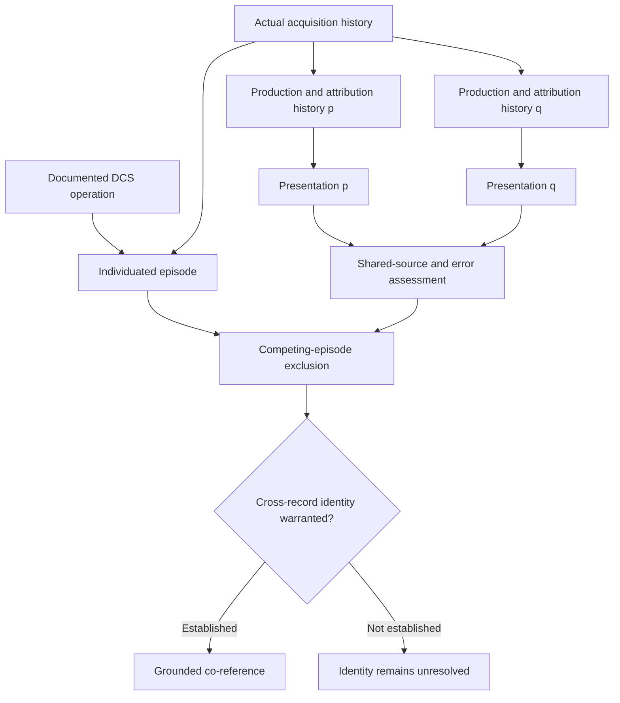
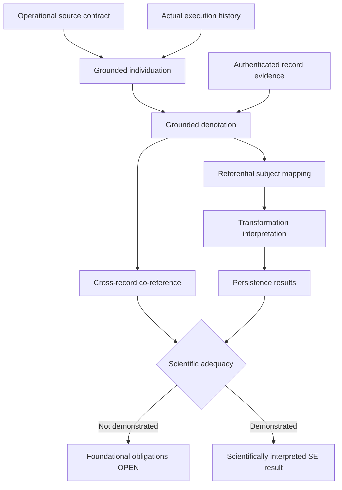

# Structural Explainability

# Scientific Development Note v0.9 — Evidence and Co-reference for Concrete Experimental Occurrences

**Date:** October 16, 2026
**Status:** OPEN — Scientific theory construction
**Research mode:** Read-only
**Predecessor:** Scientific Development Note v0.8
**Source-audit verdict:** PARTIAL
**Theory-construction verdict:** FUNDAMENTAL QUESTION REMAINS

## Executive Finding

The investigation recovered publicly inspectable archival evidence that the NIST Disk Chopper Spectrometer (DCS) has produced distinct raw-data files associated with recorded measurement activity.

It also confirmed that NIST documents:

- The operational distinction between a run and a command sequence.
- The organization of runs into acquisition cycles.
- Continued acquisition across multiple cycles.
- Accumulation and replacement of recorded data during one run.
- Explicit run-stopping operations.
- Public archiving and metadata extraction for instrument data.

These findings substantially constrain an account of DCS occurrence individuation.

However, the available evidence does not yet demonstrate that two separately produced records can be independently and reliably connected to the same particular acquisition episode.

The central difficulty is not establishing that records exist, nor proving equality between recorded attributes.

It is establishing the relationship between independently individuated physical execution episodes and the presentations that purport to identify them.

**The candidate account remains scientifically incomplete.**

---

# A. Research Question, Scope, and Source Authority

## A.1 Primary Research Question

For one independently individuated NIST DCS acquisition episode, what independently justified evidence is sufficient to establish that two separately produced records identify that very same episode, rather than distinct executions with compatible attributes?

The investigation distinguishes three questions:

1. What operationally constitutes one DCS acquisition episode?
2. What establishes that a particular record refers to that episode?
3. What evidence warrants the conclusion that two records refer to the same episode?

The third question cannot be answered by presupposing that the first two have already been resolved.

## A.2 Research Scope

The selected referent kind is:

**One actual measurement-run acquisition episode performed using the NIST Disk Chopper Spectrometer's data-acquisition system.**

Excluded referents include:

- A beamtime experiment.
- A run-buffer configuration.
- A command sequence.
- A constituent acquisition cycle.
- A datafile or version of a datafile.
- A metadata database entry.
- A research publication.
- A data-processing operation.

Such objects can be related to an acquisition episode without being identical to it.

The investigation does not attempt to construct a universal ontology of experimental occurrences.

## A.3 Protocols Applied

The actual canonical protocol instructions were inspected:

1. `protocols/source-audit/SKILL.md`
2. `protocols/theory-construction/SKILL.md`

Repository:

https://github.com/structural-explainability/se-protocols-research

Direct sources:

https://raw.githubusercontent.com/structural-explainability/se-protocols-research/main/protocols/source-audit/SKILL.md

https://raw.githubusercontent.com/structural-explainability/se-protocols-research/main/protocols/theory-construction/SKILL.md

The source-audit protocol requires recovery of existing commitments without repairing missing semantics.

The theory-construction protocol requires:

- One primary scientific question.
- Explicit separation of established and proposed claims.
- One falsifiable candidate.
- Adversarial testing.
- A theory-construction verdict.
- A deferred-obligation ledger.

The current investigation does not invoke independent review or theory acceptance.

The retrieved protocol versions were read from the public `main` branch. Their exact commit revisions were not pinned during this investigation.

## A.4 Authority Order

Authority is assigned according to the claims each source can establish.

| Source class                       | Authority                                            |
| ---------------------------------- | ---------------------------------------------------- |
| NIST DCS operating documentation   | Documented acquisition and control behavior          |
| NIST instrument specifications     | Physical and computational acquisition architecture  |
| NIST data-management policy        | Data preservation, classification, and access        |
| NIST public data archive           | Publicly exposed archival entries                    |
| NIST metadata specifications       | Defined metadata and association mechanisms          |
| Actual authenticated run histories | Potential evidence of particular physical executions |
| Authoritative SE Lean sources      | Existing formal definitions and commitments          |
| Scientific development notes       | Provisional research background                      |

An operational manual is not automatically an authoritative metaphysical identity theory.

Likewise, a repository listing is not automatically an authenticated history of physical acquisition events.

---

# B. Primary-Source Audit and Actual Evidence Coverage

## B.1 NIST DCS Users' Guide

**Source:** NIST Center for Neutron Research, DCS Users' Guide.

https://www.nist.gov/ncnr/dcs-users-guide

**Relevant sections:**

- Instrument computers.
- Runs.
- Sequences.
- Defining runs and sequences.
- Starting and stopping runs and sequences.
- `sequence.prm` and `sequence.log` files.

**Evidence status:** INSPECTED.

The guide identifies a run as a measurement using the acquisition system.

Its described execution includes:

1. Clearing measurement memory.
2. Initiating acquisition.
3. Stopping acquisition.
4. Writing measurement data.

A run may contain several acquisition cycles.

Between cycles, acquisition can resume without clearing accumulated memory.

The datafile may consequently be overwritten with an updated accumulation.

The guide also describes rejecting a constituent cycle without necessarily ending the containing run.

Three explicit stop operations distinguish immediate termination with loss of current-cycle data, immediate termination retaining that data, and termination after completing the current cycle.

**Established:** A run is an operational acquisition unit whose structure cannot be inferred solely from file versions, acquisition-cycle count, or configuration equality.

**Not established:** A complete identity criterion covering arbitrary system failure, uncontrolled interruption, recovery, and restart.

## B.2 NIST DCS Instrument Specifications

**Source:** DCS Design Features and Principal Specifications.

https://www.nist.gov/ncnr/dcs-design-features-and-principal-specifications

**Relevant section:** Data Acquisition Hardware and Software.

**Evidence status:** INSPECTED.

The specifications describe event acquisition, histogram accumulation, and transfer of acquisition information through the instrument's hardware and software.

They distinguish acquisition cycles from the accumulated measurement data written to storage.

This corroborates the distinction between the physical measurement process and the stored result.

The webpage also warns that its information may be outdated. Therefore its description does not independently verify the behavior of every current instrument configuration.

## B.3 Actual Public DCS Data Repository

**Source:** NIST Center for Neutron Research Data Repository.

**Inspected archival location:**

https://ncnr.nist.gov/pub/ncnrdata/dcs/200707/

**Evidence status:** PUBLIC DIRECTORY LISTING INSPECTED.

This investigation identified actual named entries in the DCS archive.

Examples include:

| Archival filename     | Displayed last-modified timestamp | Displayed size |
| --------------------- | --------------------------------- | -------------- |
| `20070823_005.dcs.gz` | 2007-08-23 11:12:10 -04:00        | 203K           |
| `20070823_006.dcs.gz` | 2007-08-23 13:53:26 -04:00        | 214K           |

These are concrete observations of the public archival listing.

They are not hypothetical filenames introduced for theory construction.

### What this establishes

The repository exposes distinct entries bearing DCS raw-data filenames.

Their displayed file sizes and last-modified timestamps differ.

This supports the existence of separately archived data objects.

### What this does not establish

The listing alone does not establish:

- The actual acquisition-initiation event associated with either entry.
- The complete run-control history.
- Whether either acquisition was interrupted.
- Whether the files contain final or intermediate acquisition states.
- The relationship between a filename and an authenticated physical run.
- The independent provenance of another presentation purporting to identify the same episode.

Although the entries have different names and timestamps, those attributes are properties of archival representations.

They are not independently verified occurrence-identity criteria.

### Important evidential limitation

The binary datafile contents were not successfully retrieved and inspected.

The archive's downloadable objects were therefore not treated as parsed measurement records.

The displayed timestamps are repository last-modified values, not independently verified acquisition-start or acquisition-stop times.

**Result:** Actual archival entries were located, but a physical execution history was not reconstructed.

## B.4 NIST Metadata Search Facilities

**Sources:**

https://www.ncnr.nist.gov/ncnrdata/

https://www.ncnr.nist.gov/ncnrdata/metadata/search/api_docs.html

**Relevant sections:**

- Experiment.
- Datafiles.
- `searchDatafiles`.
- API response schemas.
- Metadata extraction.

**Evidence status:** DOCUMENTATION INSPECTED; LIVE DCS QUERY RESULTS NOT RECOVERED.

The metadata specification exposes fields that can include:

- Instrument identification.
- Experiment association.
- Datafile name.
- Reactor-cycle association.
- Start date.
- Content hash.
- Extracted measurement metadata.

The documented API permits filtering by instrument, including `dcs`.

However, the published example response in the API documentation concerns the BT1 instrument, not a verified DCS acquisition episode.

It therefore cannot be used as a concrete DCS identity-validation case.

Attempts to retrieve live datafile responses through the documented endpoints did not produce inspectable records in this investigation.

### Independence limitation

NIST describes metadata extraction from archived datafiles.

Consequently, the appearance of matching information in:

1. A raw datafile, and
2. A metadata database entry derived from that file

does not automatically constitute two independent evidential observations.

The database may reproduce an attribution already contained in the datafile.

This distinction is particularly important for the current research question.

## B.5 NIST Data Management Plan

**Source:** NCNR Data Management Plan.

https://www.nist.gov/ncnr/for-users/data-and-tools/ncnr-data-management-plan

**Relevant sections:**

- Summary.
- Data Types and Classification.
- Preservation.
- Discoverability and Access.

**Evidence status:** INSPECTED.

The plan describes institutional practices for automatically archiving raw neutron measurement data.

It identifies raw measurement counts as a relevant class of scientific data.

It also establishes a policy for making archived data publicly accessible.

These practices support the scientific credibility of the data infrastructure.

However, preservation and accessibility do not themselves establish occurrence identity.

A preserved record may accurately represent an occurrence, incompletely represent it, or contain an erroneous attribution.

The plan does not supply a sufficient criterion for distinguishing those possibilities for arbitrary DCS runs.

## B.6 NIST CHRNS FAIR Data Documentation

**Source:**

https://www.nist.gov/programs-projects/chrns-non-equilibrium-structure-materials-initiative/chrns-fair-data-ncnr

**Relevant sections:**

- Searchable Metadata.
- Permanent Identifiers for Experiments.
- Capture of Process Metadata.
- Traceable Data Processing.

**Evidence status:** INSPECTED.

The documentation distinguishes:

- Experiment-level identifiers.
- Measurement-associated metadata.
- Relationships between measurements.
- Raw-data records.
- Processing histories.

This distinction is relevant because an experiment-level identifier may encompass more than one individual measurement run.

A common experiment identifier therefore cannot be taken as a sufficient condition of acquisition-episode identity.

Moreover, a traceable processing history establishes relationships between data-processing artifacts only to the extent supported by its authenticated provenance.

It does not automatically establish identity of the physical execution from which their input data originated.

## B.7 Source Coverage Summary

| Investigated question                             | Finding                                               | Classification                 |
| ------------------------------------------------- | ----------------------------------------------------- | ------------------------------ |
| Run initiation                                    | Operational start and acquisition behavior documented | FOUND                          |
| Run termination                                   | Normal completion and explicit stop modes documented  | FOUND                          |
| Acquisition cycles                                | Multiple cycles within one run documented             | FOUND                          |
| Accumulated data changes                          | Within-run accumulation documented                    | FOUND                          |
| Run versus sequence                               | Explicitly distinguished                              | FOUND                          |
| Configuration versus execution                    | Operationally distinguishable                         | PARTIAL                        |
| Arbitrary interruption and recovery               | Complete governing rules unrecovered                  | PARTIAL                        |
| Actual archived DCS records                       | Individual archival entries inspected                 | FOUND                          |
| Physical run history for a selected archived file | Not recovered                                         | NOT READ / UNVERIFIED          |
| Live DCS metadata response                        | Not successfully inspected                            | NOT READ                       |
| Independent observation of a selected run         | Not recovered from inspected materials                | NOT FOUND IN INSPECTED SOURCES |
| Provenance-to-occurrence validation               | Incomplete                                            | PARTIAL                        |
| Sufficient cross-record identity criterion        | Not established                                       | UNDER-SPECIFIED                |

The phrase NOT READ is retained wherever the limitation concerns unavailable or uninspected material.

It must not be converted into evidence that the underlying information does not exist.

## B.8 Source-Audit Verdict

**PARTIAL**

### JUSTIFIED FROM CURRENT SOURCES

1. A DCS run is operationally distinct from a command sequence, configuration, acquisition cycle, and stored datafile.
2. One run may contain multiple cycles and changing accumulated data.
3. The DCS control procedure includes explicit start and stop operations.
4. Publicly inspectable DCS raw-data archival entries exist.
5. NIST defines metadata facilities for connecting experiments and datafiles.
6. Experiment-level and datafile-level associations are not interchangeable.
7. Metadata derived from one file is not automatically independent evidence of that file's attribution.
8. Existing sources do not establish that agreement among identifiers or recorded attributes is sufficient to prove cross-record numerical identity.

### WOULD REQUIRE NEW THEORY OR INTERFACE

1. An authenticated connection between the selected archival file and a particular actual acquisition-control episode.
2. A sufficiently complete operational history for that episode.
3. Independently produced occurrence-specific evidence.
4. A justified model of record-generation and attribution errors.
5. Conditions excluding competing runs compatible with the same records.
6. Validated treatment of conflicting and missing evidence.
7. A scientifically adequate mapping from acquisition episodes to SE transformation states.

The source audit provides a basis for a revised candidate.

It does not establish the candidate's scientific sufficiency.

---

# C. Concrete Occurrence and Grounded Individuation

## C.1 Intended Referent

Let a DCS acquisition episode be an actual operational measurement execution rather than a command specification or recorded representation.

The candidate distinguishes:

- A request to begin acquisition.
- Actual entry into the acquisition process.
- Constituent cycles.
- Within-run acquisition continuation.
- Normal or early termination.
- Subsequent independently initiated operations.

The relevant physical episode is not created by assigning a filename.

Likewise, removing its records does not retroactively prevent the physical measurement activity from having occurred.

## C.2 Existence Condition

**Proposed interpretation:**

An acquisition episode exists once an actual run-control operation has successfully initiated measurement acquisition.

The occurrence does not depend on:

- Positive detected-neutron counts.
- Successful scientific results.
- A complete final datafile.
- Correct metadata attribution.
- Successful preservation of every constituent cycle.

A zero-count measurement could still involve actual acquisition.

Conversely, issuing a start command that never activates acquisition does not establish that the intended acquisition episode occurred.

The distinction between requested start and actual initiation is scientifically meaningful.

Its evidential implementation is not fully specified by the inspected source.

## C.3 Candidate Individuation

Retain and refine the v0.7 candidate:

**Acquisition-Episode Individuation**

One DCS acquisition episode is the actual run-control execution beginning with successful acquisition initiation and comprising the acquisition cycles performed under that continuing run-control execution until its operational termination.

The following distinctions are essential:

1. An acquisition cycle is a constituent activity, not necessarily a complete run.
2. Writing an accumulated datafile does not automatically create another run.
3. Revising a representation does not automatically create another physical episode.
4. Repeating a measurement configuration does not identify one previous episode.
5. An independently initiated execution after termination is provisionally treated as a new episode.

The fifth statement is an additional candidate boundary assumption.

The DCS documentation supports start and stop operations, but it does not independently establish a comprehensive rule for arbitrary failures, resets, or post-termination recovery.

## C.4 What Remains Scientifically Unsettled

The operational documentation does not fully determine whether every apparent pause is:

- A normal gap between cycles.
- A recoverable interruption within one run.
- An aborted acquisition.
- A failure followed by continuation.
- A failure followed by a new execution.

Those judgments may require an authenticated state-transition history from the control system.

An elapsed-time threshold invented for this theory would not be an independently justified boundary criterion.

## C.5 Grounding Versus Observation

Three claims must be distinguished:

**Ontological claim:** A particular acquisition episode occurred.

**Operational claim:** The episode satisfies the run-boundary and unity conditions.

**Evidential claim:** A particular record correctly identifies the episode.

The third does not follow automatically from the first two.

Even successful individuation of all episodes in a complete physical history would not establish which episode an arbitrary presentation denotes.

---

# D. Candidate Cross-Record Identification and Co-reference Criteria

## D.1 Candidate Name

**C-DCS-2: Evidence-Grounded Acquisition-Episode Attribution**

**Status:** PROPOSED — NOT SCIENTIFICALLY VALIDATED

This candidate extends Acquisition-Episode Individuation with an explicit account of evidential identification.

It is not a competing ontology of DCS runs.

It is a proposed procedure for supporting or withholding referential identity judgments.

## D.2 Candidate Conditions

For two presentations `p` and `q` to be warranted as referring to one particular acquisition episode, the following conditions are proposed.

### D1 — Referent-Kind Resolution

Both presentations must be interpreted as referring to DCS acquisition episodes.

A record identifying an experiment and a record identifying one constituent run do not thereby co-refer.

### D2 — Operational Grounding

The target episode must be grounded in actual acquisition history.

Evidence of requested execution must be distinguished from evidence that acquisition actually began.

### D3 — Record-Production Attribution

For each presentation, its production history must be sufficiently known to establish how it acquired its claimed relationship to the target episode.

Examples of relevant questions include:

- Was it generated by acquisition software?
- Was it authored by an observer?
- Was its identifier copied from another record?
- Was it derived from a datafile?
- Was its association assigned manually?
- Could the same attribution have been attached to a different run?

### D4 — Evidential Independence Assessment

Distinct files or authors must not be presumed to provide independent support.

The investigation must establish whether their occurrence attributions arise from genuinely distinguishable evidential pathways.

Independence is a proposed safeguard for this investigation, not a universal metaphysical requirement for co-reference.

### D5 — Competing-Episode Exclusion

The evidence must discriminate the proposed episode from materially plausible competing episodes.

If two distinct actual runs remain compatible with the available attribution evidence, the proposed co-reference conclusion is not established.

### D6 — Defeater Assessment

Known contradictory or undermining evidence must be evaluated.

Unresolved conflicts cannot be removed merely by selecting the preferred identifier.

The absence of a known contradiction does not, by itself, prove the accuracy of an attribution.

## D.3 Why This Is Not Yet a Sufficient Scientific Criterion

D1–D6 specify the kinds of evidence and checks required.

They do not yet establish:

1. Which instrument records faithfully capture run-control transitions.
2. Whether a particular observed start event is uniquely attributable to one episode.
3. Whether archived metadata can be connected to that start event.
4. Which error processes are possible.
5. Whether the investigated records can discriminate those errors.
6. Whether all scientifically material competing episodes have been excluded.

Consequently, the candidate is not scientifically sufficient simply because these conditions have been named.

Its most difficult obligation remains D5.

## D.4 A Non-Circular Evidential Test

Consider a documented operational interpretation with a set of physically admissible histories:

\[
\mathcal{H}\_{DCS}.
\]

Let \(E\) be the available evidence.

Let:

\[
\mathcal{H}(E)
\]

be the histories compatible with the evidence under independently justified assumptions concerning instrument behavior and record production.

For a particular history \(H\), suppose:

\[
\delta_H(p)
\]

denotes the operational episode identified by presentation \(p\), if that denotation is established in \(H\).

A proposed evidential test would require that all materially admissible histories compatible with the evidence resolve both presentations to the same particular episode, with the episode's identification itself grounded.

Schematically:

\[
\forall H\in\mathcal{H}(E),
\quad
\delta_H(p)=\delta_H(q).
\]

This expression is not yet a scientific identity theorem.

It provides a way to expose evidential underdetermination.

Its adequacy depends on independent justification for:

- The admissible operational histories.
- The history-to-record production mechanisms.
- The completeness of the competing explanations.
- The reliability of the denotation assignments.

If those assumptions merely assert that the records identify the same run, the construction is circular.

### Important limitation

Agreement across a stipulated collection of histories establishes no unconditional physical truth when the history collection excludes genuine possibilities without justification.

A theory cannot establish evidence sufficiency by defining away every counterexample.

## D.5 The Central Countermodel

Consider two possible physical histories.

**History H1**

One acquisition episode occurs.

Two separately produced records correctly describe it.

**History H2**

Two acquisition episodes occur.

One record describes the first and the other describes the second.

Both records share a copied experiment identifier, similar measurement attributes, or one erroneous attribution.

Suppose the available observations cannot distinguish H1 from H2.

Then:

\[
\delta*{H1}(p)=\delta*{H1}(q)
\]

but:

\[
\delta*{H2}(p)\ne\delta*{H2}(q).
\]

The same accessible evidence is compatible with different identity judgments.

Therefore the evidence does not entail the intended co-reference conclusion.

This is a constructed adversarial countermodel, not an observed DCS failure.

It demonstrates the insufficiency of the proposed evidence class unless additional, independently justified discriminating information is obtained.

## D.6 Evidence Dependency Diagram

The diagram expresses dependencies of justification.

It does not establish that the required evidential relationships have actually been validated.

---

# E. Formal Consequences and Scientific Proof Obligations

## E.1 Mathematical Consequence: Conditional Co-reference

Under classical numerical identity:

\[
\delta(p)=r
\]

and:

\[
\delta(q)=r
\]

imply:

\[
\delta(p)=\delta(q).
\]

This is mathematically valid when the premises are satisfied.

It does not establish those premises.

Accordingly, the result is not accepted as an original scientific contribution.

## E.2 Conditional Evidential Consequence

Suppose the available evidence leaves two operational histories admissible.

Suppose those histories disagree about whether `p` and `q` identify the same episode.

Then the evidence is insufficient to establish a unique co-reference judgment under that interpretation.

This is a consequence of evidential underdetermination.

Its substantive value lies in identifying what additional information an attribution procedure would need.

It does not prove that the missing information is obtainable.

## E.3 Source-Grounded Constraint: Changing Data Does Not Imply a New Run

The DCS guide documents accumulated data being updated across acquisition cycles within one run.

Consequently, a theory requiring unchanged datafile content as a necessary condition for run identity would conflict with documented instrument operation.

Likewise, changing file contents does not establish that two distinct acquisition episodes occurred.

This is a substantive constraint on possible theories.

It is not a novel empirical discovery.

## E.4 Source-Grounded Constraint: Configuration Equality Is Insufficient

A run buffer specifies measurement parameters used to execute a run.

Reusing those parameters does not establish that the resulting physical execution is numerically identical to an earlier execution.

The distinction between an executable procedure and its particular performance is essential to the selected referent kind.

## E.5 Unfulfilled Scientific Proof Obligations

A successful theory requires evidence establishing at least the following.

**PO-01 — Operational event anchoring**

Show that a selected acquisition actually began, using authenticated evidence of the relevant operational transition.

**PO-02 — Execution boundaries**

Establish the episode's normal or early termination, including any relevant interruptions.

**PO-03 — Record linkage**

Explain how an actual archived record became associated with the episode.

**PO-04 — Independent corroboration**

Recover a second occurrence-specific evidential path and establish its relationship to the first.

**PO-05 — Discrimination**

Show that the evidence excludes materially plausible distinct-run explanations.

**PO-06 — Error model**

Establish how attribution errors, duplicated identifiers, missing logs, and conflicting records affect the judgment.

**PO-07 — Independent application**

Test the candidate against records whose intended attribution was not selected merely to make the theory succeed.

None of these obligations is discharged simply by writing a predicate or proving its algebraic properties.

---

# F. Adversarial Cases and Falsification Results

## F.1 Testing Method

The adversarial investigation distinguishes:

- **SOURCE-GROUNDED:** A judgment constrained by inspected operational documentation.
- **OBSERVED ARCHIVE:** A factual observation about the inspected public listing.
- **CONSTRUCTED:** A hypothetical case used to test the candidate.
- **UNRESOLVED:** A case for which the available sources do not establish the intended judgment.

No hypothetical case is treated as independent empirical validation.

## F.2 Required Cases

| Case                                              | Grounded judgment                                              | Candidate prediction                                       | Result                                         |
| ------------------------------------------------- | -------------------------------------------------------------- | ---------------------------------------------------------- | ---------------------------------------------- |
| 1. Two runs with identical recorded attributes    | Attribute agreement is insufficient to establish identity      | Withhold co-reference absent discriminating evidence       | Candidate survives as a necessary safeguard    |
| 2. One run in independently produced records      | Same episode if both attributions are established              | Co-reference conditional on validated episode linkage      | Positive empirical test remains OPEN           |
| 3. Two records with the same incorrect identifier | Shared identifier does not establish identity                  | Reject identifier-only inference                           | Candidate survives constructed counterexample  |
| 4. One run with two identifiers                   | Identifier difference need not imply distinct episodes         | Permit co-reference where both links are grounded          | Requires occurrence-specific evidence          |
| 5. One run with changing accumulated data         | Within-run updates documented                                  | Preserve episode identity despite changing file states     | SOURCE-GROUNDED constraint                     |
| 6. Two runs with the same configuration           | Configuration does not establish execution identity            | Require distinct operational episode resolution            | Candidate consistent; real pair not validated  |
| 7. Several cycles within one run                  | Multi-cycle runs documented                                    | Cycles can belong to one containing episode                | SOURCE-GROUNDED constraint                     |
| 8. Rejected cycle within a continuing run         | Cycle rejection need not terminate run                         | Reject automatic episode splitting                         | SOURCE-GROUNDED constraint                     |
| 9. Interrupted and resumed acquisition            | Arbitrary recovery semantics unrecovered                       | Withhold judgment outside documented cycle continuation    | UNRESOLVED                                     |
| 10. Terminated run followed by restart            | Stop operations documented; post-stop identity rule incomplete | Treat new initiation as distinct under proposed convention | Assumption requires independent grounding      |
| 11. Requested run with no actual acquisition      | Request alone does not prove measurement                       | No acquisition episode under narrow candidate kind         | Conceptually defensible; event evidence needed |
| 12. Later correction to a record                  | Record time differs from acquisition time                      | Do not extend episode or change its identity automatically | Candidate survives                             |
| 13. Contradictory independent records             | Conflict requires investigation                                | Withhold co-reference if material ambiguity remains        | Positive attribution unresolved                |
| 14. Experiment-level record spanning several runs | Experiment association is not necessarily run identity         | Reject automatic co-reference with individual run          | SOURCE-GROUNDED distinction                    |

## F.3 Observed Archival Case

The public archive lists both:

- `20070823_005.dcs.gz`
- `20070823_006.dcs.gz`

Their displayed file attributes differ.

These entries provide concrete candidates for subsequent occurrence-attribution investigation.

However, they do not supply a verified positive case of two independent presentations identifying the same episode.

Nor does the archive listing alone establish the complete run histories of those files.

**Adversarial result:** The observed evidence does not discharge the positive cross-record identity test.

## F.4 Stronger Counterexample: Common-Source Attribution Error

Suppose:

1. A control system supplies an incorrect run identifier.
2. A datafile incorporates that identifier.
3. A separate metadata service extracts it.
4. An investigator independently writes a report using that metadata.

There are now several separately created representations.

Yet their occurrence attribution may depend on one erroneous source.

The records are distinct artifacts, but their supporting attribution information is not evidentially independent.

This construction defeats the assertion that multiple agreeing representations automatically provide independent confirmation.

It does not establish that NIST's actual infrastructure has committed such an error.

## F.5 Stronger Counterexample: Correct Component Attribution

Suppose two records accurately describe one acquisition cycle.

One presentation denotes the cycle.

The other denotes the complete run containing that cycle.

Their evidential histories may overlap perfectly.

Nevertheless, their intended referents differ.

Thus a reliable common causal history is not by itself sufficient for numerical identity.

The intended referent kind and granularity remain necessary.

## F.6 Stronger Counterexample: Incomplete History

Suppose an archival file is authentic but no operational start or stop history can be recovered.

Several possible histories remain:

- One uninterrupted run.
- One documented multi-cycle run.
- One interrupted run with recovery.
- One terminated run followed by a separate execution whose data were later combined.

Not all these possibilities are necessarily supported by DCS operational practice.

The point is that the inspected evidence has not established which competing histories are admissible for this particular file.

The candidate cannot resolve the identity question by assuming one.

## F.7 Falsification Assessment

**Candidate C-DCS-2 has not survived a complete independent empirical test.**

The constructed cases establish useful necessary safeguards.

They do not establish the sufficiency of the proposed conditions.

The central positive case remains missing:

> Two independently generated records whose authenticated production histories establish reference to one particular actual acquisition episode while excluding competing explanations.

No such verified pair was recovered in this investigation.

---

# G. Comparison With the GLP Investigation

## G.1 Distinct Referent Kinds

The v0.7 Claude investigation selected a regulated Good Laboratory Practice study.

That investigation examined OECD principles, FDA and EPA regulations, and interpretive GLP guidance.

The intended referent differs materially from a DCS acquisition run.

| Dimension             | DCS acquisition episode                    | GLP study                                                               |
| --------------------- | ------------------------------------------ | ----------------------------------------------------------------------- |
| Primary constitution  | Operational measurement execution          | Authorized and governed study                                           |
| Initiation            | Actual acquisition initiation              | Study Director's signed study plan                                      |
| Completion            | Operational acquisition termination        | Study Director's signed final report                                    |
| Internal activities   | Acquisition cycles                         | Experimental phases and activities                                      |
| Unity basis           | Continuing run-control operation           | Governing study organization                                            |
| Evidence              | Instrument data and operational records    | Plans, raw data, QA records, reports                                    |
| Central identity risk | Conflating separate measurement executions | Conflating authorized study unity with physical experimental continuity |

A GLP study can encompass multiple experimental operations.

A DCS acquisition run can occur as part of a broader scientific study.

The relationship is not automatically numerical identity.

## G.2 Evaluation of Claude's Four Evidence Conditions

Claude proposed:

1. Traceable provenance.
2. Evidence convergence.
3. Independent attestation.
4. Absence of unresolved defeaters.

These remain useful research candidates.

However, their scientific force must be assessed separately.

### Traceable provenance

A provenance chain can establish which records derive from other records.

It does not necessarily establish whether the original record accurately identifies the physical occurrence.

**Assessment:** Potentially useful; neither universally necessary nor independently sufficient.

### Evidence convergence

Several records may agree because their observations are accurate.

They may also agree because they share one attribution error.

**Assessment:** Corroborative under justified reliability assumptions; insufficient by itself.

### Independent attestation

Independently acquired evidence can reduce reliance on one attribution source.

However, independent authorship does not ensure independent observation.

**Assessment:** Valuable for the demanded independent validation; not a universal condition of true co-reference.

### Absence of unresolved defeaters

Known contradictions can undermine an attribution.

But having no known contradictions does not entail that an attribution is correct.

**Assessment:** Important for warrant assessment; insufficient as positive evidence.

## G.3 Combined Assessment

Even jointly, the four conditions do not establish DCS occurrence identity unless:

- Their evidential mechanisms are independently grounded.
- The intended operational episode has been individuated.
- The attributions are connected to that episode.
- Competing episodes are adequately excluded.

The GLP investigation therefore reinforces the current evidential problem.

It does not supply the missing DCS criterion.

## G.4 General Scientific Implication

The comparison supports a methodological distinction:

**Constitution identifies what makes the relevant kind of referent one individual. Evidence establishes whether a presentation correctly identifies that individual.**

The two investigations provide different constitution conditions.

Neither has yet established a complete cross-record evidential criterion.

The comparison is informative without yielding a universal identity rule.

---

# H. Implications for Existing SE Theory

## H.1 Scope of Source Inspection

Selected current public Lean sources were inspected directly.

The investigation did not execute Lean builds, modify sources, or conduct a complete formal dependency audit.

The conclusions below distinguish source-visible commitments from unresolved scientific interpretation.

## H.2 Neutral Substrate

**Inspected source:**

https://github.com/structural-explainability/se-theory-neutral-substrate/blob/main/SE/Referent/Carriers.lean

The `ReferentCarriers` structure declares abstract carrier types, including occurrences.

The source explicitly avoids assuming a concrete identity or persistence relation.

**Remains valid:**

The distinction between abstract carriers and substantive interpretations.

**Requires narrowing:**

Any claim that an occurrence carrier declaration independently establishes concrete DCS run identity.

**Cannot yet be determined:**

Whether further source-level interfaces will be required after the scientific interpretation is completed.

No change is currently justified.

## H.3 Unified Referential Semantics

The v0.6–v0.8 distinctions remain defensible:

- Referent kind.
- Individuation.
- Unity.
- Denotation.
- Co-reference.
- Temporal existence.
- Continuation.
- Transformation subject.
- Other relations.

The current case reinforces their separation.

A denotation function is useful only when its interpretations are independently grounded.

A mathematical equality test between denotata does not discover those denotata.

**Requires narrowing:**

Any claim that identifier equality, common provenance, or representation similarity universally establishes successful denotation.

The source-level implementation implications remain unresolved.

## H.4 Persistence

**Inspected source:**

https://github.com/structural-explainability/se-theory-persistence/blob/main/SE/Persistence/Core.lean

The current persistence formalization imports classification, generated relations, survival, equivalence, breakage, and related results.

These constructions can be mathematically meaningful under their assumptions.

However, the validity of a generated formal relation does not independently establish identity of physical DCS acquisition episodes.

**Remains valid:**

Conditional mathematical results over their formally declared domains.

**Requires narrowing:**

Any interpretation presenting those results as empirically established persistence of physical executions.

**Cannot yet be determined:**

Whether formal changes will be necessary after adequate occurrence semantics are established.

## H.5 Transformation

**Inspected source:**

https://github.com/structural-explainability/se-theory-transformation/blob/main/SE/Transformation/Effect.lean

Transformation effects may concern structural or representational states.

For the DCS case, distinguish:

- Changing acquisition activity.
- Changing accumulated measurement data.
- Replacing an archived representation.
- Correcting descriptive metadata.
- Terminating an operational episode.

These do not all have the same referential subject.

A valid theorem about transforming a data representation does not establish a theorem about the identity of the original physical measurement occurrence.

**Remains valid:**

Conditional effect semantics for defined transformations.

**Requires narrowing:**

Any claim that transformed-state correspondence itself establishes physical occurrence identity.

**May require revision:**

Only an interpretation interface that incorrectly identifies representation states with their referential subjects.

Whether such an interface exists requires further source audit.

## H.6 Identity Regimes

**Inspected source:**

https://github.com/structural-explainability/se-theory-identity-regimes/blob/main/SE/IdentityRegimes/Transform/Core.lean

The current source contains a classification for occurrences.

It also explicitly documents a formalization convention in which some paper-level inapplicability cases are represented using an ignored classification value.

The source acknowledges that those notions are distinct in the paper's semantics.

This issue remains a separate scientific and formalization obligation.

More importantly for the present investigation, an occurrence classification assigning preservation to a state-evolution transformation does not independently establish that two particular acquisition states belong to one actual DCS run.

**Remains valid:**

Formal conclusions following from the matrix as defined.

**Requires narrowing:**

Interpretation of occurrence classifications as scientifically validated identity judgments.

**May require revision:**

The interpretation of occurrence transformations and the treatment of applicability.

No change is recommended now.

## H.7 Structural Explainability Integration

**Inspected source:**

https://github.com/structural-explainability/se-theory-structural-explainability/blob/main/StructuralExplainability.lean

The integration surface describes compositions of neutral substrate and identity-regime structures.

The source explicitly excludes operational validation and domain mapping from its direct scope.

That boundary is not inherently defective.

However, it does not discharge the scientific obligations required for claims about concrete referents.

**Remains valid:**

Conditional integration theorems within their declared formal interpretation.

**Requires narrowing:**

Any claim that integrated mathematical structures alone prove physical occurrence co-reference.

**Cannot yet be determined:**

Whether a new formal interface is required before an independently validated interpretation is available.

## H.8 Cross-Layer Dependency

The dependency structure prevents downstream mathematical correctness from substituting for missing upstream scientific grounding.

It is a proposed research dependency, not an accepted universal theorem.

---

# I. Scientific Adequacy and Potential Original Contribution

## I.1 Mathematical Correctness

The principal conditional equality results remain mathematically valid.

The observational-underdetermination countermodel is coherent under the proposed classical referential semantics.

No new Lean formalization or verification was performed.

**Assessment:** CONDITIONAL.

## I.2 Scientific Adequacy

The operational description of DCS runs is independently documented.

Actual DCS raw-data archival entries were located.

The investigation did not establish:

- Authenticated acquisition histories for the selected entries.
- Independent occurrence-specific corroboration.
- A validated record-production error model.
- Evidential exclusion of competing physical episodes.
- A sufficient cross-record identity criterion.

**Assessment:** OPEN.

## I.3 Original Theoretical Contribution

The investigation has clarified a potentially important scientific boundary:

A formally established identity relation over representations does not necessarily establish the numerical identity of the real-world occurrences those representations purport to identify.

However, this distinction is not by itself an original theoretical discovery.

Nor is the source-documented multi-cycle behavior of DCS a new SE theorem.

A defensible original contribution would require something stronger.

For example:

A scientifically validated relationship between a class of operational event histories, independently produced evidence, and warranted identity judgments that yields a nontrivial result about transformations or explainability.

That contribution must be established rather than named.

**Assessment:** CANDIDATE — NOT DEMONSTRATED.

## I.4 Present Scientific Boundary

The research currently establishes that:

1. Physical occurrence individuation is kind-dependent.
2. The selected occurrence kind has significant independent operational grounding.
3. Representation identity is not sufficient for occurrence identity.
4. Independent record creation is not necessarily independent evidential support.
5. Competing physical histories can defeat co-reference inferences from compatible records.
6. The positive empirical criterion remains unresolved.

These are scientifically meaningful constraints.

They are not yet a complete theory of cross-record occurrence identity.

---

# J. Deferred-Obligation Ledger

All foundational obligations remain OPEN unless explicitly discharged.

| ID     | Deferred obligation                       | Required evidence or resolution                                              | Status |
| ------ | ----------------------------------------- | ---------------------------------------------------------------------------- | ------ |
| O09-01 | Recover authenticated operational history | Inspect run-control events for one selected DCS execution                    | OPEN   |
| O09-02 | Establish actual initiation               | Connect run activation evidence to acquisition behavior                      | OPEN   |
| O09-03 | Establish terminal boundary               | Recover normal completion or documented stop evidence                        | OPEN   |
| O09-04 | Validate interruption semantics           | Determine documented recovery behavior for relevant instrument version       | OPEN   |
| O09-05 | Identify one archived run                 | Establish an authenticated file-to-episode relationship                      | OPEN   |
| O09-06 | Recover independent presentation          | Obtain a second independently generated occurrence-specific record           | OPEN   |
| O09-07 | Audit evidential independence             | Trace whether the records share a common attribution source                  | OPEN   |
| O09-08 | Establish discrimination                  | Exclude distinct-run explanations using observed evidence                    | OPEN   |
| O09-09 | Validate error model                      | Investigate misattribution, duplication, missing records, and contradictions | OPEN   |
| O09-10 | Test real positive co-reference           | Establish one independently reviewed successful attribution pair             | OPEN   |
| O09-11 | Establish SE mapping                      | Connect individuated episodes to representation and transformation states    | OPEN   |
| O09-12 | Derive original result                    | Establish a nontrivial SE identity or explainability consequence             | OPEN   |

## J.1 Responsibility

These obligations belong to the ongoing scientific investigation of occurrence semantics.

They are not discharged by assigning their names to downstream repositories.

The immediate scientific work must establish the missing evidence and its adequacy before implementation responsibilities can be fixed.

In particular, O09-01 through O09-10 cannot be marked complete merely because a future formal interface could represent their conclusions.

## J.2 Discharge Requirements

A credible discharge of the central evidential obligations requires:

1. Selecting one concrete archived DCS acquisition candidate.
2. Recovering its authenticated run-control history.
3. Independently obtaining an occurrence-specific second presentation.
4. Establishing the acquisition-to-record association for each presentation.
5. Auditing shared attribution dependencies.
6. Testing alternative physical histories and relevant error mechanisms.
7. Determining whether the resulting evidence actually warrants numerical co-reference.

If relevant records are unavailable, the limitation must remain visible.

Failure to retrieve evidence is not evidence that a sufficient criterion cannot exist.

---

# K. Theory-Construction Verdict and Strongest Supported Definition

## K.1 Strongest Source-Supported Operational Description

**DCS measurement run**

A measurement performed using the DCS data-acquisition system, potentially comprising several acquisition cycles, with documented initiation, accumulation, and termination operations.

The available instrument instructions establish that multiple cycles and changing accumulated data can belong to one run.

This description is source-grounded.

It is not a complete identity criterion for every possible operational failure or recovery.

## K.2 Strongest Candidate Individuation Definition

**Acquisition episode**

A particular actual DCS run-control execution in which measurement acquisition is successfully initiated, constituent acquisition cycles occur under the continuing operational run, and the execution reaches its operational termination.

The rule distinguishing a later independently initiated execution from the completed episode remains a proposed boundary convention requiring further scientific grounding.

## K.3 Strongest Supported Cross-record Principle

Two presentations can be scientifically warranted as identifying one DCS acquisition episode only when their attributions to that episode are adequately established by evidence that discriminates it from materially plausible alternative episodes.

This is an evidential adequacy requirement.

It is not a demonstrated sufficient operational test.

The current investigation has not established which concrete records, error assumptions, and attribution mechanisms are jointly sufficient to satisfy it.

## K.4 Explicit Negative Finding

The publicly inspected DCS archive and documentation do not establish the identity of one concrete acquisition episode across two independently created presentations.

They establish:

- Relevant operational organization.
- Actual archival entries.
- Possible evidential mechanisms.
- Scientific constraints on inadequate identity criteria.

They do not establish the missing positive denotational associations.

## K.5 Verdict

**FUNDAMENTAL QUESTION REMAINS**

The candidate has not been empirically validated against the required positive case.

The evidence does not justify concluding that the same physical episode has been independently identified by two presentations.

The source findings are retained.

The candidate remains provisional.

No canonical theory adoption is authorized.

---

# L. Exactly One Recommended Next Scientific Question

**For one publicly archived NIST DCS datafile, can an authenticated acquisition-control history and an independently generated occurrence-specific record be recovered and shown, through independently justified attribution mechanisms, to identify the same physical acquisition episode while excluding plausible alternative runs?**

This question is narrower than constructing a universal co-reference criterion.

It directly tests the missing empirical connection between an actual occurrence and its presentations.

It also supplies a concrete success or failure condition for the next research investigation.

---

# Final Scientific Position

Scientific Development Note v0.9 advances the evidence investigation by recovering concrete archived DCS datafile entries and evaluating the independence requirements of occurrence attribution.

The operational and evidential distinction is sharper than in v0.8.

Nevertheless, the central scientific claim remains unestablished.

A complete cross-record occurrence-identity account cannot be obtained merely by combining:

- An operational definition of a run.
- A public data repository.
- Agreement among recorded attributes.
- Metadata provenance.
- Classical numerical equality.

What remains missing is an independently justified and empirically tested connection between the representations and one particular physical acquisition history.

Until that connection is demonstrated, substantive SE claims about identity-preserving transformation of concrete occurrences remain conditional.

The appropriate scientific decision is to retain the source-grounded constraints, preserve the unresolved obligations, and continue investigating the actual evidence rather than introducing additional formal identity machinery.

---

# Principal Sources

## Research protocols

1. Structural Explainability — Source Audit.
   https://github.com/structural-explainability/se-protocols-research/blob/main/protocols/source-audit/SKILL.md

2. Structural Explainability — Theory Construction.
   https://github.com/structural-explainability/se-protocols-research/blob/main/protocols/theory-construction/SKILL.md

## Primary operational and scientific sources

1. NIST — DCS Users' Guide.
   Sections: Runs; Sequences; Starting and stopping runs and sequences; sequence.prm and sequence.log files.
   https://www.nist.gov/ncnr/dcs-users-guide

2. NIST — DCS Design Features and Principal Specifications.
   Section: Data Acquisition Hardware and Software.
   https://www.nist.gov/ncnr/dcs-design-features-and-principal-specifications

3. NIST — NCNR Data Management Plan.
   Sections: Summary; Preservation; Discoverability and Access.
   https://www.nist.gov/ncnr/for-users/data-and-tools/ncnr-data-management-plan

4. NIST — NCNR Instrument Data Repository.
   https://www.ncnr.nist.gov/ncnrdata/

5. NIST — Public DCS Data Archive, reactor cycle 200707.
   https://ncnr.nist.gov/pub/ncnrdata/dcs/200707/

6. NIST — CHRNS Metadata Search API.
   Sections: Experiment; Datafiles; searchDatafiles.
   https://www.ncnr.nist.gov/ncnrdata/metadata/search/api_docs.html

7. NIST — CHRNS FAIR Data at the NCNR.
   Sections: Searchable Metadata; Permanent Identifiers for Experiments; Capture of Process Metadata; Traceable Data Processing.
   https://www.nist.gov/programs-projects/chrns-non-equilibrium-structure-materials-initiative/chrns-fair-data-ncnr

## Current SE formal sources inspected

 1. Neutral Substrate — Referent Carriers.
    https://github.com/structural-explainability/se-theory-neutral-substrate/blob/main/SE/Referent/Carriers.lean

 2. Persistence — Core.
    https://github.com/structural-explainability/se-theory-persistence/blob/main/SE/Persistence/Core.lean

 3. Transformation — Effect Semantics.
    https://github.com/structural-explainability/se-theory-transformation/blob/main/SE/Transformation/Effect.lean

 4. Identity Regimes — Transform Core.
    https://github.com/structural-explainability/se-theory-identity-regimes/blob/main/SE/IdentityRegimes/Transform/Core.lean

 5. Structural Explainability — Integration Surface.
    https://github.com/structural-explainability/se-theory-structural-explainability/blob/main/StructuralExplainability.lean

## Provisional research inputs

 1. Scientific Development Note v0.6 — Consolidated Scientific Review.
 2. Scientific Development Report v0.7 — DCS occurrence investigation.
 3. Claude's v0.7 investigation — GLP studies.
 4. Scientific Development Note v0.8 — Current State of the Research.

These four research documents remain provisional.

Their agreement does not replace independent evidence or scientific acceptance.

---

**End of Scientific Development Note v0.9**

**Scientific status:** OPEN

**Repository changes:** None.

**Next stage:** Independent scientific review of the evidential findings and the unresolved positive DCS co-reference test, without premature theory acceptance.
