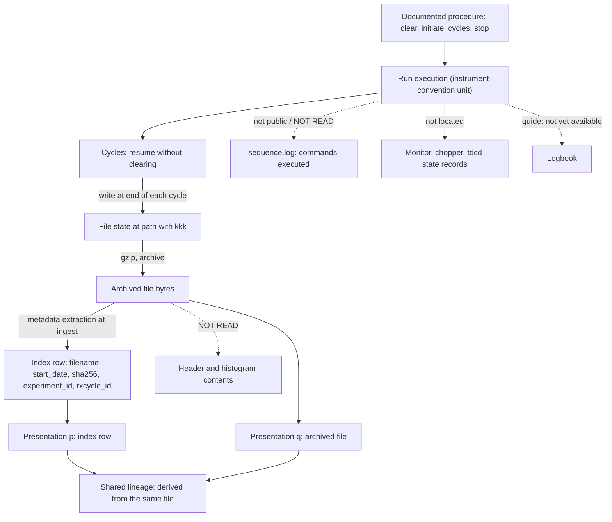
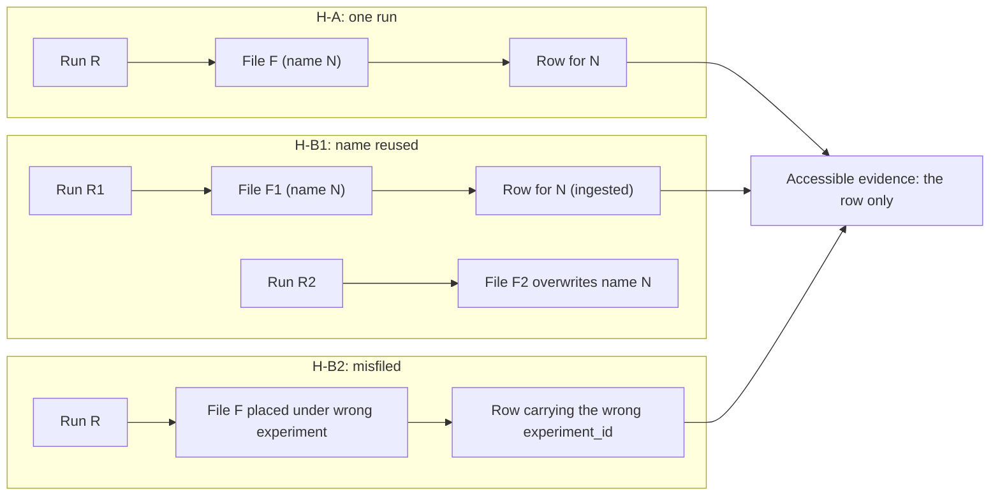
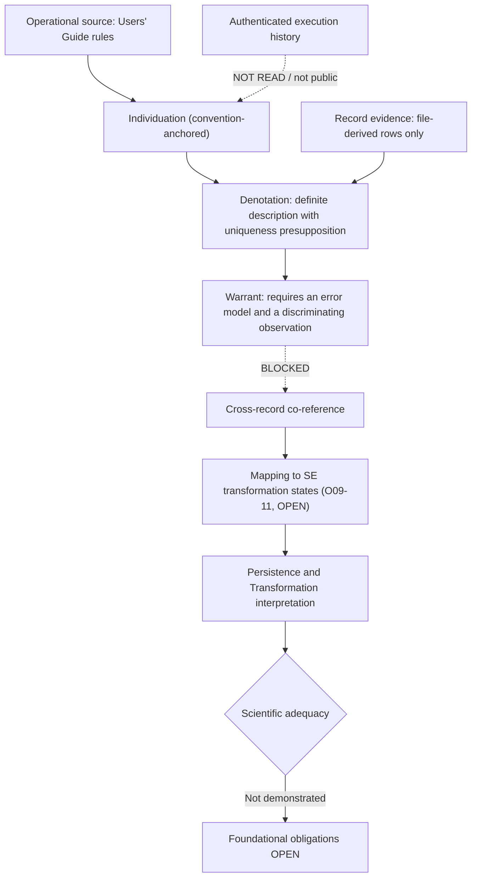

# Structural Explainability

# Scientific Development Note v0.10 — Critical Reconciliation and Evidence Feasibility for Concrete Occurrence Identity

**Date:** 2026-10-16
**Status:** OPEN — scientific reconciliation; no theory acceptance performed
**Mode:** Read-only. Repository changes: none. Lean, papers and protocols: not edited.
**Predecessors:** v0.7, v0.8, v0.9 (`C-DCS-2-ChatGPT`), v0.9-c (`C-DCS-2-Claude`)

| Decision | Result |
| --- | --- |
| Theory-construction verdict | **FUNDAMENTAL QUESTION REMAINS** |
| DCS evidence-access decision | **BLOCKED** |
| DCS case (Phase V) | **Suspend DCS-specific theory construction**, with reopening conditions in K.4 |
| Neither verdict authorizes canonical adoption | |

## Executive finding

There is not presently sufficient independently justified evidence to establish that two actual presentations identify one particular DCS acquisition episode.

- The only pair of presentations I could actually inspect is a file-derived index row and the file it was derived from. NIST states that metadata are extracted from each datafile as it moves into the repository. That pair is not two independent observations.
- The records that could be independent of the file path (control logs, raw file contents, header, logbook) were not retrievable here. They are **NOT READ**. They are not shown to be absent.
- Neither v0.9 candidate survives as a sufficient criterion. Both pass the adversarial cases only in the trivial sense that no accessible evidence satisfies either one. That avoids false positives vacuously.
- What survives is a set of source-grounded necessary constraints (SG1–SG9, K.4), a set of valid constructed counterexamples (CE1–CE8), and an error-model-relative reading of independence that replaces the universal "no shared causal link" requirement.
- Two scratch analysis scripts were run in the session scratchpad: a row-consistency check on the live rows and a constructed Poisson illustration. They are not deliverables and not implementation code.

---

# A. Research question, protocols, and source authority

## A.1 Question

For the NIST Disk Chopper Spectrometer, can publicly inspectable, independently justified evidence establish that two presentations identify one particular physical acquisition episode? Or do the available observations leave multiple distinct acquisition histories compatible?

This note reconciles two independently produced v0.9 reports, corrects unsupported claims, and decides whether the DCS case can support the required empirical test.

## A.2 Protocols

Retrieved from the `main` branch of `se-protocols-research`; commits were not pinned.

| Protocol | Read? | Use here |
| --- | --- | --- |
| `source-audit` | Yes, full text | Applied to external claims. Outcomes FOUND / PARTIAL / NOT FOUND / UNDER-SPECIFIED. NOT READ is never reported as NOT FOUND. |
| `independent-review` | Yes, full text | Applied as a standard for the comparison. See limitation below. |
| `theory-construction` | Yes, full text | Applied to the verdict and the deferred ledger. No new candidate is proposed because the evidence does not justify one. |
| `theory-acceptance` | Not read | **Not performed.** |

**Limitation on independence.** The independent-review protocol makes independence a property of the reviewer's information path. This note was produced in one context that held both v0.9 reports and the v0.10 prompt, so it is not an independent review of either report.

It is a reconciliation. Its conclusions can be reproduced by a reviewer, but the note is not itself independent evidence. The author of `NOTEv09-c` is identified as Claude, so common-mode influence between that report and this note cannot be excluded.

## A.3 Labels

Claim classes (prompt I.2): VERIFIED FROM PRIMARY SOURCE (VPS), REPORTED OBSERVATION — NOT INDEPENDENTLY REPRODUCED (REPORTED), SOURCE-SUPPORTED INFERENCE (SSI), ADDITIONAL ASSUMPTION (ASSUMP), MATHEMATICAL CONSEQUENCE (MATH), CONJECTURE (CONJ), COUNTEREXAMPLE (CEX), UNSUPPORTED, UNRESOLVED.

Case provenance in Section G: OBS = observed in this session; DOC = derived from retrieved documentation; CON = constructed (not independent validation).

"VERIFIED FROM PRIMARY SOURCE" means the primary page or endpoint was retrieved and its text examined in this session. The Users' Guide, the API documentation and the live JSON came back as full text. The Lean files and some other pages came back only as summaries or headers from an intermediate model. Those are marked "summary-level".

## A.4 Source authority and access record

Observation date: 2026-10-16 (CDT). Exact per-request times were not recorded; the tool clock read 13:36 CDT near the end of evidence gathering.

| Source | Authority for | Retrieval status |
| --- | --- | --- |
| DCS Users' Guide, `nist.gov/ncnr/dcs-users-guide`, §Runs and sequences (Runs; Sequences; Defining; Starting and stopping; sequence.prm and sequence.log); modified 2022-02-22 | Documented control and acquisition procedure | Full text retrieved |
| Legacy DCS guide page, `ncnr.nist.gov/instruments/dcs/dcs_ug/index.html`; "Last modified 29-May-2015" | File naming, binary format, Octave | Retrieved; the answer came back through a summarizing tool |
| DCS Design Features page, §Data Acquisition Hardware and Software | Hardware architecture; carries a "no longer being updated" banner | Retrieved |
| NCNR Instrument Data landing page `ncnr.nist.gov/ncnrdata/` | Metadata extraction statement; helper endpoints | Retrieved |
| CHRNS metadata API docs, `api_docs.html` | Documented schema and filters | Full text retrieved |
| Live API `ncnr.nist.gov/ncnrdata/metadata/api/v1/{datafiles,instruments,experiments}` | Index rows as served | Retrieved (raw JSON); filters untestable (below) |
| `listRxCycles.php` | Reactor-cycle windows | Retrieved through a summarizing tool |
| NCNR Data Management Plan; CHRNS FAIR page | Policy, experiment-level DOIs | Retrieved; used at page level only |
| SE Lean files (five) | Existing formal commitments | Retrieved summary-level only (Section I) |
| `NOTEv07`, `v08`, `v09`, `v09-c`, `v10-PROMPT` | Provisional research context | Read in full; no evidential authority |

**Access constraints. None was circumvented.**

1. Shell requests to `ncnr.nist.gov` returned HTTP 403 at the proxy. The fetch tool was used instead.
2. `ncnr.nist.gov/pub/ncnrdata/dcs/200707/` returned ROBOTS_DISALLOWED. Raw `.dcs.gz` files, their headers, and ChatGPT's directory listing are **NOT READ**.
3. The fetch tool drops query strings. This was observed in the returned `destination_url` for every filtered request, including `?instrument=dcs&limit=1`, `?instrument=dcs&limit=250`, `experiments?id=46&instrument_id=20` and `listftpfiles.php?pathlist[]=…`. Filter and pagination behavior is therefore **NOT TESTABLE** here.
4. `data.nist.gov/od/id/mds2-2139` and a repeat fetch of the datafiles endpoint (intended to test whether the newest row's hash changes) timed out on permission prompts. Neither was read or performed.
5. A web search for the `.dcs` header format returned nothing relevant. Header contents are NOT READ.

---

# B. Comparative scientific findings from the two v0.9 reports

## B.1 The two candidates, kept separate

| Attribute | `C-DCS-2-ChatGPT` (NOTEv09 §C–D) | `C-DCS-2-Claude` (NOTEv09-c §C–D) |
| --- | --- | --- |
| Intended referent | One actual DCS measurement-run acquisition episode, a run-control execution. Excludes experiment, run buffer, sequence, cycle, datafile, DB entry, publication, processing. | The physical process of counting into the DAQ histogram under one run-control state. Levels: experiment, sequence, run, cycle, file state. |
| Existence | Exists once run control has successfully initiated acquisition. Independent of counts, success, a complete file, or correct metadata. | Begins at a start that clears the run buffer (I1). Anchored in the instrument's run-control convention. |
| Operational individuation | Execution from successful initiation through continuing cycles to operational termination (K.2). | I1–I5: clearing start; cycle boundaries inside a run do not end it; a stop ends it; a later start is a new episode (assumption); rejected cycles are physical but excluded from the retained histogram. |
| Run boundaries | Start: successful initiation. End: normal or early termination. Failure and recovery boundaries unsettled; no invented time threshold. | Start: memory-clearing start. End: stop. Same unsettled region. Irregular gaps in start times not resolved. |
| Constituent activities | Cycles are parts. File writes do not create runs. | Cycles; overwrites at cycle ends; rejected cycles. |
| Denotation conditions | D1 referent-kind resolution; D2 operational grounding; D3 record-production attribution. Denotation δ_H(p) is relative to a history H. | W(p,E) requires L1 (documented reliability of every link from trace to p) and L2 (content sensitivity). |
| Evidential assumptions | Admissible-history set 𝓗(E), to be justified by instrument behavior and record production. | One file per run; no reissue of serial kkk (for relative co-reference); the run convention tracks a meaningful unit. |
| Co-reference criterion | Schematic test: for all H in 𝓗(E), δ_H(p) = δ_H(q). Conditions D1–D6. Stated not to be "yet a scientific identity theorem". | CoRef warranted "iff": (1) W(p1,E1) and W(p2,E2); (2) independence = no shared link after the trace and no common identifier-assignment event; (3) a content-level discriminator excludes distinct-run explanations; (4) no known defeater. Plus a relative co-reference lemma for file-derived records. |
| Competing explanations | H1/H2 countermodel; D5 competing-episode exclusion; D6 defeater assessment. | H1–H5: one run two records; two runs compatible; misattribution; shared erroneous source; same file at different cycle states. |
| Uncertainty | Qualitative ("established / not established"). An error model is required (PO-06) but not supplied. | Qualitative. CJ-A's power is described as regime-dependent, without numbers. |
| Claimed necessary | D1–D6 as "kinds of evidence and checks required". Independence explicitly "a safeguard … not a universal requirement". | L1, L2, independence, discriminator and no-defeater as conjuncts of an "iff". Necessity of each not argued separately. |
| Claimed sufficient | Explicitly not claimed. | Written as "iff", but D.2 and F show no accessible pair meets it, and the sufficiency direction is never argued. |

## B.2 Claim classification

"Report" names the v0.9 report making the claim (CG = ChatGPT, CL = Claude).

| ID | Claim | Report | Class | Note |
| --- | --- | --- | --- | --- |
| X1 | A run: memory cleared; acquisition initiated; stopped later; data written. A run normally has several cycles. | CG, CL | VPS | Guide §Runs |
| X2 | Between cycles acquisition resumes without clearing. The file is written at the end of cycle 1 and overwritten at the end of each later cycle. | CG, CL | VPS | Guide §Runs; legacy page agrees |
| X3 | Three stop modes: lose current cycle; keep current cycle; finish current cycle. | CG, CL | VPS | Guide §Starting and stopping |
| X4 | Check Stats rejects a cycle if (a) the white-beam monitor rate is below a threshold (example given: reactor shut down) or (b) the choppers were out of phase too long. The cycle is "lost rather than remeasured", so the run ends at the expected time. | CG, CL | VPS | Guide §Runs |
| X5 | Rejected-cycle data are excluded from the retained file. Mechanism (rollback or never merged) and whether the file is rewritten are not stated. | CL (I5) | SSI | Mechanism UNRESOLVED |
| X6 | "Run number n" in a sequence is run buffer n. There are 12 buffers, numbered 0–11. | CL | VPS | Guide §Sequences; §Defining |
| X7 | A buffer index therefore cannot identify an execution, because a buffer is reused by many executions. | — (new) | SSI | |
| X8 | sequence.prm is consumed as commands run. sequence.log lists "the sequence commands that have been executed to date", in the dcs home directory. Whether entries are timestamped is not stated. | CG, CL | VPS (content of fields UNRESOLVED) | Guide §sequence.prm and sequence.log |
| X9 | File names are `yyyymmdd_kkk.dcs.gz`, binary, readable with Octave. The rule assigning kkk is not stated. | CL | VPS (assignment rule UNRESOLVED) | Legacy page |
| X10 | "Rec Temp" records sample and control temperatures in the raw file at the end of each cycle. | — (new) | VPS | Guide §Runs |
| X11 | The guide's "Use of the log book" section reads "Sorry, not yet available". | — (new) | VPS | Guide §Miscellaneous |
| X12 | The Design page carries a "no longer being updated" banner. | CG | VPS | |
| X13 | 21 DCS rows (filenames, start_date, experiment_id) appear in the newest 25 mixed rows. | CL | VPS | Reproduced exactly (D.3). One sampling episode. |
| X14 | Time zone of start_date "not stated". | CL | **Corrected**: raw strings carry `-04` | D.3 |
| X15 | All DCS rows have metadata null and localdir `dcs/202608/<experiment>/data`. | CL | VPS | |
| X16 | Filters "did not take effect". | CL | UNRESOLVED | Tool drops query strings; probably a tool artifact, not shown. |
| X17 | Serials are contiguous within each day shown. | CL | MATH from X13 | Script-checked |
| X18 | Start-to-start intervals ≈ 1 h, then irregular gaps, then ≈ 2 h, then 4:04:14. | CL | MATH from X13 | Interpretation is CONJ (D.4) |
| X19 | Row 16_004 may have been still accumulating. | CL | CONJ | Untested |
| X20 | Metadata extracted from archived datafiles makes the database entry non-independent of the file. | CG | SSI | Landing page says metadata are extracted "from every datafile … as it is moved into the data repo". Which fields come from file contents versus path is UNRESOLVED. |
| X21 | The documents do not state that the index derives from the file. | CL | **Narrowed**: derivation of the `metadata` field is stated (X20); derivation of experiment_id and rxcycle_id from the path is not. | |
| X22 | 200707 listing with `20070823_005` and `_006` entries and sizes. | CG | REPORTED | ROBOTS_DISALLOWED in this session. Not confirmed, not refuted. |
| X23 | The API docs' only example is a BT1 record. | CG | VPS | Sample is `bt1`, filename `FeSe_0T_10K_87693.ng0` |
| X24 | The API offers an `instrument` filter including `dcs`. | CG | VPS (that it is documented); function UNRESOLVED | |
| X25 | `mds2-2139` is a dataset-level record without run-level fields. | CL | REPORTED | My fetch did not complete |
| X26 | Equal sha256 implies equal bytes. | CL | MATH under ASSUMP (collision resistance) | |
| X27 | A sha256 identifies a file state, not a run. | CL | MATH from X2 | |
| X28 | CJ-A: later file states of one run dominate earlier ones binwise. | CL | CONJ | D.5 |
| X29 | Dominance is not sufficient; it fails to discriminate when the second file is much larger. | CL | MATH in a constructed model; DCS applicability UNRESOLVED | Table in C.4 |
| X30 | Independence = no shared link after the trace and no common identifier-assignment event. | CL | ASSUMP | Assessed in C.4 |
| X31 | L2: an identifying record must carry information that would differ had another run been acquired. | CL | ASSUMP | Assessed in C.4 |
| X32 | A start after termination begins a new episode. | CG, CL | ASSUMP; the guide supports a memory reset (SSI), not episode identity | |
| X33 | Existence of an episode does not depend on positive counts. | CG | ASSUMP; supported by the guide's documented background measurement with the shutter closed (SSI) | |
| X34 | Countermodel H1/H2: one episode versus two, with indistinguishable evidence. | CG | CEX (constructed) | Valid as an underdetermination demonstration |
| X35 | For all H in 𝓗(E), δ_H(p) = δ_H(q) as the evidential test. | CG | ASSUMP (definition) | Adequacy rests on 𝓗(E); gap noted in C.1 |
| X36 | Relative co-reference: records derived from the same file co-refer relative to (a) one file per run and (b) no reissue of kkk. | CL | MATH given two ASSUMP | |
| X37 | Concurrent distinct runs are excluded by the single-histogram design. | CL | SSI | Design page, banner caveat |
| X38 | Both reports reach FUNDAMENTAL QUESTION REMAINS. | CG, CL | not evidence | Agreement between AI reports is not verification |
| X39 | Descriptions of Carriers, Persistence Core, Effect, the Identity Regimes OCC row and the IGN convention, and the SE integration scope. | CG | VPS at summary level (Section I) | CL did not read these files |

## B.3 Agreement, disagreement, genuinely new information

**Agreement** (not evidence): run, cycle and sequence are distinct; the file is overwritten; experiment-level records are not run-level; a start after termination is a new episode (an assumption in both); DB entries derived from files are not independent; both give the verdict FQR. My own verification: X1–X4 and X20 hold from primary text. The new-episode rule and the FQR verdicts are agreement only.

**Disagreement** (not silently reconciled):

| # | Point | CG | CL |
| --- | --- | --- | --- |
| D1 | Existence and start | Successful initiation | Memory-clearing start |
| D2 | Role of independence | A safeguard, not universal | A necessary conjunct |
| D3 | Content sensitivity | No content condition | Required (L2), with CJ-A |
| D4 | Positive result for file-derived records | None offered | Relative co-reference (X36) |
| D5 | Evidence reached | Archive listing (200707); live DCS rows not recovered | Live rows; raw files not read |

D1 matters operationally. The guide lists "memory cleared" and "acquisition initiated" as separate steps. A start that clears memory and then fails to initiate is an episode under CL and not under CG. Neither report verifies which occurs.

D5 is not a conflict of facts: the reports reached different sources. CG's "live responses not recovered" is a retrieval outcome, not evidence that the rows are absent (X13 is reproduced here).

**Genuinely new in this note:**

- X7, X10, X11.
- The shutdown-window context: the DCS rows fall in a gap between listed reactor cycles (D.3).
- The proportional interval pattern (D.4).
- Hash-scope and staleness questions (C.4).
- The vacuity-of-safety point (G.3).
- The definite-description reading of file→run denotation (E.3).

---

# C. Corrections, disagreements, and unresolved assumptions

## C.1 Corrections to the v0.9 reports

1. **(CL) Time zone.** The raw strings carry a UTC offset (`-04`, EDT). The statement that the zone "is not stated" is wrong.
2. **(CL) "Hourly fixed-length runs".** This reading is not supported as stated.
   - `rxcycle_id` is `202608` for rows dated 14–16 Oct 2026.
   - `listRxCycles.php` (summary-level) gives 202608 as 2026-08-19 04:00 UTC to 2026-09-14 03:59:59 UTC, and 202610 as starting 2026-10-19 04:00 UTC. Cycles 202606 and 202609 are absent.
   - The rows therefore lie in a gap between listed cycles.
   - The experiments listing contains a record titled "Shutdown activities Sept-Oct 2026" (candor, dated 2026-09-14, description "Debugging and development during shutdown").
   - Together this makes a no-reactor-neutron interval plausible for those DCS rows. It is **not established**. Check Stats exists precisely to reject cycles when the reactor is down (X4), and it may be unchecked.
3. **(CL) "Filters did not take effect."** Unsupported as a finding. The fetch tool strips query strings, which would produce exactly the observed unfiltered page.
4. **(CL) Derivation of the index.** Narrowed per X21.
5. **(CG) "Public directory listing inspected."** Not reproducible here. Retained as REPORTED.
6. **(CG) "Selected current public Lean sources were inspected directly."** For Persistence Core, Transformation Effect and the SE integration file, only headers, imports and doc comments are retrievable. Statements about their declarations are unsupported by what I could retrieve.
7. **(CL) The "iff" in D.1.** Conditions 1–4 contain no clause that E1 = E2. Condition 1 introduces separate episodes E1 and E2. Sufficiency holds only if condition 3 is read as "the discriminator establishes E1 = E2", which smuggles the conclusion into a conjunct. As written, 1–4 are at most necessary-style safeguards.
8. **(CG) D.4 totality.** The test "for all H, δ_H(p) = δ_H(q)" is undefined where δ_H(p) or δ_H(q) is undefined (denotation failure). A total-function reading makes failure to denote indistinguishable from denoting different episodes. The test must say how denotation failure is treated.

## C.2 Unresolved assumptions in force (all OPEN)

| ID | Assumption | Who relies |
| --- | --- | --- |
| A1 | One file per run | CL (X36); implicit in CG's use of file entries |
| A2 | kkk is not reissued under one filing path | CL |
| A3 | The run convention tracks a physically meaningful unit | CL (R2); CG implicitly |
| A4 | The 2022 guide describes October 2026 behavior (the design page says it is not updated) | both |
| A5 | The index sha256 corresponds to the current file bytes | not stated by either; needed for any index-versus-file comparison |
| A6 | `start_date` has a fixed meaning (acquisition start, file creation, or ingest) | both |
| A7 | A post-termination start is a new episode | both |
| A8 | Rejected-cycle handling never subtracts counts from earlier accepted cycles | CL (CJ-A) |

## C.3 Evidence for the semantics of start_date, from non-DCS rows

The cgd experiment 30392 has `creation_timestamp` 2026-10-15 14:23:11.742-04. Its two rows (`queue`, `console_history.html`) have start_date 14:23:12.509 and 14:23:12.304, within one second of the experiment's creation.

Those files are not acquisition files. So `start_date` is not universally "acquisition start". For DCS rows its meaning is UNRESOLVED (A6).

## C.4 Audit of the four methodological concerns

### Concern A — causal independence

**Distinguishing the dimensions.** Each dimension protects against a different threat. Sharing one is harmless for some threats and fatal for others.

| Dimension | Independence protects against | Sharing it is harmless for | Sharing it defeats corroboration of |
| --- | --- | --- | --- |
| Authors | An individual's slip or bias | Transport fidelity | Author-level error |
| Software processes | A software bug (for example a filename-assignment bug) | Content integrity checks | Bug-induced misattribution |
| Records (derivation) | Propagation of one record's corruption | Downstream corruption (a hash match detects it) | Any error at or before the shared record |
| Measurement channels | Detector or monitor fault, and spoofing | Attribution errors | Channel-specific error |
| Identifier assignment | A wrong key | Anything the key does not govern | Mis-keyed records (agreement is entailed by the common key) |
| Attribution mechanism | Misattribution of a record to the wrong trace | Corruption | Common-mode misattribution |
| Error mechanisms | Joint failure | — | Any common cause |

**Assessment of Claude's condition (no shared link after the trace and no common identifier-assignment event).**

- *Too restrictive as a condition of warrant.* Two records sharing a legitimate, reliable source can each warrant a denotation. A shared serial from a calibrated or audited counter is not worthless because it is shared. Requiring full disjointness would reject warranted attributions that rest on reliable shared infrastructure. Shared source does not automatically lose all evidential value.
- *Insufficient for corroboration.* Chains disjoint after the trace can share a cause at or before it. An operator mis-entry, or the wrong sample mounted, produces separately authored records with one inherited attribution error. Chains independent of each other can also both attach to an ambiguous trace.
- *Threat-model dependent.* Independence is a relation between failure events relative to a stated threat. "Independent" is incomplete without "with respect to threat T". Independence comes in degrees: conditional failure probabilities versus their product.

**Consequence.** Claude's condition is an ASSUMP that I do not adopt as stated. The defensible replacement is a requirement schema, not a theory. For each threat T in a stated error model, an adequate criterion must show either (i) an observation that would differ under T (discrimination), or (ii) an independent reliability justification of the shared component with respect to T. If neither holds for some T, then T-compatible histories remain admissible, and co-reference is not established relative to that model. This is a MATH consequence of underdetermination, not a new result.

The accessible DCS records satisfy neither (i) nor (ii) for the main threat (misattribution at the filing step).

### Concern B — content sensitivity

L2 is ambiguous. Three readings:

1. **Modal sensitivity** (the record would differ in some world where another run happened). Nearly all content satisfies this, including timestamps. It does not discriminate.
2. **Discriminating power relative to an alternative set**: the likelihood ratio P(content | same run) / P(content | distinct run). This is probabilistic. It requires a stated alternative set, a statistic, a null model, a false-match rate and a false-reject rate.
3. **A shared noise realization as fingerprint.** Counting statistics make independently acquired histograms independent draws, so agreement in a shared realization is strong evidence of shared acquisition. This is the rationale behind CJ-A.

L2 is neither necessary nor sufficient as an absolute:

- Not necessary. A reliable counter-assigned identifier can warrant denotation without being content-sensitive, if its reliability is independently justified.
- Not sufficient. A sha256 is content-sensitive to every byte, but two states of one run have different hashes (X27). Different executions can also produce indistinguishable outputs (zero-count or background runs; Case 2).

A useful discriminator must state its alternative set, its error rates and its regime of validity. Neither report does, and none can be tested without the file contents.

### Concern C — hash and file-state identity

| Step | Holds? | Basis |
| --- | --- | --- |
| Equal sha256 ⇒ equal bytes | Under ASSUMP (collision resistance); a computational assumption, not a logical entailment | MATH + ASSUMP |
| Equal bytes ⇒ equal file contents | Yes (same thing) | MATH |
| Equal bytes ⇒ identical stored object | **No.** Two paths can hold the same bytes (copy, mirror) | MATH |
| Same stored object at different times ⇒ same bytes | **No.** The file is overwritten at each cycle end (X2) | VPS |
| Same stored object ⇒ one episode | Only under A1 and A2 | ASSUMP |
| One episode ⇒ one hash | **No.** One run has many file states with different hashes | MATH from X2 |
| Equal bytes ⇒ one episode | **No.** Two executions may produce compatible or identical data | CEX |
| Two episodes ⇒ different hashes | Not guaranteed. Only practically likely when the data are rich and the header varies | MATH |

Two further points that neither report raised:

- **Hash scope is undocumented.** The index field is called sha256 of a `.dcs.gz` file, but the byte string hashed (compressed or decompressed) and the time it was computed are not stated. Under the gzip format, a compressed file may embed a modification time in its header (general knowledge; the format specification was not retrieved here). In that case identical data compressed at different times would hash differently. Conversely, equal hashes of compressed bytes are a stronger statement than equal histograms. UNRESOLVED.
- **Staleness.** If the hash was computed at ingest and the file was later overwritten by a further cycle, the index hash no longer matches the file. That affects the newest row `20261016_004` if that run was still accumulating (CONJ).

The format of the live value differs from the documentation. The live API returns a bytea-style escape (`\x…` after JSON unescaping). The docs' only sample shows plain hex. The documented API differs from live output in other respects too: `rxcycle_id` is an integer in the docs and a string live, and the `start_date` string format differs. Documentation is therefore not binding for live semantics.

### Concern D — CJ-A (binwise nondecreasing histograms across successive file states of one run)

**What the guide supports.** Memory is cleared at start and not between cycles (X1, X2); a file state is written at the end of each cycle; Check Stats may reject a cycle, which is "lost" (X4); a stop may discard the current cycle's data (X3).

Counts only accumulate. If each file state is the cumulative histogram of accepted cycles, and rejection or discard never subtracts previously accepted counts from the next written state, then successive file states are binwise nondecreasing.

**Conditions CJ-A silently needs** (all unverified):

1. The written file is a cumulative histogram of accepted cycles.
2. Rejection or discard does not subtract earlier accepted counts. The guide says the rejected cycle is "lost", but the mechanism (rollback or never merged) is not stated, so memory-level monotonicity is not guaranteed; file-level monotonicity requires that the file is written from accepted state only.
3. No post-processing that can reduce a bin (masking, normalization, background subtraction).
4. No counter wraparound or storage error.
5. No mid-cycle write other than a documented stop-mode write.

**Status.** CJ-A is at best a conditional necessary condition for "F2 is a later state of F1's run". Binwise dominance is neither a probabilistic indicator without a stated alternative, nor a sufficient discriminator.

**Archival relevance.** The file is overwritten at each cycle end, so the repository normally holds a run's final state. Earlier states exist only if captured by a snapshot, a polling observer, or a prior ingest. So CJ-A has practical bite mainly for comparing an earlier snapshot of an in-progress file with a later state. This is SSI. Whether intermediate states are archived is UNRESOLVED.

**Constructed power illustration (not DCS data).** Model: n = 50 independent Poisson bins; the same shape in both runs; no background or dead time; the second run's expected counts are r times the first run's. Under the same-run hypothesis, dominance holds with probability 1 (by the premises). Under "two distinct runs", log10 of the probability that dominance holds anyway:

| mean counts per bin in run 1 \ r | 1.0 | 1.1 | 1.5 | 2.0 | 5.0 |
| --- | --- | --- | --- | --- | --- |
| 0.05 | −1.03 | −1.03 | −1.01 | −0.98 | −0.85 |
| 5 | −12.44 | −10.30 | −4.74 | −1.68 | −0.00 |
| 50 | −14.20 | −7.61 | −0.24 | −0.00 | −0.00 |
| 500 | −14.78 | −1.33 | −0.00 | −0.00 | −0.00 |

Interpretation, valid only inside this model:

- Strong discrimination needs similar exposure (r near 1) and decent counts.
- Sparse bins give almost none (about 1 in 10 false-pass probability).
- When the second run is much larger (r ≥ 1.5 at ≥ 50 counts per bin), dominance fails to discriminate: the false-pass probability approaches 1.

Real bins are correlated, shapes differ and backgrounds exist, so the numbers are not transferable. Nothing in the live rows tells how many counts per bin they contain.

The observed spacing pattern (≈ 1 h, ≈ 2 h) would imply r ≈ 2 between 1 h and 2 h pairs only if those runs had the same configuration and their file contents scaled with duration. Neither was established.

---

# D. Primary-source audit and independently verified empirical observations

## D.1 Operational source — what the Users' Guide establishes (prompt II.1)

| # | Item | Finding | Class |
| --- | --- | --- | --- |
| 1 | Actual acquisition initiation | A run begins with the memory cleared and acquisition initiated. Start is a GUI action ("Run > Start", select a buffer) or a sequence command `run buffer n`. Nothing states how "initiated" is confirmed, so request versus actual initiation is not distinguished in the text. | Procedure FOUND; instance-level evidence NOT FOUND |
| 2 | Memory clearing | Step 1 of a run. Not repeated between cycles. | FOUND |
| 3 | Cycle continuation | Acquisition resumes after each cycle without clearing. | FOUND |
| 4 | Datafile creation and replacement | Written at the end of the first cycle; overwritten at the end of each later cycle. | FOUND |
| 5 | Cycle rejection | Check Stats (if enabled) rejects on low white-beam monitor rate or excessive out-of-phase fraction. The cycle is lost, not remeasured; the run still ends on schedule. Effect on the file write is not stated. | FOUND; file effect UNDER-SPECIFIED |
| 6 | Early termination | Three stop modes. The file contents after each mode (for example, is a partial cycle written?) are not described beyond "retained" or "discarded". | FOUND; post-states UNDER-SPECIFIED |
| 7 | Run restarts | No resume operation is described. A new Start follows the stated procedure, beginning with memory clearing (SSI). Crash and recovery behavior is not described. The Miscellany section does describe restarting the time-to-digital-converter daemon after killing the core program, so component restarts exist; their effect on a run in progress is not stated. | Resume: NOT FOUND (Guide, as retrieved); recovery UNDER-SPECIFIED |
| 8 | Run-buffer numbering | 12 buffers numbered 0–11; "run number n" in a sequence means buffer n. | FOUND |
| 9 | File serial numbering | `yyyymmdd_kkk.dcs.gz`. The assignment rule is not stated. | Naming FOUND; rule NOT FOUND |
| 10 | Mapping among identifiers | No statement relates buffer index, kkk and experiment_id. A buffer is a configuration slot reused by many executions, so no one-to-one mapping from buffer to execution can exist (SSI). | NOT FOUND |

**Applicability.** The guide is dated 2022-02-22 (the legacy page 2015). The design page carries a banner saying it is no longer updated. The guide's statements are documented rules, not verified current behavior (A4).

## D.2 Instrument and policy sources

- The Design page's data-acquisition section is consistent with a single acquisition histogram (X37). Its banner limits how much it can verify about current configuration.
- The Data Management Plan and the CHRNS FAIR page describe archiving and experiment-level DOIs. Neither (at page-level reading) describes run-level occurrence identification or run-control logs. I found no statement about log preservation in the DMP.
- The API documentation defines "Experiment" as "A single measurement (beamtime)", and gives `id` as "either an IMS id (numeric) or nonims". So `experiment_id` is a beamtime-level designation (supporting G.14). The meaning of the short numeric id `46` is UNRESOLVED.

## D.3 Live metadata audit (prompt II.2)

**Source:** `https://ncnr.nist.gov/ncnrdata/metadata/api/v1/datafiles`. Observed 2026-10-16 (CDT). Single sampling episode. Fields inspected: filename, experiment_id, rxcycle_id, instrument, start_date, sha256, metadata, localdir.

**Checks:**

| Check | Result |
| --- | --- |
| Endpoint and parameters | Documented parameters: experiment_id, rxcycle_id, instrument (enum includes `dcs`), instrument_id, before, after, metadata, limit (1–250, default 25), offset. |
| Do instrument filters function? | NOT TESTABLE with this tool (query strings dropped). |
| Does pagination change the sample? | NOT TESTABLE. The returned page had 25 rows, matching the documented default limit. |
| Complete filenames and start_date strings | See table below. |
| Time zone | Present: `-04`. |
| Population | The 25 rows are the newest of all instruments, not a DCS sample and not a complete population: 21 DCS, 2 cgd, 2 hfbs. |
| experiment_id | Beamtime-level (API docs). 20 DCS rows carry "46"; `20261016_004` carries "30402". Neither id was found in the unfiltered experiments page that I could retrieve. |
| rxcycle_id | Value "202608" on all 21 DCS rows. Assignment rule for timestamps outside every listed cycle is UNRESOLVED (D.4). |
| start_date semantics | UNRESOLVED (C.3). |
| sha256 | Present on all 21 DCS rows; all distinct. Role: integrity of one byte string at some time (C.4 Concern C). |
| metadata = null | True for all 21 DCS rows. The hfbs rows carry non-null metadata with a free-text "DAQ testing - no neutrons". So null for DCS reflects either no extractor or no metadata; UNRESOLVED. |
| Are records generated from datafiles? | The landing page says metadata are extracted from every datafile as it moves into the repository. Which fields derive from contents versus path is UNRESOLVED. |
| Relation to the physical process | None documented. The index is a catalogue of files. |

**The 21 DCS rows as served** (all with instrument `dcs`, rxcycle_id `202608`, metadata `null`; sha256 shown to 16 hex characters — the full 64-hex values were retrieved):

| filename | raw start_date | experiment_id | localdir | sha256 (first 16) |
| --- | --- | --- | --- | --- |
| 20261016_004.dcs.gz | 2026-10-16 09:16:48-04 | 30402 | dcs/202608/30402/data | 16b9f13b8e5f9a34 |
| 20261016_003.dcs.gz | 2026-10-16 05:12:34-04 | 46 | dcs/202608/46/data | 0d758f42e364280a |
| 20261016_002.dcs.gz | 2026-10-16 03:11:52-04 | 46 | dcs/202608/46/data | 81e5f6746f1766ce |
| 20261016_001.dcs.gz | 2026-10-16 01:11:06-04 | 46 | dcs/202608/46/data | 1512670839 3b7b77 *(sic: 15126708393b7b77)* |
| 20261015_015.dcs.gz | 2026-10-15 23:10:24-04 | 46 | dcs/202608/46/data | 82292db01b9ee0b4 |
| 20261015_014.dcs.gz | 2026-10-15 21:09:41-04 | 46 | dcs/202608/46/data | 2bc8ab6327d47bebc |
| 20261015_013.dcs.gz | 2026-10-15 19:08:57-04 | 46 | dcs/202608/46/data | 092f6d274436d048 |
| 20261015_012.dcs.gz | 2026-10-15 10:38:29-04 | 46 | dcs/202608/46/data | f6efdd2440da372c |
| 20261015_011.dcs.gz | 2026-10-15 10:21:51-04 | 46 | dcs/202608/46/data | b4b7920be5cdb0a4 |
| 20261015_010.dcs.gz | 2026-10-15 09:46:29-04 | 46 | dcs/202608/46/data | 222c16b7ce6940f6 |
| 20261015_009.dcs.gz | 2026-10-15 08:08:07-04 | 46 | dcs/202608/46/data | 4b34c1914e399bc5 |
| 20261015_008.dcs.gz | 2026-10-15 07:07:45-04 | 46 | dcs/202608/46/data | 5284a576d78097051 |
| 20261015_007.dcs.gz | 2026-10-15 06:07:24-04 | 46 | dcs/202608/46/data | 5269520f427574b6 |
| 20261015_006.dcs.gz | 2026-10-15 05:07:03-04 | 46 | dcs/202608/46/data | 0611722821a010783 |
| 20261015_005.dcs.gz | 2026-10-15 04:06:42-04 | 46 | dcs/202608/46/data | 43f12693eb8ba2db |
| 20261015_004.dcs.gz | 2026-10-15 03:06:21-04 | 46 | dcs/202608/46/data | 52df68111eb2b812 |
| 20261015_003.dcs.gz | 2026-10-15 02:06:00-04 | 46 | dcs/202608/46/data | 1a2efd8556e2bc84 |
| 20261015_002.dcs.gz | 2026-10-15 01:05:38-04 | 46 | dcs/202608/46/data | 38f6f2782ae7a9fb |
| 20261015_001.dcs.gz | 2026-10-15 00:05:17-04 | 46 | dcs/202608/46/data | c8cfc5419eed94b6 |
| 20261014_006.dcs.gz | 2026-10-14 23:04:55-04 | 46 | dcs/202608/46/data | 1b94ae23242e592c |
| 20261014_005.dcs.gz | 2026-10-14 22:04:34-04 | 46 | dcs/202608/46/data | 3d349873e90e5855 |

*(Hash prefixes are for orientation only; the sha256 column is not used in any argument below except for the facts that all 21 are present and distinct.)*

**Reproduction verdict on Claude's table:** the 21 filenames, start times and experiment ids match NOTEv09-c exactly, as shown by a script comparison. Reported rows are VERIFIED (X13), with the caveats of a single sampling episode and an unfiltered newest-25 page. Timestamps were not re-fetched later, so staleness behavior of a mutable row is untested.

## D.4 What the rows do and do not show (prompt concern E)

**Equal selected attributes versus identical records.** The 21 rows are not identical records. They differ in filename, start_date and sha256 (all distinct). They share instrument, rxcycle_id, null metadata and, for 20 of 21, the experiment and path. Equality of selected attributes is routine here and demonstrates only attribute compatibility. It does not establish a repeated physical configuration, an interruption, a restart, or occurrence identity.

**Computed facts** (MATH from the strings):

- Serials are contiguous within each day shown (14th: 005–006; 15th: 001–015; 16th: 001–004).
- There are 20 start-to-start intervals:
  - 10 intervals of 3621 s or 3622 s (seven of 3621, three of 3622);
  - 5 intervals of 7242–7246 s;
  - 5 irregular intervals: 5902 s, 2122 s, 998 s, 30628 s, and 14654 s (the last one between `_003` and `16_004`).
- Both regular classes are proportional to the nominal 1 h or 2 h: 3621/3600 = 7242/7200 ≈ 1.00583. That is a computed observation about spacing alone. It does not establish run durations, fixed run lengths, or what causes the ratio.
- All 21 filename dates equal the local start_date date. All 21 localdir experiment components equal experiment_id. The page is sorted descending by start_date.
- No equal-bytes pair occurs in this sample (all 21 hashes distinct), so Case 15 is not observed.

**Interpretation limits.** The spacing is consistent with automatic repetition and with interruptions or differently scheduled runs. Start times alone cannot separate these. The irregular gaps may or may not be restarts. `start_date` semantics are unresolved. The context (rows fall in a gap between listed reactor cycles) means these may be runs without reactor neutrons, so the content regime for any discriminator is unknown.

## D.5 Actual evidence availability (prompt II.3)

| Record | Public? | Actually inspected? | Authenticated? | Specific to an episode? | Derived from another record? | Independent of the file in a relevant sense? |
| --- | --- | --- | --- | --- | --- | --- |
| Raw `.dcs.gz` bytes | Directory exists; fetch tool ROBOTS_DISALLOWED; human browser access untested | **No** | Index sha256 would allow an integrity check; not performed | A state of one run | It is the primary trace product | n/a |
| Header of raw file | Same | **No** | — | Possibly | — | NOT READ |
| Index row (datafiles endpoint) | Yes | Yes (D.3) | No | File-specific | **Yes** (metadata extracted from the file; field-level derivation UNRESOLVED) | **No** |
| `listftpfiles.php` (filename, modified time, sha256 for files in a path) | Documented on the landing page | Behavior only; parameters untestable here | — | File-specific | Reads file state | NOT READ for DCS |
| Acquisition-start evidence | Not located | No | — | — | — | NOT READ |
| Termination evidence | Not located | No | — | — | — | NOT READ |
| `sequence.log` (commands executed; in the dcs home directory on the control computer) | Not documented as public | No | — | Sequence-level; time fields unknown | Written by the control side (SSI) | NOT READ |
| Instrument-state records (white-beam monitor, chopper phase, tdcd) | Not located | No | — | — | — | NOT READ |
| Experimental logbook | The guide's logbook section says "not yet available"; no logbook located | No | — | — | — | Unread, not shown absent |
| Independently authored observation or attestation | None located | No | — | — | — | NOT READ |
| Experiment-level DOI record | Reported by CL (`mds2-2139`) | No (my fetch failed) | — | Experiment-level | — | REPORTED |

## D.6 Evidence-access decision (prompt II.4)

**BLOCKED.**

The proposed test requires an occurrence-specific second record whose production path is separable from the file, and the file contents needed to apply any content-level discriminator. Neither was recovered or accessible to this investigation.

What was recovered is the operational documentation (D.1) and the file-derived index rows. Those support only the relative co-reference of an index row with its file, which is not the required test.

This verdict concerns the present investigation. It does not show that no adequate criterion exists, and it does not show that the missing records do not exist or are not accessible by other routes.

---

# E. Grounded DCS occurrence individuation

## E.1 Constitution

**What makes one DCS execution one operational occurrence?** By the documented procedure: a run begins with memory clearing and initiated acquisition, comprises cycles that resume without clearing, and ends at the final cycle or one of three stops. Documented consequences:

- **SG1** Run, sequence, run buffer, cycle, file state and experiment are distinct.
- **SG2** The "run number" in control commands is a buffer index.
- **SG3** Memory is cleared at start and not between cycles.
- **SG4** The file is a sequence of states of one run; the archive normally retains the final state (SSI).
- **SG5** A rejected cycle is physically acquired yet lost; the run continues.
- **SG6** Three stop modes have different data consequences.
- **SG7** Changing file contents do not imply a new run; equal configuration does not imply the same run.
- **SG8** Acquisition can occur without beam (shutter-closed background measurement; reactor shutdown), so positive counts are not a condition of existence.
- **SG9** The index is derived from files (X20).

**Convention versus physical independence.** The unit "run" is individuated by the instrument's run-control convention, not by physics independently. Operational kinds are legitimately individuated by their operational rules, so this is not a defect of the kind. It limits claims: a record that denotes an instrument-defined run does not thereby show that the unit is physically individuated (A3). I accept Claude's R2 as a restriction on claims, not as a refutation of the kind.

**Divergence between the candidates (D1).** Their existence conditions come apart in at least one case: a start that clears memory but fails to initiate. The guide does not say whether this happens or how it would be recorded.

## E.2 Denotation

**What establishes that a presentation identifies the occurrence?** For the public records, denotation is by name. The filename `yyyymmdd_kkk.dcs.gz` stands for "the run whose cycle-end writes produced the bytes at this path", and the index row denotes the file by the same filename.

This is a definite description. It succeeds only if exactly one run produced the content at that path. That is a uniqueness presupposition, and it is exactly A1 and A2. If a name were reused, the description would pick the last producing run and lose the earlier one. If one run produced several files, the description would still be unique per file but would require the many-to-one mapping to be documented.

## E.3 Warrant

**What evidence justifies accepting or rejecting the denotation?** For file→run, the warrant is the NCNR filing practice. That practice is not documented in anything I retrieved (A1, A2 and the kkk assignment rule are UNRESOLVED). The sha256 supports integrity of a byte string (C.4 Concern C) and nothing about attribution to a run.

I do not answer one of the three problems by answering another.

## E.4 Record lineage

Solid lines: documented or observed. Dotted lines: inaccessible or undocumented. Both presentations that were actually accessible descend from the same file state; the records that could be separable from that lineage are all dotted.

---

# F. Evaluation of competing co-reference criteria

## F.1 Criteria without presupposing necessity or sufficiency

Status columns: S = supported by sources; A = additional assumption; C = conjectural.

| Criterion | Role | Basis | Available for DCS? | Assessment |
| --- | --- | --- | --- | --- |
| Authenticated acquisition-control history | Anchors the occurrence's start, stop and cycles independently of the file | A (no source says such a history is authenticated or public) | **No** (`sequence.log` lists commands; time fields and public access unknown) | Strongest candidate for discrimination of restarts; inaccessible |
| Traceable record production | Shows how each record became associated with the run | S for the derivation file→row; A for file→run | Partly (derivation documented; filing step not) | Useful for dependency analysis; says nothing on correctness of the origin attribution |
| Content-sensitive measurements | Discriminates same-run states from different runs | A, with CJ-A as C | **No** (file contents NOT READ) | Valuable as a probabilistic discriminator with stated error rates; neither necessary nor sufficient (C.4) |
| Independent observation | Reduces dependence on one attribution source | A | **No** | Valuable for corroboration relative to a threat; not a condition of numerical identity |
| Agreement between records | Evidence only if agreement is not entailed by the common source | A | The only agreement available is entailed by the common source (file-derived row) | Non-evidential here |
| Common identifiers | Link by name | S (names exist) | Yes | Warrants only relative to A1 and A2; fails for case 6 |
| Reliable shared provenance | Allows identification through shared infrastructure if its reliability is justified | A | **No justification of reliability found** | Not excluded in principle; not satisfied here |
| Exclusion of plausible competing episodes | The condition that decides co-reference | A (both reports' D5 / condition 3) | **No** | Requires one of the options in the requirement schema (C.4 Concern A) |
| Absence or resolution of defeaters | Defeasible-warrant check | A | Vacuous (no defeater inventory exists) | Necessary for defeasible warrant; insufficient |

**Comparison of the two candidates.** CG's D1–D6 and CL's conditions 1–4 contain the same ingredients with different roles. Neither can be satisfied by accessible evidence. CL's independence conjunct is too strong (C.4 Concern A). CG's leaves independence to be "assessed", which is closer to the error-model-relative reading but supplies no criterion for the assessment. CL's content condition is the only attempt at a discriminator and is untestable here.

## F.2 Competing physical histories (prompt III.3)

Take presentations p (index row of `20261015_004.dcs.gz`) and q (the archived file at that name).

- **H-A (genuine co-reference).** One run executes; the file at that name is its product; the row is extracted from that file at ingest.
- **H-B1 (distinct acquisitions under one name).** A different run later overwrites the file under the same name (a reissued serial, or a copy placed under that name). The row retains the earlier ingest.
- **H-B2 (misattribution).** The file is correctly produced but filed under the wrong experiment or path. For the newest row, `experiment_id` 30402 versus 46 could be a real change of beamtime or a filing change.

**Does any recovered evidence discriminate?**

| Observation (recovered) | H-A | H-B1 | H-B2 | Discriminates? |
| --- | --- | --- | --- | --- |
| Distinct filenames and hashes in the 21 rows | predicted | predicted | predicted | No |
| Contiguous serials per day | predicted | predicted (a reissue leaves no gap) | predicted | No |
| start_date increases with serial | predicted | predicted | predicted | No |
| Interval pattern | compatible | compatible | compatible | No |
| experiment_id 30402 on the newest row | possible new beamtime | possible | **predicted** if misfiled | No (absent a documented beamtime assignment) |
| Null metadata | n/a | n/a | n/a | No |

No recovered observation discriminates. A comparison of the index hash with the file's current hash and modification time (`listftpfiles.php`) would discriminate H-B1 from H-A. It was not testable here.

## F.3 Evidential certainty (prompt III.4)

| Level | What it would require | Reached? |
| --- | --- | --- |
| Logical entailment of co-reference | Premises that exclude every competing history | No; unattainable from empirical records in general |
| Scientific identification under accepted operational assumptions | Documented filing rules and a validated error model | No (A1, A2 undocumented) |
| High-confidence probabilistic inference | A stated error model with bounded rates for misfiling, reissue and ingest faults | No; no rates exist. Quantifying would need those rates and a discriminating observation. |
| Unvalidated heuristic matching | Name or attribute agreement | Yes; this is all that is available |

I do not demand logical certainty from empirical evidence. I also do not call heuristic name agreement conclusive numerical identity.

---

# G. Adversarial cases and falsification results

## G.1 Candidates under test and decision rules

- **CG**: co-reference is established only if D1–D6 are met; otherwise "not established". It never outputs "distinct".
- **CL**: co-reference is warranted iff conditions 1–4 hold; otherwise "not warranted". For file-derived records it separately outputs relative co-reference (X36).

Where the two agree I write "both".

## G.2 Cases

Provenance tags per prompt: OBS, DOC, CON.

**1. Two distinct runs with the same recorded configuration.** CON (OBS for attribute compatibility only).

- *Expected judgment:* distinct runs.
- *Candidate prediction:* both withhold co-reference.
- *Primary-source basis:* guide (configuration is a buffer; SG7). Rows: 20 share experiment 46, instrument, null metadata and path.
- *Additional assumptions:* that distinct files are distinct runs (A1). Configuration itself was not read.
- *Evidential dependencies:* header and contents (NOT READ).
- *Ambiguity:* every distinguishing attribute is system-assigned.
- *Consequence:* confirms compatibility is routine. A safeguard, not a test.

**2. Two distinct runs with identical or indistinguishable content.** CON.

- *Expected:* distinct.
- *Prediction:* both withhold (CL: condition 3 fails; CG: D5).
- *Basis:* guide documents shutter-closed background runs and reactor-down rejection (SG8), so near-empty histograms are possible.
- *Assumptions:* that such outputs occur.
- *Dependencies:* file contents and header (NOT READ). If the header contains a time field, bytes would differ.
- *Ambiguity:* content sensitivity vanishes at low counts (C.4).
- *Consequence:* a content-based discriminator has an empty regime. Identical bytes in the sample were not observed (all hashes distinct).

**3. Two genuine records of one run sharing a trustworthy acquisition source.** OBS-pattern (file and derived row); trustworthiness unverified.

- *Expected:* co-refer.
- *Prediction:* **CG** can establish if D3 and D5 are met by reliability evidence. **CL** returns "not warranted", because condition 2 fails; relative co-reference applies instead (X36).
- *Basis:* X20.
- *Assumptions:* A1, A2 and source reliability.
- *Dependencies:* shared lineage.
- *Counterexample/ambiguity:* **separates the candidates.** CL's independence conjunct gives a false negative where identity holds and the source is reliable.
- *Consequence:* supports narrowing CL's independence to the error-model-relative form.

**4. Two separately created records sharing an incorrect attribution.** CON.

- *Expected:* both claim run X; their real origin may be run Y, or two runs.
- *Prediction:* both flag the dependence only if the common source is known. If hidden, both are fooled.
- *Basis:* DOC (filename-keyed lineage).
- *Assumptions:* that a mis-key can occur (not observed).
- *Dependencies:* attribution step.
- *Counterexample:* shared-error undetectable by agreement (CE2).
- *Consequence:* any criterion based only on the shared pipeline is defeated.

**5. One run associated with two different identifiers.** DOC (partial).

- *Expected:* same run.
- *Prediction:* neither derives co-reference from the identifiers; CG allows it if both links are grounded; CL requires the discriminator.
- *Basis:* three identifier families exist: buffer index, kkk, experiment_id (SG2).
- *Assumptions:* that a synonymy mapping exists.
- *Dependencies:* a mapping record (NOT FOUND).
- *Ambiguity:* buffer ≠ execution (X7), so these are not synonyms.
- *Consequence:* identifier synonymy must be evidenced, not read off.

**6. Two runs accidentally assigned the same identifier.** CON.

- *Expected:* distinct.
- *Prediction:* identifier-only inference fails; both withhold.
- *Basis:* none (kkk assignment rule NOT FOUND).
- *Assumptions:* reissue is possible.
- *Dependencies:* kkk semantics (A2).
- *Ambiguity:* contiguity of serials in the rows (verified) does not test reuse, because an overwrite leaves no gap.
- *Consequence:* the name-based denotation (E.2) depends on an undocumented uniqueness presupposition.

**7. Changing file contents within one run.** DOC; not observed (single snapshot per row).

- *Expected:* one run, many states.
- *Prediction:* both preserve episode identity despite hash change.
- *Basis:* SG4 (X2).
- *Assumptions:* that earlier states can be observed at all (the archive normally holds the final state).
- *Dependencies:* snapshots or polling.
- *Ambiguity:* the index hash may be stale for an in-progress file (C.4).
- *Consequence:* file-state identity is not episode identity. Cross-state co-reference needs filename or CJ-A.

**8. A rejected acquisition cycle.** DOC.

- *Expected:* run continues; the rejected cycle's data are lost.
- *Prediction:* both reject automatic splitting of the episode.
- *Basis:* X4.
- *Assumptions:* A8 (no subtraction of earlier counts).
- *Dependencies:* file-write behavior at rejection.
- *Ambiguity:* mechanism of loss (rollback or never merged) unstated.
- *Consequence:* the file under-represents the physical extent of the episode ("acquired" versus "retained"). Absence of data is not absence of acquisition.

**9. An interruption followed by resumption.** DOC + CON.

- *Expected:* undetermined by documents beyond cycle continuation.
- *Prediction:* CG: withhold; CL: one episode by run-control stipulation.
- *Basis:* guide describes no resume operation; the Miscellany section describes daemon restarts.
- *Assumptions:* that a restart can occur mid-run.
- *Dependencies:* control log (NOT READ).
- *Ambiguity:* physical continuity across an interruption is not examined.
- *Consequence:* **UNRESOLVED.** Individuation here is convention-anchored (E.1).

**10. A completed or aborted run followed by another start.** DOC.

- *Expected:* new run.
- *Prediction:* both treat it as a new episode.
- *Basis:* a start follows the procedure beginning with memory clearing (SSI).
- *Assumptions:* A7.
- *Dependencies:* whether the same kkk is reused.
- *Ambiguity:* the irregular gaps (5902 s, 2122 s, 998 s, 30628 s) are compatible with restarts or with scheduled differences.
- *Consequence:* memory reset is source-supported; episode identity is a convention in both reports.

**11. A command that does not initiate acquisition.** DOC.

- *Expected:* not an acquisition episode.
- *Prediction:* both exclude it; CG states request versus actual initiation, CL begins at memory clear.
- *Basis:* sequences contain non-acquisition commands (chopctrl, temperature set, wait, shutter close, collimator, motor move) and `dryrun` checks syntax.
- *Assumptions:* that a failed start leaves detectable traces.
- *Dependencies:* instance-level log.
- *Ambiguity:* clear-without-initiate (D1 divergence).
- *Consequence:* supports CG's distinction of request from execution; unresolved for failed starts.

**12. A later correction to metadata.** CON.

- *Expected:* the record changes; the occurrence does not.
- *Prediction:* both keep warrant relative to evaluation time.
- *Basis:* none (DCS metadata null; no correction mechanism documented).
- *Assumptions:* that corrections occur.
- *Dependencies:* revision policy (PO-CL-7).
- *Ambiguity:* whether the index updates on re-ingest.
- *Consequence:* judgments need a revision-time parameter. No test possible.

**13. Contradictory but individually authenticated records.** CON.

- *Expected:* none justified.
- *Prediction:* both withhold.
- *Basis:* none.
- *Assumptions:* authentication exists.
- *Dependencies:* defeat-ordering (not defined).
- *Ambiguity:* the experiment 30402 observation (the row cites an experiment the unfiltered listing did not show) is not a contradiction between authenticated records; it may reflect index lag or a page-size effect.
- *Consequence:* neither candidate can adjudicate conflicts.

**14. An experiment-level designation encompassing multiple runs.** OBS + DOC.

- *Expected:* aggregation, not identity.
- *Prediction:* both reject co-reference with a run-level record.
- *Basis:* API docs define experiment as a beamtime; 20 rows share "46".
- *Assumptions:* that "46" is a beamtime.
- *Dependencies:* the experiment record (unreadable here).
- *Ambiguity:* boundaries of the experiment.
- *Consequence:* confirms the level distinction. Supports no cross-record claim.

**15. Two distinct files containing exactly equal bytes.** CON; not observed.

- *Expected:* two files; same run only if one is a copy.
- *Prediction:* relative co-reference does not apply (different paths). CG and CL withhold.
- *Basis:* none.
- *Assumptions:* that duplicates arise.
- *Dependencies:* hash scope (compressed or decompressed).
- *Ambiguity:* equal bytes could mean a copy (one run) or two runs with identical output.
- *Consequence:* equal content is not occurrence identity; filename-based relative co-reference gives a false negative for copies.

**16. One file and a database record derived entirely from that file.** OBS.

- *Expected:* same attribution; not independent.
- *Prediction:* CL: relative co-reference (X36), condition 2 fails; CG: D4 flags dependency.
- *Basis:* X20.
- *Assumptions:* A1, A2.
- *Dependencies:* ingest mechanism.
- *Ambiguity:* which fields derive from contents versus path.
- *Consequence:* the only fully accessible pair, and it cannot test the central question.

## G.3 Falsification results

| Case | Provenance | Candidate outputs differ? | Result |
| --- | --- | --- | --- |
| 1 | CON (OBS attributes) | No | Safeguard only |
| 2 | CON | No | Empty regime for content criteria |
| 3 | OBS-pattern | **Yes** | CL false negative; supports narrowing CL |
| 4 | CON | No | Both defeated if the common source is hidden |
| 5 | DOC | Partly | Needs a mapping record |
| 6 | CON | No | Exposes the uniqueness presupposition |
| 7 | DOC | No | File-state ≠ episode |
| 8 | DOC | No | Acquired ≠ retained |
| 9 | DOC + CON | Partly | UNRESOLVED |
| 10 | DOC | No | Convention |
| 11 | DOC | Partly | D1 divergence |
| 12 | CON | No | No test possible |
| 13 | CON | No | No adjudication rule |
| 14 | OBS + DOC | No | Level distinction confirmed |
| 15 | CON | No | Copy versus second run |
| 16 | OBS | No | Dependency, not a test |

**Vacuity of safety (CE8).** In every case where the right answer is "do not conclude identity", both candidates pass. But both candidates also reject every accessible pair, so passing is vacuous: a criterion that never outputs a positive cannot output a false positive. Adversarial testing needs positive controls, cases where co-reference is independently known to hold, to measure false negatives. Cases 3, 5, 7, 15 and 16 are where the criteria are stressed in that direction, and only Case 3 separates them.

**Constructed cases are not validation.** Only Cases 14 and 16, and the attribute facts in Case 1, are observed. None tests the central claim.

---

# H. Scientific adequacy and potential original contribution

**Mathematical correctness.**

- Both candidates are internally consistent at the level they are stated.
- The lemmas in X26, X27, X36 hold given their premises.
- Two gaps: CL's "iff" lacks an E1 = E2 link (C.1.7), and CG's universal test is undefined where denotation fails (C.1.8).
- No Lean formalization or verification was performed by me.

**Scientific adequacy: NOT ESTABLISHED.**

- No causally separable pair of presentations of one run was inspected.
- The individuation unit is the instrument's own convention (A3).
- The only content-level discriminator (CJ-A) is an untested conjecture with regime-dependent power.
- Safety against false positives is vacuous (G.3).
- The guide and design page may not describe current behavior (A4).

**Distinguishing the notions the task requires.**

| Notion | Status here |
| --- | --- |
| Actual numerical identity | Classical identity E1 = E2 is not what the evidence addresses; the evidence concerns warrant |
| Successful denotation | File→run denotation is a definite description with an undocumented uniqueness presupposition (E.2) |
| Evidence warranting a denotation | Filing practice; undocumented |
| Evidence warranting co-reference | None independent |
| Independent corroboration | Not obtained; it should not be a necessary condition of identity, and I do not make it one |
| Uncertainty from incomplete observations | Not quantifiable without rates |

**Potential original contribution.**

| Candidate contribution | Assessment |
| --- | --- |
| Separating file-state, run, and experiment | Largely a restatement of the guide and standard data-management practice. Modest. |
| Acquired versus retained (rejected cycles) | Source-supported (X4). Useful as a reminder that a presentation need not exhaust its referent. Not a theorem. |
| Binwise dominance as necessary-but-not-sufficient | A statistical fact in a constructed model. DCS applicability unestablished. |
| Independence relative to a stated error model (requirement schema) | A sharpening of both reports; follows from underdetermination (MATH). Not shown to produce any result beyond that. |
| File→run denotation as a definite description with uniqueness presupposition | A clarification that locates exactly which filing assumptions carry the weight. Not an empirical result. |
| Vacuity of false-positive-only testing | A methodological observation. |

**Assessment:** CANDIDATE — NOT DEMONSTRATED. The note establishes constraints and a precise statement of what is missing. It establishes nothing that is not already implied by treating the filename as the run identifier plus the error-model requirement. A defensible original contribution would need a nontrivial result relating a class of operational histories, independently produced evidence and warranted identity judgments, obtained on a case where the evidence can be read.

---

# I. Implications for existing SE theory

**Basis.** I fetched five Lean files. A summarizing tool returned: (a) a structured summary for `Carriers.lean` and `IdentityRegimes/Transform/Core.lean`; (b) headers, imports and doc comments only for `Persistence/Core.lean` and `Transformation/Effect.lean`; (c) imports and a module doc comment summary for `StructuralExplainability.lean`. I did not build or execute Lean and did not read declarations beyond what is described. Existing Lean theorems are not treated as empirical validation. Statements about their validity are conditional on the authors' claims.

| Theory | Source-level observation (summary-level) | Remains valid | Requires narrowing | May need revision | Cannot be determined |
| --- | --- | --- | --- | --- | --- |
| **Neutral Substrate** (`SE/Referent/Carriers.lean`) | `ReferentCarriers` has three independent `Type u` fields: Entity, Occurrence, InstitutionalArtifact. The doc comment states no identity, persistence or finiteness is assumed and that regimes define individuation, co-reference and persistence separately. | The abstract-carrier design is compatible with all findings; no identity is imposed, so nothing here contradicts the DCS constraints. | Any reading that a declared carrier establishes concrete DCS identity. | Nothing justified. | Which carrier a file state or an index row belongs to. The source does not say, and I do not assign one. |
| **Unified Referential Semantics** | No URS source file was retrieved; this row rests on v0.8 and the v0.9 descriptions (AI reports). | The separation of constitution, denotation, warrant, co-reference and relatedness is supported (E.1–E.3, F). | Any reading that denotation functions or equality of denotata establish co-reference without an evidential relation. | If co-reference is currently defined without an evidential parameter, an error-model-relative evidential relation would be needed. Whether it is defined that way is not determined here. | Whether a denotation function for DCS can be defined from public evidence. Currently it cannot. |
| **Persistence** (`SE/Persistence/Core.lean`) | Core imports classification, generated relation, survival, equivalence, breakage, invariance and non-collapse. Doc comment: it does not import Transformation, define regimes or admissibility; "a regime's persistence behavior is an inhabitant of `Classification` supplied downstream". | Conditional results over declared classifications. | Reading them as empirical persistence of physical executions. This investigation shows what supplying an occurrence classification empirically would require (cycles as parts, file-state succession, interruption semantics) and that it is not available for DCS. | Not determined. | The persistence of a run across an interruption (Case 9). |
| **Transformation** (`SE/Transformation/Effect.lean`) | Header and imports only: Dimension, Model, Orthogonality, Composition, Sequence, Coherence. | Not assessable beyond the doc comment. | Any claim that transformed-state correspondence establishes occurrence identity. For DCS, accumulation of cycles (evolution of the occurrence), overwriting of a file (replacement of a representation), and metadata correction have different referential subjects. | Only an interface that identified representation states with their referential subjects. Whether one exists cannot be seen from the retrieved text. | Whether the effect model carries an explicit subject. |
| **Identity Regimes** (`SE/IdentityRegimes/Transform/Core.lean`) | 9×10 matrix; nine row profiles (OBL, OCC, REC, ENR-L, ENR-I, CTX-E, CTX-S, NOR-C, NOR-S). Counts reported in the source summary: PRS 22, BRK 20, IGN 48, total 90 (the total checks: 22 + 20 + 48 = 90). OCC row: AD = BRK ("sub-occurrences with distinct temporal individuation"); SE = PRS ("stages may constitute the same event"); RA and BF = IGN via the N/A→IGN convention. The file states that "N/A and IGN are not the same thing in the paper" and that the mapping does not model applicability. | Formal conclusions from the matrix as defined. | The OCC row is compatible in direction with the documented run→cycles decomposition and with within-run state change (SG4, SG7). I record compatibility only. The matrix is stipulated, and I do not map DCS onto its cells. | The N/A→IGN convention conflates inapplicability and ignoring, as the source itself notes. This investigation gives no new evidence on it. | Whether any DCS fact bears on the OCC.RA and OCC.BF cells. |
| **SE integration** (`StructuralExplainability.lean`) | Module doc comment summary: scope excludes domain mappings, operational validation, runtime systems and path-grammar adequacy. Public surface lists `SEContext`, predicates `Traceable`, `Composable`, `Integrated`, and theorems such as `composable_of_neutral`. | Conditional integration results within the declared scope. | Any claim that integrated formal structures prove physical co-reference. | Possible terminology collision: the Lean predicate `Traceable` and the evidential sense of "traceable provenance" in the v0.9 reports are different notions. The predicate's definition was not retrieved. | Whether a new formal interface is required before a validated interpretation exists. |

**Dependency picture.** Downstream formal results are only as scientifically interpreted as their upstream grounding.

---

# J. Deferred-obligation ledger

Disposition vocabulary: OPEN (unchanged), OPEN-BLOCKED (cannot proceed with accessible evidence), CLARIFIED (sharpened, still open), PARTIALLY ADDRESSED, RESOLVED (for a sub-item only). **No obligation is discharged by assigning it downstream.**

## J.1 `C-DCS-2-ChatGPT` obligations

| ID | Obligation | Disposition | Note |
| --- | --- | --- | --- |
| O09-01 | Recover authenticated operational history of one execution | OPEN-BLOCKED | `sequence.log` is documented but not public as far as I could reach; time fields unknown |
| O09-02 | Establish actual initiation | OPEN-BLOCKED | Procedure-level documentation recovered (D.1); no instance evidence; clear-versus-initiate divergence (D1) |
| O09-03 | Establish terminal boundary | OPEN-BLOCKED | Three stop modes documented |
| O09-04 | Validate interruption semantics | PARTIALLY ADDRESSED | No resume operation documented; daemon restart documented; recovery unrecovered |
| O09-05 | Identify one archived run | CLARIFIED | Reduces to the uniqueness presupposition A1, A2 |
| O09-06 | Recover an independent second presentation | OPEN-BLOCKED | Candidates enumerated (D.5); none public |
| O09-07 | Audit evidential independence | PARTIALLY ADDRESSED | Accessible records shown to share one lineage (X20); field-level derivation OPEN |
| O09-08 | Establish discrimination | OPEN-BLOCKED | |
| O09-09 | Validate error model | CLARIFIED | Requirement schema stated (C.4); no model validated |
| O09-10 | Test real positive co-reference | OPEN-BLOCKED | |
| O09-11 | Establish SE mapping | OPEN | Not attempted; depends on upstream |
| O09-12 | Derive an original result | OPEN | None established (H) |
| PO-CG-01…07 | Event anchoring; execution boundaries; record linkage; independent corroboration; discrimination; error model; independent application | Dispositioned with O09-01…12 above | PO-CG-07 (independent application): OPEN |

## J.2 `C-DCS-2-Claude` obligations

| ID | Obligation | Disposition | Note |
| --- | --- | --- | --- |
| L-01 | Read a raw header and histogram | OPEN-BLOCKED | ROBOTS_DISALLOWED; not circumvented |
| L-02 | Obtain `sequence.log` and controller or tracker logs | OPEN-BLOCKED; CLARIFIED | The log lists commands executed; whether it records acquisition events is not stated |
| L-03 | Are those logs causally independent of the DAQ file path? | OPEN | Likely the same control software (SSI); independence is threat-relative |
| L-04 | `start_date` semantics; time zone | Time zone **RESOLVED** (`-04`); semantics OPEN | Non-DCS rows show start_date can mean file creation (C.3) |
| L-05 | kkk assignment and reissue | OPEN | |
| L-06 | Mapping between run-buffer index and file serial | CLARIFIED | No one-to-one mapping can exist (X7) |
| L-07 | Index ingestion mechanism | PARTIALLY ADDRESSED | Extraction at ingest stated; which fields derive from where OPEN |
| L-08 | Meaning of experiment 46 versus 30402 | OPEN | API docs define experiment as beamtime; "46" unexplained |
| L-09 | Stop-mode post-states and Check Stats handling | PARTIALLY ADDRESSED | Modes and tests read; file effect unstated |
| L-10 | Test CJ-A on real data | OPEN-BLOCKED | Constructed power analysis done (C.4); does not discharge |
| L-11 | Defeat-ordering and revision policy | OPEN | |
| L-12 | Verify Lean content | PARTIALLY ADDRESSED | Summary-level; declarations missing for three files |
| L-13 | Verify GLP/EPA sourcing | OPEN | Not examined |
| L-14 | Verify v0.7 claims on the Lean inspection | PARTIALLY ADDRESSED | Identity Regimes OCC row and N/A→IGN convention agree at summary level |
| L-15 | Does the guide still describe current operations? | OPEN | Guide 2022; design page banner |
| PO-CL-1…7 | Independent trace; individuation conditions for real runs; link reliability; source independence; CJ-A; start_date and serial semantics; revision policy | Dispositioned with L-01…15; PO-CL-4: CLARIFIED (universal disjointness rejected) | |

## J.3 New obligations from this note

| ID | Obligation | Status |
| --- | --- | --- |
| N10-01 | Scope and time of the index sha256: compressed or decompressed; at ingest or current; staleness for in-progress files | OPEN |
| N10-02 | Consistency of index rows with the directory listing (`listftpfiles.php`: modified time, sha256) and the database search page | OPEN-BLOCKED (parameters untestable here) |
| N10-03 | Rule assigning `rxcycle_id` to timestamps outside every listed reactor cycle | OPEN |
| N10-04 | Were the Oct 14–16 DCS runs acquired with beam? Effect on any discriminator's regime | OPEN |
| N10-05 | Positive controls for adversarial testing (the vacuity problem, CE8) | OPEN |
| N10-06 | Error-model requirement schema: stated threat set, discrimination or independent reliability for each threat | OPEN (requirement, not a theory) |
| N10-07 | Treatment of denotation failure in any evidential test over a history set | OPEN |
| N10-08 | Reproduction of CG's 200707 listing by a permitted route | OPEN |
| N10-09 | API filter and pagination behavior | OPEN (NOT TESTABLE with this tool) |
| N10-10 | Whether the archive retains intermediate file states (affects Case 7 and CJ-A) | OPEN |

---

# K. Case-feasibility decision and theory-construction verdict

## K.1 DCS evidence-access decision

**BLOCKED** (basis in D.6). A human opening the raw files in a browser might succeed where this automated retrieval was refused; I did not test that and do not assume either outcome.

## K.2 Theory-construction verdict

**FUNDAMENTAL QUESTION REMAINS.**

- *Not ACCEPT and not ACCEPT WITH NARROWING.* Neither candidate survived concrete adversarial tests on observed positive evidence. They passed only vacuously (G.3), and the one case that separates them (Case 3) shows CL's independence conjunct returning a false negative.
- *Not REJECT.* Rejection requires a scientific failure that forces it. The identified defects (the "iff" without an E1 = E2 link; the untreated denotation failure; over-strong independence) are narrowable. The candidates are not shown contradictory, and a negative empirical situation is not a refutation of a criterion.
- *The fundamental question that remains:* how a presentation's warrant for a concrete occurrence can be established, without circular reliance on a shared attribution, when the only accessible records descend from one file. The two reports reached the same verdict. That agreement is not part of my reasoning, which rests on the grounds above.

This is a theory-construction verdict, not scientific acceptance. It authorizes nothing.

## K.3 Answer to the final scientific requirement

There is not presently sufficient independently justified evidence to establish that two actual presentations identify one particular DCS acquisition episode.

What can be said:

- An index row and its archived file co-refer *relative to* A1 and A2. This is scientific identification under undocumented filing assumptions, not independent corroboration, and not entailment.
- No probability can be assigned, because there is no error model and no rates.

## K.4 Phase V — decision on the DCS case

**Suspend DCS-specific theory construction.** This is a decision about the research case, not about the general SE research program.

**Preserved source-grounded conclusions:** SG1–SG9 (E.1).

**Preserved valid counterexamples** (constructed unless marked):

- CE1 Underdetermination countermodel H1/H2 (X34).
- CE2 Common-source attribution error.
- CE3 Part versus whole (cycle versus run).
- CE4 Indistinguishable outputs defeat content sensitivity.
- CE5 File-state versus run (hash differs within a run; bytes may coincide across files).
- CE6 Buffer reuse: a buffer index is not an execution identifier (DOC).
- CE7 Stale index hash and compressed-byte hash dependence (CON).
- CE8 Safety by vacuity.

**Cross-record identity remains unresolved.**

**Exactly what evidence is missing:**

- M1 Raw file bytes and header format.
- M2 Two or more states of one run, and two or more distinct runs of nominally equal configuration.
- M3 A run-control or sequence log with documented time fields.
- M4 Instrument-state records (monitor, chopper) specific to a run.
- M5 A logbook (the guide says it is not yet available).
- M6 NIST documentation of kkk assignment, `start_date`, `rxcycle_id` and ingest, including how the index treats an overwritten file.
- M7 An error model or audit giving rates for misfiling, reissue and ingest faults.
- M8 A positive-control design.

**What would permit reopening:**

- R1 Lawful access to M1 and M2.
- R2 An occurrence-specific record whose production process is documented as separate from the file-writing path with respect to a stated threat (M3, M4 or M5), plus an authenticated link from it to the run.
- R3 M6 from NIST documentation or staff.
- R4 M7, or a bounded-risk argument.
- R5 M8.

I do not propose a replacement theory. I do not claim that another domain solves the problem. A more accessible occurrence kind may be examined in later research, but it must meet the same requirements.

---

# L. Exactly one recommended next scientific question

**Is there a publicly inspectable concrete occurrence for which two records with documented, causally separate production processes can both be retrieved and read, such that, under an explicitly stated error model, their agreement would discriminate one occurrence from two occurrences with compatible attributes?**

---

**End of Scientific Development Note v0.10**

**Scientific status:** OPEN
**Repository changes:** None. No Lean, paper, protocol or repository file was created or edited. Two throwaway analysis scripts were run in the session scratchpad (a check of the live-row table and the constructed Poisson illustration); they are not deliverables.
