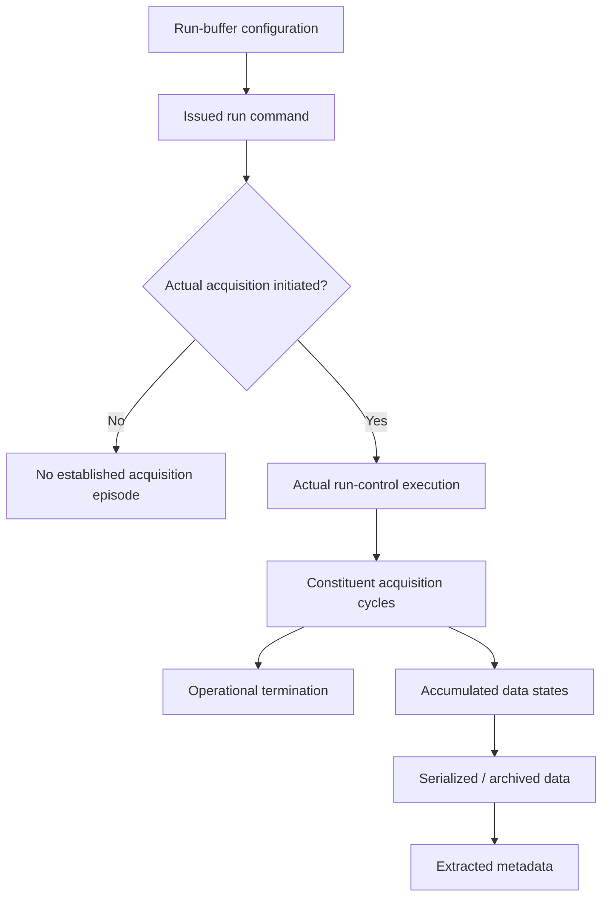
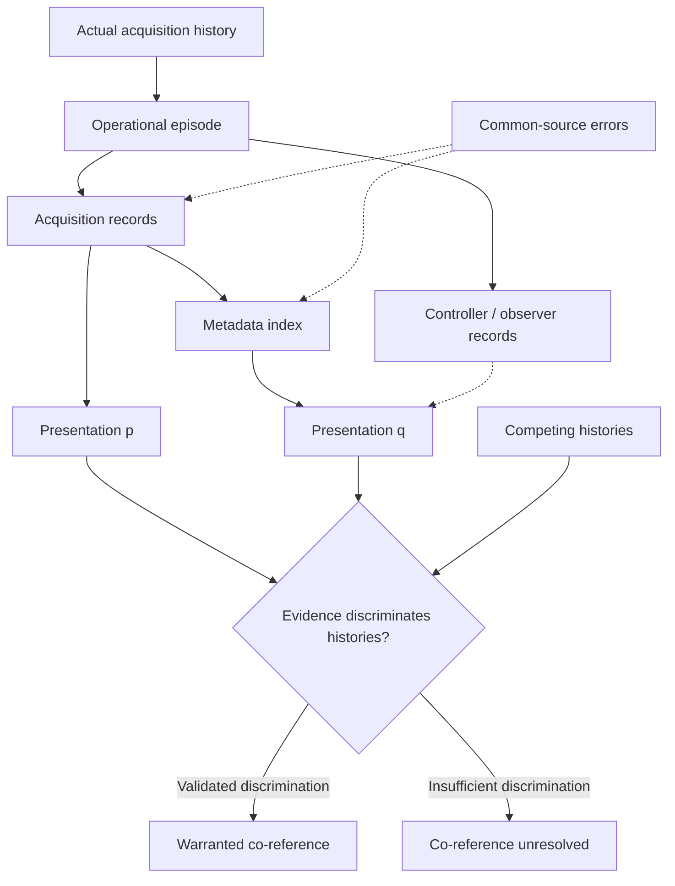
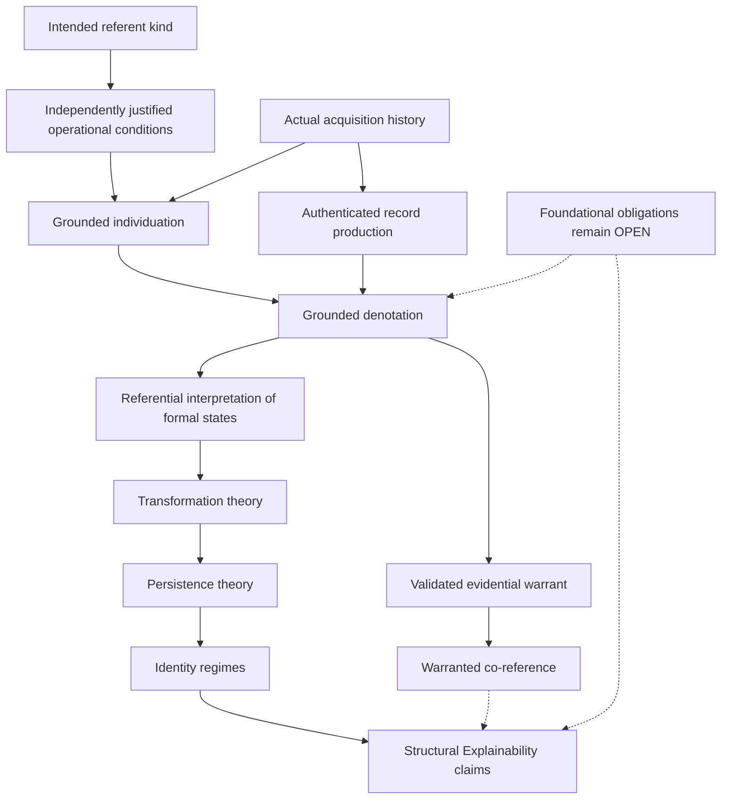

# Structural Explainability

# Scientific Development Note v0.10 — Critical Reconciliation and Evidence Feasibility for Concrete Occurrence Identity

**Date:** October 16, 2026
**Status:** OPEN — Scientific theory construction
**Research mode:** Read-only
**Predecessors:** Scientific Development Notes v0.7, v0.8, and two independent v0.9 investigations

**Source-audit verdict:** PARTIAL
**Independent-review status:** Retrospective adversarial reconciliation completed; independent empirical validation unavailable
**DCS evidence-access decision:** BLOCKED
**Theory-construction verdict:** FUNDAMENTAL QUESTION REMAINS
**DCS case decision:** SUSPEND pending access to adequate evidence

## Executive Finding

The NIST Disk Chopper Spectrometer (DCS) documentation provides a scientifically useful operational account of measurement runs.

It establishes that a run is an acquisition operation, may comprise multiple acquisition cycles, and may produce changing accumulated data without becoming a different run.

However, the investigation does not establish that two actual independently produced presentations identify one particular physical acquisition episode.

The two v0.9 investigations correctly identify a serious evidential gap. Their proposed solutions do not resolve it.

The ChatGPT proposal describes important conditions for scientifically warranted attribution but has not shown those conditions to be jointly sufficient.

The Claude proposal introduces more restrictive causal-independence and content-sensitivity conditions. These are not established as necessary conditions and, even together, do not establish sufficient conditions for occurrence identity.

Neither proposal has passed the required positive empirical test.

The strongest defensible conclusion is:

**Publicly accessible DCS documentation establishes important operational distinctions, but the evidence recovered in this investigation does not discriminate all materially relevant competing acquisition histories.**

This finding does not demonstrate that occurrence identity is intrinsically unknowable.

It demonstrates that the present case lacks the accessible evidence necessary to validate the proposed scientific criteria.

No new general identity definition is justified by these results.

---

# A. Research Question, Protocols, and Source Authority

## A.1 Primary scientific question

For the NIST Disk Chopper Spectrometer, can publicly inspectable, independently justified evidence establish that two presentations identify one particular physical acquisition episode, or does the available evidence leave multiple distinct acquisition histories compatible with the observations?

The referent kind is restricted to:

**One actual measurement-run acquisition episode performed by the DCS data-acquisition system.**

The investigation does not attempt to establish identity conditions for arbitrary events, institutions, organisms, records, or transformations.

## A.2 Research protocols

The following canonical protocols were retrieved and read:

1. Source Audit
   https://github.com/structural-explainability/se-protocols-research/blob/main/protocols/source-audit/SKILL.md

2. Independent Review
   https://github.com/structural-explainability/se-protocols-research/blob/main/protocols/independent-review/SKILL.md

3. Theory Construction
   https://github.com/structural-explainability/se-protocols-research/blob/main/protocols/theory-construction/SKILL.md

The source-audit protocol governs recovery and classification of existing commitments.

The independent-review protocol requires adversarial evaluation, explicit provenance, and separation of genuinely independent reviews from subsequent reconciliation.

The theory-construction protocol requires separation of established science, proposed definitions, unresolved assumptions, counterexamples, and deferred obligations.

The theory-acceptance protocol was not invoked.

### Review independence qualification

This investigation is a retrospective reconciliation.

Both v0.9 reports were supplied before the present assessment. Consequently, the present assessment is not a fresh blinded review of either proposal.

The reports describe independently conducted investigations, but their complete original information paths and execution provenance were not independently reconstructed.

Their independence as reports must not be confused with independent empirical confirmation.

The present investigation therefore evaluates the claims against accessible sources and constructed counterexamples rather than counting agreement among investigators as evidence.

## A.3 Authority order

Authority depends upon the proposition being evaluated.

| Source                              | Authority                                                     |
| ----------------------------------- | ------------------------------------------------------------- |
| DCS operating documentation         | Documented acquisition and control behavior                   |
| DCS instrument specifications       | Described acquisition architecture                            |
| Authenticated operational histories | Particular acquisition events, if recovered                   |
| Raw instrument records              | Recorded measurement products, if inspected and authenticated |
| Metadata specifications             | Field meanings, schemas, and documented interfaces            |
| Live metadata responses             | Actual returned records, when independently reproduced        |
| NCNR data-management policies       | Preservation and access practices                             |
| Authoritative Lean files            | Existing formal definitions and mathematical commitments      |
| Prior scientific notes              | Provisional conclusions and hypotheses                        |
| Research protocols                  | Research procedure, not empirical identity semantics          |

No source is automatically authoritative outside its scientific responsibility.

For example, an operational manual may define what the instrument calls a run without establishing a metaphysical theory of numerical identity.

Similarly, an authenticated datafile may establish that certain bytes were preserved without establishing that its assigned run identifier is correct.

## A.4 Epistemic classifications

The following classifications are used throughout this report:

- **VERIFIED FROM PRIMARY SOURCE:** Independently retrieved and inspected source content supports the claim.
- **REPORTED OBSERVATION — NOT INDEPENDENTLY REPRODUCED:** A prior investigation reports an observation not recovered in this investigation.
- **SOURCE-SUPPORTED INFERENCE:** A conclusion reasonably follows from primary-source descriptions but is not itself explicitly specified.
- **ADDITIONAL ASSUMPTION:** A premise not established by inspected sources.
- **MATHEMATICAL CONSEQUENCE:** A result following from stipulated definitions or premises.
- **CONJECTURE:** A substantive claim not yet established.
- **COUNTEREXAMPLE:** A construction showing failure of a proposed general condition.
- **UNSUPPORTED:** A claim whose stated evidential or inferential basis is inadequate.
- **UNRESOLVED:** An issue for which the current evidence does not determine an answer.

Constructed counterexamples are identified separately from observed empirical cases.

## A.5 Source coverage

The following external sources were inspected during this investigation:

- NIST DCS Users' Guide, including the sections on runs, sequences, run buffers, stopping operations, and command logs.
- NIST DCS Design Features and Principal Specifications, particularly Data Acquisition Hardware and Software.
- NCNR Instrument Data portal.
- CHRNS metadata search API documentation.
- NCNR Data Management Plan.
- NIST CHRNS FAIR-data documentation.
- Selected authoritative SE Lean files listed in Section I.

The DCS Users' Guide content was recovered through the indexed NIST page result. A separate direct page retrieval timed out.

The following were not successfully inspected:

- Actual DCS binary datafile contents or headers.
- An authenticated acquisition-control log for a selected run.
- An actual `sequence.log` associated with the reported archive entries.
- A separately produced occurrence-specific instrument-state record.
- An independently authored observation of a selected run.
- A live DCS metadata JSON response reproducing the records reported by Claude.

These are retrieval limitations, not evidence of nonexistence.

The inspected public protocol and Lean sources were retrieved from their current `main` branches. Exact immutable revisions were not pinned. This limits reproducibility of source-version claims.

---

# B. Comparative Scientific Findings From the Two v0.9 Reports

## B.1 Candidate identification

Both investigations use the identifier `C-DCS-2`.

Their proposed criteria differ sufficiently that they must remain separate.

This report designates them:

- `C-DCS-2-ChatGPT`
- `C-DCS-2-Claude`

Neither is a canonical SE definition.

## B.2 C-DCS-2-ChatGPT

**Candidate name:** Evidence-Grounded Acquisition-Episode Attribution.

### Intended referent

One actual DCS measurement-run acquisition episode.

### Existence

An episode is proposed to exist once actual measurement acquisition has been successfully initiated.

A start request without successful initiation is not sufficient.

Positive neutron counts and a completed datafile are not required by the candidate.

### Operational individuation

The candidate identifies an episode with an actual run-control execution, its constituent cycles, and its operational termination.

A new execution following termination is provisionally distinct.

Arbitrary failure and recovery behavior remains unresolved.

### Denotation and warranted co-reference

The proposal specifies six conditions:

| Condition | Proposed requirement                                |
| --------- | --------------------------------------------------- |
| D1        | Resolve the intended referent kind                  |
| D2        | Ground the claimed episode in actual acquisition    |
| D3        | Establish record-production and attribution history |
| D4        | Assess evidential independence                      |
| D5        | Exclude materially plausible competing episodes     |
| D6        | Investigate defeaters                               |

The proposed criterion requires enough evidence to connect both presentations to the same operational episode.

Its strongest proposed evidential test considers alternative admissible histories.

For evidence E, let H(E) be the admissible histories compatible with E.

Within each history H, successful denotations must satisfy:

\[
\delta_H(p)=\delta_H(q).
\]

The condition is evaluated within each history, not by presupposing that individuals in different possible histories are numerically identical.

### Evidential assumptions

The proposal assumes that:

- Relevant histories can be identified.
- Record-production mechanisms can be characterized.
- Material alternative explanations can be recognized.
- Denotational assignments can be grounded.
- Relevant attribution errors can be evaluated.

These assumptions are not currently discharged.

### Necessity and sufficiency

D1–D6 are presented as proposed requirements for warranted attribution.

Their universal necessity has not been established.

Their joint scientific sufficiency has not been established.

Requiring agreement across an independently justified set of compatible histories could be sufficient for a specified logical entailment claim.

It does not automatically supply a usable empirical decision procedure.

### Treatment of uncertainty

The proposal withholds a positive co-reference judgment when the evidence leaves materially different compatible acquisition histories.

It does not equate an unresolved judgment with proven numerical distinctness.

### Assessment

**Independent-review disposition: INSUFFICIENT BASIS.**

The proposal is scientifically useful as an evidential checklist and underdetermination test.

Its proposed requirements are not yet a validated criterion for successful occurrence identification.

In particular, the admissible-history set must not be constructed by assuming the very co-reference conclusion being tested.

## B.3 C-DCS-2-Claude

Claude's proposal is a narrower evidential-chain account.

### Intended referent

One DCS acquisition episode constituted by operation under a run-control state.

### Existence and boundaries

The proposed conditions are:

- I1: A run begins through the documented start-and-memory-clear operation.
- I2: Cycles continuing without memory clearing remain within the run.
- I3: A stop ends the run.
- I4: A new start following termination constitutes a new episode.
- I5: A rejected cycle remains physical acquisition activity even when its measurements are excluded from retained data.

I1–I3 are substantially supported as normal operational procedures.

I4 is an additional boundary assumption requiring qualification for abnormal restart behavior.

I5 is consistent with the documented rejection procedure, but the implementation details of data exclusion were not established.

### Trace and attestation

The proposal introduces a physical trace Tr(E).

An attestation connects a presentation to the trace through a causal attribution chain.

Warranted denotation requires:

- L1: Documented reliability of the links in the chain.
- L2: Content sensitivity to the occurrence being identified.

### Independence

Two presentations are called independent when their chains share no link after the physical trace and do not share an identifier-assignment event.

### Warranted co-reference

The proposal requires:

1. Warranted attribution of both presentations.
2. Independence of their attribution chains.
3. A content-level discriminator excluding distinct-run alternatives.
4. Absence of known defeaters.

### Additional conjecture

Claude proposes `CJ-A`, a histogram-monotonicity discriminator.

Under the conjecture, successive accumulated histograms of one run should be binwise nondecreasing.

### Treatment of uncertainty

The proposal withholds co-reference when the required independence or discrimination evidence is missing.

It distinguishes insufficient evidence from demonstrated distinctness.

### Necessity and sufficiency

The proposal defines its warrant in terms of these conditions.

That gives a conditional formal criterion within the proposed model.

It does not demonstrate that these conditions are necessary or sufficient for scientifically warranted identity judgments in actual DCS operation.

### Assessment

**Independent-review disposition: REJECT for the proposed universal necessity of causal disjointness and content sensitivity; INSUFFICIENT BASIS for the remaining empirical sufficiency claim.**

The strict evidential conditions are not adequately justified.

This does not invalidate the underlying importance of provenance, content, or error analysis.

It means their appropriate roles remain dependent upon the actual measurement and attribution mechanisms.

## B.4 Comparison

| Question                | C-DCS-2-ChatGPT                            | C-DCS-2-Claude                                |
| ----------------------- | ------------------------------------------ | --------------------------------------------- |
| Referent                | Actual acquisition episode                 | Actual acquisition episode                    |
| Existence               | Successful acquisition initiation          | Run-control start with memory clearing        |
| Boundaries              | Operational initiation through termination | Run-control lifecycle, I1–I4                  |
| Components              | Constituent acquisition cycles             | Constituent cycles, including rejected cycles |
| Denotation              | Grounded attribution to episode            | Reliable trace-to-record chain                |
| Source independence     | Dependency assessment                      | Required causal-chain disjointness            |
| Content sensitivity     | Potentially relevant evidence              | Required condition                            |
| Alternative histories   | Explicit universal compatibility test      | Content-level discrimination                  |
| Defeaters               | Explicit investigation                     | No known defeater                             |
| Uncertainty             | Withhold judgment under underdetermination | Withhold judgment if tests fail               |
| Necessary conditions    | Proposed, not validated                    | Stipulated in the candidate                   |
| Sufficient conditions   | Not demonstrated                           | Not demonstrated                              |
| Positive empirical test | Missing                                    | Missing                                       |

## B.5 Genuine advances

The investigations contribute different findings.

The ChatGPT report identified concrete archived filename candidates and articulated the need to test competing physical histories.

The Claude report reported a live API sample containing 21 DCS records and supplied additional conjectures about content-level evidence.

These are distinguishable investigative contributions.

However, the two reports did not establish a complete positive attribution case.

Agreement between their conceptual conclusions is not independent empirical confirmation.

---

# C. Corrections, Disagreements, and Unresolved Assumptions

## C.1 Causal independence is not universally necessary

Claude's disjoint-chain requirement is too restrictive as a general scientific requirement.

Suppose two records are produced by a trustworthy acquisition controller.

Both inherit a common event identifier from that controller.

If the identifier-assignment mechanism is sufficiently reliable for the intended inference, their common origin need not prevent warranted co-reference.

Their evidence is statistically and causally dependent, but dependence does not automatically make the attribution worthless.

Conversely, two records produced by separate authors can inherit one incorrect run identifier.

Therefore, the appropriate scientific concern is not merely whether chains overlap.

It is whether the shared mechanisms and plausible errors have been adequately characterized.

Independence of the following must remain separate:

- Authorship.
- Software process.
- Stored artifact.
- Measurement channel.
- Identifier assignment.
- Attribution mechanism.
- Error mechanism.

**Correction:** Causal-chain disjointness may strengthen corroboration under a suitable model, but it is not an established universal necessary condition of co-reference warrant.

## C.2 Content sensitivity is neither necessary nor sufficient as stated

A presentation can correctly identify a particular execution without containing a measurement uniquely characteristic of that execution.

For example, an authenticated control record might identify a particular run by a reliably maintained operational event association.

Its identifying information need not depend on neutron histogram contents.

Conversely, two distinct acquisitions can produce observationally indistinguishable data.

Therefore, requiring a record to contain content that necessarily changes whenever another physical execution occurs is too strong.

A measured-content discriminator may nevertheless be useful.

Its evidential value depends upon:

- The observable being compared.
- The physical variability of the measurement.
- The reliability of measurement and processing.
- The error and collision probabilities.
- The alternatives the discriminator is intended to exclude.

**Correction:** Content sensitivity is a potentially useful evidential property, not an independently established necessary or sufficient identity condition.

## C.3 SHA-256 does not establish physical occurrence identity

The following implications must not be conflated:

\[
\text{same hash}
\]

\[
\text{same bytes}
\]

\[
\text{same stored object}
\]

\[
\text{same acquisition episode}
\]

SHA-256 maps arbitrarily long byte sequences into a finite digest space.

Consequently, equality of hashes does not logically entail byte equality.

Collision resistance makes accidental equality of hashes for different ordinary files extraordinarily unlikely under relevant assumptions.

That is a practical cryptographic reliability claim, not an identity theorem.

Likewise, byte equality does not establish numerical identity of stored objects.

Two different files can contain exactly the same bytes.

One file can also be copied to another location.

Finally, neither identical files nor equal bytes necessarily identify one physical acquisition.

**Correction:** The v0.9 Claude implication from equal bytes to the same file state is valid only under an additional definition equating states extensionally by byte content.

It is not valid if file states include object identity, acquisition context, or temporal provenance.

## C.4 Different file states do not imply different runs

NIST documents the replacement of accumulated data during a multi-cycle run.

Thus, file-state inequality is not evidence sufficient to establish distinct acquisition episodes.

A file may also contain different compressed bytes despite equal decoded measurement content.

The relationship among:

- Physical acquisition.
- In-memory histogram.
- Serialized measurement data.
- Compressed file.
- Archived file object.

requires explicit interpretation.

## C.5 Histogram monotonicity remains unvalidated

Claude's `CJ-A` conjecture proposes:

\[
F_2(b) \geq F_1(b)
\]

for every histogram bin b, when F1 and F2 are successive accumulated states of one run.

The NIST guide establishes continued acquisition without clearing memory between ordinary cycles.

It does not explicitly guarantee that every stored histogram bin is monotonically nondecreasing under all possible operating conditions.

The analysis must account for rejected cycles, error correction, memory handling, intermediate writes, detector behavior, and data reduction.

A rejected cycle is reported as lost, but the source does not establish precisely how its contributions are excluded internally.

Even if monotonicity holds for correctly captured raw count states in normal operation, it is not sufficient for co-reference.

Two distinct runs can produce histograms satisfying the same inequality.

**Correction:** CJ-A is a conditional, untested conjecture, not a validated necessary or sufficient discriminator.

## C.6 Shared-source agreement does not have zero evidential value

Claude's non-independence argument correctly identifies common-mode error risks.

However, saying that dependent records provide no evidence is too strong without a specified claim and error model.

Agreement can provide evidence that a data-processing or copying operation preserved particular information correctly.

It may add little or no independent evidence that the original physical attribution was correct.

These are different propositions.

**Correction:** Evidence must be evaluated relative to the claim it supports.

Pipeline consistency is not equivalent to occurrence identification.

## C.7 Reported metadata fields were not identical

Claude reported multiple DCS rows sharing selected attributes.

Those rows had different filenames and start-date values.

Therefore, the observation does not establish completely identical metadata records.

In addition, shared `experiment_id` values do not establish equality of instrument configurations.

**Correction:** The observation is compatibility of selected metadata attributes, not complete equality of records or verified equality of measurement settings.

## C.8 The current evidence does not demonstrate instrument restart behavior

Claude inferred possible interruptions and restarts from irregular intervals between reported start dates.

This is a possible explanation.

Other explanations include differing planned run lengths, scheduling gaps, and changes in measurement procedure.

No relevant operational stop-and-restart history was inspected.

**Correction:** The reported timestamp patterns do not establish that any selected run was interrupted or restarted.

## C.9 Remaining disagreements

The two proposals still disagree on:

1. Whether causal disjointness is required.
2. Whether content sensitivity is required.
3. What must be established before record attribution counts as warranted.
4. Whether a content-level discriminator is essential.
5. How strongly the available data justify run-level individuation.
6. Whether identifier-based attribution can become sufficient under validated operational assumptions.

These questions cannot be settled by merging the definitions.

The appropriate conclusion is that neither proposal currently supplies a scientifically validated sufficient criterion.

---

# D. Primary-Source Audit and Independently Verified Empirical Observations

## D.1 NIST DCS Users' Guide

**Primary source:**
https://www.nist.gov/ncnr/dcs-users-guide

Relevant sections:

- Instrument Computers.
- Runs and sequences.
- Runs.
- Sequences.
- Defining runs and sequences.
- Starting and stopping runs and sequences.
- sequence.prm and sequence.log files.

The guide identifies a run as a measurement using the data-acquisition system.

Its elementary operation consists of memory clearing, acquisition initiation, acquisition termination, and file writing.

It also describes multi-cycle acquisition.

### Verified operational findings

| Question                     | Finding                                                                    | Coverage        |
| ---------------------------- | -------------------------------------------------------------------------- | --------------- |
| Acquisition initiation       | Initiation is part of the documented run operation                         | FOUND           |
| Memory clearing              | Memory is cleared at run start                                             | FOUND           |
| Cycle continuation           | Acquisition resumes without clearing memory between ordinary cycles        | FOUND           |
| File replacement             | Accumulated data are written and later overwritten                         | FOUND           |
| Rejected cycles              | Check Stats can reject a cycle without extending the expected run duration | FOUND           |
| Early termination            | Three explicit stop modes are documented                                   | FOUND           |
| Run-buffer indices           | Twelve run buffers are numbered 0 through 11                               | FOUND           |
| File serial numbers          | Date-based filenames use sequential suffixes                               | FOUND           |
| Sequence logging             | sequence.log lists executed sequence commands                              | FOUND           |
| Run-buffer-to-file mapping   | No sufficient mapping contract recovered                                   | PARTIAL         |
| Arbitrary failure/recovery   | No complete governing rule recovered                                       | UNDER-SPECIFIED |
| Particular execution history | No authenticated instance recovered                                        | NOT READ        |

### Stop modes

The documented modes distinguish:

1. Immediate termination with current-cycle data discarded.
2. Immediate termination with current-cycle data retained.
3. Termination after completing the current cycle.

The operational distinction is established.

Its applicability to every abnormal or uncontrolled failure is not.

### Run-buffer and file numbering

The guide describes numbered run buffers and a separate raw-data filename convention.

For files created from 2003 onward, the documented naming pattern is:

`yyyymmdd_kkk.dcs.gz`

The `kkk` value is a file sequence number.

A run-buffer index is a configuration/control identifier.

The guide does not establish that these identifiers are interchangeable.

It also does not provide a complete guarantee about uniqueness or reuse across abnormal situations.

### Command logging

The guide describes `sequence.log` as a record of executed sequence commands.

This is potentially useful operational evidence.

However, a command log is not automatically an independent observation that physical acquisition successfully occurred.

Its actual evidential force depends upon how the command was logged and whether execution acknowledgments or instrument-state transitions were recorded.

No relevant actual sequence log was inspected.

## D.2 DCS instrument specifications

**Primary source:**
https://www.nist.gov/ncnr/dcs-design-features-and-principal-specifications

Relevant section: Data Acquisition Hardware and Software.

The page describes detector-event handling, histogram accumulation, reflective memory, and acquisition cycles.

It corroborates the distinction between accumulated measurement data and the constituent acquisition process.

It also describes accumulated datasets being backed up at cycle boundaries.

The page explicitly warns that it is no longer being updated and its information may be outdated.

Although the page displays a May 27, 2026 update date, that metadata does not establish that the described acquisition architecture was revalidated on that date.

**Status:** VERIFIED FROM PRIMARY SOURCE for the documented architecture; current implementation applicability remains UNRESOLVED.

## D.3 NCNR data repository and metadata lineage

**Primary source:**
https://www.ncnr.nist.gov/ncnrdata/

The portal states that metadata are extracted from datafiles as they are moved into the data repository.

This is an important independently verified finding.

It establishes that the public metadata system has a documented datafile-derived information path.

Therefore, agreement between a raw file and corresponding extracted metadata cannot automatically be counted as independent corroboration of the original acquisition attribution.

The source does not establish every implementation detail of the ingestion process.

In particular, it does not establish whether each occurrence identifier is obtained from the filename, embedded header, another controller service, or some combination.

**Status:** VERIFIED FROM PRIMARY SOURCE for the general extraction process; particular attribution dependencies remain UNDER-SPECIFIED.

## D.4 Metadata API specification

**Primary source:**
https://www.ncnr.nist.gov/ncnrdata/metadata/search/api_docs.html

The specification describes:

- Experiment lookup.
- Datafile lookup.
- Instrument lookup.
- Search parameters.
- Result pagination.
- Structured metadata responses.

The documented datafile endpoint is:

https://ncnr.nist.gov/ncnrdata/metadata/api/v1/datafiles

The documented `instrument` filter includes `dcs`.

The API supports `limit` and `offset` pagination, with a documented maximum `limit` of 250.

The published response example concerns BT1, not DCS.

Its `start_date` value uses an ISO timestamp containing a timezone offset.

This establishes that the documented field can carry timezone information.

It does not establish the exact values or field semantics of Claude's reported 2026 DCS records.

### Field interpretation

| Field         | What can be established                | What remains unresolved                                         |
| ------------- | -------------------------------------- | --------------------------------------------------------------- |
| filename      | Recorded file name                     | Whether its assignment uniquely tracks physical runs            |
| experiment_id | Experiment association identifier      | Particular study/run membership semantics                       |
| rxcycle_id    | Reactor-cycle association field        | Complete relationship to each run                               |
| instrument    | Instrument identifier or alias         | Whether all archived historical mappings are correct            |
| instrument_id | Instrument numeric identifier          | Mapping for the reported rows                                   |
| start_date    | Recorded date/time field               | Exact acquisition-event semantics                               |
| sha256        | Reported content digest                | Hashing point, byte representation, and attribution correctness |
| metadata      | Extracted metadata field               | Why a particular row has null metadata                          |
| localdir      | Reported in Claude's live observations | Exact generation and attribution mechanism                      |

A null metadata value, if reproduced, would establish that the returned field was null.

It would not independently establish that no instrument metadata existed elsewhere.

## D.5 Attempt to reproduce Claude's 21 DCS rows

Claude reported sampling live API output on October 16, 2026.

The reported sample comprised 21 DCS rows:

- Twenty associated with `experiment_id = 46`.
- One associated with `experiment_id = 30402`.

The reported filenames span October 14–16, 2026.

Claude also reported shared instrument values, path patterns, and null metadata.

### Independent replication attempt

The following sources were investigated:

- Published API documentation.
- Documented datafile endpoint.
- Instrument endpoint.
- Experiment endpoint.
- NCNR data portal.
- Public metadata search interface.

The API documentation was accessible.

Direct attempts to retrieve the JSON result endpoints through the available retrieval interface did not produce inspectable live responses.

The public search interface likewise did not expose reproducible row content through that interface.

Consequently:

**The 21-row observation was not independently reproduced.**

It is retained as a reported observation.

Its reported counts, field values, ordering, and timing calculations must not be promoted to independently verified facts.

### Specific limitations

The following remain unverified:

- Original complete filename values.
- Original full `start_date` strings.
- Timezone offsets on the reported rows.
- Instrument-filter behavior.
- Pagination effects.
- Whether the sample represented the newest records.
- Exact `experiment_id` semantics.
- Whether any records were modified after Claude's observation.
- Actual physical relationships among the reported files.

The report's abbreviated timestamp table cannot establish the original timezone information.

The apparent regularity of the reported timestamps is an observation about the reported values, not independent evidence of repeated configurations or successful acquisition starts.

## D.6 Actual archival files

ChatGPT's v0.9 report identified these public archive entries:

- `20070823_005.dcs.gz`
- `20070823_006.dcs.gz`

The original report states that their archival listing showed different sizes and modification timestamps.

The present investigation attempted to revisit the archive but could not retrieve inspectable content through the available interface.

Therefore, the entries remain:

**REPORTED OBSERVATIONS — NOT INDEPENDENTLY REPRODUCED IN v0.10.**

The earlier report's observations are not discarded.

However, this investigation cannot independently confirm the files' present availability, contents, or linkage to physical acquisitions.

## D.7 Data-management and FAIR documentation

**Sources:**

https://www.nist.gov/ncnr/for-users/data-and-tools/ncnr-data-management-plan

https://www.nist.gov/programs-projects/chrns-non-equilibrium-structure-materials-initiative/chrns-fair-data-ncnr

The NCNR Data Management Plan, effective September 19, 2025, describes raw measurement data, automatic archiving, preservation, and public-access policies.

It defines raw data in terms of measurement counts written in the instrument's standard format.

It also describes circumstances in which data availability may be delayed or excluded from the general policy.

The FAIR documentation distinguishes data, experiment identifiers, process metadata, and traceable processing.

These are important elements of scientific data governance.

Neither source provides a complete evidential criterion connecting two arbitrary independent presentations to one particular DCS acquisition episode.

## D.8 Evidence-access matrix

| Evidence                         | Accessible documentation   | Actual instance inspected | Authenticated linkage to selected run | Independent attribution established |
| -------------------------------- | -------------------------- | ------------------------- | ------------------------------------- | ----------------------------------- |
| DCS operating protocol           | Yes                        | Procedure only            | No                                    | N/A                                 |
| DCS acquisition datafile         | Archive described          | No in v0.10               | No                                    | No                                  |
| Acquisition initiation event     | Procedure described        | No                        | No                                    | No                                  |
| Acquisition termination event    | Procedure described        | No                        | No                                    | No                                  |
| sequence.log                     | Format and role described  | No                        | No                                    | No                                  |
| Controller/state log             | Potential source           | No                        | No                                    | No                                  |
| Experiment logbook               | Mentioned in documentation | No                        | No                                    | No                                  |
| Metadata API                     | Schema verified            | No live DCS row           | No                                    | No                                  |
| Independent authored observation | Not recovered              | No                        | No                                    | No                                  |

A documented capability is not the same as recovered instance evidence.

A publicly described data source is not necessarily readable through the available research interface.

## D.9 Source-audit conclusion

### JUSTIFIED FROM CURRENT SOURCES

1. DCS runs are operational measurement units.
2. Runs may contain multiple cycles.
3. Acquisition may continue without clearing accumulated memory.
4. Datafiles may be overwritten with updated accumulated data.
5. Rejected cycles do not automatically constitute separate runs.
6. Explicit stopping operations exist.
7. Command sequences and run buffers are distinct from particular acquisitions.
8. Archived measurement data and searchable extracted metadata are part of the documented infrastructure.
9. File-derived metadata do not automatically provide independent attribution evidence.

### WOULD REQUIRE NEW THEORY OR INTERFACE

1. Authenticated operational histories for particular runs.
2. A validated mapping between acquisition transitions and records.
3. A justified model of relevant attribution errors.
4. A defensible discriminator among competing physical histories.
5. Validated warrant conditions for cross-record identification.
6. A grounded interpretation connecting physical occurrences to SE formal objects.

**Source-audit verdict: PARTIAL.**

---

# E. Grounded DCS Occurrence Individuation

## E.1 Strongest supported operational description

A DCS run is a measurement performed using the instrument's acquisition system, potentially comprising several cycles, under documented initiation, accumulation, and termination procedures.

This description is source-grounded.

It is not a complete numerical-identity criterion for every possible failure or recovery condition.

## E.2 Actual occurrence versus operational specification

The following must remain distinct:

The diagram describes conceptual and documented operational dependencies.

It does not assert that every arrow has been verified for a particular archived run.

## E.3 Existence conditions

The strongest candidate interpretation is:

**An actual acquisition episode occurs when the DCS successfully initiates measurement acquisition under an operational run-control execution.**

This excludes an unexecuted command specification.

The candidate does not require that the resulting measurement be scientifically useful.

The absence of recorded counts is not sufficient to establish that acquisition never occurred.

However, the evidence needed to confirm successful initiation for a particular run has not been recovered.

The existence criterion remains operationally plausible rather than independently validated for particular episodes.

## E.4 Unity and constituents

The guide provides a defensible distinction between the containing run and constituent acquisition cycles.

A run can contain several cycles.

A rejected cycle can remain part of the physical activity while not contributing retained measurement data.

Consequently, the recorded dataset need not represent every physical acquisition activity performed during the run.

The unity of the run is associated with its governing acquisition operation.

It is not constituted merely by equality of datafile contents.

## E.5 Boundaries and restarts

For ordinary documented operation:

- Acquisition begins under a start operation.
- Constituent cycles may continue without clearing memory.
- Acquisition ends through completion or a documented stop.

The following remain unresolved:

- Uncontrolled power interruption.
- Instrument software failure.
- Partial restart.
- Controller state recovery.
- Memory restoration.
- Continued acquisition after abnormal interruption.
- Recovery involving a new command but retained state.

It would be scientifically unjustified to infer a universal persistence criterion from the statement that ordinary cycles resume without memory clearing.

## E.6 Operational convention versus physical individuation

A particularly important conclusion from Claude's investigation survives scrutiny.

The run is an operationally established measurement unit.

Its boundaries are partly determined by the DCS control procedure.

This does not mean its identity is arbitrary.

Operational conventions can establish legitimate scientific units.

However, their adequacy must be judged relative to the intended referent kind.

The evidence does not establish that one run corresponds to one uninterrupted physical process in every possible sense.

Nor does it establish that the instrument's operational grouping is the uniquely correct individuation of every underlying physical activity.

The intended referent remains the operational acquisition episode.

Its empirical identification remains open.

---

# F. Evaluation of Competing Co-reference Criteria

## F.1 Constitution, denotation, and warrant

Three separate questions must be answered.

**Constitution:** What establishes one operational acquisition episode?

**Denotation:** Which episode does a particular presentation identify?

**Warrant:** What evidence justifies accepting that attribution?

Successful constitution does not entail successful denotation.

Successful denotation does not automatically imply that the available evidence proves it.

Likewise, evidential uncertainty does not automatically imply indeterminate numerical identity.

## F.2 Evaluation of proposed evidence conditions

| Proposed condition                    | Necessity established?                                                  | Sufficiency established?     | Assessment                                  |
| ------------------------------------- | ----------------------------------------------------------------------- | ---------------------------- | ------------------------------------------- |
| Authenticated control history         | No universal necessity                                                  | No                           | Strong potential occurrence anchor          |
| Traceable record production           | No universal necessity                                                  | No                           | Important evidential mechanism              |
| Content-sensitive measurement         | No                                                                      | No                           | Potential discriminator                     |
| Independent attestation               | No                                                                      | No                           | May improve corroboration                   |
| Agreement between records             | No                                                                      | No                           | Can result from common error                |
| Common identifier                     | No                                                                      | No                           | Requires validated assignment               |
| Reliable shared provenance            | Not universally                                                         | No                           | May support dependent evidence              |
| Exclusion of competing histories      | Necessary for deductive identification under a specified complete model | Conditional only             | Depends on admissible-history justification |
| Absence of known defeaters            | Not universally necessary as stated                                     | No                           | Absence of known error is not proof         |
| Resolution of material contradictions | Important for strong warrant                                            | No general sufficiency shown | Requires reliability and revision model     |

No inspected source establishes these conditions as a jointly sufficient empirical criterion.

## F.3 Constructed competing histories

Consider two presentations p and q.

The available evidence E contains:

- Matching experiment association.
- Compatible measurement descriptors.
- Consistent timestamps or identifiers.
- No authenticated operational event history linking each presentation to one particular acquisition episode.

### Constructed history H1: genuine co-reference

One actual acquisition episode R occurs.

Two presentations are generated concerning R.

Their associations are correct.

Thus:

\[
\delta\_{H1}(p)=R
\]

and

\[
\delta\_{H1}(q)=R.
\]

### Constructed history H2: distinct episodes

Two acquisition episodes R1 and R2 occur.

Presentation p concerns R1.

Presentation q concerns R2.

A common experiment identifier, repeated configuration, copied identifier, or attribution error produces the same accessible evidential pattern.

Thus:

\[
\delta\_{H2}(p)=R_1
\]

and

\[
\delta\_{H2}(q)=R_2,
\qquad R_1\neq R_2.
\]

Suppose both histories remain compatible with the retrieved observations:

\[
\operatorname{Obs}(H1)=E
\]

and

\[
\operatorname{Obs}(H2)=E.
\]

The evidence then fails to determine a unique co-reference judgment.

This is a logical result about the constructed model.

It is not a finding that NIST's actual records contain an attribution error.

It also does not prove that the two histories would remain compatible if richer operational evidence became available.

## F.4 Evidential dependency

Dashed edges indicate possibilities whose operation has not been established for any selected DCS instance.

In particular, the diagram must not be interpreted as proving that the controller or observer records actually recovered for this investigation are independent.

No such occurrence-specific records were recovered.

## F.5 Logical entailment versus scientific identification

Four outcomes require different evidential standards.

### Logical entailment

A conclusion follows in every admissible model satisfying the premises.

Its force depends upon whether those premises adequately represent the target phenomenon.

### Scientific identification

An attribution is accepted under empirically justified operational assumptions and accepted error tolerances.

This need not provide metaphysical or mathematical certainty.

### Probabilistic identification

Evidence changes the relative plausibility of competing attributions.

A calibrated quantitative conclusion requires an appropriate statistical or reliability model.

No such model has been validated for the present DCS case.

### Heuristic matching

Records are treated as related because their identifiers, timestamps, configurations, or contents resemble one another.

Such matching can generate hypotheses.

It is not, without further justification, sufficient to establish numerical co-reference.

## F.6 Scientific determination

Neither v0.9 proposal establishes a complete empirical criterion for identifying one actual DCS episode across independent presentations.

C-DCS-2-ChatGPT provides a useful way to express underdetermination.

C-DCS-2-Claude identifies plausible evidential resources but imposes unvalidated restrictions.

Neither proposal can be promoted to canonical theory.

---

# G. Adversarial Cases and Falsification Results

The following cases test the strongest defensible claims.

`DOC` indicates an operational distinction grounded in inspected documentation.

`CONSTRUCTED` indicates a hypothetical case.

`REPORTED` indicates an earlier reported observation not independently reproduced in v0.10.

No constructed case is represented as empirical validation.

| #   | Adversarial case                                                | Expected identity judgment                                                      | Candidate prediction                                                                        | Basis, assumptions, and evidential dependencies                           | Consequence                                                |
| --- | --------------------------------------------------------------- | ------------------------------------------------------------------------------- | ------------------------------------------------------------------------------------------- | ------------------------------------------------------------------------- | ---------------------------------------------------------- |
| 1   | Two distinct runs with the same configuration                   | Distinct occurrences                                                            | Both should withhold identifier-only co-reference                                           | CONSTRUCTED; repeatable run-buffer settings; no actual pair authenticated | Configuration equality is insufficient                     |
| 2   | Distinct runs with identical recorded contents                  | Distinct occurrences                                                            | Claude's content criterion cannot discriminate them; ChatGPT requires stronger evidence     | CONSTRUCTED; identical observations are physically conceivable            | Content equality is insufficient                           |
| 3   | Two genuine records of one run sharing a trustworthy controller | Same occurrence                                                                 | ChatGPT can permit dependent evidence; Claude's strict disjointness may reject warrant      | CONSTRUCTED; reliable shared source assumed                               | Strict independence is not universally necessary           |
| 4   | Separately produced records sharing an incorrect attribution    | Co-reference depends on actual targets; shared identifier alone is insufficient | Both must investigate common error; Claude's independence rule may detect some dependencies | CONSTRUCTED; common erroneous assignment                                  | Shared provenance does not establish correctness           |
| 5   | One run assigned two identifiers                                | Same occurrence if both denote that run                                         | Both require validated mapping                                                              | CONSTRUCTED; reliable synonymy not demonstrated                           | Identifier inequality does not imply occurrence inequality |
| 6   | Two runs assigned one identifier                                | Distinct occurrences                                                            | Both should reject identifier-only inference                                                | CONSTRUCTED; accidental reuse or error assumed                            | Identifier equality does not imply identity                |
| 7   | File contents change during one run                             | Same operational run                                                            | Both preserve run identity                                                                  | DOC; successive accumulated data states                                   | File-state equality is not necessary                       |
| 8   | Rejected acquisition cycle                                      | Containing run can remain one occurrence                                        | Both retain containing run                                                                  | DOC; exact internal count-removal procedure unresolved                    | Retained data do not exhaust physical activity             |
| 9   | Interruption followed by resumption                             | Unresolved outside documented cycle continuation                                | Both require additional operational rules                                                   | CONSTRUCTED; arbitrary failure recovery not documented                    | Continuation criterion incomplete                          |
| 10  | Completed or aborted run followed by another start              | Normally distinct operational executions; abnormal cases require qualification  | Both provisionally classify new initiation as distinct                                      | DOC for stop modes; ADDITIONAL ASSUMPTION for universal restart rule      | Boundary criterion not fully validated                     |
| 11  | Command never initiates acquisition                             | No actual acquisition episode of the selected kind                              | Both distinguish request from execution                                                     | CONSTRUCTED; start failure assumed                                        | Command issuance is not occurrence existence               |
| 12  | Later metadata correction                                       | Physical episode unchanged; evidential attribution may change                   | Both permit revised warrant                                                                 | CONSTRUCTED; actual correction mechanism not recovered                    | Record change differs from occurrence change               |
| 13  | Contradictory authenticated records                             | Actual identity not determined by contradiction alone                           | Both should withhold unsupported certainty                                                  | CONSTRUCTED; conflicting records without reliability adjudication         | Defeater-resolution model missing                          |
| 14  | Experiment identifier encompasses multiple runs                 | Experiment designation not numerically identical to an individual run           | Both distinguish referent levels                                                            | DOC for conceptual distinction; REPORTED for sample grouping              | Aggregation is not identity                                |
| 15  | Distinct files with exactly equal bytes                         | Distinct stored objects; acquisition identity unresolved                        | Neither may infer run identity from byte equality                                           | CONSTRUCTED; equality of bytes assumed                                    | File-content equality is not object or occurrence identity |
| 16  | Metadata entry derived entirely from one datafile               | Same source lineage, but occurrence attribution may remain unverified           | ChatGPT requires dependency assessment; Claude's strict independence fails                  | DOC for general metadata extraction; individual pipeline unverified       | Derived records are not independent corroboration          |

## G.1 What has been falsified?

The constructed cases refute the universal sufficiency of:

- Equality of run configurations.
- Equality of selected metadata fields.
- Equality of file contents.
- Equality of cryptographic hashes as a logical guarantee.
- Shared experiment identifiers.
- Shared provenance without attribution validation.
- Mere existence of several representations.

They also refute the claim that causally disjoint attribution chains are always necessary for warranted co-reference.

These are counterexamples to proposed general claims.

They do not demonstrate actual failures in the NIST DCS archive.

## G.2 What remains empirically untested?

No actual positive case was established involving:

1. One authenticated physical DCS acquisition episode.
2. Two actual occurrence-specific presentations.
3. Established production and attribution histories for both.
4. A justified evaluation of shared errors.
5. Evidence discriminating relevant distinct-run alternatives.

Consequently, the central positive scientific claim remains untested.

## G.3 Status of CJ-A

The histogram monotonicity conjecture has not been empirically validated or refuted against inspected successive DCS file states.

Even if validated as a necessary condition for a restricted class of normal raw accumulation states, it would remain insufficient for identifying one run.

Thus, the conjecture is not accepted as a cross-record identity criterion.

## G.4 Falsification result

The strongest result is an evidential underdetermination finding.

A constructed one-run history and a constructed two-run history can produce indistinguishable currently considered attribution evidence.

No retrieved occurrence-specific operational evidence eliminates the ambiguity.

Therefore, the available evidence class is insufficient for the intended positive test.

---

# H. Scientific Adequacy and Potential Original Contribution

## H.1 Mathematical correctness

Classical equality remains a coherent formal commitment.

The conditional relation:

\[
\operatorname{CoRef}(p,q)
\iff
\delta(p)=\delta(q)
\]

is mathematically meaningful when both denotations are defined within the relevant interpretation.

A generated equivalence relation can also be mathematically valid.

Neither construction independently determines which actual occurrence a presentation denotes.

The present investigation does not challenge mathematical correctness merely because empirical interpretation remains open.

## H.2 Scientific adequacy

Scientific adequacy requires more than mathematically consistent predicates.

The intended phenomena must be represented through justified interpretation conditions.

For DCS, this requires establishing:

- Actual acquisition events.
- Relevant operational boundaries.
- Reliable connections from records to those events.
- Applicable error assumptions.
- Discrimination against materially plausible alternatives.

The present investigation has not discharged these conditions.

Therefore:

**Scientific adequacy of either proposed DCS cross-record criterion is not established.**

## H.3 Original theoretical contribution

Several findings are scientifically important:

1. Operational runs and recorded data states are not interchangeable.
2. Agreement among dependent records is not independent attribution evidence.
3. Valid provenance does not automatically establish correct occurrence denotation.
4. Cross-record co-reference may be underdetermined by accessible evidence.
5. Strong independence requirements can reject scientifically legitimate dependent evidence.

However, these findings are largely logical consequences, methodological clarifications, or applications of established measurement and provenance distinctions.

They are not yet demonstrated as original SE identity theorems.

In particular, restating a mathematical co-reference definition does not establish a substantive result about real measurement occurrences.

## H.4 Potential contribution

A genuinely substantive result could eventually establish a validated relationship between:

- Operationally individuated occurrences.
- Empirical observation and record-production mechanisms.
- Warranted denotation.
- Identity-preserving or identity-breaking transformations.
- Structural explainability consequences.

The contribution would need to establish something beyond its own definitional premises.

The present DCS evidence does not support that result.

## H.5 Scientific assessment

| Achievement                                              | Assessment              |
| -------------------------------------------------------- | ----------------------- |
| Mathematical coherence of conditional identity reasoning | Supported               |
| Operational description of DCS runs                      | Substantially supported |
| Complete DCS individuation across arbitrary failures     | Unresolved              |
| Successful denotation of an actual selected run          | Not established         |
| Independent cross-record identification                  | Not established         |
| Validated scientific warrant criterion                   | Not established         |
| Original substantive SE identity contribution            | Not established         |

These distinctions must remain explicit in later theory work.

---

# I. Implications for Existing SE Theory

Selected authoritative Lean sources were inspected directly.

This was a read-only source inspection.

No Lean builds were executed, and no comprehensive formal dependency audit was performed.

The conclusions are therefore restricted to source-visible commitments and scientifically justified implications.

## I.1 Neutral Substrate

Inspected:

https://github.com/structural-explainability/se-theory-neutral-substrate/blob/main/SE/Referent/Carriers.lean

The source defines abstract carriers for entities, occurrences, and institutional artifacts.

Its documentation explicitly avoids assuming concrete identity or persistence relations at the carrier level.

**Mathematically valid:** Abstract carrier declarations.

**Scientifically supported:** Separating a formal carrier from its empirical interpretation is appropriate.

**Requires narrowing:** Any assertion that an occurrence carrier itself individuates actual DCS acquisitions.

**Possible revision:** None established by this investigation.

**Cannot determine:** Whether an additional scientifically grounded interpretation interface will ultimately be required.

## I.2 Unified Referential Semantics

The v0.8 distinctions remain useful:

- Referent kind.
- Unity.
- Individuation.
- Denotation.
- Evidential warrant.
- Co-reference.
- Temporal existence.
- Continuation.
- Transformation subject.

These are conceptual research commitments, not a completed empirical semantics.

No new authoritative Unified Referential Semantics implementation was established by the present source audit.

**Mathematically valid:** Conditional formulations using established denotations and classical equality.

**Scientifically supported:** Keeping constitution, denotation, and warrant distinct.

**Requires narrowing:** Claims treating shared records, hashes, or identifiers as generally sufficient for co-reference.

**Possible revision:** Future interpretation conditions, if scientific evidence warrants them.

**Cannot determine:** A complete referential semantics for concrete experimental occurrences.

## I.3 Persistence

Inspected:

https://github.com/structural-explainability/se-theory-persistence/blob/main/SE/Persistence/Core.lean

https://github.com/structural-explainability/se-theory-persistence/blob/main/SE/Persistence/Relation/Generated.lean

https://github.com/structural-explainability/se-theory-persistence/blob/main/SE/Persistence/Relation/Equivalence.lean

The formalization defines generic dynamics and an equivalence relation generated from preserving transformation steps.

The corresponding theorems establish properties of those constructions.

**Mathematically valid:** The source-visible conditional results over the declared formal relations, subject to successful formal checking.

**Scientifically supported:** No conclusion from this DCS investigation that the generated relation adequately represents numerical identity of actual acquisition episodes.

**Requires narrowing:** Any empirical interpretation of generated identity relations as validated occurrence persistence.

**Possible revision:** The scientific interpretation of the generated relation may require reevaluation.

**Cannot determine:** Whether formal definitions must change before a grounded occurrence interpretation is available.

Importantly, equivalence closure can relate states by mathematical construction.

That construction does not itself establish that the states are presentations or stages of one real physical occurrence.

## I.4 Transformation

Inspected:

https://github.com/structural-explainability/se-theory-transformation/blob/main/SE/Transformation/Effect.lean

https://github.com/structural-explainability/se-theory-transformation/blob/main/SE/Transformation/Effect/Model.lean

The source defines abstract transformation-state configurations, dimension-wise agreement, and step relations.

Preservation and breakage results follow from stated frame and change laws.

**Mathematically valid:** Conditional preservation and breakage theorems under the formal laws.

**Scientifically supported:** The need to distinguish representation changes from changes in physical acquisition activity.

**Requires narrowing:** Any interpretation that equates datafile transformation with transformation of the original measurement occurrence.

**Possible revision:** Only after a relevant concrete interpretation is validated.

**Cannot determine:** Whether existing transformations adequately capture all occurrence-relevant change.

No DCS-specific mapping from physical acquisition histories into the formal state model was validated.

## I.5 Identity Regimes

Inspected:

https://github.com/structural-explainability/se-theory-identity-regimes/blob/main/SE/IdentityRegimes/Transform/Core.lean

The source contains the canonical classification matrix and a specific occurrence row.

The occurrence row includes:

`SE = PRS`

The source also explicitly states that paper-level N/A classifications are mapped to IGN in the implementation.

It acknowledges that inapplicability and applicable-but-ignored behavior are semantically distinct.

**Mathematically valid:** The declared classification matrix and results derived from it, within the formal model.

**Scientifically supported:** No empirical evidence from DCS validates a universal occurrence-preservation classification.

**Requires narrowing:** Any claim that `OCC.SE = PRS` alone establishes persistence of an actual DCS episode.

**Possible revision:** Applicability semantics remain a separately documented modeling concern.

**Cannot determine:** Whether the specific occurrence row is empirically adequate for the present referent kind.

The DCS investigation neither validates nor refutes the entire identity-regime classification architecture.

## I.6 Structural Explainability integration

Inspected:

https://github.com/structural-explainability/se-theory-structural-explainability/blob/main/StructuralExplainability.lean

The public source describes integration of Neutral Substrate and Identity Regimes.

It explicitly excludes operational validation and domain mappings from its own scope.

**Mathematically valid:** Conditional formal integration results under their declared premises.

**Scientifically supported:** The integration layer must not be treated as independent evidence of occurrence identity.

**Requires narrowing:** Any interpretation that presents integrated theorems as already validating physical co-reference.

**Possible revision:** Not established.

**Cannot determine:** Whether new integration commitments will become necessary after adequate empirical semantics are developed.

## I.7 Cross-layer scientific dependency

This diagram represents the research dependencies relevant to this investigation.

It is not asserted as an accepted universal formal theorem.

The essential principle is that mathematical results from downstream theories cannot substitute for missing empirical interpretation.

No repository changes are justified by the present evidence.

---

# J. Deferred-Obligation Ledger

The prior v0.9 reports contain two overlapping sets of obligations.

The ChatGPT report uses identifiers `O09-01` through `O09-12`.

Claude's report uses `PO-1` through `PO-7` and `L-01` through `L-15`.

The following ledger preserves their responsibilities while recording what v0.10 actually resolves.

A clarification of an obligation is not its discharge.

## J.1 Reconciled DCS obligations

| v0.10 ID | Scientific obligation                                                               | Prior references               | Disposition                                                                               |
| -------- | ----------------------------------------------------------------------------------- | ------------------------------ | ----------------------------------------------------------------------------------------- |
| D10-01   | Recover an authenticated physical trace and establish actual acquisition initiation | O09-01, O09-02, L-01, PO-1     | OPEN — occurrence-specific evidence unavailable                                           |
| D10-02   | Establish actual run termination and the relevant stop/rejection behavior           | O09-03, L-09, PO-2             | PARTIAL — documented stop modes verified; instance-level events not recovered             |
| D10-03   | Establish interruption, recovery, restart, and current-system applicability         | O09-04, L-15, PO-2             | OPEN — no validated abnormal-recovery contract                                            |
| D10-04   | Establish file-to-run association and identifier mapping                            | O09-05, L-05, L-06, PO-3, PO-6 | OPEN — serial and mapping semantics incomplete                                            |
| D10-05   | Recover a second occurrence-specific presentation                                   | O09-06, L-02                   | OPEN — no actual paired operational record                                                |
| D10-06   | Establish record-production dependencies and attribution reliability                | O09-07, L-03, L-07, PO-3, PO-4 | PARTIAL — general metadata extraction verified; instance-specific dependencies unverified |
| D10-07   | Validate discrimination among competing episodes, including CJ-A                    | O09-08, L-10, PO-5             | OPEN — no validated content discriminator                                                 |
| D10-08   | Establish an adequate attribution-error, contradiction, and revision model          | O09-09, L-11, PO-7             | OPEN — no validated model                                                                 |
| D10-09   | Perform an actual positive cross-record identity test                               | O09-10                         | BLOCKED — essential occurrence-specific records not recovered                             |
| D10-10   | Establish mapping from grounded episodes to SE formal interpretation                | O09-11, L-12, L-14             | PARTIAL — selected Lean sources audited; scientific mapping remains OPEN                  |
| D10-11   | Derive a nontrivial original SE identity or explainability result                   | O09-12                         | OPEN — no substantive result demonstrated                                                 |
| D10-12   | Establish semantics of API time fields and record creation                          | L-04, PO-6                     | PARTIAL — schema timestamp example verified; actual DCS field semantics unknown           |
| D10-13   | Determine reported experiment associations and sample membership                    | L-08                           | OPEN — reported IDs not independently reproduced                                          |
| D10-14   | Verify historical GLP/EPA sourcing where needed                                     | L-13                           | DEFERRED — outside the present DCS evidence investigation                                 |

## J.2 Specific conclusions about retired candidate requirements

The following requirements should not be retained as universal conditions without renewed justification:

**Universal causal disjointness:** Rejected as an established necessary condition.

**Universal content sensitivity:** Rejected as an established necessary condition.

**Histogram monotonicity as a sufficient discriminator:** Refuted at the conceptual level by distinct-run constructions.

**SHA-256 equality as logical proof of byte equality:** Rejected without a cryptographic collision assumption.

**Byte equality as object identity:** Rejected unless the intended object is expressly defined extensionally by bytes.

**Shared metadata as independent empirical corroboration:** Not supported where metadata are derived from the original file.

These corrections resolve specific conceptual errors.

They do not discharge the occurrence-attribution obligations.

## J.3 Carry-forward obligations from v0.8

The broader scientific obligations remain OPEN:

| ID     | Obligation                                                                    | Status |
| ------ | ----------------------------------------------------------------------------- | ------ |
| REF-1  | Establish sufficient evidence for concrete cross-record occurrence identity   | OPEN   |
| IND-1  | Validate operational individuation against actual executions                  | OPEN   |
| TEM-1  | Establish interruption and continuation criteria                              | OPEN   |
| GLP-1  | Relate regulated-study identity to constituent experimental executions        | OPEN   |
| GLP-2  | Examine amendment, designation continuity, and attestation                    | OPEN   |
| UNI-1  | Establish adequate unity conditions for composite and overlapping occurrences | OPEN   |
| MAP-1  | Ground mappings to transformation subjects and states                         | OPEN   |
| GEN-1  | Test transfer of conclusions between referent kinds                           | OPEN   |
| NS-1   | Review concrete referential interpretation of Neutral Substrate               | OPEN   |
| PER-1  | Audit persistence interpretation against grounded occurrences                 | OPEN   |
| IR-1   | Audit identity-regime applicability and occurrence classifications            | OPEN   |
| ORIG-1 | Establish original substantive SE contribution                                | OPEN   |

The DCS access limitation does not discharge these general obligations.

Nor should they be assigned to downstream repositories merely to remove them from the scientific investigation.

## J.4 Reopening conditions

A DCS-specific positive test would require, at minimum:

1. An identifiable actual acquisition episode.
2. A sufficiently authenticated run-control or equivalent physical-event history.
3. At least two occurrence-specific presentations whose production and attribution mechanisms can be examined.
4. A defensible account of relevant shared error sources.
5. Evidence capable of discriminating the same-run hypothesis from materially plausible distinct-run explanations.

The records need not have completely disjoint causal histories.

Their evidential adequacy must be justified relative to the scientific claim.

Until this evidence becomes accessible, further DCS-specific identity formalization would risk replacing missing empirical knowledge with stipulated predicates.

---

# K. Case-Feasibility Decision and Theory-Construction Verdict

## K.1 DCS evidence-access decision

**BLOCKED**

The current publicly retrievable evidence is insufficient for the proposed positive cross-record occurrence-identity test.

Operational documentation and metadata specifications are available.

However, no authenticated occurrence-specific record pair was recovered that permits the required denotation and competing-history analysis.

This is stronger than saying the evidence is merely imperfect.

The essential observed relationships needed for the test are missing from the accessible material.

At the same time, the result does not establish that these records do not exist.

The block concerns the present investigation's evidence access.

## K.2 Case-feasibility decision

**SUSPEND DCS-SPECIFIC THEORY CONSTRUCTION.**

Reasons:

1. The operational description has yielded its principal source-grounded distinctions.
2. Both v0.9 proposals remain scientifically incomplete.
3. No positive independent attribution case has been established.
4. Repeating abstract counterexamples is unlikely to discharge the missing empirical obligations.
5. The strongest remaining DCS-specific questions require occurrence-specific records rather than additional generic predicates.

The case should be reopened only if evidence becomes accessible that permits genuine testing of competing acquisition histories.

Suspension is not rejection of the DCS operational source.

It is not rejection of the general SE research program.

It is a methodological decision to avoid continued theory construction unsupported by the available evidence.

## K.3 Strongest supported DCS conclusion

One DCS measurement run can encompass several acquisition cycles and changing accumulated data states.

The operational distinctions between runs, sequences, configurations, cycles, and datafiles are documented.

Nevertheless, the current investigation has not established which actual physical acquisition episode two independently produced presentations identify.

No general cross-record identity criterion follows from the available archive, metadata, hashes, timestamps, or stated provenance mechanisms.

## K.4 Theory-construction verdict

**FUNDAMENTAL QUESTION REMAINS**

The selected scientific question has not been answered affirmatively.

There is no validated sufficient criterion for establishing numerical co-reference of one actual DCS acquisition episode across independently justified presentations.

The principal obstacle is empirical grounding rather than lack of additional mathematical notation.

The present results justify:

- Retaining the source-grounded operational distinctions.
- Retaining meaningful counterexamples.
- Correcting unsupported necessity and sufficiency claims.
- Preserving the unresolved scientific obligations.
- Suspending further DCS-specific theory construction until adequate evidence becomes available.

They do not justify adopting either v0.9 candidate.

They do not establish scientific acceptance of an occurrence-identity theory.

They do not authorize repository or manuscript changes.

---

# L. Exactly One Recommended Next Scientific Question

**Which independently documented occurrence kind provides publicly inspectable, occurrence-specific operational records and sufficiently justified attribution mechanisms to test whether two presentations identify one particular occurrence rather than distinct occurrences compatible with the same observations?**

This is a scientific feasibility question.

It should be answered before constructing another substantive occurrence-identity criterion.

A future case must supply actual interpretable evidence, not merely a new vocabulary for identity.

No alternative domain is assumed in advance to solve the problem.

---

# Final Scientific Position

Scientific Development Note v0.10 establishes a stopping point for the present NIST DCS investigation.

The two v0.9 reports are useful but not independently validating.

They identify a common foundational problem:

**An operational unit can be scientifically meaningful without the available records being sufficient to establish which particular unit a presentation denotes.**

The subsequent reconciliation also establishes that evidential independence cannot be reduced to disjoint causal chains, and that content similarity or sensitivity cannot substitute for validated attribution.

The research therefore retains the distinction between:

1. What constitutes an actual occurrence.
2. What a presentation denotes.
3. What evidence warrants that denotation.
4. What evidence warrants co-reference.
5. What follows mathematically once denotation and identity are established.

These distinctions remain important to Unified Referential Semantics.

However, the present evidence does not determine their complete substantive realization for DCS measurement episodes.

The scientifically appropriate action is to suspend this empirical case, preserve the unresolved obligations, and investigate whether a better-evidenced occurrence kind permits the foundational question to be tested.

The goal is not to construct a theory that appears complete.

The goal is to establish what the evidence can actually justify.

---

# Principal Sources

## Research protocols

1. Structural Explainability Research Protocols — Source Audit
   https://github.com/structural-explainability/se-protocols-research/blob/main/protocols/source-audit/SKILL.md

2. Structural Explainability Research Protocols — Independent Review
   https://github.com/structural-explainability/se-protocols-research/blob/main/protocols/independent-review/SKILL.md

3. Structural Explainability Research Protocols — Theory Construction
   https://github.com/structural-explainability/se-protocols-research/blob/main/protocols/theory-construction/SKILL.md

## NIST scientific and operational sources

1. NIST Center for Neutron Research, DCS Users' Guide.
   Sections: Instrument Computers; Runs and Sequences; Runs; Sequences; Defining Runs and Sequences; Starting and Stopping Runs and Sequences; sequence.prm and sequence.log Files.
   https://www.nist.gov/ncnr/dcs-users-guide

2. NIST, DCS Design Features and Principal Specifications.
   Section: Data Acquisition Hardware and Software.
   https://www.nist.gov/ncnr/dcs-design-features-and-principal-specifications

3. NCNR Instrument Data portal.
   Sections: Metadata Search System; Helpers.
   https://www.ncnr.nist.gov/ncnrdata/

4. CHRNS Metadata Search API.
   Sections: Experiment; Datafiles; searchDatafiles; Instrument.
   https://www.ncnr.nist.gov/ncnrdata/metadata/search/api_docs.html

5. NIST NCNR Data Management Plan.
   Effective September 19, 2025.
   Sections: Purpose; Summary; Scope; Data Types and Classification; Preservation; Discoverability and Access.
   https://www.nist.gov/ncnr/for-users/data-and-tools/ncnr-data-management-plan

6. NIST CHRNS FAIR Data at the NCNR.
   https://www.nist.gov/programs-projects/chrns-non-equilibrium-structure-materials-initiative/chrns-fair-data-ncnr

## Authoritative Lean sources inspected

 1. Neutral Substrate — Referent Carriers
    https://github.com/structural-explainability/se-theory-neutral-substrate/blob/main/SE/Referent/Carriers.lean

 2. Persistence — Core
    https://github.com/structural-explainability/se-theory-persistence/blob/main/SE/Persistence/Core.lean

 3. Persistence — Generated Relations
    https://github.com/structural-explainability/se-theory-persistence/blob/main/SE/Persistence/Relation/Generated.lean

 4. Persistence — Identity Equivalence
    https://github.com/structural-explainability/se-theory-persistence/blob/main/SE/Persistence/Relation/Equivalence.lean

 5. Transformation — Effect
    https://github.com/structural-explainability/se-theory-transformation/blob/main/SE/Transformation/Effect.lean

 6. Transformation — State Model
    https://github.com/structural-explainability/se-theory-transformation/blob/main/SE/Transformation/Effect/Model.lean

 7. Identity Regimes — Transformation Classification Matrix
    https://github.com/structural-explainability/se-theory-identity-regimes/blob/main/SE/IdentityRegimes/Transform/Core.lean

 8. Structural Explainability — Integration Surface
    https://github.com/structural-explainability/se-theory-structural-explainability/blob/main/StructuralExplainability.lean

## Provisional research inputs

 1. Scientific Development Note v0.7 — Concrete Occurrence Individuation.

 2. Scientific Development Note v0.8 — Current State of the Research.

 3. Scientific Development Note v0.9 — ChatGPT DCS Evidence and Co-reference Investigation.

 4. Scientific Development Note v0.9 — Claude DCS Evidence and Co-reference Investigation.

 5. Scientific Development Note v0.10 Prompt — Independent Scientific Reconciliation and Evidence Feasibility.

These research notes were used as provisional inputs, not independent empirical authorities.

---

**End of Scientific Development Note v0.10**

**Scientific status:** OPEN
**DCS evidence-access decision:** BLOCKED
**Theory-construction verdict:** FUNDAMENTAL QUESTION REMAINS
**DCS investigation:** SUSPENDED pending adequate evidence
**Canonical adoption:** NOT AUTHORIZED
**Repository changes:** NONE
