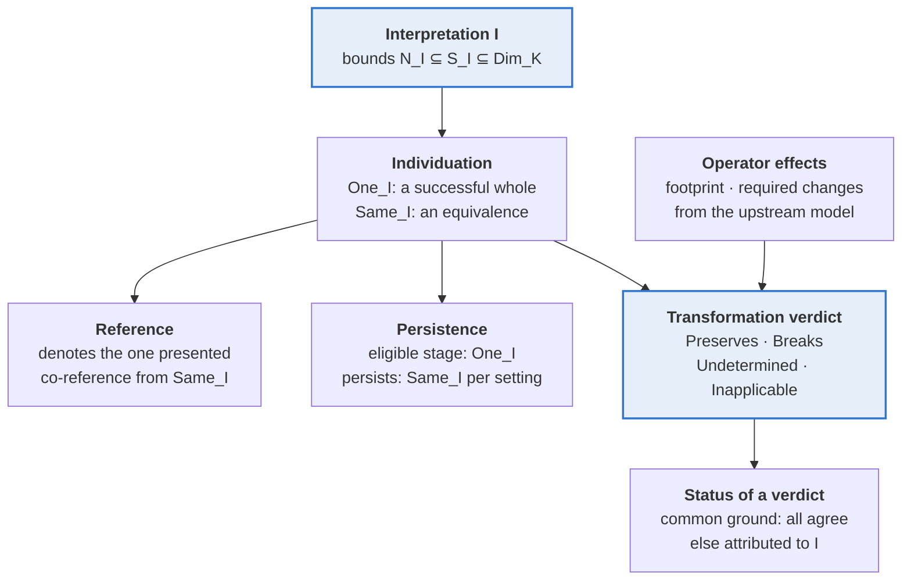

# Unified Referential Semantics (draft v0.1)

Oct 16, 2026 · @Denise

An interpretation supplies one criterion. Individuation uses it to say what counts as a whole and when two presentations are the same; reference and persistence are read off that sameness; the effects of an operator are then checked against the same bounds to give a transformation verdict.

Tags in the text refer to the companion grounding ledger: F for a result of prior science, S for an SE assumption, P for a program decision, K for a candidate contribution that is argued here and not established elsewhere, and T for a recorded tension.

## 1. Setting

The theory takes its primitives from Neutral Substrate (NS), adds one parameter and one construct, and defines or derives everything else.

| Item                                          | Role                                                                                                                                                                                                                                   | Source                                                                             |
| --------------------------------------------- | -------------------------------------------------------------------------------------------------------------------------------------------------------------------------------------------------------------------------------------- | ---------------------------------------------------------------------------------- |
| Kind K                                        | One of NS's three carriers: entity, occurrence, institutional artifact                                                                                                                                                                 | S1                                                                                 |
| Presentation p, context c, `presents_c(p, x)` | A candidate representation of a referent; the circumstances, including setting, in which it is evaluated; the link from a presentation to a carrier element                                                                            | S9                                                                                 |
| Reference ρ                                   | A use that purports to refer, evaluated in a context                                                                                                                                                                                   | S8                                                                                 |
| Setting s, stage a                            | A point of evaluation for persistence; a whole-stage candidate                                                                                                                                                                         | S8                                                                                 |
| Interpretation I                              | An admissible framework's account of K. It supplies the governing criterion, and the class of all admissible interpretations is open                                                                                                   | S4, S5                                                                             |
| Dimensions Dim_K                              | The subset of the eleven Transformation effect dimensions that are meaningful for K: content, arrangement, composition, referent population, representation population, containment, binding, association, lineage, evidence, standing | Reused from upstream as a starting vocabulary; its adequacy is tested in section 8 |
| Criterion bounds (N_I, S_I)                   | Sets of dimensions: agreement on N_I is necessary for sameness, agreement on S_I is sufficient                                                                                                                                         | K, grounded in F5 Def 4                                                            |

A **contract** is a condition relating NS predicates to each other. It never identifies two of them. Judgments are relative to an interpretation I unless stated. `one` and `sameUnit` are written One_I and Same_I when evaluated in the context that I fixes.

Agreement on a set D of dimensions means two presentations have equal values on every dimension in D. It is written agree_D(p, q) and is an equivalence relation for every D.

## 2. Individuation: wholes and sameness

A presentation succeeds as one whole when its interpretation's criterion applies to it without residue and it presents a single referent; two successful presentations are the same unit when they meet that criterion's bounds.

**Criterion.** An interpretation I of kind K supplies dimension sets N_I and S_I with N_I ⊆ S_I ⊆ Dim_K.

- **I1 Necessity.** Same_I(p, q) implies agree\_{N_I}(p, q).
- **I2 Sufficiency.** If One_I(p), One_I(q) and agree\_{S_I}(p, q), then Same_I(p, q).

I1 and I2 are the necessary and sufficient forms of an identity condition (F5, Def 4) read in the two-level form of F2. The inclusion N_I ⊆ S_I follows from them when dimension values vary independently (a K premise): any pair agreeing on S_I must also agree on N_I. A criterion is **complete** when N_I = S_I; then Same_I is agreement on that one set, which is the key form. Frege's direction example is complete (F1, F2). A **partial** criterion leaves pairs that agree on N_I but not on S_I undecided.

**I3 Success.** One_I(p) holds exactly when all three hold:

1. p is admissible as a whole-directed presentation under I;
2. p supplies a value for every dimension in S_I, so the criterion is determinate on p;
3. exactly one carrier element x satisfies presents_I(p, x).

A missing value is a failure of information, not of the framework. A presentation of several referents is ambiguous and a presentation of none is empty; neither is one whole. The three conditions are jointly sufficient only for presentations without internal parts; when presentations have parts, F5 (Defs 8 and 9) adds that an equivalence relation must link them, a refinement NS does not yet express (section 9).

**I4 Sameness is identity of units.** Same_I relates only successful presentations, and on them it is an equivalence relation. Grounding: identity is the equivalence relation that satisfies Leibniz's Law (F2), and NS describes `sameUnit` as a dyadic identity judgment. I2 and I1 place Same_I between agreement on S_I and agreement on N_I, both equivalences, so the law is satisfiable. A relation that fails it, such as a similarity or a directional match, is a different relation and not sameness (F3 Objection 5; F11).

The relation Same_I is the interpretation's own judgment, backed by the evidence S4 requires of it. The dimension sets N_I and S_I do not found it. They represent what it requires, which is how the theory meets P-A and the circularity worry in T3.

**I5 Link to referents.** If Same_I(p, q), then p and q present a common carrier element, which is unique by I3. The converse is not required: two successful presentations of one element may be different units under I, for example two versions of one record under a version-sensitive criterion. This is how carrier equality is related to `sameUnit` without being identified with it.

**Derived results**

- **2.1 Key form.** If I is complete, the units of K under I are the classes of agree\_{N_I}, and Same_I is the kernel of the map from a successful presentation to its values on N_I. Proof: I1 and I2 give Same_I = agree\_{N_I} on successful presentations.
- **2.2 Determinacy.** A presentation that fails One_I has no sameness verdict under I, because Same_I relates only successes. What it lacks is information, not a verdict.
- **2.3 Plurality is expressible.** Two interpretations may give the same kind different bounds. They then judge the same pair differently, and neither judgment is derived from the other. Section 5 says what follows.

## 3. Reference: denotation and co-reference

A reference succeeds when the presentation it uses succeeds as one whole; it then denotes that presentation's referent, and two successful references co-refer exactly when their presentations are the same unit.

Each reference ρ in a context c has a presentation pres_c(ρ), the presentation through which it purports to refer. An anaphoric or borrowed reference takes the presentation of the reference it borrows from, which is the chain structure of F8.

- **R1 Success.** ρ succeeds in c exactly when One_c(pres_c(ρ)).
- **R2 Denotation.** If ρ succeeds in c, den_c(ρ) is the unique x with presents_c(pres_c(ρ), x). This is the reference-to-referent bridge that NS leaves open (S8).
- **R3 Co-reference.** coRef_c(ρ, σ) holds exactly when both succeed and Same_c(pres_c(ρ), pres_c(σ)).

R3 relates co-reference to `sameUnit` without identifying them: the arguments differ (references in a context versus presentations), and co-reference passes through pres_c.

**Derived results**

- **3.1** Co-reference is an equivalence relation on successful references. Proof: R3 and I4.
- **3.2** If ρ and σ co-refer, then den_c(ρ) = den_c(σ). Proof: R3 and I5.
- **3.3** Reference failure has two sources. A presentation that supplies too little fails condition 2 of I3, and an ambiguous or empty presentation fails condition 3. Either way the reference co-refers with nothing.
- **3.4** Co-reference is not equality of wording, of presentation, or of sense. Two references with the same words in different contexts can take different presentations and fail to co-refer, as with indexicals. Two differently worded references can co-refer when their presentations are the same unit. That is Frege's informative identity (F8): co-reference is a semantic fact, and a speaker may not know it holds.

## 4. Persistence: stages and continuing units

Persistence is the same criterion applied across settings: a stage is eligible when it is a successful whole at its setting, and two eligible stages persist together exactly when the criterion's bounds hold across the two settings.

A stage a at setting s is a presentation evaluated in the context c(s) of that setting.

- **P1 Eligibility.** eligibleStage(s, a) holds exactly when One\_{c(s)}(a). This supplies the existence-at-a-setting condition in F5's identity conditions, E(x,t) together with the sortal property, which NS leaves out (T6). A stage that is not a successful whole at s is not there to be evaluated.
- **P2 Persistence extends sameness.** For eligible stages a at s and b at s', persists(s, s', a, b) implies agree\_{N_I}(a, b), and agree\_{S_I}(a, b) implies persists(s, s', a, b). The same bounds apply across settings, as in F5's Def 4 with times.
- **P3 Synchronic collapse.** persists(s, s, a, b) holds exactly when Same\_{c(s)}(a, b). This ties persistence to individuation without identifying them.

**Readings of persistence.** An interpretation reads persistence either as identity of continuing units or as a counterpart relation between stages (F4). P1 to P3 hold on both readings.

**Derived results**

- **4.1 Equivalence only on the identity reading.** On the identity reading, persists is an equivalence relation on eligible stages: reflexive and symmetric by P3 and I4, transitive because it is identity of units. On the counterpart reading it need not be transitive, which is how stage theory treats fission (F4).
- **4.2 Branching is an interpretation's policy.** Take a stage a at s and two later stages b and b' at s' that do not persist together. An interpretation on the identity reading cannot let both persist with a, because symmetry and transitivity would force b and b' to persist together. It must deny one, deny both, or count b and b' as one continuing unit. An interpretation on the counterpart reading may let both be counterparts of a. What a branching transformation does to identity is therefore fixed by the interpretation's branching policy and not by the transformation alone.
- **4.3 Neutrality about the theory of persistence.** P1 to P3 mention neither parthood of stages in referents nor stage membership. A stage-to-referent membership can be defined where the identity reading gives continuing units: a stage belongs to the unit it persists into. This supplies the membership relation NS leaves open without choosing between perdurantist, endurantist and stage-theoretic accounts.
- **4.4 Institutional persistence.** The sources read give no persistence criteria for corporations or offices (F9). For institutional artifacts the criteria come from the interpretations and are not supplied by the theory.

## 5. Interpretations: warranted judgments and common ground

A judgment is warranted within an interpretation when that interpretation's criterion and the contracts yield it, and it is common ground only when the contracts and the substrate's own referential facts yield it, so every other identity judgment must be attributed to an interpretation.

An admissible interpretation is an account of K that satisfies the contracts I1 to I5, R1 to R3 and P1 to P3. The contracts constrain what counts as a referential account. They leave the content of the criterion, the sets N_I and S_I, free. That freedom is one K assumption, **Criterion Openness**: for any identity proposition not entailed by the contracts and the substrate's referential facts, some admissible interpretation denies it. It cannot be proved here. It is the formal reading of basis plurality, and it is what the open framework class (S5) makes plausible.

| Status                   | Defining condition                                                                                                                  | Settled by                                          |
| ------------------------ | ----------------------------------------------------------------------------------------------------------------------------------- | --------------------------------------------------- |
| Warranted in I           | Follows from I's bounds, Same_I and the contracts                                                                                   | Nothing further; it holds in I                      |
| Common ground            | Follows from the contracts and the substrate's referential facts, so it is consistent with every admissible interpretation (S6, S7) | Nothing further; it holds in all                    |
| Semantic disagreement    | Two admissible interpretations warrant opposite judgments (framework-variant, S6)                                                   | Adopting an interpretation; more data does not help |
| Insufficient information | A presentation fails One_I because a value its criterion needs is missing (I3, condition 2)                                         | More data                                           |
| Inapplicable             | The question presupposes a dimension the kind lacks, or a stage that is not eligible at its setting (P1)                            | Reframing the question                              |
| Operator-undetermined    | An operator's effects do not fix the verdict (section 6)                                                                            | Case-level values or a stronger criterion           |

The last four are distinct conditions (P-D) with different remedies.

**Derived results**

- **5.1 Agreement among known interpretations is not common ground.** S6 defines invariance as consistency with every admissible framework, including ones not yet known. By Criterion Openness, an identity judgment not entailed by the contracts is denied by some admissible interpretation, so agreement among those currently known gives no evidence of invariance (P-C).
- **5.2 Neutral sameness.** If p and q agree on every dimension of Dim_K, and both are admissible and singular in I, then Same_I(p, q) in every admissible I. Proof: S_I ⊆ Dim_K, so agreement on all of Dim_K gives agreement on S_I, and I2 applies.
- **5.3 Neutral difference.** If p presents only x and q presents only y, with x different from y, then Same_I(p, q) fails in every admissible I. Proof: I5 requires a common carrier element. This takes the presents facts as substrate-fixed, which S7 requires of referential commitments.
- **5.4 What the substrate may commit to.** Under S7 and the SE-100 neutrality constraint, the substrate commits directly to common-ground identity judgments, such as 5.2 and 5.3, and the equivalence laws within a fixed interpretation. For a contested judgment j it commits only to the attribution that a named interpretation I, with its source and basis, judges j. That is a permitted attribution proposition and not a commitment to j. A substrate serving interpretations with different criteria therefore keeps each criterion as its own account and merges none into one Same. This resolves T1.

## 6. Transformation: verdicts from a criterion and an operator's effects

An operator preserves identity under an interpretation when its footprint avoids the criterion's sufficient set, breaks it when a required-change clause lies inside the necessary set, and otherwise leaves the verdict undetermined; the first two results are instances of upstream Transformation theorems.

**Link to the Transformation model.** Presentations of K are configurations of an upstream `StateModel` M. Then `agree d` is dimension d's agreement equivalence and `step op s t` is one atomic application of operator op. This correspondence is a K premise. Under it, I1 and I2 are upstream's `AgreementRequired` and `AgreementSuffices` applied to Same_I: for every d in N_I, Same_I requires agreement on d; and agreement on all of S_I suffices for Same_I. The upstream facts used are:

- `footprint op` is an upper bound on the dimensions a step may change; everything outside it is unchanged (frame law).
- `requirements op` is a list of clauses, and every step changes at least one dimension in each clause (change law). Every clause is nonempty and lies inside the footprint.
- `step_preserves`: if agreement on D suffices for P and the footprint avoids D, every step preserves P.
- `step_breaks`: if some required clause C has every dimension required by P, every step breaks P.

**Verdicts.** For an operator op, an interpretation I and a kind K:

| Verdict                      | Condition                                                                                                      |
| ---------------------------- | -------------------------------------------------------------------------------------------------------------- |
| Inapplicable to K            | Some required clause of op contains no dimension of Dim_K, so the change law cannot be met on K-configurations |
| Preserves                    | footprint(op) shares no dimension with S_I                                                                     |
| Breaks                       | Some clause C in requirements(op) has C ⊆ N_I                                                                  |
| Undetermined by the operator | op applies to K and neither of the above holds                                                                 |

**Derived results**

- **6.1 Preservation.** If op preserves under I, every step from a successful presentation s to a successful presentation t satisfies Same_I(s, t). Proof: `step_preserves` with D = S_I, using I2.
- **6.2 Breakage.** If op breaks under I, every step has Same_I(s, t) false. Proof: `step_breaks` with P = Same_I, using I1 for each dimension of C.
- **6.3 Exclusion.** When N_I ⊆ S_I, no applicable operator both preserves and breaks. Proof: a breaking clause C lies in N_I, hence in S_I; C is nonempty and inside the footprint, so the footprint meets S_I, contradicting preservation.
- **6.4 Tightness for complete criteria.** Let I be complete, with Same_I equal to agreement on S_I, and let M be the maximal model. Then exactly one holds: every step of op preserves, every step breaks, or steps of both kinds exist. Proof: `maximalModel_breaks_agreementOn_iff` says every step breaks agreement on S_I exactly when S_I contains a required clause. If the footprint meets S_I but no clause lies inside S_I, one step can change only dimensions outside S_I (preserving) and another can change a dimension inside S_I (breaking). For a partial criterion the verdicts are sound but not tight, because the bounds do not decide the pairs between them.
- **6.5 Operator versus instance.** The operator verdict holds for every step of op. For one pair (s, t) the bounds give Same_I when the pair agrees on S_I, give not-Same_I when it disagrees on some dimension of N_I, and leave it undecided otherwise.
- **6.6 Sequences.** A sequence whose combined footprint avoids S_I preserves Same_I, by 6.1 step by step and the transitivity of I4. Sequence-level breakage is not yet in the upstream theory and is not claimed here. A relation generated by non-breaking steps, as in SE-200, is therefore contained in Same_I, and it equals Same_I only if the operators connect every pair the criterion calls the same.
- **6.7 Branching, revisited.** The `branch` operator has footprint and requirement {lineage}. If lineage is outside S_I, branching preserves, so each branch is the same unit as its origin and the branches are the same as each other. If lineage is in N_I, branching breaks. If lineage is in S_I but not in N_I, the verdict is undetermined, and the interpretation must supply the branching policy of 4.2. That policy is where lineage sits relative to the bounds.

## 7. Derived distinctions

Two criteria must be represented separately exactly when some operator preserves identity under one and breaks it under the other, so the number of regimes is a count of verdict profiles relative to a vocabulary of operators, not a design choice.

**Profiles and separation.** For a vocabulary V of operators and an interpretation I of kind K, the profile of I assigns each operator in V one of Preserves, Breaks, Undetermined or Inapplicable (section 6). The profile depends only on Dim_K, N_I and S_I. Two interpretations are **separable over V** when some operator in V preserves under one and breaks under the other. They are **distinguishable over V** when their profiles differ in any entry, including applicability or determination.

**Derived results**

- **7.1 No neutral verdict.** Suppose I and J are admissible and an operator op preserves under I and breaks under J, and some step of op joins successful presentations. Then neither "op preserves identity" nor "op breaks identity" is consistent with every admissible interpretation, so neither is referential common ground. The substrate may only attribute the verdict to the interpretation that supports it (section 5). Proof: each statement contradicts one of the two interpretations on that step.
- **7.2 Nested criteria.** Call J **coarser** than I when S_J ⊆ N_I. Then N_J ⊆ S_J ⊆ N_I ⊆ S_I, and on presentations successful under both, Same_I implies Same_J, because agreement on N_I includes agreement on S_J and I2 applies to J. Further, Preserves under I implies Preserves under J (the footprint avoids S_I, which contains S_J), and Breaks under J implies Breaks under I (a clause inside N_J lies inside N_I). So no operator preserves under the finer criterion and breaks under the coarser one. Definite disagreement between nested criteria runs one way only: the coarser preserves while the finer breaks, or one of them is undetermined.
- **7.3 Incomparable criteria separate both ways.** Let I be identity by agreement on arrangement alone and J identity by agreement on lineage alone. Neither is nested in the other. In the upstream vocabulary, `RO` has footprint and sole requirement {arrangement}, so it breaks I and preserves J. `BR` has footprint and sole requirement {lineage}, so it breaks J and preserves I. These two criteria are therefore separable by two operators in opposite directions, and any representation that merges them loses a verdict.
- **7.4 Monotonicity in the vocabulary.** If V ⊆ V', profile equality over V' implies profile equality over V. Enlarging the vocabulary can therefore split classes of interpretations and can never merge them. The number of classes required is non-decreasing in V.
- **7.5 What a merge loses.** Interpretations of the same kind whose profiles agree over V can share one representation as far as operator-level verdicts over V go. They still differ at the instance level (6.5), because their bounds differ and Same_I and Same_J may differ on a particular pair. They also still differ in what counts as successful presentation (I3), reference (section 3) and persistence (section 4). A merge is lossless only relative to the operator-level question asked.
- **7.6 Regimes as an outcome.** A regime is a class of interpretations that agree in kind and in profile over the vocabulary. By 7.1 and 7.4, any set of admissible interpretations that are pairwise separable over V gives a lower bound on the number of regimes any adequate theory needs for V. The full number is not fixed, because the class of admissible interpretations is open (section 5) and the vocabulary is not assumed exhaustive. What the theory supplies is the test for when two proposed regimes are really one, and for when one proposed regime hides two.
- **7.7 Kinds are sortals.** The carriers of NS (section 1) do not individuate kinds; criteria do. A finer kind of referent (a rule, a scope, a record, an obligation-bearer, a plain referent) is a distinct sortal only when its Dim_K or its bounds differ. Two kinds with the same carrier and the same criterion are one sortal under two names. An operator that is inapplicable to one kind and applicable to another separates the kinds by applicability, which is a distinction of kind and not of criterion.

## 8. Cases and counterexamples

Every case below is read by derivation from sections 1 to 7, not tested against an independent source of verdicts; each outcome is a prediction of the theory, and a mismatch with a well-grounded judgment would be a defect in a definition.

### 8.1 Construction cases

These cases come from SE-210 and from the vulnerability-matching commitments. They informed the definitions, so they illustrate the theory and do not test it independently.

| Case                                                                                                                                            | Reading under the theory                                                                                                                                                                                                                                                                                                                                                                                                  |
| ----------------------------------------------------------------------------------------------------------------------------------------------- | ------------------------------------------------------------------------------------------------------------------------------------------------------------------------------------------------------------------------------------------------------------------------------------------------------------------------------------------------------------------------------------------------------------------------- |
| SE-210 rule edits: a content-keyed criterion and a structure-keyed criterion over three edits (refine structure, revise wording, amend content) | The two criteria are incomparable (neither S is inside the other's N), so by 7.3 they separate in both directions: structural refinement preserves under the content criterion and breaks under the structure criterion, and a content amendment does the reverse. This matches SE-210. Two findings follow in 8.3: no operator has a content-only clause, and wording has no dimension of its own.                       |
| PURL qualifier order, and empty qualifier versus absent qualifier                                                                               | Same, within the interpretation whose criterion is the canonical PURL built by the documented construction procedure. A string-level interpretation distinguishes the two inputs, but its referent is the literal string, a different sortal (7.7), so the two interpretations do not conflict. The judgment is warranted in the canonicalization interpretation and is common ground only as an attribution (section 5). |
| OCI digest identifies content independent of retrieval URL                                                                                      | Same, under a criterion whose sufficient set contains the verified content digest and excludes location. Verification is what makes the presentation successful (I3). The judgment is warranted within the content-addressed interpretation.                                                                                                                                                                              |
| Trivy: a versionless VEX PURL matches all versions                                                                                              | No identity judgment. A versionless PURL presents more than one package version, so it fails I3 and there is no successful reference (R1) and no Same_I. The match is also directed, and Same_I is an equivalence (I4). The theory therefore places this relation outside identity, as a decision relation, in agreement with the commitment's `not_asserted` identity claim.                                             |
| VEX matching semantics underdetermined by the PURL specification                                                                                | No identity judgment is warranted from the specification alone: insufficient information. If separate tools supply separate documented interpretations, the case becomes semantic disagreement between admissible interpretations. The theory cannot tell the two apart without those interpretations.                                                                                                                    |

### 8.2 Adversarial probes

These cases were chosen to break the theory, and each is derived from the definitions.

| Probe                                                             | Derivation                                                                                                                                                                                                                                                                                               | Outcome                                                                                                                                                                                                                                                                          |
| ----------------------------------------------------------------- | -------------------------------------------------------------------------------------------------------------------------------------------------------------------------------------------------------------------------------------------------------------------------------------------------------- | -------------------------------------------------------------------------------------------------------------------------------------------------------------------------------------------------------------------------------------------------------------------------------- |
| Fission: one unit branches into two continuants (Ship of Theseus) | On the identity reading Same_I is an equivalence (I4), so two continuants each the same as the origin are the same as each other, which conflicts with the intuition that they differ. By 6.7 the verdict is determined only when lineage lies outside S_I (both same) or inside N_I (branching breaks). | The theory forces a choice of policy. On the identity reading a criterion must place lineage in N_I or accept that branches coincide. On the counterpart reading (section 4) the relation need not be an equivalence and no conflict arises. The choice is the interpretation's. |
| Document editing (Renear and Wickett)                             | The same carrier can be individuated as a work (a document as an evolving thing) or as a text at a time. These are two sortals with different bounds (7.7).                                                                                                                                              | No contradiction: an edit can preserve identity as a work and break it as a text. Same_I is relative to the sortal, and the theory reports the sortal along with the verdict.                                                                                                    |
| Corporate merger and successor liability                          | `MG` has the full footprint (all eleven dimensions) and the single required clause {composition, referent population}. By the verdict table it preserves only if S_I is empty, which no real criterion is, and it breaks only if both composition and referent population lie in N_I.                    | A merger is operator-undetermined for every criterion that does not require both. A verdict needs a policy or the facts of the case, as legal practice also finds.                                                                                                               |
| Specimen split                                                    | `SP` has footprint {content, arrangement, composition, referent population} and the single clause {composition}.                                                                                                                                                                                         | It breaks any criterion with composition in N_I. It preserves only a criterion whose S_I avoids all four footprint dimensions. A criterion keyed to the whole specimen is broken; one keyed to a lineage or label alone is preserved.                                            |
| Occurrence granularity: one event individuated as one or as many  | The theory has no dimension that fixes how many occurrences a presentation covers.                                                                                                                                                                                                                       | Open (section 9). I3's single-carrier condition decides success but does not say which granularity is right.                                                                                                                                                                     |

### 8.3 Findings about the vocabulary and the evidence

- **No content-only operator.** The only requirement clause containing `content` is `EX`'s {content, composition, arrangement}. A criterion whose necessary set is {content} alone is therefore never broken by any operator: `EX` is undetermined for it, since a step may change only composition. Instance-level verdicts remain available (6.5), but operator-level breakage of a content-keyed criterion needs all three dimensions in N_I.
- **Wording has no dimension of its own.** SE-210's "revise wording" is content-preserving and structure-preserving. The upstream vocabulary has no dimension on which such a step acts, so it cannot be modeled except as a step with no effect. This is a candidate missing dimension (or a refinement of `content`) and is not assumed.
- **The SE-200 table as evidence.** Reading its preserve and break cells as given verdicts, 26 of the 36 pairs among the nine positions have an operator that one preserves and the other breaks, and the largest set of pairwise-separable positions has four members. The other ten pairs differ only in whether a transformation is judged at all. The table uses ten transformations, whose relation to the seventeen upstream operators is not established here, so this is a statement about that table and not a count of regimes.

## 9. Limits and open problems

The draft is a paper-level derivation. Its definitions and results are stated precisely enough to be formalized, and nothing here has been proved in Lean or tested on independent cases outside software and legal records.

- **Criterion Openness is assumed (K).** Section 5 relies on the premise that any identity proposition not entailed by the contracts and referential facts is denied by some admissible interpretation. It is needed to keep the substrate neutral and has not been derived from the SE-100 definitions.
- **Independence of the three accounts.** The theory links individuation, reference and persistence through one criterion (I1 to I5, R1 to R3, P1 to P3). Whether any of the three can be defined without the others in a way that matters for a case is not shown.
- **Composite presentations.** I3 is sufficient for success only when a presentation has no parts. Guarino and Welty's parts-unity (Defs 8 and 9 in their ER-2000 paper) is not part of NS and is not derived here.
- **Link to the Transformation model (section 6).** Reading presentations as configurations of the upstream state model is a premise. Sequence-level breakage is not in the upstream theory, so 6.6 claims only preservation along sequences.
- **Dimensions and vocabulary.** Dim_K is a subset of the eleven upstream dimensions, and the vocabulary is the seventeen operators. Section 8.3 finds a gap (no content-only operator, no wording dimension). Whether other kinds, such as physical objects or occurrences, need dimensions the vocabulary lacks is open.
- **Occurrence granularity.** The theory has no account of how many occurrences one presentation covers (8.2).
- **Institutional persistence.** The sources consulted gave no criteria for persistence of organizations across changes in responsibility, so section 8.2's merger reading rests on the operator model alone.
- **Carrier versus criterion.** I5 requires a common carrier element for sameness. The converse (same carrier element implies same, for some interpretation) is not required, and the theory does not say when a carrier is too coarse for a criterion.
- **Preserve versus neutral.** Whether a distinction between operators that preserve and operators that are merely neutral carries scientific content, beyond Undetermined, is open.
- **Evidence.** The cases in 8.1 helped shape the definitions. The independent application cases that would test the theory (institutional identity, physical objects, occurrences, scientific records, changes in organizational responsibility) remain to be assembled.
