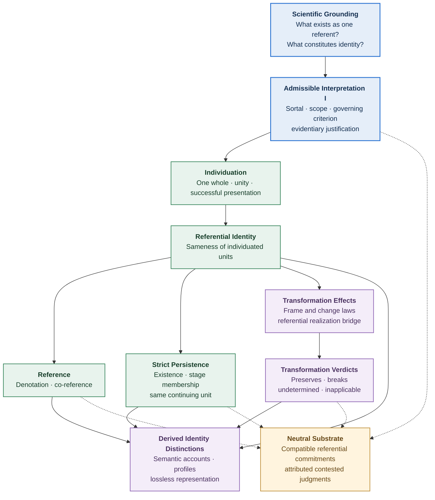
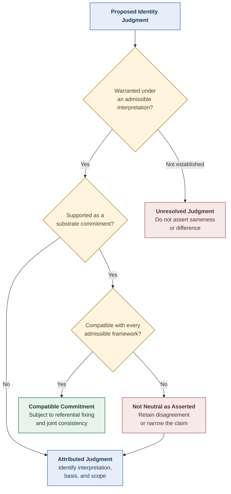
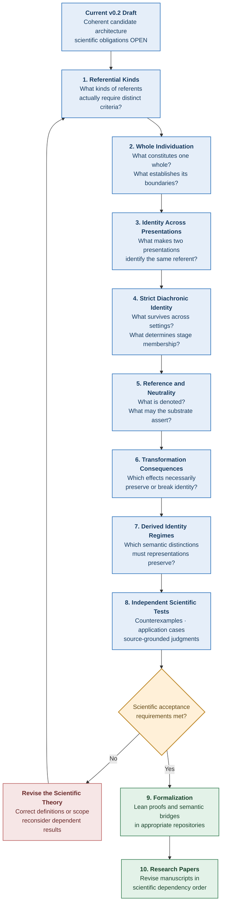
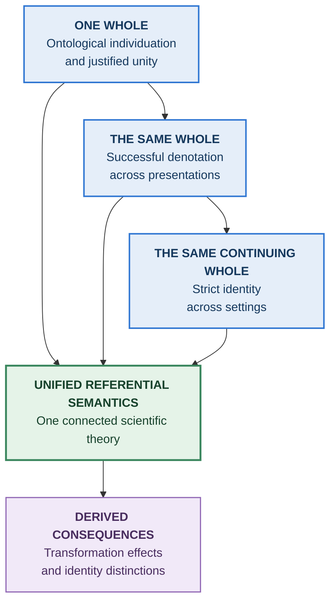

# Structural Explainability

# Unified Referential Semantics — Scientific Review and Revised Specification

**Version:** 0.2 — Working Research Draft
**Date:** October 16, 2026
**Status:** OPEN — Not scientifically accepted
**Scope:** Individuation, identity, reference, co-reference, persistence, interpretation, transformation, and identity regimes
**Research principle:** All prior definitions, theorems, classifications, repository boundaries, and manuscripts are revisable when scientific justification requires it.

---

## 1. Objective

Develop one scientifically grounded, mathematically coherent, integrated theory of referential identity for Structural Explainability (SE).

The theory must explain:

1. What makes something one individuated referent.
2. What makes two presentations identify the same referent.
3. What makes two references co-refer.
4. What makes a referent remain the same across settings.
5. How an interpretation warrants identity judgments.
6. How transformations affect identity.
7. Which distinctions an adequate representation must preserve.

The objective is not to recover the historical nine-regime classification, preserve existing Lean interfaces, or reconcile earlier papers at the expense of scientific validity.

**The theory determines the formalization. The formalization does not determine the theory.**

Existing results should be retained when mathematically correct and scientifically adequate. Results that fail either requirement must be revised, narrowed, or withdrawn.

The theory may require changes in any previous SE repository.

### 1.1 Central scientific question

> For each intended referent kind, what independently justified conditions establish that a presentation identifies one whole, and that presentations or stages across change identify that very same whole?

This question is the principal unresolved scientific obligation.

The mathematical machinery for equivalence, reference, persistence, and transformation cannot independently answer it.

The research must establish the conditions under which that machinery represents actual referential identity.

### 1.2 Three separate achievements

Scientific acceptance requires three distinct achievements.

**Mathematical correctness**

Definitions must be consistent, and theorems must follow from their stated assumptions.

**Scientific adequacy**

The formal structures must represent their intended phenomena. Assumptions must be justified, interpretation conditions must be explicit, and meaningful counterexamples must be addressed.

**Original theoretical contribution**

The theory must establish substantive results about identity, persistence, transformation, or explainability that are not merely restatements of assumptions.

Successful Lean compilation establishes neither scientific adequacy nor original theoretical contribution.

All three achievements are required.

---

## 2. Scientific Review of Draft v0.1

### 2.1 Verdict

**Unified Referential Semantics v0.1 is not scientifically acceptable as written.**

It contains a genuine foundational countermodel, incomplete semantic bridges, insufficiently justified assumptions, and claims stronger than the cited mathematical results establish.

The most consequential defect is the attempt to characterize identity through necessary and sufficient agreement on a finite transformation-dimension vocabulary without first establishing that those dimensions adequately identify the intended referents.

This affects individuation, co-reference, persistence, transformation, and identity-regime derivation.

### 2.2 Foundational counterexample

Draft I2 states:

\[
\operatorname{One}_I(p)
\land
\operatorname{One}\_I(q)
\land
\operatorname{agree}_{S_I}(p,q)
\Longrightarrow
\operatorname{Same}\_I(p,q)
\]

where:

\[
S_I\subseteq\operatorname{Dim}\_K.
\]

Draft I5 states that sameness requires the presentations to share a unique carrier element.

Consider:

- Two successful presentations, \(p\) and \(q\).
- Distinct carrier elements, \(x\ne y\).
- Every one of the eleven available dimension values is identical.
- Each presentation identifies exactly one carrier element.

I2 implies:

\[
\operatorname{Same}\_I(p,q).
\]

I5 implies:

\[
x=y.
\]

The proposed construction therefore conflicts with the contracts.

Strictly, this is not a proof that I1–I5 are jointly inconsistent in every model. Models that exclude the construction can satisfy them.

However, the theory does not justify excluding distinct referents with identical dimension values.

A restriction excluding such pairs would itself require scientific grounding.

**Disposition:** Reject unconditional dimension sufficiency as a universal identity principle.

Dimension agreement may establish identity only within a domain where the claimed sufficiency has been independently justified.

### 2.3 Other material defects

| Location  | Problem                                                                           | Required correction                              |
| --------- | --------------------------------------------------------------------------------- | ------------------------------------------------ |
| I3        | A singular carrier presentation is treated as sufficient to establish one whole   | Establish whole individuation and unity          |
| I4        | Equivalence is imposed without deriving it from a grounded referential relation   | Establish its legitimate domain and semantics    |
| I5        | Carrier equality and unit identity are insufficiently distinguished               | Define their relationship explicitly             |
| R1–R3     | Co-reference is tied to the problematic sameness criterion                        | Ground co-reference in successful denotation     |
| P1        | Successful presentation is treated as existence at a setting                      | Establish existence and stage membership         |
| P2–P3     | Cross-setting equivalence lacks an adequate bridge                                | Establish strict diachronic identity             |
| Section 4 | Counterpart relations and strict persistence are treated as alternative readings  | Keep them distinct                               |
| Section 5 | Consistency, entailment, and openness are conflated                               | Separate the logical statuses                    |
| Section 6 | Transformation results are transferred without their required semantic hypotheses | Establish the realization bridge                 |
| Section 7 | Operator-profile equality is treated as possible regime equivalence               | Specify and preserve the full intended interface |

### 2.4 Results worth retaining

The review does not require rejecting the entire earlier program.

The following remain valuable:

- Necessary and sufficient conditions as tools for representing independently justified identity criteria.
- Keys as representations of criteria rather than foundations of identity.
- The separation between successful individuation and unsuccessful or ambiguous presentation.
- Interpretation-relative judgments and referential common ground.
- Strict persistence as distinct from transformation, derivation, and succession.
- The Transformation theory's frame and change laws.
- The distinction between operator guarantees and instance-level judgments.
- The requirement that identity-regime distinctions follow from substantive semantics.
- The rejection of a predetermined regime count.

These are retained as concepts or conditional mathematical results, not automatically as scientifically established claims.

---

## 3. Proposed Unified Architecture

The corrected theory proceeds from referential semantics toward transformation consequences.

The arrows indicate dependencies of scientific justification.

They do not imply that every concept is mechanically computed from the preceding one.

In particular, the grounding of individuation and diachronic identity cannot be replaced by constructing an arbitrary mathematical equivalence relation.

---

## 4. Revised Referential Semantics

The following constitutes the current **candidate specification v0.2**.

The specification is designed to be mathematically coherent while explicitly preserving unresolved scientific obligations.

Its abstract semantic functions and relations are proposed structures. Their introduction does not establish that particular interpretations of real-world phenomena are adequate.

### 4.1 Referential kinds and sortals

Retain the three broad Neutral Substrate carrier categories:

\[
K\in
\{
\text{entity},
\text{occurrence},
\text{institutional artifact}
\}.
\]

These are broad carrier categories.

They do not necessarily provide complete individuation criteria.

A more specific **sortal** identifies the kind of thing whose identity is being investigated.

For example, a record, a textual version, an abstract work, a physical specimen, an occurrence, and an institution may require different conditions for individuation and persistence.

The inventory of relevant sortals is not assumed exhaustive.

A sortal must not be introduced merely because a different transformation classification is desired.

Its justification must come from the intended referential domain.

### 4.2 Admissible interpretations

An interpretation \(I\) supplies:

1. An intended referent kind or sortal.
2. A domain \(U_I\) of individuated units.
3. Criteria for successful whole individuation.
4. A grounded relationship between presentations and units.
5. Conditions for identity across settings.
6. A documented scope and evidentiary basis.

The class of interpretations remains open.

However, admissibility does not mean that arbitrary identity criteria are scientifically acceptable.

Interpretations must satisfy the existing SE requirements for consistency, evidentiary grounding, and documented interpretive function.

The scientific adequacy of their particular identity criteria remains subject to review.

### 4.3 Individuation

Let:

\[
\operatorname{Presents}\_I(c,p,u)
\]

mean that presentation \(p\), evaluated in context \(c\), presents the intended individuated unit \(u\).

Let:

\[
\operatorname{Unity}\_I(c,p,u)
\]

mean that the relevant conditions for presenting \(u\) as one whole are satisfied.

Define successful individuation as:

\[
\begin{aligned}
\operatorname{One}\_I(c,p)\iff {}&
\operatorname{AdmissiblePresentation}\_I(c,p)\\
&\land\ \exists u\in U_I:\bigl(
\operatorname{Presents}\_I(c,p,u)\\
&\qquad\land\operatorname{Unity}\_I(c,p,u)\\
&\qquad\land
\forall v\in U_I,\,
(\operatorname{Presents}\_I(c,p,v)\Rightarrow v=u)
\bigr).
\end{aligned}
\]

Successful individuation therefore requires:

- An admissible presentation.
- Exactly one presented referent.
- A justified unity condition establishing the intended whole.

A presentation of one carrier element does not automatically satisfy these conditions.

**Scientific limitation:** `Presents` and `Unity` are not yet independently grounded for every intended sortal.

They are the principal scientific predicates requiring further development.

The current specification defines how established individuation supports subsequent semantics. It does not pretend that merely introducing these predicates establishes individuation.

### 4.4 Successful denotation

For a successful presentation, define:

\[
\delta_I(c,p)=u,
\]

where \(u\) is the uniquely individuated unit.

This is a partial semantic function.

It is defined only where successful individuation has been established.

A failed or ambiguous presentation does not receive an arbitrary default denotatum.

The absence of sufficient information to establish denotation must remain distinguishable from a proven unsuccessful reference.

### 4.5 Sameness of individuated units

For successful presentations under one interpretation:

\[
\begin{aligned}
&\operatorname{Same}\_I((c,p),(d,q))\\
&\qquad\iff
\delta_I(c,p)=\delta_I(d,q).
\end{aligned}
\]

Both denotations must be defined, and the contexts must be comparable under the interpretation.

**Theorem 4.1 — Equivalence of sameness**

On the domain of successful, comparable presentations:

\[
\operatorname{Equivalence}(\operatorname{Same}\_I).
\]

**Proof outline**

Because sameness is equality of denotata in \(U_I\), reflexivity, symmetry, and transitivity follow from equality.

**Mathematical status:** Valid conditional derivation.

**Scientific status:** Dependent on the grounded adequacy of the individuation and denotation relations.

This result does not establish that two things are the same merely because an interpretation assigns them the same identifier.

The denotation function must itself represent the intended referential identity.

### 4.6 Carrier equality

The relationship between an individuated unit and an underlying carrier element is interpretation-dependent.

Carrier association is distinct from referential identity.

In general, neither implication is unconditional:

\[
x=y\Rightarrow\operatorname{Same}\_I(p,q)
\]

nor:

\[
\operatorname{Same}\_I(p,q)\Rightarrow x=y.
\]

A particular referential domain may justify one or both implications.

That requires establishing the relevant carrier/unit correspondence.

For example, a version-sensitive referent and a continuing record may have different relationships to the same underlying carrier.

The theory must not silently equate these relationships.

---

## 5. Reference and Co-reference

A reference use \(\rho\) in context \(c\) has an associated presentation:

\[
\operatorname{pres}\_c(\rho)=p.
\]

Successful reference requires successful singular denotation through that presentation, together with its appropriate referential use.

For successful references:

\[
\operatorname{den}\_I(c,\rho)
=

\delta_I(c,\operatorname{pres}\_c(\rho)).
\]

Define co-reference:

\[
\begin{aligned}
&\operatorname{coRef}\_I(c,\rho,\sigma)\\
&\quad\iff
\operatorname{RefSuccess}\_I(c,\rho)
\land
\operatorname{RefSuccess}\_I(c,\sigma)\\
&\qquad\land
\operatorname{den}\_I(c,\rho)
=

\operatorname{den}\_I(c,\sigma).
\end{aligned}
\]

The same definition can be extended to references in different contexts when those contexts have a justified common interpretation.

**Theorem 5.1 — Co-reference equivalence**

Co-reference is an equivalence relation on successful references under the same referential account.

**Proof outline**

Co-reference is the pullback of equality through successful denotation.

This result preserves the distinctions among:

- Reference equality.
- Presentation equality.
- Carrier equality.
- Successful denotation.
- Sameness of individuated units.
- Co-reference.

No one of these concepts is substituted for another merely because they coincide in a particular implementation.

---

## 6. Strict Persistence Across Settings

Persistence is strict diachronic identity.

It is not merely:

- Temporal proximity.
- Historical continuity.
- Provenance.
- Derivation.
- Succession.
- Counterpart correspondence.
- Transformation reachability.

The theory must establish when eligible stages belong to the very same continuing unit.

### 6.1 Existence at a setting

Introduce:

\[
E_I(u,s)
\]

meaning that individuated unit \(u\) exists at setting \(s\), as understood under interpretation \(I\).

Existence conditions must be scientifically justified.

A record's presence or absence may provide evidence, but is not universally identical to the referent's existence or nonexistence.

### 6.2 Stage membership

Introduce:

\[
\operatorname{StageOf}\_I(s,a,u)
\]

meaning that \(a\), evaluated at setting \(s\), is a stage of individuated unit \(u\).

This relationship must be grounded independently of the persistence relation it is intended to explain.

It must not be defined as:

> A stage belongs to a unit exactly when it persists with another stage of that unit.

Such a definition would assume the identity judgment that the theory seeks to justify.

### 6.3 Eligible stages

An eligible stage is an admissible whole-stage candidate that belongs uniquely to an existing unit at its setting and satisfies the governing stage-unity conditions.

Symbolically:

\[
\operatorname{Eligible}\_I(s,a)
\]

requires unique, justified stage membership and existence.

The exact stage-unity and existence criteria remain domain-dependent scientific obligations.

### 6.4 Strict persistence

For eligible stages:

\[
\begin{aligned}
&\operatorname{Persists}\_I(s,t,a,b)\\
&\quad\iff
\exists u\in U_I:
\operatorname{StageOf}\_I(s,a,u)
\land
\operatorname{StageOf}\_I(t,b,u).
\end{aligned}
\]

The existence and eligibility requirements apply at both settings.

**Theorem 6.1 — Strict persistence equivalence**

Where stage membership is unique and grounded within one continuing-unit domain, persistence is an equivalence relation on eligible stage occurrences.

**Proof outline**

Two eligible stage occurrences persist together precisely when they belong to the same individuated unit. Equality of that unit is reflexive, symmetric, and transitive.

**Scientific qualification**

This is not a proof that actual stage membership has been established.

The substantive diachronic criterion remains an independent obligation.

### 6.5 Branching and fission

Suppose one stage \(a\) has two later successor candidates \(b\) and \(c\).

If both persist strictly with \(a\), they must belong to the same continuing unit.

If the successor stages are independently established as belonging to distinct continuing units, they cannot both be strictly identical to the original.

A scientifically justified interpretation may determine that:

- One branch continues the original and another is derivative.
- Neither branch continues the original.
- The transformation changes the relevant referential kind or produces newly individuated units.
- The available evidence does not determine the identity outcome.

Which judgment is justified must follow from the governing diachronic criterion.

A counterpart or historical-succession relation may connect multiple branches without asserting strict identity.

The theory must retain those distinct relations rather than describing them as interchangeable forms of persistence.

---

## 7. Interpretation and Referential Common Ground

Interpretation-relative warrant must be distinguished from neutral referential commitment.

Let \(T_0\) denote substrate commitments and \(F_I\) the commitments of an admissible interpretation.

The following logical statuses are different.

| Status                   | Condition                                                                                  |
| ------------------------ | ------------------------------------------------------------------------------------------ |
| Warranted under \(I\)    | The proposition follows under \(I\), subject to evidentiary requirements                   |
| Universally entailed     | Every admissible substrate-framework theory entails the proposition                        |
| Universally compatible   | Adding the proposition remains consistent with every admissible substrate-framework theory |
| Attributed               | The proposition reports a judgment made under a named interpretation                       |
| Insufficient information | The available evidence establishes neither the relevant proposition nor its negation       |
| Framework disagreement   | Admissible interpretations support incompatible judgments                                  |

Universal compatibility does not imply universal entailment.

Failure to derive a proposition does not establish its negation.

Agreement among currently examined frameworks does not prove agreement among all admissible frameworks.

### 7.1 Criterion Openness

Reject the proposed **Criterion Openness** assumption from v0.1.

The openness of the framework class does not entail:

> Every identity proposition not universally established must be denied by some admissible interpretation.

The assumption is neither independently justified nor necessary for the existing neutrality requirement.

### 7.2 Referential Common Ground

Neutral Substrate requires its referential commitments to remain compatible with every admissible framework.

This is a requirement on the complete commitment set.

It is not sufficient to show that each proposition is individually compatible when their conjunction may be inconsistent.

The substrate must not silently assert an interpretation-dependent identity criterion as universal.

Where a judgment is contested, it may preserve a properly grounded attribution to the governing interpretation without asserting the contested judgment itself.

The diagram represents the conceptual decision process.

A compatible proposition is not automatically asserted. Its inclusion still requires referential fixing, adequate grounding, and compatibility of the resulting complete commitment theory.

---

## 8. Transformation Effects on Referential Identity

Transformation analysis follows the independently justified identity criterion.

It does not establish that criterion merely by classifying transformations.

### 8.1 Reuse of Transformation v0.5.1

Retain the existing mathematical machinery:

- `StateModel`
- `AgreementSuffices`
- `AgreementRequired`
- `step_preserves`
- `step_breaks`
- `footprint`
- `requirements`
- `SequenceStep.preserves`

The Transformation theory distinguishes configurations from referents.

Its frame law establishes that an operator step leaves dimensions outside its footprint unchanged.

Its change law establishes that each required-change clause has at least one changed dimension.

These are properties of transformation configurations.

### 8.2 Referential realization bridge

Introduce a scientifically justified relationship between:

1. A transformation configuration.
2. Its relevant referential subjects.
3. A before/after operator step.
4. The presentations or stages whose identity is being compared.

For interpretation \(I\), write:

\[
\operatorname{Realizes}\_I(op,p,q)
\]

for a valid referential comparison realized by an operator step.

This relationship must identify the relevant before and after subjects.

It is particularly important when one transformation produces multiple outputs.

The bridge must be defined without assuming that the operator preserves or breaks identity.

Otherwise the proposed transformation theorem would be circular.

### 8.3 Necessary and sufficient dimensions

Let \(N_I\) be a set of dimensions whose agreement is independently established as necessary for identity.

Let \(S_I\) be a set of dimensions whose agreement is independently established as sufficient for identity on a specified comparison domain.

The conditions are:

\[
\operatorname{Same}_I(p,q)
\Rightarrow
\operatorname{agree}_{N_I}(p,q)
\]

and:

\[
\operatorname{EligibleComparison}_I(p,q)
\land
\operatorname{agree}_{S_I}(p,q)
\Rightarrow
\operatorname{Same}\_I(p,q).
\]

Sufficiency must be established independently of the identity conclusion.

The comparison domain must not be defined simply as the set of pairs already known to be identical.

The eleven current dimensions are not assumed complete.

The inclusion:

\[
N_I\subseteq S_I
\]

may hold for particular justified signature models, but is not imposed as a universal scientific axiom.

### 8.4 Preservation theorem

If:

\[
\operatorname{footprint}(op)\cap S_I=\varnothing
\]

and the sufficient-agreement condition applies to every eligible realized step, then the operator preserves identity on that domain.

**Proof outline**

The frame law establishes agreement on every dimension of \(S_I\).

The certified sufficiency condition establishes identity.

### 8.5 Breakage theorem

If some required-change clause \(C\) satisfies:

\[
C\in\operatorname{requirements}(op)
\]

and:

\[
C\subseteq N_I,
\]

then every eligible realized step breaks identity on that domain.

**Proof outline**

The change law establishes disagreement on at least one dimension of \(C\).

Necessary agreement for identity is violated.

Therefore identity cannot hold.

### 8.6 Qualification of transformation verdicts

The four classification outcomes are:

| Verdict      | Meaning                                                                                         |
| ------------ | ----------------------------------------------------------------------------------------------- |
| Preserves    | Every applicable, valid referential realization preserves identity                              |
| Breaks       | Every applicable, valid referential realization breaks identity                                 |
| Undetermined | The available operator semantics do not establish either guarantee                              |
| Inapplicable | The operation is not meaningful or realizable for the intended domain under the stated contract |

The classification requires an adequately specified realization domain.

Universal preservation and breakage claims should not be accepted merely because that domain is empty.

An operator footprint is an upper bound on possible changes.

It is not proof that every footprint dimension changes.

Likewise, the absence of a breakage proof is not evidence of preservation.

### 8.7 Sequences

The existing sequence-preservation result remains mathematically useful.

If every relevant step preserves strict identity, transitivity establishes preservation across the sequence.

However:

\[
\text{not known to break}
\not\Rightarrow
\text{known to preserve}.
\]

Consequently, the draft's claim that relations generated by non-breaking steps are contained in strict identity must be withdrawn.

Generated equivalence relations may represent strict identity only after their generating relations have been shown to be referentially sound.

Completeness additionally requires showing that every intended same-referent pair is captured by the generated relation.

---

## 9. Derived Identity Regimes

An identity regime must preserve the referential distinctions required by its declared semantic interface.

The complete candidate referential account includes:

\[
\mathcal R_I=
(
\operatorname{One}\_I,
\operatorname{den}\_I,
\operatorname{Same}\_I,
\operatorname{coRef}\_I,
\operatorname{Eligible}\_I,
\operatorname{Persists}\_I
).
\]

The interpretation, referent domain, unity criteria, and supporting semantic conditions remain part of the account.

### 9.1 Operator profiles

For a transformation vocabulary \(V\):

\[
\operatorname{Profile}\_V(I)
\]

assigns each operator its qualified preservation, breakage, undetermined, or inapplicable verdict.

This is a projection of the referential account.

It is not the complete account.

### 9.2 Lossless representation

Two interpretations may be merged only relative to an explicitly defined service interface.

A representation is lossless when it preserves every independently justified distinction observable through that interface.

Operator-profile equality is sufficient for a representation whose only service is answering those operator-level questions.

It is not sufficient for a complete referential representation.

Two accounts can agree on all operator classifications while disagreeing on:

- Successful individuation.
- Denotation.
- Co-reference.
- Instance-level identity.
- Strict persistence.
- Applicable referent kinds.

Such accounts must remain distinguishable whenever those judgments are part of the intended interface.

### 9.3 Consequences

The number of identity regimes is a derived outcome.

The nine historical regimes do not constitute a required lower bound for every scientifically justified referential theory.

A finite transformation vocabulary may produce a finite number of operator-profile classes.

That does not establish that the number of complete semantic identity accounts is finite or equal to the historical count.

Existing regime distinctions remain useful historical and construction evidence.

They are not normative targets.

---

## 10. Mathematical Results and Open Obligations

| Result                                              | Mathematical status                                       | Scientific dependency                              |
| --------------------------------------------------- | --------------------------------------------------------- | -------------------------------------------------- |
| Sameness is equivalence on successful presentations | Follows from equality of denotata                         | Grounded individuation                             |
| Co-reference equivalence                            | Follows from successful denotation                        | Referential adequacy                               |
| Strict persistence equivalence                      | Follows from unique continuing-unit membership            | Grounded diachronic membership                     |
| Branching exclusion                                 | Follows from strict identity and distinct successor units | Justified successor individuation                  |
| Complete key representation                         | Conditional theorem                                       | Criterion completeness and domain adequacy         |
| Transformation preservation                         | Conditional theorem                                       | Valid sufficient dimensions and realization bridge |
| Transformation breakage                             | Conditional theorem                                       | Valid necessary dimensions and realization bridge  |
| Sequence preservation                               | Conditional theorem                                       | Identity-preserving steps and compatible endpoints |
| Lossless regime representation                      | Conditional theorem                                       | Complete declared semantic interface               |

These are mathematical derivations or theorem proposals.

The new referential statements have not been Lean-verified.

Their scientific premises remain subject to independent justification.

### 10.1 Unresolved scientific obligations

**OB1 — Whole individuation**

Establish the conditions under which a presentation successfully identifies one whole.

**OB2 — Referential grounding**

Establish when a presentation or reference denotes the intended unit, independently of a chosen implementation key.

**OB3 — Diachronic identity**

Establish when stages across settings belong to the same continuing unit without defining membership circularly through persistence.

**OB4 — Dimensional adequacy**

Determine when the Transformation dimensions are sufficient or necessary for the intended identity criterion.

**OB5 — Transformation realization**

Establish the relationship between transformation configurations, operator steps, and referential comparisons.

**OB6 — Referential neutrality**

Establish the compatibility of proposed substrate commitments with the admissible framework class.

**OB7 — Regime completeness**

Establish which distinctions a lossless representation must preserve.

The first three obligations are foundational.

The subsequent obligations cannot be considered scientifically discharged until their foundational dependencies have been addressed.

---

## 11. Counterexamples and Current Disposition

| Counterexample                                           | Current disposition                                       |
| -------------------------------------------------------- | --------------------------------------------------------- |
| Different referents with identical dimension values      | Refutes unconditional dimension sufficiency               |
| Multiple presentations of one referent                   | Handled through grounded denotation                       |
| Ambiguous or unsuccessful reference                      | Requires separate success and information judgments       |
| Institutional disagreement                               | Requires interpretation attribution and grounded criteria |
| Continuing object undergoing internal change             | Requires diachronic identity criteria                     |
| Copying and branching                                    | Does not automatically establish strict identity          |
| Record identity versus document content                  | May require different sortals and criteria                |
| Occurrence individuation and granularity                 | Scientifically open                                       |
| Scope extension versus structural alteration             | Requires independently justified identity criteria        |
| Historical derivation versus persistence                 | Distinct relations                                        |
| Transformation with uncertain identity effects           | Must remain undetermined without sufficient evidence      |
| Same operator profile with different reference judgments | Refutes full semantic equivalence from profile equality   |

These are adversarial and construction cases.

They do not constitute independent empirical validation.

The next development cycle must distinguish cases used to construct or revise definitions from cases selected independently to test the resulting theory.

---

## 12. Scientific Assessment

### 12.1 Mathematical correctness

**Status: CONDITIONAL**

The revised definitions have coherent mathematical interpretations.

Several consequences follow directly from equality or from the established Transformation theorems under additional hypotheses.

Formal consistency and the complete integration bridges have not yet been independently verified in Lean.

### 12.2 Scientific adequacy

**Status: OPEN**

The central unresolved question is the scientific grounding of whole individuation and diachronic identity.

The current proposal exposes this obligation instead of hiding it.

That is an improvement in conceptual precision, not a completed scientific result.

### 12.3 Original theoretical contribution

**Status: CANDIDATE**

The potential contribution is an integrated account connecting:

1. Grounded individuation and referential identity.
2. Interpretation-relative warrant and neutral commitments.
3. Strict persistence and transformation effects.
4. Certified transformation consequences.
5. Lossless identity-regime representation.

The theory must demonstrate substantive explanatory or deductive consequences beyond simply defining these relationships.

It is not sufficient to rename standard logical constructions or assemble independently familiar concepts.

### 12.4 Compatibility with Neutral Substrate

**Status: CONDITIONAL**

The proposal respects the existing separation among individuation, co-reference, persistence, and referential commitments.

It preserves the distinction between framework-relative judgments and neutral substrate commitments.

Full compatibility requires proving the relevant referential commitment sets satisfy the existing neutrality conditions.

### 12.5 Generality

**Status: UNESTABLISHED**

The architecture is mathematically general.

Its scientific adequacy has not been established across physical objects, occurrences, institutional identities, legal entities, scientific records, and software artifacts.

The current dimension vocabulary and available examples do not justify a universal completeness claim.

---

# Part II — Research Development Plan

## 13. What Changes Now That All Prior Work Is Revisable?

The research should stop treating earlier repository boundaries, classifications, and formal definitions as constraints on scientific discovery.

They remain evidence and reusable implementation resources.

**The scientific dependency order determines the revision order.**

This means a foundational defect must be corrected at its actual theoretical source.

It must not be hidden in a downstream adapter, additional assumption, or classification exception.

The existing Lean theory may be mathematically correct while failing to establish the scientific claim it was intended to represent.

That distinction must remain explicit throughout the revision process.

### 13.1 What not to do next

Do not immediately:

- Rewrite the nine-regime matrix.
- Add a new identity-key abstraction to Lean.
- Introduce additional dimensions simply to repair particular rows.
- Classify all seventeen operators against hypothetical criteria.
- Rewrite all existing papers.
- Create another theory repository.
- Treat the revised unit-denotation function as a completed account of individuation.

Each activity would risk building more formal structure before establishing its scientific foundation.

### 13.2 What to do next

Resolve the scientific identity question beginning with **what constitutes one whole**.

Then establish how the same whole is identified across presentations and settings.

Only after those criteria are sufficiently justified should the theory determine which transformation properties preserve or break the resulting identity.

---

## 14. Scientific Development Sequence

The ordering is a research priority, not a requirement to complete all scientific work in a single linear pass.

Findings about diachronic identity may expose defects in individuation.

Findings about referential kinds may require a revised sortal inventory.

Transformation counterexamples may reveal missing criteria.

When a counterexample defeats a definition, revise the definition and reconsider all dependent results.

Do not defend a definition merely because existing Lean theorems depend on it.

---

## 15. First Research Problem: Whole Individuation

### 15.1 The fundamental distinction

We must distinguish:

**An existing object or occurrence**

Something in the intended domain of discourse.

**A carrier element**

Something that participates in the Neutral Substrate's representation of the domain.

**A presentation**

Something that purports to present a referent.

**An individuated whole**

Something whose unity and identity conditions have been established under an admissible interpretation.

**A successful reference**

A referential use that identifies a uniquely individuated unit.

These may correspond one-to-one in particular models.

They must not be identified universally without justification.

### 15.2 What must be established

For each candidate referent kind, investigate:

| Question                                  | Scientific requirement                                                                |
| ----------------------------------------- | ------------------------------------------------------------------------------------- |
| What exists?                              | Establish the relevant domain of discourse                                            |
| What is one whole?                        | Establish boundary and unity conditions                                               |
| What distinguishes two wholes?            | Establish individuation conditions                                                    |
| What counts as the same whole?            | Establish synchronic identity criteria                                                |
| What constitutes successful presentation? | Establish referential grounding                                                       |
| What survives change?                     | Establish diachronic identity criteria                                                |
| What is merely related?                   | Distinguish identity from continuity, succession, copying, similarity, and derivation |
| What evidence is sufficient?              | Establish conditions supporting warranted judgments                                   |
| What could defeat the criterion?          | Construct counterexamples and identify scope limits                                   |

These questions must be answered using the relevant scientific, formal, institutional, or domain-specific sources.

They must not be answered by simply selecting a convenient dimension set.

### 15.3 Scientific sources of identity conditions

Different domains may require different kinds of grounding.

Potential sources include:

- Constitutive rules and institutional authority.
- Physical or causal continuity.
- Material composition and boundaries.
- Event occurrence and temporal realization.
- Formal identity conditions for mathematical objects.
- Documented information-object semantics.
- Established software artifact identification rules.
- Domain-specific equivalence and canonicalization standards.

These are candidate sources of grounding, not a list of accepted universal identity criteria.

Each source must be evaluated for what it actually establishes.

For example, a naming convention may establish a valid identifier within one registry without establishing metaphysical identity across every possible interpretation.

A cryptographic digest may identify a particular content representation without establishing the identity of the underlying work, document, legal record, or physical object.

A causal chain may establish derivation without establishing strict persistence.

The theory must make those distinctions explicit.

---

## 16. Referential Kinds to Investigate

The existing Neutral Substrate categories provide the initial organization.

They do not settle the finer individuation questions.

| Broad carrier          | Candidate referent kinds                                             | Principal scientific challenge               |
| ---------------------- | -------------------------------------------------------------------- | -------------------------------------------- |
| Entity                 | Physical object, enduring object, software artifact, record          | Unity and identity through change            |
| Occurrence             | Event, process occurrence, temporally bounded realization            | Event boundaries and granularity             |
| Institutional artifact | Institution, office, obligation-bearing entity, normative instrument | Constitutive rules, standing, and continuity |

Additional candidate distinctions include:

- Record versus informational content.
- Document version versus abstract work.
- Software package versus package version.
- Software artifact versus representation of an artifact.
- Organization versus office.
- Normative rule versus textual expression of a rule.
- Occurrence versus representation of an occurrence.
- Referent versus identifier.

This is a **research inventory**, not a newly asserted sortal taxonomy.

A distinction should be retained when independently justified identity conditions or referential services require it.

A distinction should not be introduced merely because two historical classification rows differ.

Conversely, a genuine referential distinction must not be discarded because the current Transformation vocabulary cannot express it.

---

## 17. Evidence and Scientific Validation

The existing grounding ledger provides a useful distinction among evidence classes.

| Class                       | Role                                                                             |
| --------------------------- | -------------------------------------------------------------------------------- |
| Foundational (F)            | Independently established scientific theory or accepted prior result             |
| SE assumption (S)           | Explicit SE commitment whose continued adoption requires justification           |
| Candidate (K)               | New theoretical contribution not yet established                                 |
| Construction (C)            | Cases used to develop or revise the theory                                       |
| Adversarial (A)             | Cases designed to defeat a proposed definition                                   |
| Independent application (I) | Cases selected without using the definition to construct their expected outcomes |
| Historical (H)              | Earlier classifications and manuscripts, not normative acceptance targets        |

A case used to construct a definition cannot subsequently serve as an independent validation of that definition.

If an independent case forces a revision, that case becomes construction evidence for the revised version.

New independent applications are then required.

No finite test corpus establishes that a scientific theory is uniquely true.

The objective is justified premises, correct derivations, meaningful defeater resistance, independently supported applications, and explicit limits.

### 17.1 Scientific acceptance conditions

A candidate definition or theorem is acceptable only when:

1. Its mathematical meaning is precise.
2. Its assumptions are explicit and justified.
3. Its intended scientific interpretation is established.
4. Known counterexamples have been addressed or converted into explicit scope limits.
5. Independently selected applications provide relevant adequacy evidence.
6. Its contribution goes beyond simply assuming the intended conclusion.
7. Its compatibility with upstream theory is established, or upstream theory is revised.
8. Its remaining obligations are transparent.
9. Its formalization verifies the intended mathematical statement.
10. The established theory has undergone independent and human scientific review.

An unresolved core scientific obligation cannot be treated as complete merely because responsibility has been assigned to a downstream repository.

---

## 18. Implications for Existing Repositories

No existing theory repository is automatically authoritative over the new scientific findings.

The smallest adequate revision should be made at the correct semantic boundary.

### 18.1 Neutral Substrate

Repository:

https://github.com/structural-explainability/se-theory-neutral-substrate

Current role:

- Abstract individuation.
- Co-reference.
- Persistence.
- Referential commitments.
- Framework admissibility.
- Referential common ground.
- Neutrality.

**Decision:** Retain the abstract interfaces provisionally.

Do not force new substantive identity criteria into Neutral Substrate unless the scientific review establishes that they belong at the foundational level.

Revise the existing interfaces if their actual semantic contracts are shown to be inadequate.

### 18.2 Transformation

Repository:

https://github.com/structural-explainability/se-theory-transformation

Current role:

- Transformation operators.
- Effect dimensions.
- Footprints.
- Required-change clauses.
- State models.
- Atomic and sequence-level theorems.

**Decision:** Preserve mathematically valid infrastructure.

Revise its scientific vocabulary or effect semantics if independent analysis reveals inadequacy.

Do not introduce new dimensions solely to reproduce historical identity classifications.

### 18.3 Persistence

Repository:

https://github.com/structural-explainability/se-theory-persistence

Current role:

- Preserving-step reachability.
- Generated equivalence relations.
- Survival and breakage classifications.
- Invariance and non-collapse results.

**Decision:** Re-examine the scientific interpretation of generated equivalence as identity.

An equivalence closure is mathematically valid without necessarily being strict referential identity.

The repository must establish the conditions under which its generated relation is sound and complete for the intended identity semantics.

If those conditions cannot be established generally, narrow or rename the relevant semantic claims.

### 18.4 Identity Regimes

Repository:

https://github.com/structural-explainability/se-theory-identity-regimes

Current role:

- Historical identity regime vocabulary.
- Profile definitions.
- Transformation classification matrix.
- Non-collapse and lower-bound results.
- Admissibility structures.

**Decision:** Re-derive regimes from accepted referential semantics.

Do not preserve the nine-regime count as a scientific requirement.

The existing machinery may be reused for interface-relative distinctions, but its claims must be revised wherever they exceed the semantic distinctions actually established.

The current dependency declarations and implementation imports should be reconciled before integrating revised theory.

### 18.5 Research protocols

Repository:

https://github.com/structural-explainability/se-protocols-research

**Decision:** Continue using the existing theory-construction, source-audit, independent-review, and theory-acceptance protocols.

The core distinction among mathematical correctness, scientific adequacy, and original theoretical contribution remains essential.

No additional administrative protocol is currently justified.

### 18.6 Research papers

Revise manuscripts after their governing scientific definitions are accepted.

A paper should not be maintained as an authoritative description of a scientific result that the underlying theory has rejected.

Historical results may be retained as historical results, explicitly qualified.

The papers should ultimately form a scientifically coherent dependency sequence.

---

## 19. Recommended Immediate Research Work

The next work is not implementation.

It is a focused scientific investigation of the foundational referential conditions.

### Task 1 — Establish the referent-kind inventory

Identify the intended referent kinds, distinguishing the three broad Neutral Substrate carriers from scientifically justified finer sortals.

Do not assume that the current inventory is complete.

Do not derive kinds from historical regime names.

**Result required:** A defensible account of which referential distinctions genuinely require separate individuation criteria.

### Task 2 — Establish whole-individuation conditions

For each justified kind, determine the conditions that make something one whole rather than several wholes, part of another whole, or merely a representation.

Investigate whether unity follows from:

- Material or structural integration.
- Causal or historical organization.
- Event boundaries.
- Constitutive institutional rules.
- Formal identity conditions.
- Another independently justified criterion.

Do not select one universal condition without scientific evidence.

**Result required:** Explicit, justified whole-individuation conditions and their scope.

### Task 3 — Establish sameness across presentations

Determine when two presentations identify the same individuated whole.

Distinguish semantic identity from observational similarity, key equality, and evidence of identity.

**Result required:** A noncircular relationship between successful presentation and referential identity.

### Task 4 — Establish strict diachronic identity

Determine what makes the same whole exist across settings.

Test change, replacement, splitting, branching, merger, succession, and institutional reconstitution.

**Result required:** Justified stage-membership and persistence conditions that do not presuppose the disputed persistence judgment.

### Task 5 — Reconstruct the integrated semantics

Only after the preceding results are sufficiently grounded, determine what relationships among individuation, denotation, co-reference, and persistence actually follow.

The present v0.2 equations remain candidate structures subject to revision.

**Result required:** One scientifically grounded, mathematically coherent referential account.

---

## 20. Minimum Formalization Boundary

Formalization follows scientific acceptance.

The first Lean work should establish only the accepted semantic relationships that are necessary for the integrated theory.

Candidate proof targets include:

- Successful individuation implies unique denotation.
- Sameness is equivalence on its eligible comparison domain.
- Co-reference corresponds to equality of successful denotata.
- Strict persistence corresponds to grounded continuing-unit identity.
- Dimension-based transformation certificates are sound under explicit bridges.
- A lossless representation preserves every judgment within its declared semantic interface.

These proof targets remain revisable.

No new repository is required at this stage.

Existing mathematical infrastructure should be reused whenever its interpretation and assumptions are adequate.

The formalization must not obscure unresolved scientific premises behind abstract function arguments, unexamined axioms, or uninterpreted relations.

---

## 21. Next Scientific Question

The immediate research problem is:

> **For each intended referent kind, what independently justified conditions establish that a presentation identifies one whole, and that presentations or stages across change identify that very same whole?**

The next investigation should proceed in three connected parts.

### A. Ontological question

**What constitutes one whole?**

Investigate unity, boundaries, kind membership, parthood, and individuation.

Determine whether these are governed by universal principles, kind-specific criteria, or appropriately constrained interpretations.

### B. Referential question

**What makes presentations identify that whole?**

Investigate successful denotation, reference fixing, multiple representations, identification errors, ambiguity, and legitimate disagreement.

Determine which referential facts are independently established and which depend on a particular framework.

### C. Diachronic question

**What makes it remain the same whole?**

Investigate existence across settings, change, persistence, fission, replacement, derivation, and institutional continuity.

Determine what establishes strict identity rather than a weaker relationship.

The three parts must eventually form one coherent semantics.

They cannot remain three disconnected sets of definitions.

The research should establish the scientific criteria first, then derive the formal consequences.

If the evidence shows that the kinds, identity criteria, or relationships differ from those assumed in previous SE papers or Lean repositories, those earlier theories must change.

---

## 22. Current Conclusion

The v0.2 proposal establishes a clearer conceptual architecture than v0.1.

It distinguishes:

- A carrier from an individuated whole.
- A presentation from its denotatum.
- Equality of observed properties from referential identity.
- Co-reference from presentation equality.
- Strict persistence from historical continuity.
- Transformation effects from identity criteria.
- Interpretation-relative warrant from neutral commitment.
- Operator-profile equivalence from complete referential equivalence.

However, these distinctions alone do not constitute a complete scientific theory of identity.

The central unresolved obligation remains the justification of whole individuation and strict diachronic identity.

The proposed denotation and stage-membership relations make this obligation visible; they do not discharge it.

The current scientific verdict is therefore:

**OPEN — Coherent candidate architecture, foundational scientific grounding incomplete.**

### Research direction

Proceed from the question of what makes one whole, through what establishes sameness across presentations and settings, to what transformation consequences and identity distinctions can actually be derived.

Revise any previous theory that conflicts with the scientifically justified result.

Retain mathematical results when sound, but distinguish their formal validity from the scientific interpretation of their premises.

Do not require the final theory to reproduce the historical nine regimes, eleven dimensions, or seventeen operators.

**The end state is one scientifically grounded, consistent, extensible theory of referential identity, supported by explicit assumptions, correct derivations, independent applications, and formally verified consequences.**

The next scientific development begins with whole individuation—not transformation classification.

---

## 23. Primary Research Basis

### Existing SE theory

- [Neutral Substrate](https://github.com/structural-explainability/se-theory-neutral-substrate)
- [Transformation](https://github.com/structural-explainability/se-theory-transformation)
- [Persistence](https://github.com/structural-explainability/se-theory-persistence)
- [Identity Regimes](https://github.com/structural-explainability/se-theory-identity-regimes)
- [Research Protocols](https://github.com/structural-explainability/se-protocols-research)

### Supplied research documents

- `Unified Referential Semantics (draft v0.1)`
- `UNIFIED_SEMANTICS_LEDGER.md`
- `Structural Explainability — Unified Referential Semantics: Scientific Review and Integration`

### Scientific literature recorded in the grounding ledger

The supplied ledger documents the consulted foundational literature, including:

- Carrara and Gaio on identity criteria.
- Stanford Encyclopedia of Philosophy, _Identity_.
- Stanford Encyclopedia of Philosophy, _Relative Identity_.
- Stanford Encyclopedia of Philosophy, _Identity Over Time_.
- Guarino and Welty on identity, rigidity, and unity.
- Fregean treatments of sense, reference, and criteria of identity.
- Stanford Encyclopedia of Philosophy, _Vagueness_.
- Stanford Encyclopedia of Philosophy, _Reference_.
- Stanford Encyclopedia of Philosophy, _Social Ontology_.
- Renear and Wickett on documents and change.
- Halpin and colleagues on the semantics of `owl:sameAs`.
- W3C PROV-DM.

The supplied ledger distinguishes fully consulted sources from partially consulted sources and leads not yet read.

The present specification does not promote partial sources or unread leads into established scientific grounding.

Any subsequent scientific premise must be supported by its actual source or explicitly marked as an SE assumption or candidate contribution.

---

**Next research focus:** Independently justified criteria for one whole, sameness across presentations, and strict identity across settings.
